# 使用 AngularJS 开发单页 Web 应用：P32：第17讲：ng-repeat


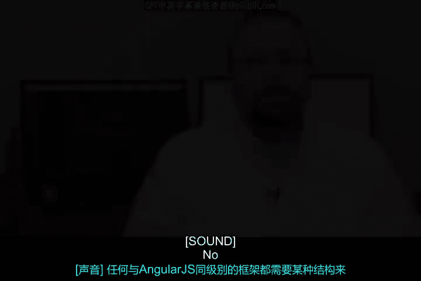

## 概述
在本节课中，我们将要学习 AngularJS 中的一个核心指令：`ng-repeat`。这个指令允许我们循环遍历数据集合，并将结果动态输出到网页上。我们将通过构建一个购物清单应用来理解其基本用法、如何遍历对象数组，以及如何利用它实现数据的动态更新。

---

## 什么是 ng-repeat？

任何像 AngularJS 这样级别的框架，都必须提供某种结构来循环遍历数据并将结果输出到网页。AngularJS 确实拥有这样的结构，它被称为 `ng-repeat`。这就是我们本节课要学习的内容。

我们已经见过一些指令，例如 `ng-app` 和 `ng-controller`。`ng-repeat` 是另一个我们将要学习的指令，它是 AngularJS 开箱即用的一部分。

## 示例应用：购物清单

现在，我们进入编辑器，位于课程示例文件夹中。让我们来看这个简单的购物清单应用。

我们有一个名为 `ShoppingListApp` 的 `ng-app`，以及一个名为 `ShoppingListController` 的控制器，所有逻辑都将在这里发生。

### 数据模型

让我们切换到 `app.js` 文件，看看这里有什么。

我们有两个数组：
*   **`shoppingList1`**：包含 8 个字符串元素。
*   **`shoppingList2`**：包含 4 个对象元素，每个对象都有 `name` 和 `quantity` 属性。

在控制器中，我们将这两个数组作为属性附加到 `$scope` 服务上，这样它们就可以在 HTML 模板中被引用。

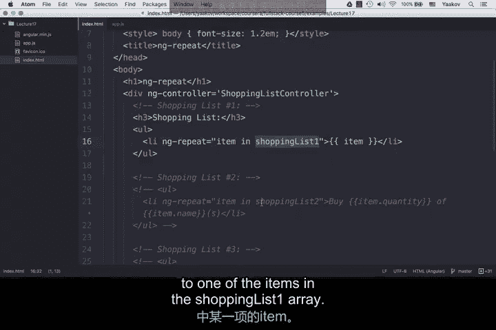

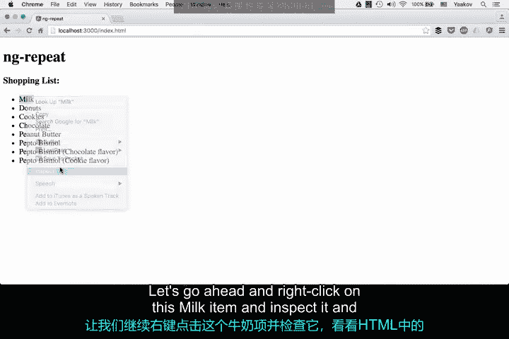

### 基础循环：遍历字符串数组

回到 `index.html`，我们看到第一个购物清单版本。这里有一个无序列表 (`<ul>`)，其列表项 (`<li>`) 上有一个名为 `ng-repeat` 的属性。

`ng-repeat` 的语法类似于 `for-each` 循环。`item in shoppingList1` 表示我们将遍历 `shoppingList1` 数组，每次迭代时，当前遍历到的集合元素将被赋值给 `item` 变量。

在列表项标签体内，我们使用双花括号插值来显示 `item` 的值。每次迭代都会输出一个新的列表项，其内容对应数组中的一个元素。

**代码示例：**
```html
<ul>
  <li ng-repeat="item in shoppingList1">{{ item }}</li>
</ul>
```

保存并查看浏览器，你会看到购物清单中的八个项目都被输出到了页面上。检查 HTML 代码，你会发现 `ng-repeat` 指令将 `<li>` 标签重复了八次，每次都将数组中的一个元素作为内容插入。

### 进阶循环：遍历对象数组

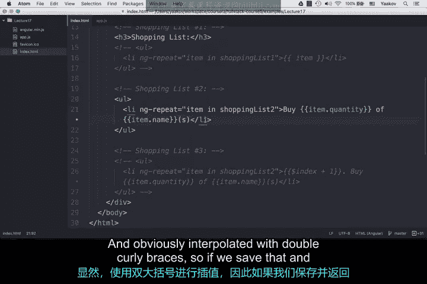

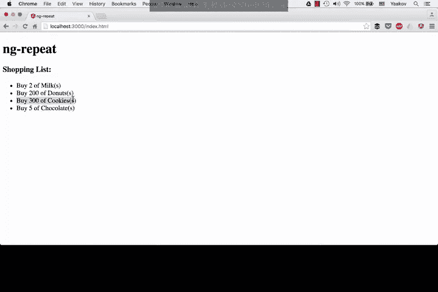

现在，让我们注释掉第一个列表，查看第二个购物清单。这次我们遍历的是 `shoppingList2` 数组，它包含的是对象。

在循环中，每个 `item` 变量代表一个对象。因此，在插值时，我们可以使用点号表示法来访问对象的属性，例如 `{{ item.quantity }}` 和 `{{ item.name }}`。

**代码示例：**
```html
<ul>
  <li ng-repeat="item in shoppingList2">Buy {{ item.quantity }} of {{ item.name }}</li>
</ul>
```

保存后，浏览器会显示如“Buy 2 of Milk”这样的条目。这表明我们可以轻松地遍历和显示复杂的数据结构。

### 获取循环索引

有时，我们可能希望获取当前项的索引（位置）。`ng-repeat` 指令通过 `$index` 属性向宿主标签的体内暴露了这个索引值。

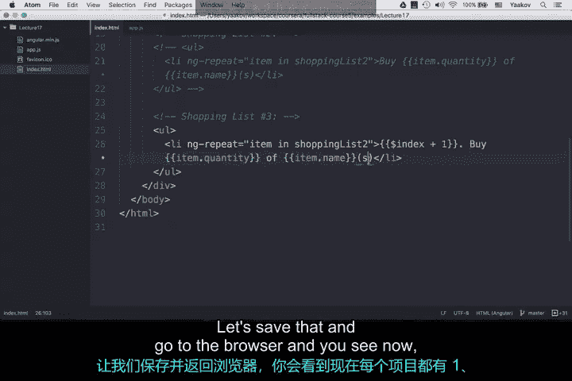

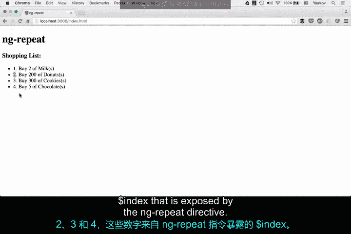

我们可以像下面这样使用它，为列表项添加编号（注意索引从 0 开始，所以我们加 1 使其从 1 开始显示）。

**代码示例：**
```html
<ul>
  <li ng-repeat="item in shoppingList2">
    {{ $index + 1 }}. Buy {{ item.quantity }} of {{ item.name }}
  </li>
</ul>
```

保存后，每个列表项前面都会出现 1、2、3、4 这样的编号。

## 数据绑定与动态更新

`ng-repeat` 的强大之处在于它与 AngularJS 的数据绑定深度集成。双花括号插值会设置监视器（watchers）。这意味着，如果数组中的数据发生变化，这些变化会自动反映在页面上。

### 监视深层属性

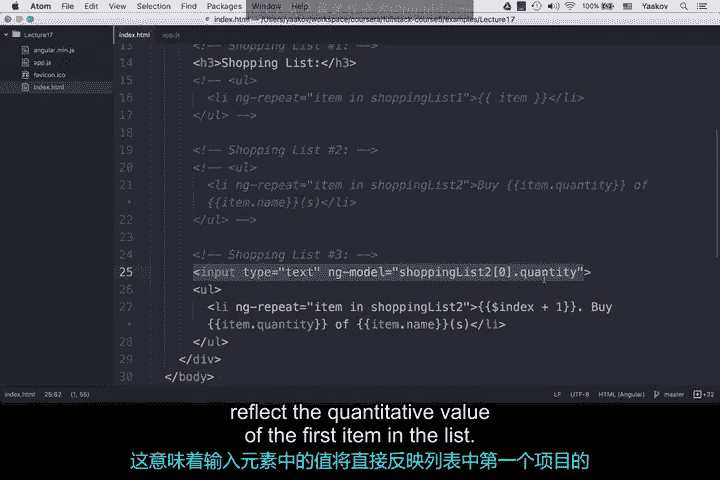

这种监视甚至适用于对象内部的深层属性。让我们添加一个输入框，将其与 `shoppingList2` 中第一个商品的 `quantity` 属性进行双向绑定。

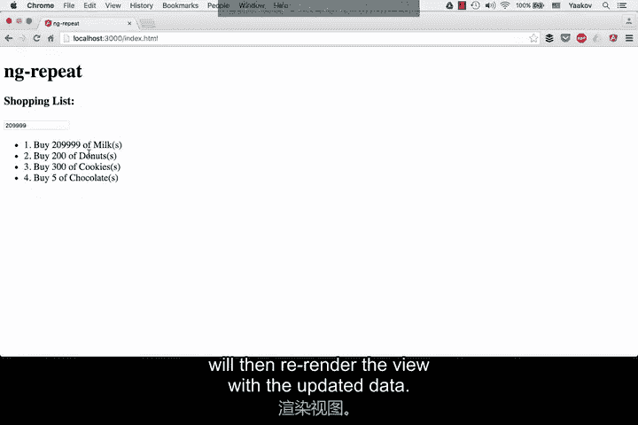

**代码示例：**
```html
<input type="text" ng-model="shoppingList2[0].quantity">
```

保存后，输入框中会显示数字 2（即牛奶的数量）。如果你在输入框中修改这个值，列表中的对应数量会立即自动更新，无需任何额外操作。

### 动态添加新项

`ng-repeat` 不仅监视集合内元素的变化，还监视整个集合本身。当集合增加或减少元素时，视图会自动重新渲染以反映更新后的数据。

让我们实现一个功能，允许用户向购物清单中添加新商品。

首先，在 HTML 中添加两个输入框和一个按钮，用于输入新商品的名称和数量，并绑定点击事件。

**HTML 代码示例：**
```html
<input type="text" ng-model="newItemName" placeholder="Item Name">
<input type="text" ng-model="newItemQuantity" placeholder="Item Quantity">
<button ng-click="addToList()">Add To List</button>
```

然后，在控制器中实现 `addToList` 函数。这个函数会创建一个新的商品对象，并将其推入 `shoppingList2` 数组。

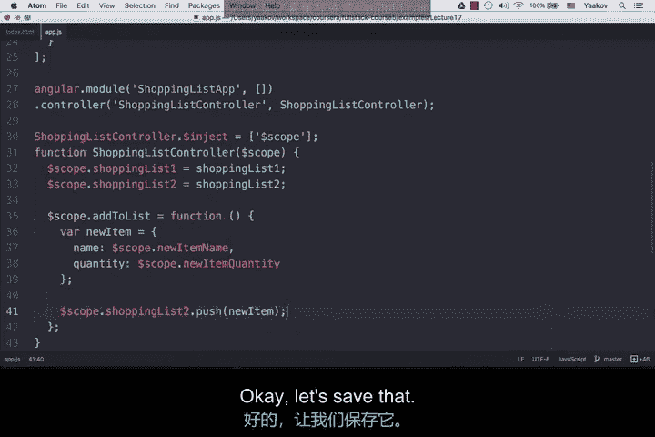

**JavaScript 代码示例：**
```javascript
$scope.addToList = function() {
  var newItem = {
    name: $scope.newItemName,
    quantity: $scope.newItemQuantity
  };
  $scope.shoppingList2.push(newItem);
};
```

保存后，在浏览器中测试。输入商品名（如“Rich Cookie”）和数量（如 500），点击“Add To List”按钮，新的商品项就会立即出现在列表中。同时，之前绑定的第一个商品的输入框依然可以正常工作，修改其值会实时更新列表。

## 总结

本节课中，我们一起学习了 `ng-repeat` 指令。

`ng-repeat` 是一个用于扩展 HTML 元素功能的指令。它允许我们赋予常规 HTML 动态行为的能力，这是 AngularJS 的一个强大理念。

其行为类似于其他编程语言中的 `for-each` 循环。它的工作方式是在某个元素上添加 `ng-repeat` 属性，然后指定一个变量（如 `item`）和一个集合（通常是 `$scope` 上的一个属性）。在循环体内，可以使用该变量来访问集合中的当前元素。

此外，`ng-repeat` 还向宿主标签体内暴露了一个特殊的 `$index` 属性，它保存着当前项在循环中的数字索引，可以在插值或模板内的计算中使用。

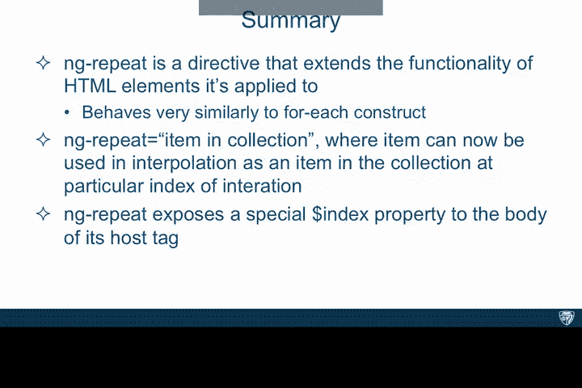

最重要的是，`ng-repeat` 与 AngularJS 的数据绑定系统紧密结合。它会为遍历的项设置监视器，当数据模型中的数组或对象属性发生变化时，视图会自动、高效地更新，从而极大地简化了动态数据渲染的复杂性。