# 约翰霍普金斯大学《使用 AngularJS 开发单页 Web 应用｜Single Page Web Applications with AngularJS》中英 - P33：32_第18讲：带过滤器的ng-repeat.zh_en - GPT中英字幕课程资源 - BV1dsFDeZEQr

🎼。

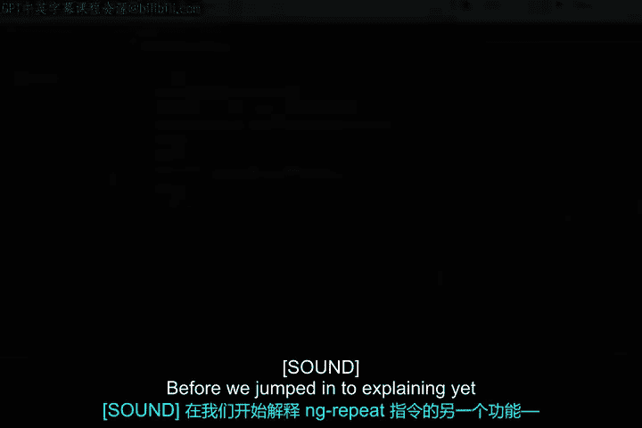

Before we jump into explaining yet another feature of NG repeatat Directive。

 which is being able to filter it， let's talk about filters in general and how they work in JavaScript。

I am right now located in lecture 18 folder， which is located in fulltag course 5 examples folder and we have an extra couple of files here filterhtml and filter js So filtertml is a simple hl page and all we really needed for to include our filter js script So let's go ahead and go to filter js and at this point all it has is a simple array with numbers1 through 10 and all we're doing here is saying number array and just basically console logging it let's go to our browser and see that in fact it is logging1 through 10 So the idea of filtering arrays is applying some sort of function to this array such that only some of these elements make it to the new array and not all of them So let's go ahead and go to the mazilla developer network and we'll look up the filter function in the array that prototype you can see the filter says filter method creates a new array with all elements that pass the test implemented by the provided function。

😊。

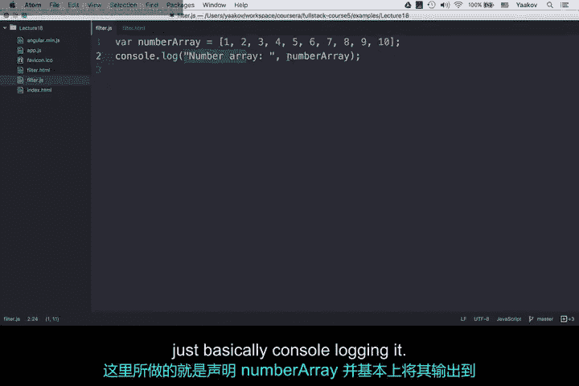

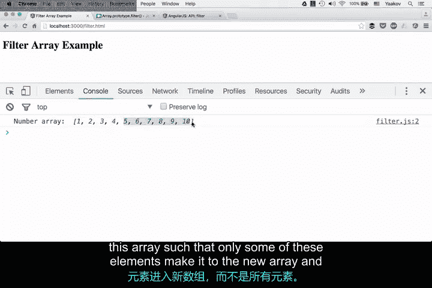

is basically the original array。 you call the filter function。

 give it some callback and possibly some extra arguments。

 So the return value is the new array with the elements that pass the test。

 And every argument into our callback is one of the items inside of the array。

 and think you could even look at a couple of examples here that are going on。

 So let's go ahead back to our page。 and let's go back to the code editor。

 And let's go ahead and write our first filter。 we'll create a new array called filtered number array。

😊，And we'll call the original number array and we'll walk the filter function and we'll put a semicolon at the end and this takes another function。

 We don't need the name for it， and the value of this function is going to be each item inside of the number array。

 So what we need to do is we need to return whether or not this value this particular value that is passed is true or false。

 meaning does it make the cut or doesn't it make the cut。 So let's return， for example。

 value greater than5 In other words， if the value passed in is greater than5。

 then that item will make it into the new filtered number array And if it's less than5 or equal to5 it will not。

 So now if we go ahead and log that we'll say filtered number array。😊。

And we'll call filtered number array。

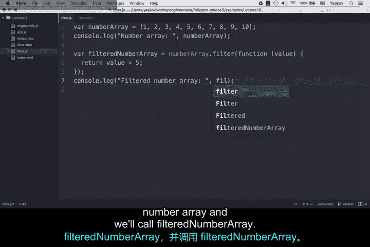

And if we save that and go back to our browser， we'll see that the filtered number array now starts with 6 and ends in 10。

 in other words anything below 5 did not make it into this new array。

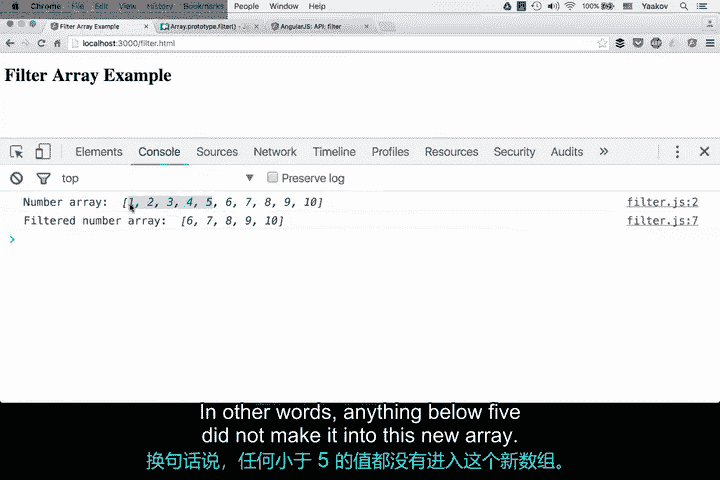

In fact， we could make the code a little bit more elegant。

 since we're having a function here inside as a value to another function。

 we could just go ahead and cut that out and create a new function， let's call it above five filter。

And， basically。Well， we don't need the whole function declaration here and basically just have the return value here。

so now we could take that above5 filter and as a value。

 this is now the function value pass it into the filter as an argument。

 so if we save that now the code looks a lot more elegant。

 we'll go back and we see value is not defined and that's because we messed up we forgot to put the value right here as an argument because that's what it takes and now you should see the filtered number array 678910。

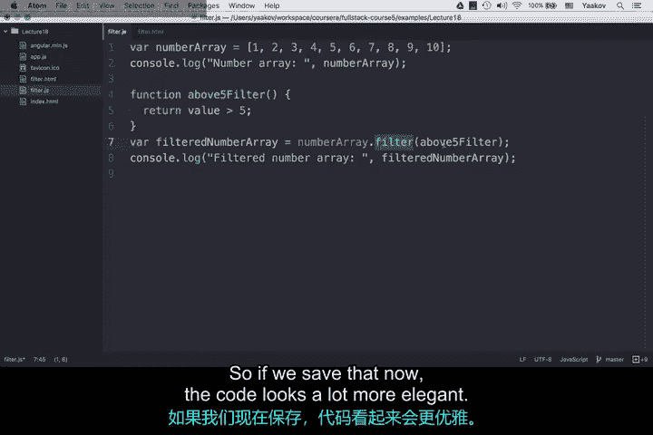

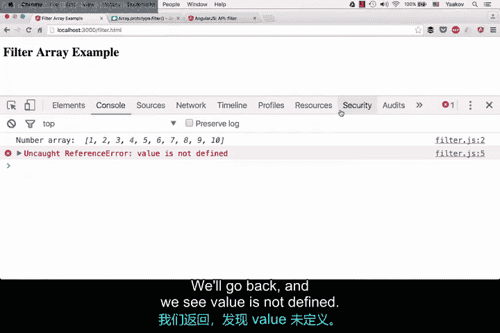

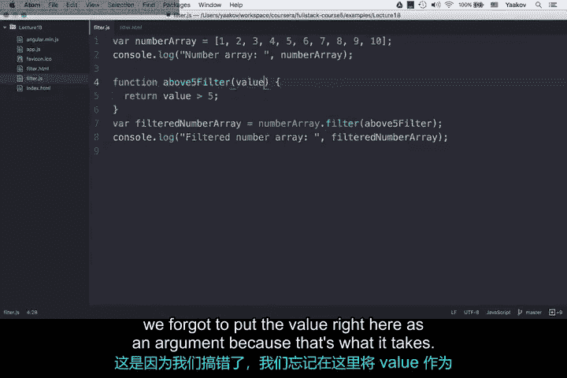

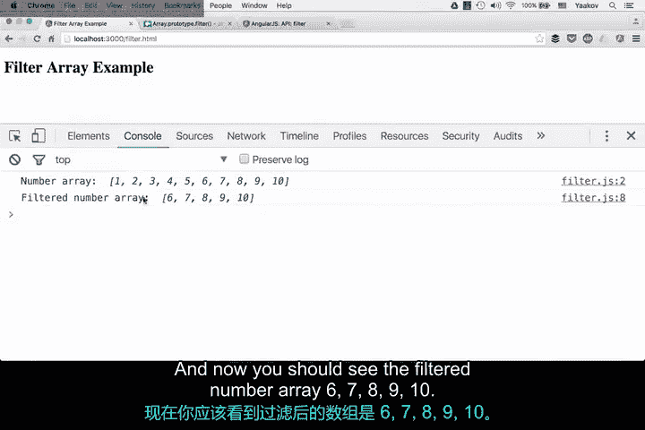

Okay， so that's as far as numbers are concerned well what happens if we have a bunch of strings then we cut and paste an array that I've prepared that is the exact shopping list from the previous lecture and you can see here it's got again a shopping list of eight items and we logging the shopping list just to the console we' save that let's go back to our browser and you'll see that the shopping list contains these eight items on the screen。

😊。

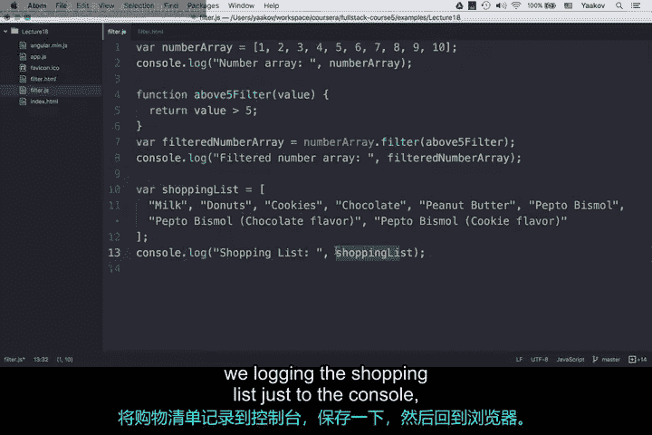

So let's go back to the code editor and try to create a filter shopping list。

 So for that we'll start with the search value。 that's what we're looking for and we'll call it bismal that's what we're searching for that's the string we're searching for and we'll create a function call it containstains filter and the value again is going to be the value through the iterations of the filter function so in here we're going to do a simple comparison of saying value dot index of and we'll say this search value and if it's not equal to negative one it means that we found that search value as part of the string that the value will be。

 and the value again is one item inside of the array。

 So now we have our function one more time so now we could go ahead and say var searched shopping list。

😊。

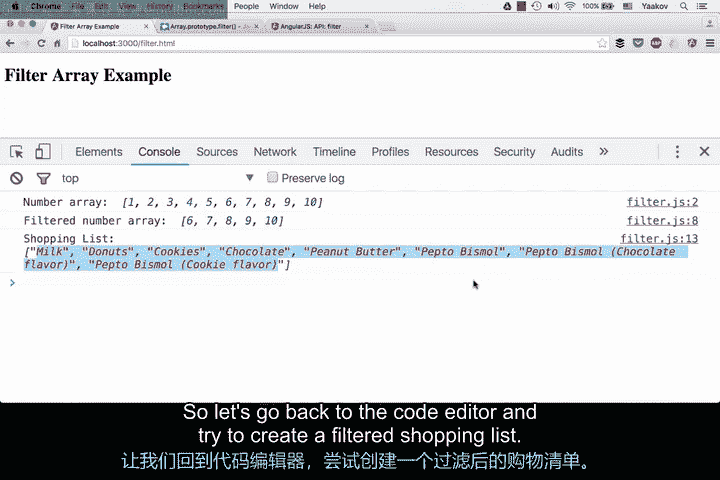

We're going to invoke the filter function on the original shopping list and provided the contains filter that we created just a second ago。

 so now we could log this searched shopping list。😊。

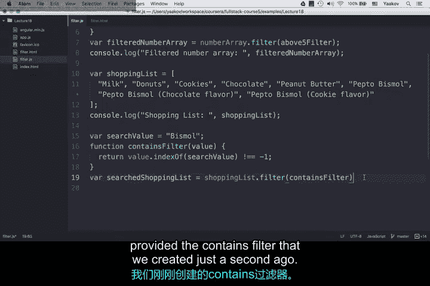

And we'll log it and say search shopping list and let's take a look。 So we're looking for Bsmal。

 we go back to our browser， we see that now only the items that contain the word Bsmal are actually in fact part of our。

 which is one to3 items Okay so let's apply that knowledge to Angular Js and Nng repeat we would like to be able to filter the array that is being output by the NG repeatat on the fly。

 So the first thing if we go to Angular Js， which is our Angularjs。

 org and go to develop and developer guide。And you'll see here filters we've been to this website before and one more time we've been to this link。

 which is the builtin filters。 In other words， filters that we don't need to build ourselves。

 If we click on that， you'll see there is a filter filter kind of a repetitive but it selects a subset of items from an array and returns it as a new array sounds just like our filter function and the fact it is if we click on that you'll see there' is a couple of ways of declaring it inside HTML binding or inside jascript we're interested in the HTML template binding one and we see here that it's a filter expression followed by a pipe just like any other filter。

 then the word filter then some expression。 well what can that expression be Well if that expression happens to be a string it says here that the string is used for matching against the contents of the array all strings or objects with string properties in array that match the string will be returned and so on and there's a whole slew of different options here besides just a very basic one all we're concerned。

😊，About this point is just a basic one so again， it's going to be a filter followed by a colon as you remember followed by is this expression。

 which if it's a string it's going to start filtering on that string filtering the array expression on that string so let's go back to our code editor。

😊。

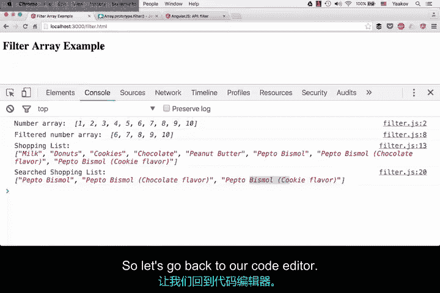

And let's introduce the application we're actually going to be working with。

 which is let's close those two， which is index that HTML and Abdotjs insideside of English that HTML。

 we have a simple energy repeat that basically loose over this shopping list and if you look at Abjs the shopping list is nothing more than that same shopping list we've been working with before is just an array So if we save that and go back to our browser and let's go back to the actual index that HTML instead of filtered that HTML you'll see that we have our shopping list here let's close the console So here's our shopping list。

 that's that same shopping list we had before。 Well let's go back to our code editor and inside the index that HTML right above the actual list we'll go ahead and create an input element with N model being bound to a property that will create right now on the fly called search So that's gonna to be our property So now since this。

😊。

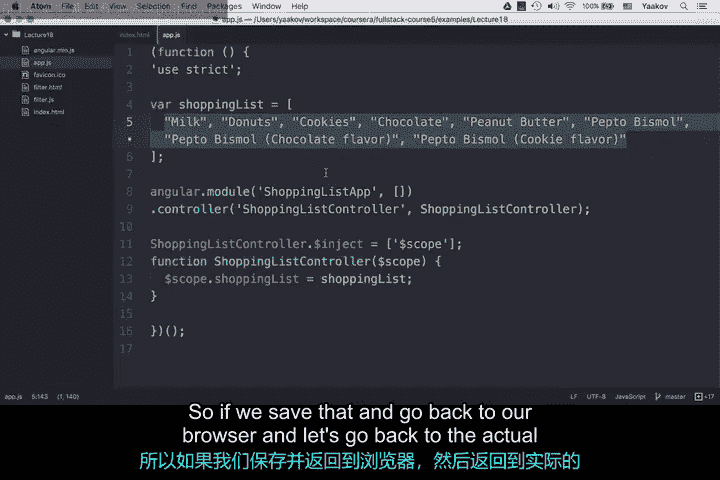

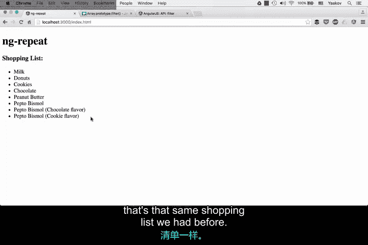

This is an array。 We can now filter this array using this search string right here。

 This is a two way binding， which means as we type。

 the search property will get updated automatically so we could say pipe。😊，Filter。

 that's the namea filter， colon， and then search。So now what's gonna to happen is that as I type in this field。

 the filter will kick in automatically since all these things are registered with watchers inside the digestig loop and our shopping list will automatically be filtered based on whatever the search string that we're providing through this input element let's go to our browser and see that in action So here's our shopping list and as we start typing for example Bsmal you could see that Bsmal is the only thing that's showing up the three items and if we go back as we erase it's again getting bigger and bigger because we're filtering this on the fly So if we just say milk so milk is the only thing that's going to show up so to go back to our code editor you see that using the filter is doing basically the same thing that we've done in our filter Gs file where it is using the search string to figure out whether or not an item in the shopping list array matches that search string but since we're updating that search。

😊。

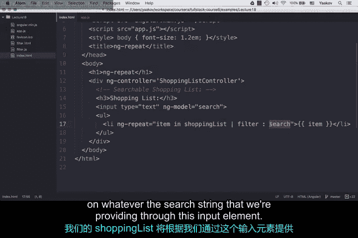

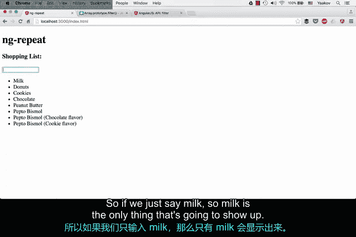

Using our two way binding， the shopping list andG repeatpe gets filtered on the fly。

 and this is the way we can have a user searchable list where the user just types in a search and the list automatically gets filtered based on that search。

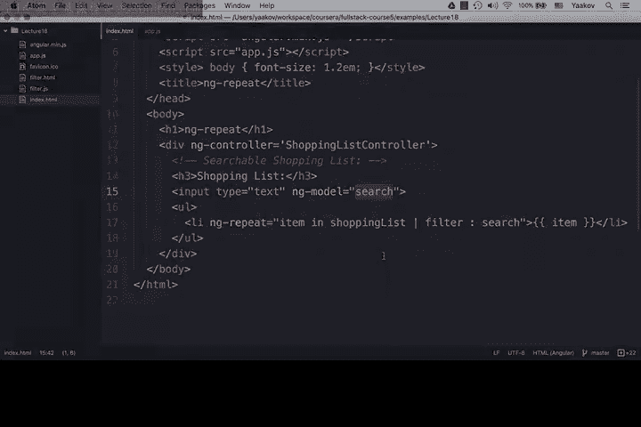

So let's summarize， we spoke about a special function called filter that exists on the array object。

 and what does is it creates a new array where each item of the new array satisfies some condition of a comparison function that is passed into the filter function itself。

Now Angular has a special filter cold filter， now it's a little repetitive。

 but it represents the filter function we spoke about on the array object。

Now provided a string is the first argument to that filter that Angular JS filter function。

 it will filter the original collection or an array。

 it's applied to matching all string items against the provided one that you're searching for。

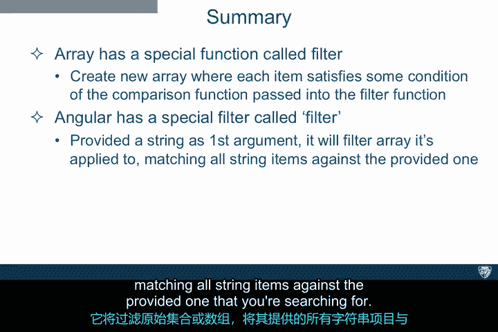

And as you saw in the code， we applied it using NG repeat item in collection and then we filter the collection by putting a pipe filter column and the search string that is actually filtering our array that is signified by the collection and as you can remember we actually bound search string to a text box input element which allowed the user to type in whatever string they wanted into the text box and that string would be served as the search string that would filter the collection of our NG repeat that way our NG repeat would update the UI depending on what the person is typing in into that search box that translates into that property search string。

😊。

