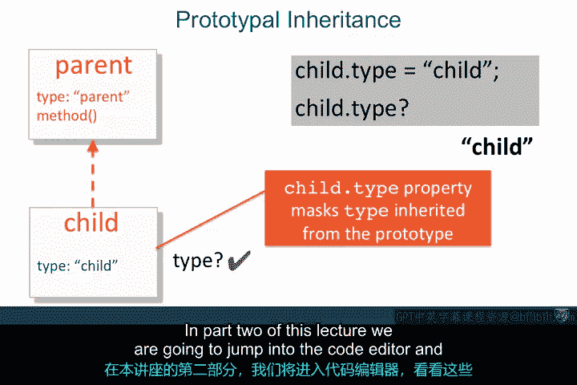
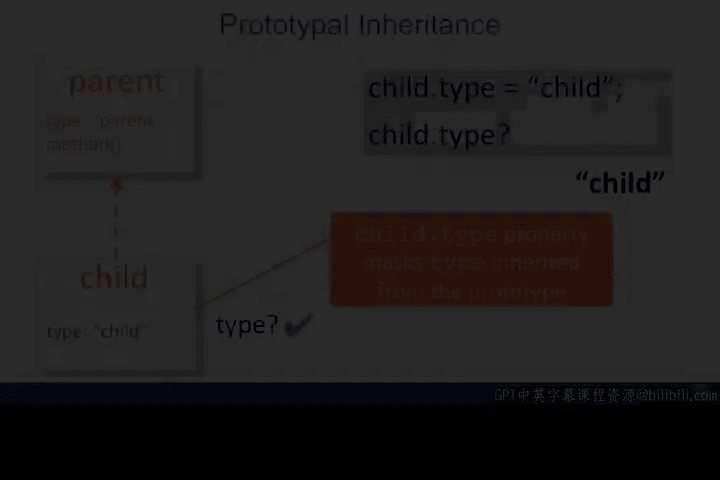

# 约翰霍普金斯大学《使用 AngularJS 开发单页 Web 应用｜Single Page Web Applications with AngularJS》中英 - P34：33_第19讲（第1部分）：原型继承.zh_en - GPT中英字幕课程资源 - BV1dsFDeZEQr

🎼。

Up until now we've been using a simple controller declaration inside of our HTML we use something like NG dash controller equals some name of the controller that we declared in our angular module but there's a better syntax to follow and that is controller S syntax and we will be building up to that in this lecture however to truly appreciate what controller S syntax is accomplishing for us we need to first understand a pretty fundamental concept in JavaScript in general and that is prototypal inheritance without understanding this basic concept in ja we would simply be memorizing strange rules instead of understanding why things work the way they do we don't want to do that so in part one of this lecture we will delve into prototypal inheritance and see how it works。

😊，The first question is what is inheritance in general Well inheritance is when an object or class is based on another object or class。

 the parent object using the same implementation and or the same values。 So for example。

 if you have an animal object or class， it might have some properties like a number of legs。

 it might have a method called walk。You can then have another class or object called dog that inherits from the animal class or object one way。

 another， the dog object or the dog class has access to the number of legs property and also to the walk method。

Different languages have different types of inheritance that they implement， but in general。

 this technique is used for code reuse as well as logical entity structure Now note here that I'm not trying to be super accurate with my terminology and differentiate between subtyping and inheritance is a relationship etc for our purposes these definitions will suffice without throwing more theoretical complexity into the mix so that's inheritance。

Unlike object oriented inheritance， which is based on classes and is much more complex and has a lot of rules that you have to memorize and has different intricacies。

 Prototypal inheritance is based on object instances and is very simple and straightforward。

 the original object instance becomes the prototype for all subsequently created objects。

 In this example， we have an object called parent and it has a type property that is equal to the string parent and a method with a name method。

😊，Then if we create a child object that is going to be based on our parent object。

 that child object will start off with being simply an empty object。 however。

 if we try to evaluate an expression child that type the ja engine will look into the child object and look to see if it has the type property in this case it doesn't。

 So what it will do， the ja engine will then look to the prototype chain to see which object is actually the parent of this child object and in this case it's the parent object itself and we'll ask that parent object whether or not there is a type property that belongs to it in this case there is one and it evaluates to the parent string。

 so therefore it will get resolved， the type property will get resolved to the parent object。

 which means child that type expression will then get resolved to the string parent。😊。

Now the reason it's called the prototype chain is because it doesn't have to be limited to just one object and its subsequent child。

 it can have grandchildren， great grandchildren and so on and so forth。

 in other words you could create yet another object that is based on the child object and therefore the current parent will then become the grandparent of that newly created object。

However， what will happen if instead of evaluating child that type expression。

 we set a type property on the child object。 What will happen is that the child object will no longer be empty。

 it will actually have a property called type that will evaluate to the string child。

 what will then happen if you try to evaluate child that type in this case。

 What will happen is that since the child that type property actually masks the type that is inherited from the prototype of this object。

 which is the type property of the parent object， This will get evaluated and resolved immediately。

 which means it will not go looking up the prototype chain to the parent object， therefore。

 in this case， child that type expression will get evaluated to the string child。😊。

In part two of this lecture， we're going to jump into the code editor and see how these concepts work in action。

😊。

