# 约翰霍普金斯大学《使用 AngularJS 开发单页 Web 应用｜Single Page Web Applications with AngularJS》中英 - P35：34_第19讲（第2部分）：原型继承.zh_en - GPT中英字幕课程资源 - BV1dsFDeZEQr

🎼。

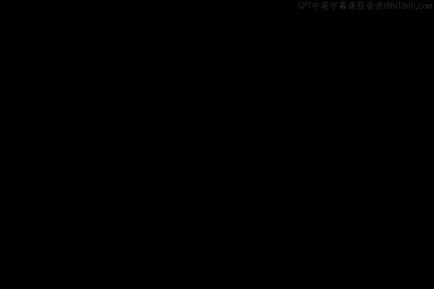

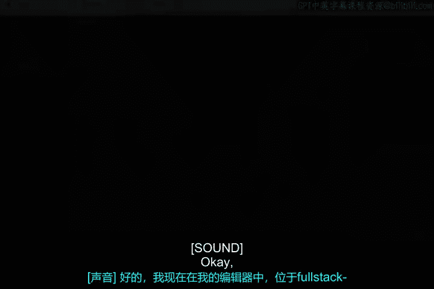

Okay so I'm in my editor and I'm located in the lecture 19 folder。

 which is in the full stack dash course 5 examples folder and what we're going to do here is I'vewritten some code and we're going to start going through this code chunk by chunk and I'll explain to you what's going on as we go。

 The first piece is right here as we're declaring a parent object So it's a simple object liter declaration。

 It has a value property which is equal to parent value an object property。

 which itself has a property called object value object value and it's equal to parent object value and it has a walk method or function that basically just if you invoke it will log the walking string to the console。

 Next， let's go ahead and create a child object that is going to be based on our parent object that is the child object will have prototypal inheritance from the parent object。

 and the way to do that is to call object that create。😊。

Passing it the object you want to base your new object on object that create is something that should be supported by all the modern browsers。

 So after line 12， our parent object is now the prototype for our child object。

 And what we're going do now is we're just going go ahead and console log some of the things that we see inside the child object and the parent object。

 So the first one is we're going to go ahead and say child that value。

 Now this value really comes from the parent object。

 And what's going to happen is that JavaScriptscript engine will go ahead and go up the prototype chain and look up this value inside the prototype of the child object。

 which is the parent and should print out parent value。

Then we're going to do something similar except this time we're going to say child object objectvalue。

 which means we're going to once again go up the prototype chain and look up the object which is just a property on the parent prototype object again and look up each object value property Now just to compare we're going to go ahead and access the parent property is directly as well and say parent that value and parent object object value and then just for good measure。

 we'll go ahead and log both objects， the parent and the child Since I have my browser sync already working and it's actually pointed to prototype HTMLt which is just a simple HTML file that references prototype js which is what we're writing here So once we're saved and we go back to the browser we could see that the child that value is parent value and that's because the jascript engine went up the prototype chain to look up this value in the parent object and。

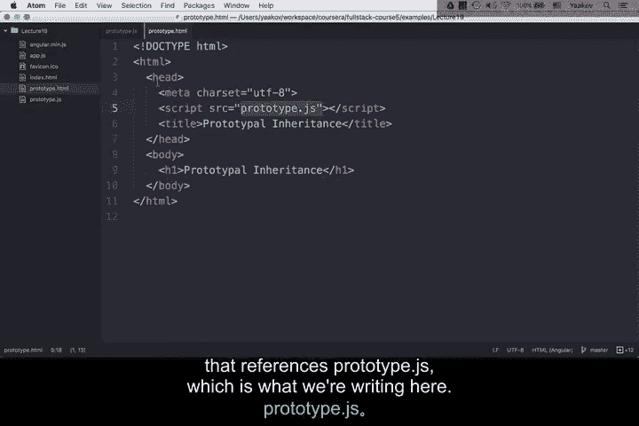

That that object value is yet again parent Ob value for the same reason。

 you can also see that the parent value， parent that value and parent object that object value are also exactly the same as the ones that we got from the child。

Now let's take a look at the objects themselves well here's the parent object and as we expect it's got the parent value and if we open it up。

 it's got the value， the walk function， which if you hover you'll see that it's just console that log and it's got that object property which itself is an object。

 which obviously has the object value， parent object value。😊。

Now if we close that and look at our child object， you could see that it doesn't really have any properties of its own。

 but if we open it up， you'll see that it has one special property called underscore underscore pro underscore underscore and it's a special property you shouldn't be accessing directly for performance reasons。

 but that is where the JavaScript engine in its kind of behind the scenes holds a reference to the parent prototype over the child object so if you open that up you'll see that it looks very familiar it's got the Op property。

 the value property and the walk property， which is a function。

 so you could see that we're still referencing our parent object using this underscore underscore proto underscore underscore property。

Let's go back to the code editor and we'll un the next chunk of code which is the one right here and what we're going to do now is we're actually going to declare our own value property on the child object and we'll call it child value and will also say child。

 object that object value and change the value to child object value Now what should happen here is since we're declaring a value property on the child when we reference it later in a console。

 log， the JavaScriptscript engine will not access the parent's value property but it will access the child's value property because the child's value property is masking the parent value property however。

 since this object property is still not a property of the child object but is still requiring the JavaScript engine to walk up the prototype chain in order to look it up。

 this object value will actually get change。And change to the string child object value on the parent object itself。

 So what we're going to do is we're going to declare it we change stuff and we're going actually just copy and paste these lines of code right in the console log so we could see what we're changing in our console in the browser and then we'll again go ahead and log the child child value child that object value and we' log parent that value and we log parent object that object value and if everything works right。

 the parent that object that object value should be equal at this point to whatever comes out from child object value they should really point to the same object and then for good measure will go ahead and output the parent object in the child object let's go ahead and save that go to our browser and we could see after we change things we change the child value to child value and now this value is masking our prototypes parent value property So if we go to the child。

😊，It will indeed say child value as we said it， and if we go to the parent。

 you could see that the parent did not get changed simply because we are masking the value now in the child and we're not affecting the parent value when we're setting it right here to this string child value。

However， since when we access or set the object value which is itself a property of the object property。

 that object property requires the JavaScript engine to walk up the prototype chain and look it up on the parent object and therefore when we change it。

 this string will now get recorded in the parent that object that object value directly and now if you look at our objects that we actually output to the console you'll see that our child object now has its own value called child value and if we open it up。

 you'll see it doesn't it has a child value and its pro or prototype is still pointing to the parent and the parent has a value but its value is still saying parent value again。

 that's because the value got masked by the child property that is of the same name。

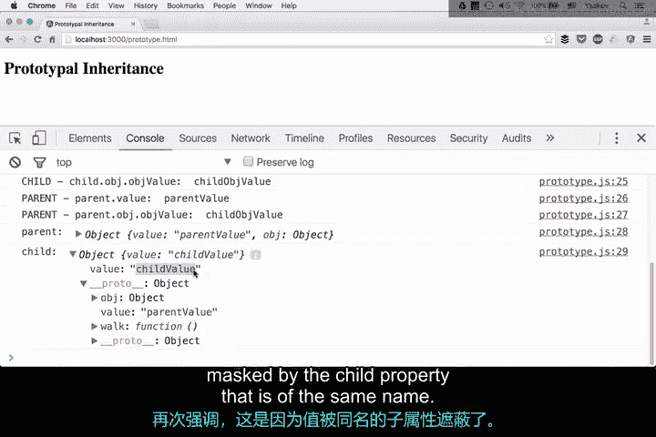

Let's go back to the code editor and actually verify that the child。

 let's unment this line right here and verify that the child ob is actually equal to the parent object。

 meaning that when we resolve the dot ob on the child。

 the JavaScript engine actually walks up the prototype chain and it is the exact same instance of the object that is attached to the parent one。

 so we're going go ahead and say if one equals the other， it should output true， we'll save this。

 we'll go back to the browser and indeed child that ob is actually equal to the parent object。

Okay so let's go back to the code once again and let's see here that we don't have to get stuck on just one child。

 we could create a grandchild of the parent and the way we could do that is yet again call object that create except this time our prototype will be the child which means the grandchild is created based on the prototype of the child object and the child object is still an object that was based on the parent object so therefore the grandchild and you could tell that this is still working just fine because we could first of all output it to the console and see what that object holds and certainly we could call grandchild。

 walk which is something that is not even coming from the child object but coming all the way from the parent let's go ahead and save that let's go back to our browser console and you see here the grandchild object is an empty one but if we open it up you see we have a prototype open that up that prototype which was our child object。

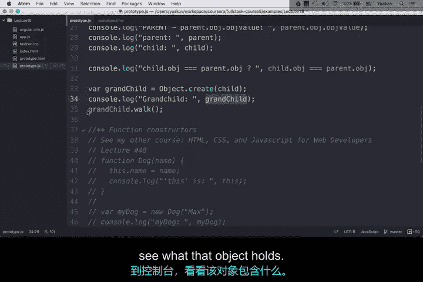

hass its own child value or the value property with child value as the string。

 but it also has a prototype as well， if we open that up。

 you'll see our familiar parent object with its walk method and sure enough we call grandchild。

walk it will print out walking because this function is council logging the walking exclamation point string。

So that's protopal inheritance and it's really very simple。

 it's either the JavaScript engine will look for a property by walking up its prototype chain and looking on its parent object for that particular property or if the object already has that property that property is really masking the prototypes property and therefore gets resolved immediately so as you've seen there is a bit of a contrast here between a primitive value like a string that gets inherited through the protopal inheritance and a property that is itself an object and gets inherited through the prototypepal inheritance the obvious difference here is that changing the values of the properties of the inherited object does not mask those properties from the parent prototype。

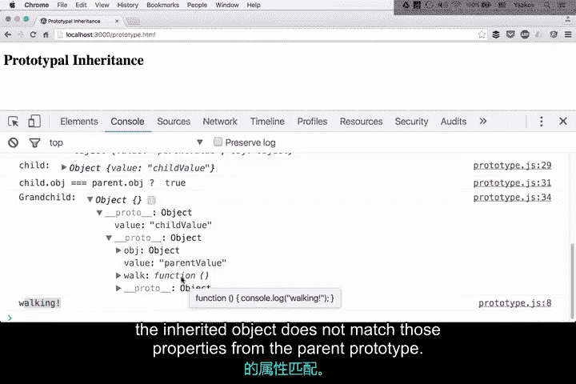

Let's go back to the code editor and see one more very important concept before we jump into the controller as syntax explanation In fact。

 let's go ahead and comment this whole thing out so you could have it for reference。

And what we'll comment out is this particular piece right here。Function constructors。 Now。

 if you don't know anything about function constructors at all。

 I highly suggest that you look into my other course called HTMLl Css and jascript for web developers in particular lecture 48 that explains all this in much more detail。

 however， here we'll just quickly review Since functions at the end of the day are just objects themselves you could create new objects and treat them sort of like classes using functions。

 and you could use the functions as a constructor for that object。 In this case。

 we have a function called dog and it takes an argument called name and we're able to say this that name equals the name that whatever the name is being passed in。

 And inside of this function， we're going to go ahead and log this keyword to see what it actually points to in what's inside of it。

 Now， in order to create the object using a function constructor you need to actually give it the new keyword before you invoke the function。

 So the invocation of。😊，Fction is not the regularvocation where you just give it the name。

 put Pars behind it passing some arguments， but you actually need to put the keyword new in front of it when you do that when you log my dog you will see that this will be the dog object which will have a max as the name property on that object now if you make a mistake and try to invoke the function constructor simply without the new keyword that this keyword inside of the function constructor will no longer point to the function constructor object or the dog object in this case but it will point to the outer scope and in this case the outer scope is the global scope and the global scope in a browser is nothing more than the window。

So let's go ahead and save that and go back to our browser and you'll see that this is pointing to the dog and dog is actually a name of our object。

 and again my dog is exactly the same thing and in the second case where if we go back to the code where we actually invoked the function constructor directly without the new keyword。

 you'll see that inside of that function constructor that this keyword resolved to the window object and not to the dog object that we expected。

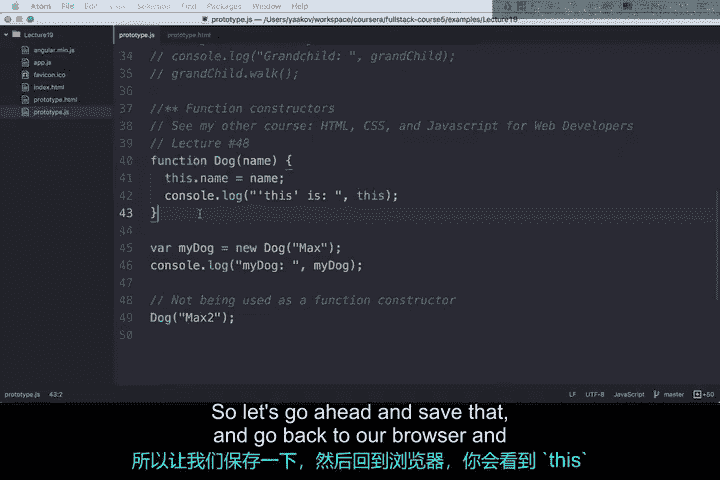

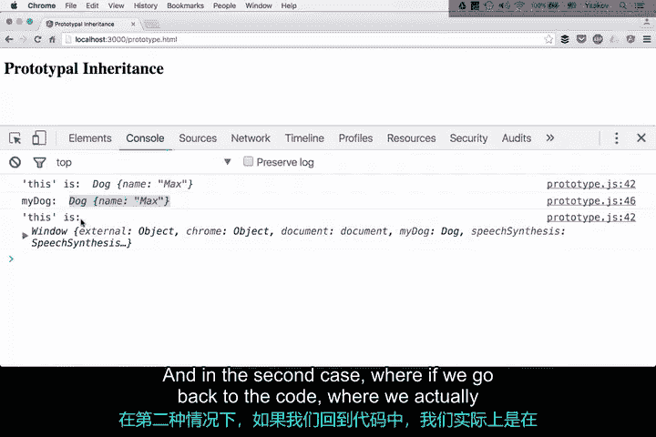

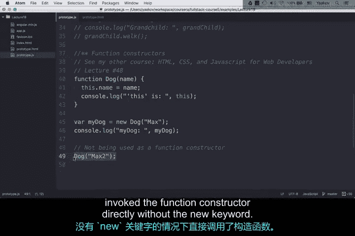

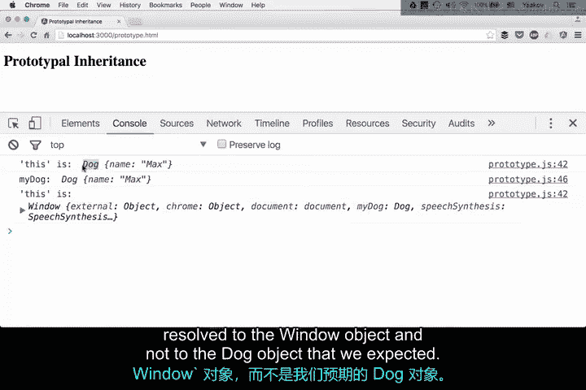

One quick tip is that when the functions start with a capital letter。

 it's just a little reminder that this is not a regular function to be used as any other function。

 but is actually a function constructor。In part three of this lecture。

 we'll look at some angleges specific concepts that are built on top of the concepts that we just learned。

😊。

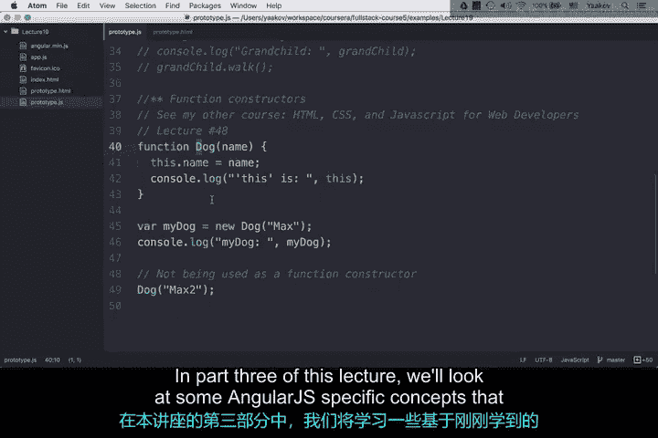

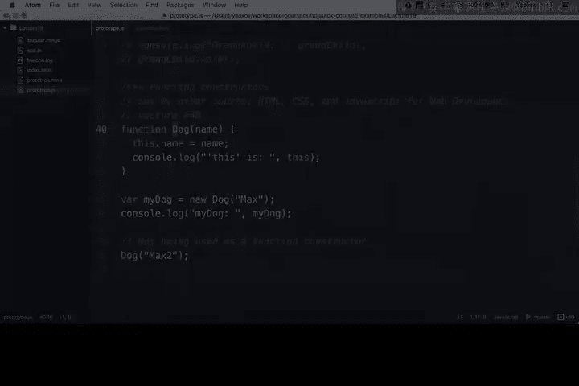