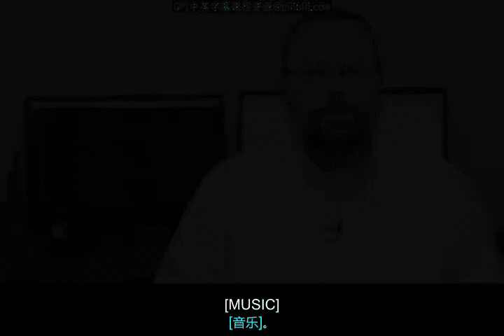
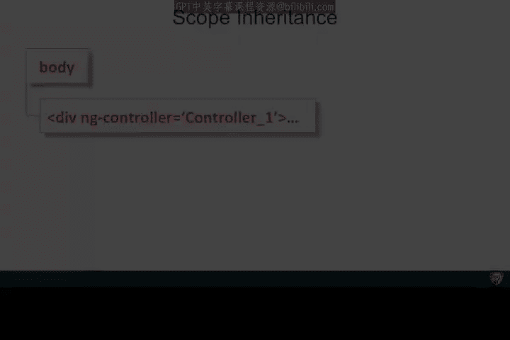
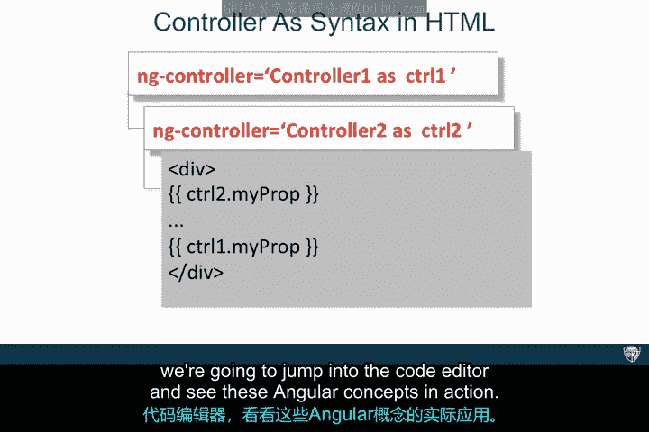
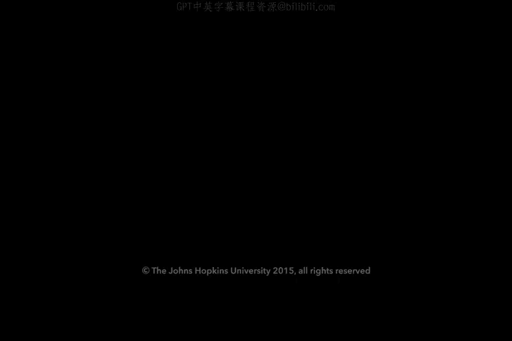

# 约翰霍普金斯大学《使用 AngularJS 开发单页 Web 应用｜Single Page Web Applications with AngularJS》中英 - P36：35_第19讲（第3部分）：作用域继承.zh_en - GPT中英字幕课程资源 - BV1dsFDeZEQr

🎼。

Now that we understand how prototypal inheritance works。

 let's talk about another concept called scope inheritance。

It's not common nor is it a good practice to have one controller that handles everything in your page it's much easier to code smaller pieces of functionality that are responsible for smaller parts of your page As you know。

 document object model or the DOm is a tree of nested HTML elements and nodes。

When you declare that a controller is responsible for part of your page。

 some natural nesting of controllers will occur。 Therefore， the scope service。

 or simply the scope of the outer controller is available to the inner controllers however。

 angular makes it even nicer than that the scope of the inner controller prototypically inherits from the scope of the outer controller Since you now know what prototypal inheritance means you understand that the properties declared on the outer controller scope controller1 in this case are accessible to the inner controller scope controller2 and 3 without any extra effort that is。

 of course， if the inner controller doesn't mask those outer parent controller scope properties by declaring those same properties on its own scope。

😊，So if we declare a property calledP on the scope of the first controller and make it equal to a string CTRL1 to signify that comes from the first controller。

 and then try to access that same property on the scope of the second controller and the third controller which are inheriting from the controller one。

 the JavaScript engine will go up the prototype chain and will look up the value of the property in the first controller which is going to be again。

 CTRL1。But what would happen if first inside of our controller2。

 we retrieved the prop value inherited from scopepe 1。

 evaluated it somehow and then wanted to change it in such a way that both scopepe onces prop value and scopepe2's prop value would be identical better yet。

 we would want them pointing to the same memory location。However。

 without manually going up the prototype chain and retrieving the instance of scopecope 1 object。

 we can't achieve this with primitive types every time we set the prop property on scopepe 2。

 we end up masking the prop property of scopepe 1 from the view of scope 2 so in this scenario dollar sign scopepe 1 that prop would still be unchanged and be equal to that same CTRL1。

However， as you may remember from the previous video。

 when we're dealing with prototypically inherited objects， things work out very differently。

The reason for this is that just to get to the property of the inherited object。

 we already have to walk up the prototype chain， so when we change the property of such an object。

 we're changing it at its original source， therefore all controllers reflect the change and no masking occurs。

As you can see in this case， even though we change the object's property prop through the reference of scope 2。

 which is an inner controllert scope， S 1 with the same object property prop changed its value as well so you can see it's very advantageous when we have scope inheritance to work with objects that are properties of the scope and not with primitive properties that are directly sitting on the scope itself。

 and this is where controller S syntax comes to help us quite a bit the controller S syntax provides us with a very convenient object we can use to attach all of our properties too。

 so property masking does not get in the way。 it lets us specify a label in our HTML template the name of this label is attached to the corresponding scope service as a property so in this case for the first controller at scope do CTtRl1 and for the second Do sign scope do CTRl2 those properties。

In this case， CTRO1 and CTRO2 point to objects that are instances of the controllers themselves In other words。

 the controller instance gets attached as a property on the dollar sign scope。

That means that when it comes to implementing the controller function or the function that is responsible to implement the functionality of our controller。

 we can attach our properties directly to this keyword inside of our controller function and not even have to inject the dollar science scope into the controller。

 so the this keyword becomes synonymous with the name of the label given then the controller as syntax in our HTML template。

The reason we're able to accomplish all that without much code is because Angular does a lot for us behind the scenes。

 Here's about what it does。 Obviously what Angular actually does is much more involved。

 so this is just a rough idea of what happens behind the scenes So in our case we have two nested controllers。

 the outer controller controller1 declared as CTrL1 and the inner controllertroll controller2 declared as CTRl 2 After Angular JS creates the scope for our controller 1 which we'll call Do sign scope1 for now。

😊，Angular Js attaches a property called CTRL1 the same as our label and then instantiates it using our controller function as a function constructor。

 which means CTRL1 is now equivalent this keyword inside of our function constructor represented by that function that we specified as our controller function Since the one protopal inheritance scope 2 which is the inner scope is going to get created based on Dos scope 1。

 which is the outer scope then we're going to go through a similar process where we're going to create a property for scope 2 with the name of the label that we assigned our controller2 as which is CTRL2 and we'll initialize it with the instance of the controller2 function that is created using the new keyword therefore using controller2 function as a function constructor so yet again the CTRL2 is going to be pointing to the same。

😊，ThingThat this keyword will point to inside of the control to function constructor。

But things don't just get better and simpler inside of our JavaScript The controller S syntax makes the HTML template simpler as well not only does it allow me to access properties that are named the same from the parentcope without masking any properties it also makes for a much more readable code so now when I look at this interpolation CTRL 2 do myP I know that this property is instantiated and belongs to controller 2 and CTrL1。

 MyP is a property that is instantiated on controller 1 and that's where it belongs。Okay。

 off hand waving for now， and in part four of this lecture。

 we're going to jump into the code editor and see these angular concepts in action。😊。

