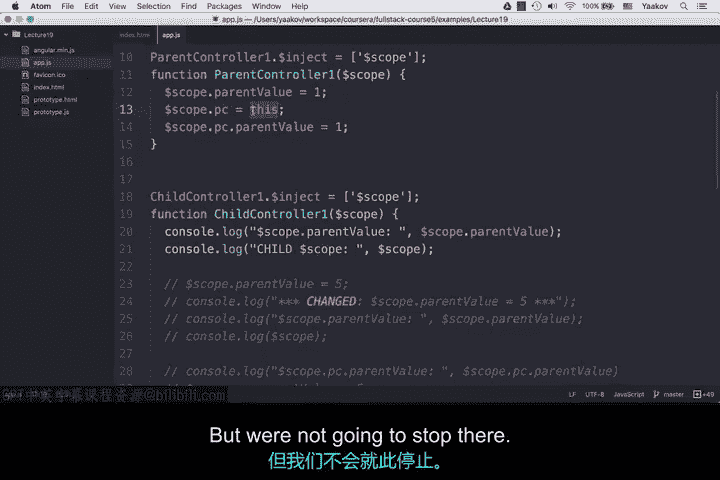
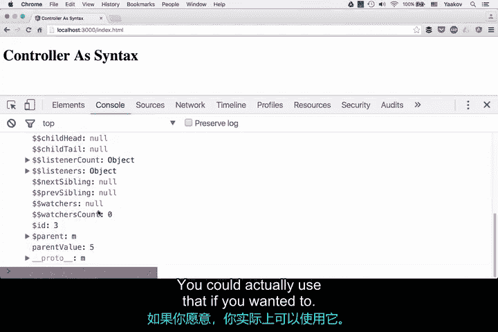
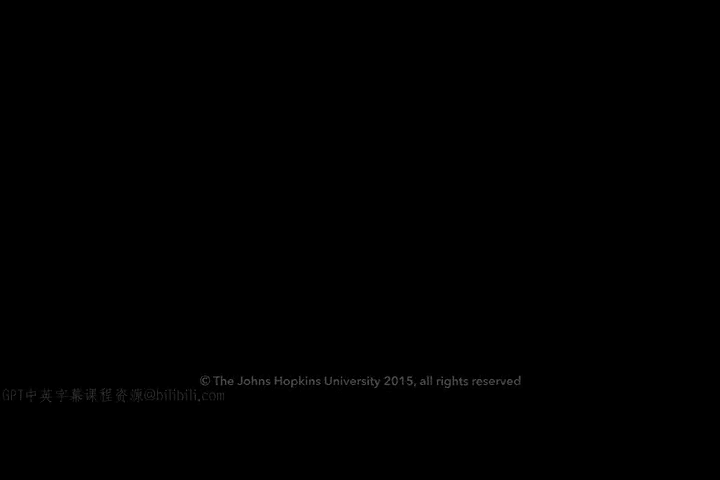

# 约翰霍普金斯大学《使用 AngularJS 开发单页 Web 应用｜Single Page Web Applications with AngularJS》中英 - P37：36_第19讲（第4部分）：作用域继承.zh_en - GPT中英字幕课程资源 - BV1dsFDeZEQr

🎼。

So I'm back in my Adam code editor and I'm located in lecture 19 which is located in fulltag dash coursese 5 examples folder and here I've set up a simple app called controller as app and what it has here actually has a couple of things first thing we're going to look at is we're going to use the controller as we usually use it without the controller as syntax but we'll play around with the protopal inheritance between the nested controllers and then at the end we're going to go ahead and take a look at the controller as syntax that we discussed。

So the first thing is we have a couple controllers here。

 one is the parent controller called parent controller1。

 and the other one is child controller called Chil controller 1 and the child controller。

 as you can see， is nested inside of the parent controller1 Let's go ahead and take a look at Abda JS。

And Abdags just declares our application and then it declares our four controllers and the last two parent controller2 and child controller2 we're not going to use just yet。

 so you know these two you could ignore for now but meanwhile we have the parent controller one and a child controller1 The parent controller1 sets up a few values number one it sets up a parent value property equal to one which means it's a primitive type value and then it sets up a PC property studying for parent controller that is equal to this meaning this is the actual parent controller one instance Now the reason this is going to point to the parent controller one instance is because when we call the angular controller method the function value that is passed to it as the controller function is treated as a function constructor so therefore at some point there is going to be a new and it's going to new up this object and when we use a new in front of a function it becomes。

function constructor and therefore this the keyword this is going to point to the instance of the parent controller one in this case so here we have the dollar sign scope that PC that's another attribute on the scope service and we're going to equal it to this but we're not going to stop there we're also going to attach a parent value to the actual PC which is our controller so the controller instance is actually going to have a parent value property and we're also going to equal to one。

Now the child controller is not going to declare anything of its own instead which is going to use the scope which is declared on the child controller itself and ask it for the parent value now it doesn't really have a parent value of its own which means it's going to try to look up the parent value up the prototype chain and should give us number one here。

 the primitive value1 since the prototype for the scope of child controller1 is the scope of the parent controller one and to begin with we just go ahead and dump the scope to the console so we could see what's sitting inside the scope and we could see if we could perhaps traverse the prototype chain ourselves in the Chrome developer tools so point is the first thing we should see so the logging statements are only coming from the child controller so there are no logging statements in a parent controller and a child controller is going to try to say my scope that parent value what is that equal to and then it's going to dump the actual scope to the console。

 the scope of the child controller。SoLet's save that and let's go to the browser and let's take a look so scope that parent value is one and this one is clearly coming from the parent controller since we as a child controller don't even have a parent value property at all Well let's take a look at the dollar sign scope object that we printed to the console let's open it up a little bit and we could see that we don't really have any kind of values here it certainly don't have the parent value property but we do see the underscore underscore proto underscore underscore and if we open that up that's supposed to be the prototype for our child controller and you could see that it has the parent value attribute which is equal to one which is what we retrieved in our child controller and you could also see that it has the PC attribute that is pointing to the parent controller one which is the instance of actually our parent controller and if we open it up actually you could see that it also has a parent value property。

On it also equal to one。 So now we understand and kind of ourselves traversed the prototype chain to see where the parent value on the scope service came from in our child controller。

 let's go back to the code editor and then some more statements that I prepared here let's un this piece and what we're doing here now is on the child scope we're setting a parent value Since we created an identical property name on our child scope it means we will start masking that property name from our prototype which is our parent controller one。

 So the next line here， all we're doing here is just council logging the fact that we're changing or actually adding the parent value property to our child scope and what we're going to do is we're going to go ahead and print out or log the scope again the child scope's parent value and that should be the new value right here。

 but what we're going to do again is we're going to go ahead and log the scope object。

And see if we could again traverse the prototype chain to see if the prototypes value。

 the parent value has changed because of us changing this value right here。

 so let's save that and go to the the browser and we could see here we change the value to5。

 so now scope that parent value is5 because this parent value is now belonging to the child controller the scope on the child controller So if we open up our child controller scope we'll see that we should have now a parent value that is sitting directly on the child controller and if we go ahead and look at the prototype of our child controller and scroll down here you'll see that the parent value that we used before is still one。

 And the reason for that is is because our child controller scope is masking the parent value property So the ja engine is not going up the prototype chain to look up the parent value。

Let's go back to the code editor and see a couple more things here What we're going to do now is we're going to start messing with the actual parent controller object that we declared on the parent controller scope so let's un this chunk of code right here and now we would want to retrieve the parent controller object which as you can remember is actually pointing to the instance of the parent controller itself So we're kind of mimicking the whole idea of controller as syntax but we're doing it all by ourselves without the angular JS help so what we're doing here is we're traversing the prototype chain and looking up the PC the parent controller object and we're retrieving the parent value property of that PC object and here it is we're just console logging it after we're going to go ahead and change that value and remember since in order to for us to even get to this object we need to right here in this dot we need to actually traverse。

😊，The prototype chain to our parent object， it means that when we change the property parent value。

 it will actually change not only here in the child scope。

 but it will actually change at its root at its parent controller1 and all we're going to do is basically log the fact that we're about to change that will print the value back out which at this point should be5 and then we'll dump the scope again onto the console to see if we could again manually traverse the prototype chain to see if we see what the differences were let's go ahead and save that and go to our browser and you could see here what we're doing here is we're saying the scope PC parent value is one after we change that the scope our child scope that PC parent controller parent value is now five So if everything went according to how we understood it there should not be any extra properties on the child scope and the parent。

 the prototype of our child。pe should still contain the PC object。

 and that object should contain the parent value property with the new value 5 that we updated。

 Let's go ahead and open that up。If we take a look our parent value is 5。

 that's again the local parent value of the local child scope。

 if we look at the prototype we'll see that the PC is still pointing obviously to the parent control one if we open it up you'll see that the parent value here is5 so we did update it in the same location as the actual prototype object as a side note if you take a look here and we'll close this up for a second let's open it back up you'll see that not only do we have a prototype underscore underscore Pro underscore underscore but we also have this dollar sign parent object Well I told you before that is best practice to access the underscore underscore pro underscore underscore because it's kind of an internal jascript object however。

 Anglo Js exposed at least if not all of it but certainly part of it of that object to us as a dollar sign parent and that is not an object that you should avoid。

 you can actually use that if you wanted to So for example I could go back to my code。

I can actually traverse that object and let's say I could log and say I want to log scope。😊。

That dollar sign parent， that parent value。And if I save that， we go back to our browser。

 you'll see that the dollar sign scope， that dollar sign parent。

 that parent value is one and that is being retrieved from the parent。

 meaning going up the prototype chain and retrieving it from the parent。

 which is the parent controller one scope object。In the final part of this lecture。

 part5 will continue our example， but this time we'll explore using the controller S syntax。

 as well as go through a quick summary of concepts that we've learned in this lecture。

