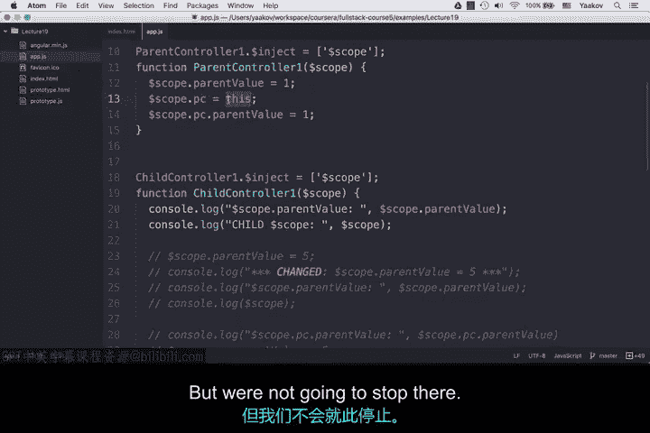
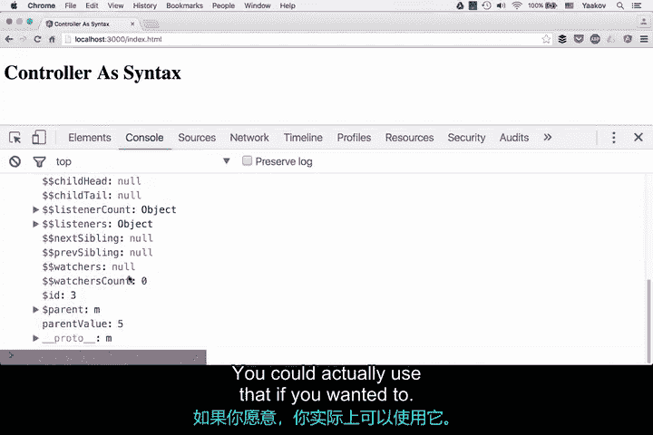
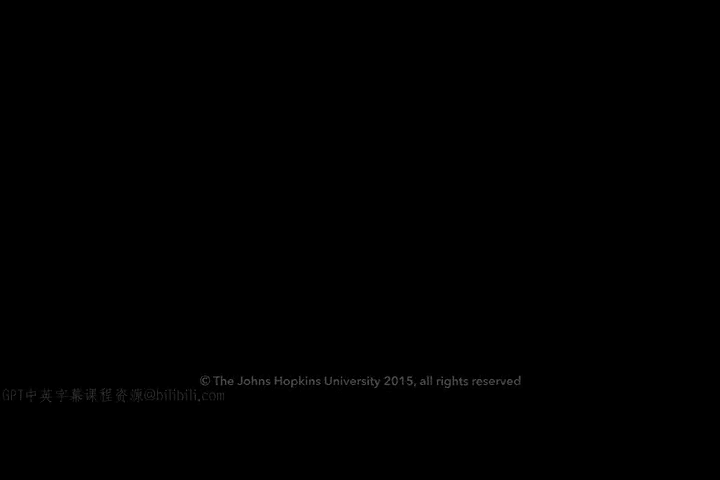

# 使用 AngularJS 开发单页 Web 应用：19：作用域继承（第4部分）


在本节课中，我们将学习 AngularJS 中嵌套控制器之间的作用域继承机制。我们将通过一个具体的例子，演示原型链如何影响属性的查找和修改，并初步了解 `controller as` 语法的原理。

## 示例应用结构

首先，我们来看一个简单的应用。它包含两个控制器：一个父控制器 `ParentController1` 和一个嵌套在其中的子控制器 `ChildController1`。

以下是 `app.js` 文件中的代码：

```javascript
angular.module('ControllerAsApp', [])
.controller('ParentController1', ParentController1)
.controller('ChildController1', ChildController1)
.controller('ParentController2', ParentController2)
.controller('ChildController2', ChildController2);
```

目前，我们只关注 `ParentController1` 和 `ChildController1`。

## 父控制器设置



在 `ParentController1` 中，我们设置了两个属性：

```javascript
function ParentController1($scope) {
  $scope.parentValue = 1;
  $scope.pc = this;
  this.parentValue = 1;
}
```

*   **`$scope.parentValue = 1;`**：在作用域对象上设置了一个原始类型的属性 `parentValue`，值为 `1`。
*   **`$scope.pc = this;`** 和 **`this.parentValue = 1;`**：`this` 关键字指向 `ParentController1` 的实例。我们将其赋值给作用域的 `pc` 属性，同时也在控制器实例本身上设置了一个 `parentValue` 属性。

## 子控制器与原型链查找

`ChildController1` 的代码如下：

```javascript
function ChildController1($scope) {
  console.log("$scope.parentValue: ", $scope.parentValue);
  console.log($scope);
}
```

子控制器自身没有定义 `parentValue` 属性。当它尝试访问 `$scope.parentValue` 时，JavaScript 引擎会沿着原型链向上查找。由于子控制器的 `$scope` 的原型是其父控制器的 `$scope`，因此它找到了值为 `1` 的 `parentValue`。

在浏览器控制台中，我们可以看到子控制器的 `$scope` 对象本身没有 `parentValue`，但其 `__proto__`（原型）对象上存在该属性。

## 属性屏蔽

接下来，我们在子控制器中添加代码，修改 `parentValue`：

```javascript
$scope.parentValue = 5;
console.log("CHANGED: $scope.parentValue = ", $scope.parentValue);
console.log($scope);
```

现在，子控制器的 `$scope` 上直接拥有了自己的 `parentValue` 属性（值为 `5`）。这**屏蔽**了原型链上的同名属性。此时，访问 `$scope.parentValue` 将直接返回子作用域上的值，而不会继续向上查找。原型链上父控制器的 `parentValue` 仍然是 `1`。

## 通过引用修改父级属性

上一节我们看到了属性屏蔽。本节中，我们来看看如何通过引用修改父控制器实例上的属性。

我们通过 `$scope.pc` 来访问父控制器实例，并修改其上的 `parentValue`：

```javascript
console.log("$scope.pc.parentValue: ", $scope.pc.parentValue);
$scope.pc.parentValue = 5;
console.log("CHANGED: $scope.pc.parentValue = ", $scope.pc.parentValue);
console.log($scope);
```

因为 `pc` 是一个指向父控制器实例的引用，所以修改 `$scope.pc.parentValue` 会直接改变父控制器实例上的属性值。在控制台中检查原型链，可以看到父控制器实例（即 `pc` 对象）的 `parentValue` 已被更新为 `5`。

## 使用 `$scope.$parent`

AngularJS 提供了 `$scope.$parent` 属性来安全地访问父作用域，这比直接使用 `__proto__` 更推荐。

例如，我们可以这样访问父作用域的属性：

```javascript
console.log("$scope.$parent.parentValue: ", $scope.$parent.parentValue);
```

这将输出 `1`，因为它从父控制器的 `$scope` 对象上获取 `parentValue`。



## 总结

本节课中我们一起学习了：
1.  **原型链继承**：子控制器的 `$scope` 原型指向父控制器的 `$scope`，从而实现属性继承。
2.  **属性屏蔽**：当子作用域定义了与父作用域同名的属性时，会屏蔽父级的属性。
3.  **通过引用修改**：通过附着在作用域上的对象引用（如 `pc`），可以修改父级控制器实例的属性。
4.  **`$parent` 属性**：使用 `$scope.$parent` 可以安全地访问父作用域。



在下一部分，我们将继续本例，并正式探讨 `controller as` 语法。