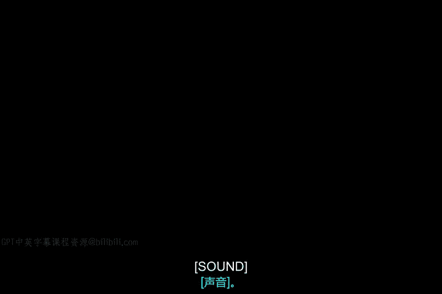
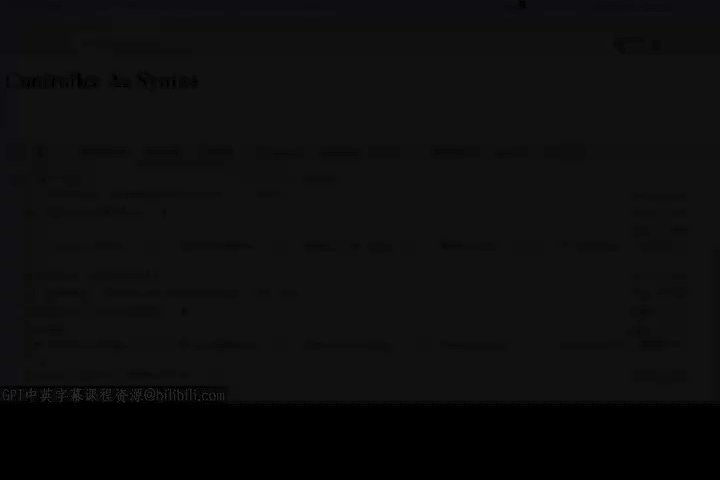
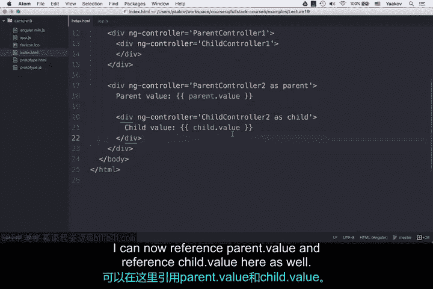
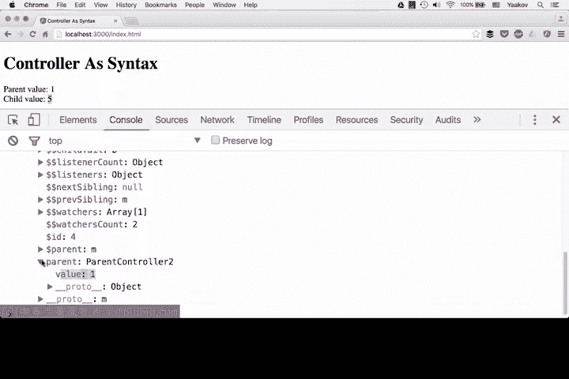
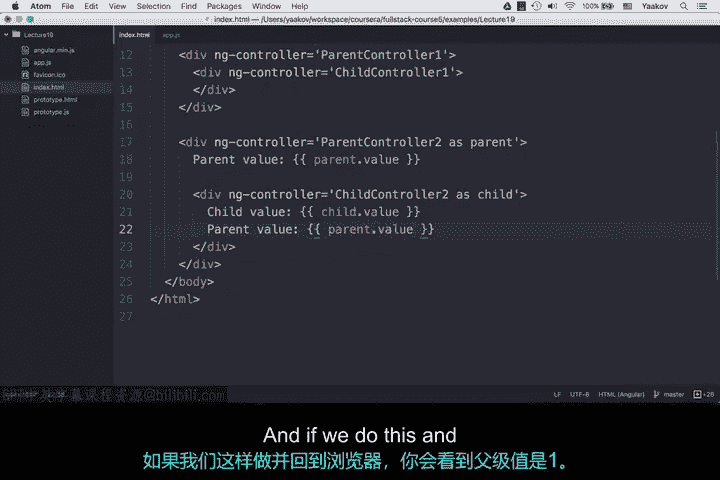
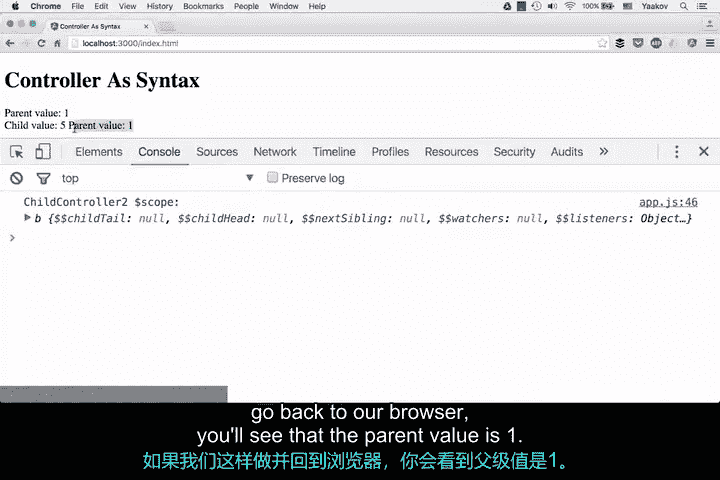
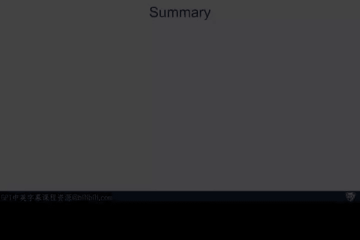
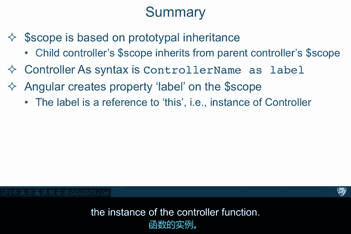
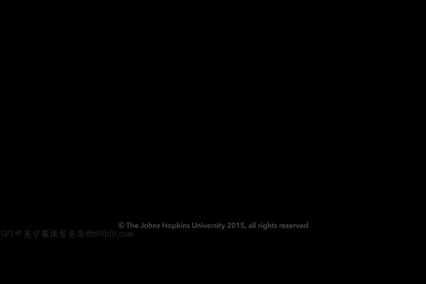

# 约翰霍普金斯大学《使用 AngularJS 开发单页 Web 应用｜Single Page Web Applications with AngularJS》中英 - P38：37_第19讲（第5部分）：Controller As语法.zh_en - GPT中英字幕课程资源 - BV1dsFDeZEQr

🎼。

In part four of this lecture， we explored a coding example that showed how the dollar sign scope inheritance works in Angular in this lecture we'll continue with that coding example。

 but now use the controller add syntax。😊，Okay so let's go back to the code editor and actually what we'll do not to convolute our logging statements。

 let's go ahead and comment this whole thing out and what we'll do this time is go to our index that HTML and we'll unment the couple of controllers that we have here so what we do here is we have a couple of controllers one is a controller called parent controller2 and in this time we're using the controller as syntax and giving that controller a label and we'll call it parent call it whatever we want and then if you look down here we have another energy controller which is child controller2 and we're giving it a label of child so since any properties they're going to be added now to the scope are not going to be added directly to the dollar S scope but going to be added to the dollar S scopepe that parent property or that parent object and since we know that we don't need to actually mention dollar Scope that property that is sitting on the s scope which is the parent。

Property can now be referenced directly in our HTML template。 so we could say parent that value。

 assuming there is a value property on that parent object。 and we could also say here。

 child that value。 Let's go to app dot js and take a look as to what our controllers look like。

 So first of all here we have our parent controller too。

 and it's kind of a best practice to try to name the this variable that we're going to kind of attach all kinds of properties to the same as the label inside of your HTMLtl template。

 you don't have to do it。 some people actually name it Vm for view model。

 but I like to keep it at the same name as the label I gave in the HTMLl template。

 But what you name it here makes absolutely no difference because this is just a local variable。

 and you're just using it instead of having to say this everywhere。 Some people say this everywhere。

 But this is a little bit more clear to read。 So what I'm doing here is I'm saying parent that value equals one。

 which means I'm assign a property co called value。😊。

To the instance of this parent controller too Now note that even though I have this scope here injected。

 I really don't need it here and it's probably actually left over here because I was doing console log statements but since I have no console log statements that in the parent controller to that I want to log the dollar sign scope to the console I'm just going take it out altogether we don't really need it because the scope is provided we're just not using it anywhere because we're attaching the properties directly to the instance of the controller itself and it's Angular Js that is's taking the instance of this controller and assigning it to the dollar sign scope for us behind the scene。

 Now let's take a look at the child controller too and the only using again I'm injecting scope here is because this time I'm actually going to log the scope so we could just look at it but really I don't really need it here at all unless I'm specifically using it for something and here the construct is exactly the same we're decing a local variable that is the same name as the。

😊，Labeled that we declared our controller with an HTML template。

 and we're creating a property on that object called Val。

 which is exactly the same name as the property of the parent。However。

 since we're assigning it to the instance of the controller in both cases。

 this value in no way is going to mask this value， which means as long as we reference the proper controller。

 these values can work independently and all we're doing here is we're going to go ahead and dump the scope object to the console so we can take a look let's save that for a second and let's go back to the index at HTML and see what we're doing here。

As you can see， it's much easier to read as to what's going here as well since parent is been assigned as a property on our Dallasine scope by Alo JS。

 I can now reference parent that value and reference child that value here as well let's go ahead and save that and go to the browser。

😊。

You could see that the parent value here is one as we expected it to be and the child value of the child inner controller is5 now let's go ahead and take a look at the child's scope object if we open it up a little bit here。

 we could see that we have a child property that is equal to the child controller two instance and we could see here if we open it up that is value equal to five now if we go ahead and traverse its prototype chain。

Right here， we'll see that its prototype has a parent property and that parent property is equal to parent controller two instance。

 and we could see here that its value is1。

So if we go back to the code editor， you'll see how much easier it is now to even reference properties of our parent controller in our inner child controller。

 so for example， I could say here， parent value。😊，And I can reference now the parent controller since parent is something that got inherited as part of the prototype chain。

 so parent that value and if we do this and go back to our browser you'll see that the parent value is one and it's the same parent value that we retrieved right here even though this parent value is being mentioned inside of our child controller so this way it's much easier to read。

 you see here that we're actually referencing some property that belongs to this particular controller so it's easier to read easier to debug and you could see where these properties are coming from。

😊。

So let's summarize first of all， please don't think that all these numerous concepts that we learned as part of this lecture are only applicable to understanding the controller as syntax what we learned is applicable throughout Angular JS framework and really throughout JavaScript in general。

😊，So let's review inheritance in general is used for code reuse and sometimes to express a relationship between entities。

😊，Prototyal inheritance in ja is based on object instances rather than classes In general。

 Prototypal inheritance is much simpler than a classbased inheritance having only a couple of rules to know First。

 the child's object's properties are inherited from the parent and are looked up through the prototype chain so they are actually not sitting directly on the child。

 Second， the property can be local if it's declared on the child object itself with the same name as the parent and therefore masking the parent's property。

😊，Now when it comes to Angular JS， the dollarci scope is based on prototypal inheritance。

 which means that a child controller's dollarine scope inherits from the parent controller's dollars scope so if you have two nested controllers。

 the inner controller's scope is prototypically inherited from the outer controller scope Now when it comes to controller as syntax。

 it's very simple， it's the controller name andng dash controller equals controller name as and you give it a specific label Angular then creates a property with that same label name on the dollarci scope that belongs to that controller。

The label name becomes a reference to the this keyword。

 in other words the instance of the controller function。

 not the reason that works is because when we call thatt controller to declare our controller in Angular GS the dot controller treats our controller function as a function constructor so when you start declaring properties that you want to share between your view model。

 the controller and the HTML template， you attach them directly to the controller instance。

 in other words you attach them to the this keyword， not the dollar sign scope。

 with the controller as syntax， the syntax in the R HTML templates as well as our JavaScript code becomes much simpler and we no longer have to deal with the masking that can occur with the protopal inheritance。

 making the code much simpler to write。😊。

