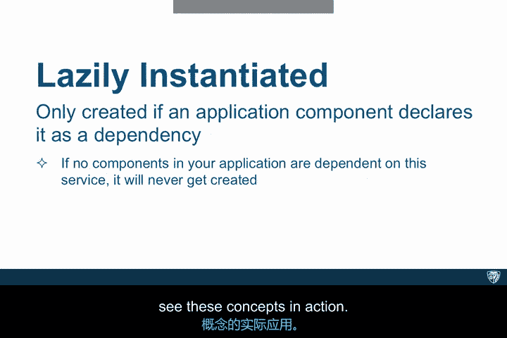

# 约翰霍普金斯大学《使用 AngularJS 开发单页 Web 应用｜Single Page Web Applications with AngularJS》中英 - P39：38_第20讲（第1部分）：自定义服务.zh_en - GPT中英字幕课程资源 - BV1dsFDeZEQr

🎼。

In this lecture， we're going to learn why and how to build custom services in Angular JS。

Remember that controllers are the view model in our model view view model design pattern that we've discussed before。

The job of the view model is to represent the state of the view。 Obviously。

 the way we represent that state is through the data that's dealt with in the controller's instance。

😊，As we've learned， that happens through the Doar science scope Ob。

We also discussed that the controller should not contain much if any business logic functionality itself。

 instead it should pass on the responsibility of handling business logic to some other components。

When we speak about controller responsibility， the controllers are supposed to set up the initial state of data on the dollar science scope。

 they are also supposed to add behavior to the dollar science scope Now when we speak about adding behavior to dollar science scope。

 we don't mean to say that the controller should be responsible for business logic there what it means is that the controller is responsible for handling any events and updating the view state in other words affecting the values on the dollar science scopepe object as a result of some event bound to one of the methods on the dollar Science scope。

On the other hand， we do not want to use controllers among other things to handle business logic directly。

 the code that handles the business logic should be factored out into its own component。

 which we're about to talk about。😊，And also controllers should not be used to share code or state across other controllers。

 We spoke previously about the fact that it's rare for a web application to only have one controller with multiple controllers in the same app。

 it's inevitable that some data will have to be shared across those controllers controllers shouldn't be used for this type of sharing The answer to all these things is to use a custom service。

 Now how do you register a custom service。 Well， it's actually very similar to the way you register controller。

😊，The module instance in Angular has another method called service and just like a controller。

 it takes the name of the service and the function value that is to be the function constructor used to create that service note my terminology I do mean that the function value they provide to the dot service method is treated as a function constructor and we already discussed before what that means in the previous course Also note that the string name that you give to the service is the name that you used to inject into other services or controllers。

 not the name of the function that is used as a function constructor to create the service。😊。

There are a couple more very important properties of creating a service with a that service method the service Angular JS will create for us using this method is guaranteed to be a singleton Now what's a singleton Well that's yet another design pattern。

And the loose definition of a single design pattern is that it restricts an object to always having a single instance What that means is that each dependent component will get a reference to the same instance。

😊，Which means also that multiple controllers injected with that particular service will all have access to the same service instance。

😊，That enables us to share data between different controllers or other components within our application。

So if you place some data into the service in one controller。

 you can immediately retrieve it in another controller inject it with the same service。

 that's why services are very convenient for sharing data across your application。😊。

There's another property of a service that we need to know about and that is lazily instantiateated what lazy instantiation means is that the service is only created if an application component declares it as a dependency if no components in our application are dependent on the service it will never even get created Okay so that's enough of theory in the part two of this lecture let's jump into the code editor and see this concept in action。

😊。

