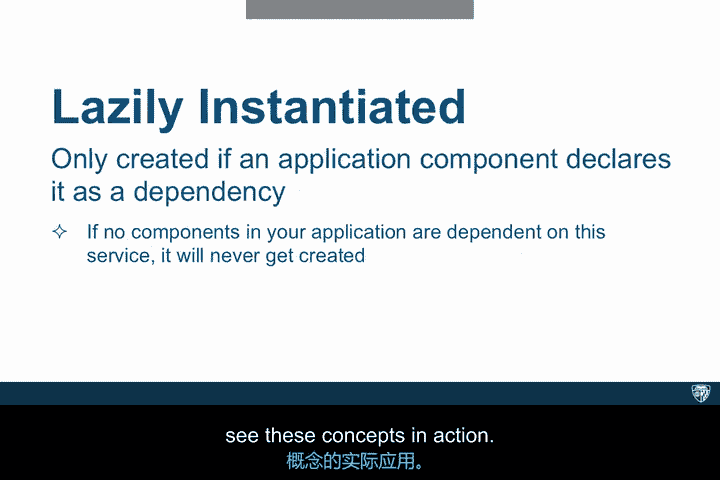

# AngularJS 单页应用开发：第20讲（第1部分）：自定义服务 🛠️

## 概述
在本节课中，我们将要学习为什么以及如何在 AngularJS 中构建自定义服务。我们将探讨控制器在 MVVM 模式中的角色，理解为何业务逻辑不应放在控制器中，并学习如何通过创建单例服务来共享代码与状态。

## 控制器在 MVVM 中的角色
上一节我们介绍了 MVVM 设计模式。在本节中，我们来看看控制器在其中扮演的具体角色。

控制器是我们之前讨论过的模型-视图-视图模型（MVVM）设计模式中的视图模型。视图模型的工作是表示视图的状态。显然，我们表示该状态的方式是通过控制器实例中处理的数据。正如我们所知，这是通过 `$scope` 对象实现的。

我们也讨论过，控制器本身不应包含太多（如果有的话）业务逻辑功能，而应将处理业务逻辑的责任传递给其他组件。

## 控制器的职责与限制
当谈论控制器的职责时，控制器应该负责设置 `$scope` 上的初始数据状态，同时也应该为 `$scope` 添加行为。这里所说的“添加行为”，并不意味着控制器应该负责业务逻辑，而是指控制器负责处理任何事件并更新视图状态。换句话说，就是影响 `$scope` 对象上的值，这些变化是由绑定到 `$scope` 上某个方法的事件触发的。

另一方面，我们不希望使用控制器（以及其他组件）来直接处理业务逻辑。处理业务逻辑的代码应该被分解到它自己的组件中，这正是我们接下来要讨论的。

此外，控制器也不应用于跨其他控制器共享代码或状态。我们之前提到过，一个 Web 应用程序很少只有一个控制器。在同一个应用中有多个控制器时，不可避免地需要跨这些控制器共享一些数据。控制器不应用于这种类型的共享。所有这些问题的答案就是使用自定义服务。

## 如何注册自定义服务
那么，如何注册自定义服务呢？实际上，这与注册控制器的方式非常相似。

Angular 中的模块实例有另一个名为 `service` 的方法。就像控制器一样，它接收服务的名称和一个函数值，该函数值将作为创建该服务的函数构造函数。请注意我的术语：我确实是指提供给 `.service` 方法的函数值被视为一个函数构造函数，我们在之前的课程中已经讨论过这意味着什么。

同时请注意，你给服务的字符串名称是你用来注入到其他服务或控制器中的名称，而不是用作创建服务的函数构造函数的函数名称。

## 服务的核心特性：单例与惰性实例化
使用 `.service` 方法创建服务还有几个非常重要的特性。AngularJS 将使用此方法为我们创建的服务保证是一个**单例**。

那么什么是单例呢？这是另一个设计模式。单例设计模式的宽松定义是：它限制一个对象始终只有一个实例。这意味着每个依赖组件都将获得对**同一个实例**的引用。这也意味着，注入了该特定服务的多个控制器都将能够访问**同一个服务实例**。这使我们能够在应用程序的不同控制器或其他组件之间共享数据。

因此，如果你在一个控制器中将一些数据放入服务中，你可以立即在另一个注入了同一服务的控制器中检索到它。这就是服务在跨应用程序共享数据时非常方便的原因。

我们需要了解的服务的另一个属性是**惰性实例化**。惰性实例化意味着，只有在应用程序组件声明依赖该服务时，该服务才会被创建。如果我们应用程序中没有组件依赖于该服务，那么它甚至永远不会被创建。

## 总结
本节课中我们一起学习了在 AngularJS 中创建自定义服务的核心理念。我们明确了控制器应专注于视图状态管理，而将业务逻辑和跨组件数据共享的职责委托给服务。通过 `.service` 方法注册的服务是**单例**的，这确保了数据的一致性共享，并且它们是**惰性实例化**的，有助于优化应用性能。在下一部分，我们将进入代码编辑器，实际查看这些概念的应用。