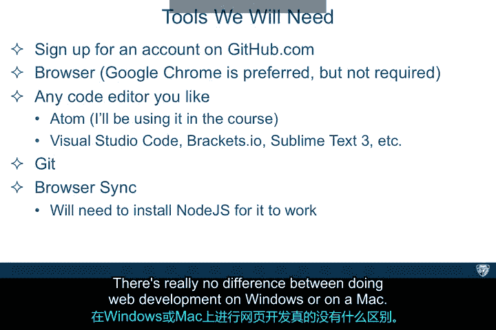

# 约翰霍普金斯大学《使用 AngularJS 开发单页 Web 应用｜Single Page Web Applications with AngularJS》中英 - P3：2_开发环境设置：我们需要什么.zh_en - GPT中英字幕课程资源 - BV1dsFDeZEQr

🎼。

So in these set of lectures， we're going to speak about how to set up your development environment for the rest of the course。

The first thing that you'll need to do is sign up for a Github。com account it's very straightforward。

 give you a username， password and email address and you're done。

You're also going to need some sort of browser for the rest of the course now I'm going to use Google Chrome and I think that's a preferred browser that's just my personal preference because it has the Chrome developer tools that are very advanced in terms of web development help。

 but that's not required you could use any browser you want that you prefer。

Also you need some sort of code editor that you're going to use in this course I'm going to use the Adam code editor it's free。

 it's very good it has plenty plugins that you could put in to help you code and it's actually also made by Github however you don't have to use that one you could use Vi Studio code that's also free brackets thato that's free Sublime text3 is also free but kind of asks you to eventually pay for it so basically choose the editor that you like and you're going to be productive in。

The other tool that we're going to need is Git we're going to need Git for a couple of reasons number one is if you're trying to become a little bit more a professional web developer。

 you cant get away without knowing at least a little bit of Git and in this course we're going to do the bare minimum of Git commands so we're not definitely going to get into the Git commands very deeply however the bare minimum of those commands is something you should know at least get familiar with and get your feet wet with that。

😊，We're also going to use a tool called browser sync and I'll show you what that tool actually does。

 but it's going to help us develop locally in our machine at the same time see all of our updates as we code them in the editor live in the browser automatically without having to click the refresh button The browser sync tool actually is a node JS component or no JS package and we will need to install node JS in order for it to work。

😊，Now， next few videos， I'm going to split them up between the Mac OS and Windows。

 I'm going to explain everything on Mac OS and I will explain everything in Windows。

 so choose your operating system depending on what you are using throughout the rest of the course。

 I'm actually going to be using my own computer which is a Mac but just because the windows and the buttons are going to look slightly different if you're using Windows don't be scared of that there's really nothing else other than the slight look changes that' is going to be different for the rest of the course once you type the two three different commands that exist in Windows versus on the Mac OS other than that。

 theyre really identical there's really no difference between doing web development on Windows or no Mac。

