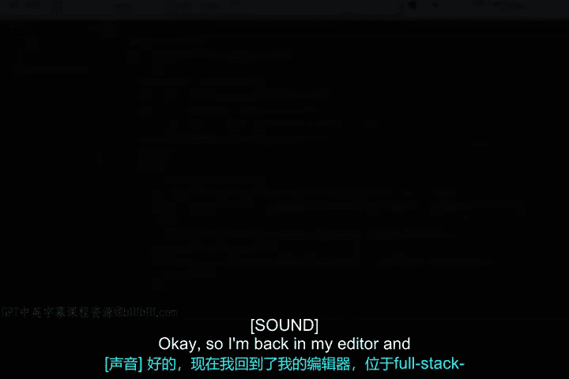
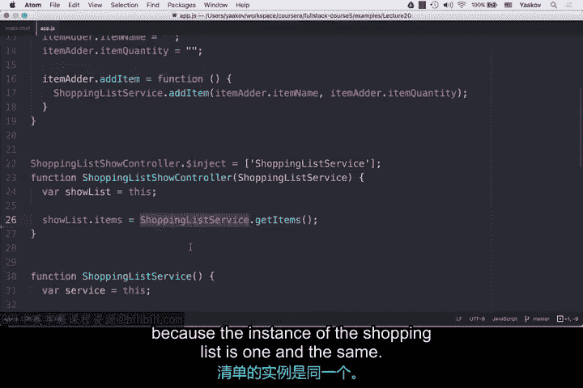
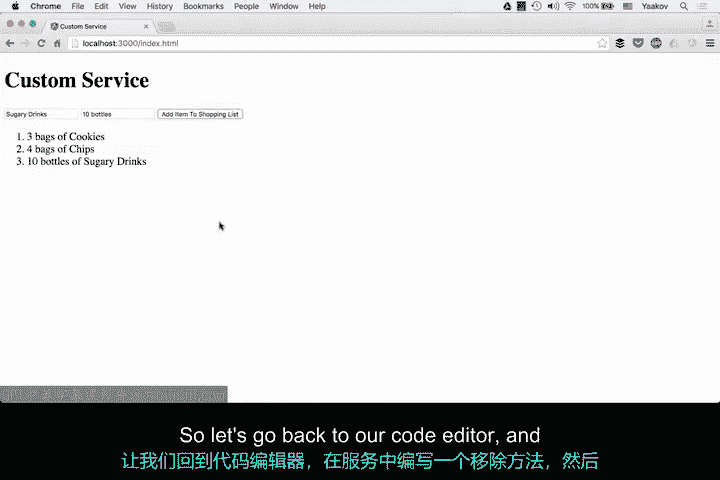
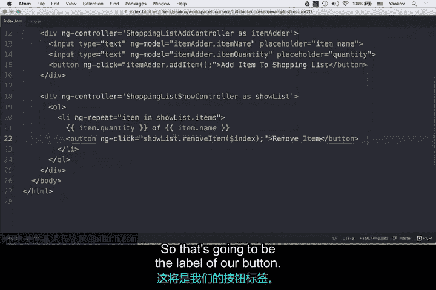
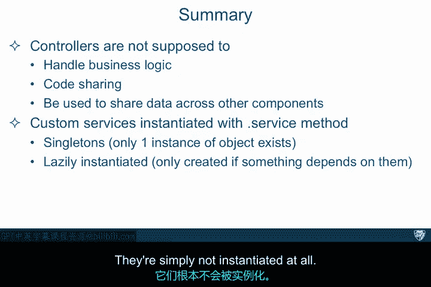

# 约翰霍普金斯大学《使用 AngularJS 开发单页 Web 应用｜Single Page Web Applications with AngularJS》中英 - P40：39_第20讲（第2部分）：自定义服务.zh_en - GPT中英字幕课程资源 - BV1dsFDeZEQr

🎼。

Okay so I'm back in my editor and I'm located in lecture 20 in the fulltag coursese5 examples folder and here we have a very simple shopping list tab and what this app will do is we'll let us add things to our shopping list but what we did here is we broke it up into two controllers In fact let me go ahead and close the file browser so you could see this little bit better So there's two controllers here the controller one is called a shopping list add controller and you could see that we're using the controller as syntax so anywhere within this controller right here we're going be referring to our controller as item Ed so this is the thing that's going to let us add items to our shopping list and you could see the we have a couple of input text boxes here and each of them is bound to a property that is sitting directly in the controller just as they should in a controller as syntax and one is called item name and the other one is called item quantity We also have a button here with an En click bound to item Ed that add item what that's obviously going to do。

😊，I going to read these particular properties and create an item then place it into some data structure like an array to keep a list of all items in our shopping list。

 The second controller we have here is this one right here and this one is nicknamed as show list that's its label and all we're doing here is let's scroll up a little bit all we're doing here is we're doing NG repeatpeat and there's apparently inside of that controller a property called items and it's a collection probably an array and we're looping over those items and every time through the loop we're saying I want to list the item that quantity of item that name and we're doing this inside of an ordered list so it's going to call one23 and so forth。

 Of course these are two separate controllers so we can't exactly share data directly between them but we can do is have a service that shares data between them and also have some methods that help us keep track of the items in our shopping list let's go ahead and go to the Abda GS and see how we did that。

😊，So the first thing you see is we declared both of these controllers。

 This is something you've seen before。 There's nothing new here。

 and then what we've done here is we've declared a service Service is called shopping list service and just for convenience the function value that is representing that shopping list service is also named shopping list service let's go ahead and jump and take a look at that shopping list service。

 well it's a regular function and since it's going to be used as a function constructor we know that we can attach things to this variable in order to expose it to the outside world So here we're doing a regular pattern that we've learned in a previous course with just basically renaming this variable to something that's more readable and will not have issues with inner functions So now everything from now on that's called service is really just this And you see here we're declaring an array of items and we're not exposing it through the service so it's going to be internal to our shopping list service and we have this one method here or a couple methods one ised item and。

😊，item takes an item name and a quantity。 All it does is it creates an object item with a name and quantity properties and then pushes that item。

 that object onto our items array。 And the last method here is called get items and all it does is actually expose our internal items array to the outside。

 So if you call get items， you're actually going to get our items array。

 So if we ever decided to represent the items not as an array， but something else。

 So maybe want something more complex。 this get items method helps us hide that data structure from the outside world。

 meaning outside of our shopping list service。 So let's take a look at our two controllers。

 The first one， we called the shopping list add controller。

 that's the guy who is going to be responsible for adding things to the shopping list。

 And as you can see we're injecting it with the shopping list service。

 and obviously repeating it not only in the dollar sign inject array。

 but inside of the argument list。😊，of the actual function that represents the shopping list a controller and again the same pattern。

 itemss Ed that's our label from the HTML template and Its Eder is going to initialize the item name to be an empty string and item quantity also to be an empty string and here we only have one method which is add item and what that's going to do is going to use our shopping list service and call our shopping list services Ed item which is going to pass it the item name that is bound to our HTML input field and the item quantity which is also bound to the HTML input field。

Now when we look at the controller that is responsible for displaying the shopping list we see here that we have a very similar construct here。

 we also are injecting this shopping list service and as you remember it's the same instance of the shopping list service that Angular JS created for us in this particular color right here service when Angular JS creates that it only creates one of them and every time it injects it it injects the exact same instance into wherever you try to inject it to in this case the couple of controllers so our shopping list service is injected into the shopping list show controller and again the same pattern show list equals this because this is a controller as syntax so we're attaching all the properties directly to the instance of the controller that is automatically attached to the dollar sign scope for us by Angular the controller as syntax so shopping list here all is' doing is exposing the items list and the way we get the items is again from the shopping list service that get items。

😊，So whatever that was placed into the items array that is internal to the shopping list by the other controller using that same shopping list service instance is going to be returned right here by get items because the instance of the shopping list is one and the same let's go ahead and save that and go to our browser since I have the brow running already and I could start entering my item names let's see cookies very important let's get like three bags of that click add item to shopping list and you could see it's showing up immediately in the other part of the page and this part of page is something that the second controller。

 the show controller is responsible for let's go ahead and add something else good like chips let's get four bags of that and add that to the list you could see again it's immediately showing up since we've bound the items collection that is being output through the NG repeatpe we've bounded to the shopping list items that is internal to the shopping list。

And for a good measure， let's go ahead and do sugary drinks。 Let's get like 10 of those。

10 bottles and add to the shopping list。 here we go。 So were we're good to go here。

The only minor problem here is is we don't have any way of removing anything from the shopping list so let's go back to our code editor and code up a remove method on the service and then propagate it throughout the components that use that shopping list service so let's go ahead and Ed method right here we'll say service that remove item and it's a function and what we're going to do is we're going to ask for an item index from whoever is using it because we have a list after all so it should have whatever the item index that you want to remove and we'll say items that splice。

Slice the special array method and it takes an index that you want to remove from and how many want to remove from that index and since we only remove one。

 we're going to remove just one okay so that's the remove or not the remote remove remove item method okay so we've got the remove item method next let's go to our show controller or the shopping list show controller and code up a method that we'll be able to use in the template we'll say show list that remove item。

Equals to function。Don't need the name， and we'll also ask the HTML template to pass us along an index on which the user clicked and we'll see how we're going to do that。

 So we'll say item index。And here， since we're using or reusing the shame instance of the shopping list service。

 we could say shopping list service right there，remove item and we'll just pass along the item。😊。

Index， and I misspelled here。 It's index。 Okay， so we're good to go。 semicolon。Right there。 Okay。

 let's go to the index HTMLml our template and actually make sure that it invokes our remove item method。

 The way we'll do that is we'll scroll down to each item here。

 This is where each item is being displayed and right next to the item will create a button。😊。

That will have En click。Bound2 and our show list is the label。

 so we have to use the show list that remove item。And as you remember from our discussion of N repeat。

 it exposes the index through the loop using the dollar sign index property that is available to the body of the element on which the NG repeat is declared。

 So that's exactly what we're gonna do' gonna to say remote again remove not remote remove item and index is going be dollar sign index is what we're passing it along。

 So it should point to exactly the item， the index of the item in our array。

 So let's go ahead and save that。 And one more thing just forgot to put the label in here we'll say remove。

😊，Item， so that's going to be the label of our button。

 So let's go back to our browser and you can see now when we add stuff like cookies。

And three bags of it will'll click add， you see the remove button now shows up。

 Let's go ahead and add something else like chips again。 that's four bags again。

 we'll add that to the list and let's go ahead and add what we're really gonna need after all this。

 That type of food is peptobysmal。And we'll get two bottles of that and we'll add that to the list。

 Okay， so now we have three items in the list and we have the remove buttons and if we click the remove button。

 the four bags of chips will go away， let's take a look and soon enough it goes away and we could actually remove every single one of them one by one so the item list is now empty。

So let's review controllers are not supposed to handle business logic they're also not supposed to be used to share code。

 so if you have common code between different controllers。

 it's not a good idea to try to reuse the controllers rather you should refactor that code into a service and then share the service between the controllers controllers are also not supposed to be used to share data across different components。

Now custom services instantiated with the dot service method are singletons。

 which means there's only one instance of the object that ever exists。

 which means you could share data between different controllers or other components using that service because again only one exists so therefore it's going to hold the same data across all of your components of your application also services that instantiated with the thatt service method are lazily instantiated。

 which means they're only created if something actually depends on them。

 if nothing depends on them they're simply not instantiated at all。

 and last but not least that dot service method that you supply the function to as your custom service treats that function as a function constructor and we've spoken before that what it means is that the Ang Gs internally will actually new up your function using the new keyword which has a ramification for what this keyword means inside of your service function。

😊。

