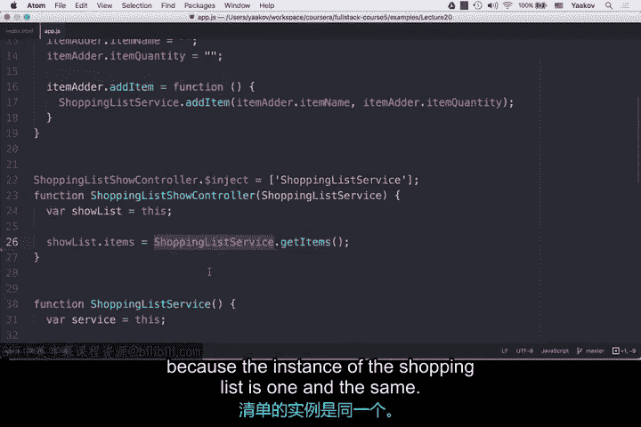
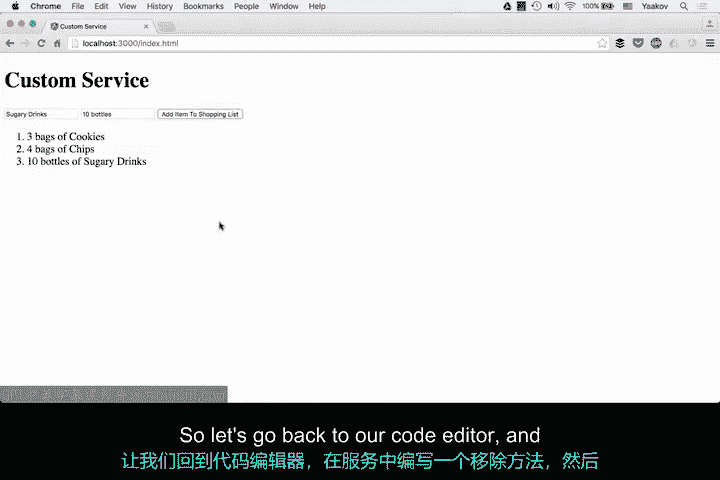
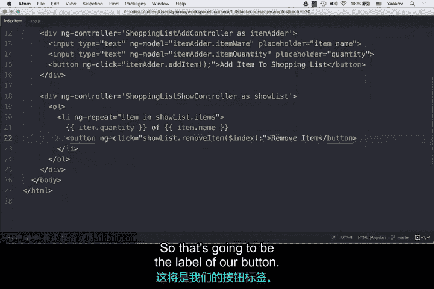
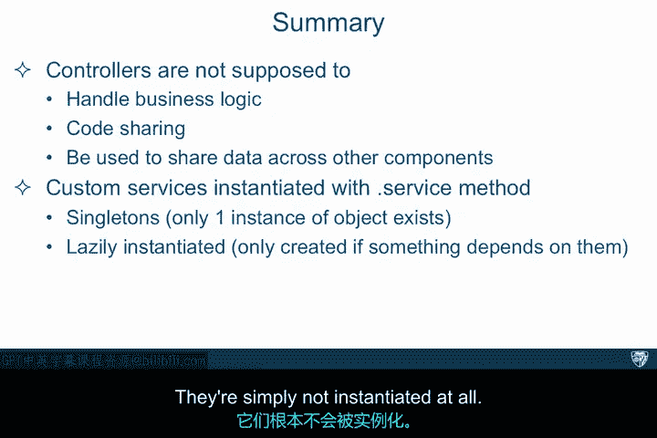

# 使用 AngularJS 开发单页 Web 应用：第20讲（第2部分）：自定义服务 🛠️


在本节课中，我们将学习如何在 AngularJS 应用中创建和使用自定义服务。服务是一种强大的工具，用于在控制器之间共享数据和业务逻辑，使代码更加模块化和可维护。

---

## 概述

我们将构建一个简单的购物清单应用。该应用包含两个主要部分：一个用于添加新物品，另一个用于显示清单。这两个部分由不同的控制器管理。为了在它们之间共享数据（即购物清单），我们将创建一个自定义服务。通过本教程，你将理解服务如何作为单例（Singleton）工作，以及如何利用它来协调不同组件间的状态。

---

## 应用结构分析

首先，我们来看一下应用的基本结构。应用包含两个控制器：

1.  **`shoppingListAddController`**：负责处理用户输入，将新物品添加到清单。
2.  **`shoppingListShowController`**：负责获取并显示当前的购物清单。

这两个控制器是独立的，无法直接共享数据。为了解决这个问题，我们需要一个中介——自定义服务。

---

## 创建自定义服务

在 AngularJS 中，我们使用 `.service` 方法来创建自定义服务。这个服务将作为单例，意味着整个应用中只会存在它的一个实例。所有依赖它的组件都将获得这同一个实例，从而实现数据共享。

以下是购物清单服务的定义：

```javascript
// 定义名为 `ShoppingListService` 的服务
app.service('ShoppingListService', function () {
  // 内部私有变量，存储物品列表
  var items = [];

  // 公开给外部使用的方法：添加物品
  this.addItem = function (itemName, itemQuantity) {
    var item = {
      name: itemName,
      quantity: itemQuantity
    };
    items.push(item);
  };

  // 公开给外部使用的方法：获取所有物品
  this.getItems = function () {
    return items;
  };

  // 公开给外部使用的方法：根据索引移除物品
  this.removeItem = function (itemIndex) {
    items.splice(itemIndex, 1);
  };
});
```

**核心概念解析**：
*   **单例模式**：通过 `.service()` 创建的服务是单例。`ShoppingListService` 在整个应用生命周期内只被实例化一次。
*   **数据封装**：服务内部的 `items` 数组是私有的，外部只能通过公开的方法（如 `getItems`）来访问，这保护了数据结构的内部实现。
*   **方法暴露**：通过将函数赋值给 `this`（如 `this.addItem`），我们将其作为服务实例的方法公开出去。

---

## 在控制器中注入并使用服务

定义了服务之后，我们需要在控制器中“注入”它才能使用。AngularJS 的依赖注入机制会自动为我们提供该服务的单例实例。

### 添加物品控制器

`shoppingListAddController` 依赖 `ShoppingListService` 来保存用户输入的新物品。

```javascript
app.controller('ShoppingListAddController', ['$scope', 'ShoppingListService',
  function ($scope, ShoppingListService) {
    var adder = this;

    // 初始化绑定到输入框的模型数据
    adder.itemName = '';
    adder.itemQuantity = '';

    // 添加物品的方法
    adder.addItem = function () {
      // 调用服务的 addItem 方法
      ShoppingListService.addItem(adder.itemName, adder.itemQuantity);
      // 清空输入框
      adder.itemName = '';
      adder.itemQuantity = '';
    };
  }
]);
```

### 显示清单控制器

`shoppingListShowController` 同样依赖 `ShoppingListService`，用于获取要显示的物品列表，并处理移除操作。



```javascript
app.controller('ShoppingListShowController', ['$scope', 'ShoppingListService',
  function ($scope, ShoppingListService) {
    var showList = this;

    // 从服务获取物品列表
    showList.items = ShoppingListService.getItems();

    // 移除物品的方法
    showList.removeItem = function (itemIndex) {
      // 调用服务的 removeItem 方法
      ShoppingListService.removeItem(itemIndex);
    };
  }
]);
```

**关键点**：两个控制器注入的是**同一个** `ShoppingListService` 实例。因此，在 `AddController` 中添加的物品，会立即反映在 `ShowController` 获取的 `items` 列表中。

---



## 构建用户界面

有了控制器和服务，我们需要构建对应的 HTML 模板来绑定数据和操作。

### 添加物品区域
此部分绑定到 `ShoppingListAddController`（别名为 `adder`）。

```html
<div ng-controller="ShoppingListAddController as adder">
  <h3>添加新物品</h3>
  <input type="text" ng-model="adder.itemName" placeholder="物品名称">
  <input type="text" ng-model="adder.itemQuantity" placeholder="数量">
  <button ng-click="adder.addItem()">添加到购物清单</button>
</div>
```

### 显示清单区域
此部分绑定到 `ShoppingListShowController`（别名为 `showList`），并使用 `ng-repeat` 循环显示物品。

```html
<div ng-controller="ShoppingListShowController as showList">
  <h3>购物清单</h3>
  <ol>
    <!-- 循环遍历 items 数组，$index 是当前项的索引 -->
    <li ng-repeat="item in showList.items">
      {{ item.quantity }} 份 {{ item.name }}
      <!-- 点击按钮调用移除方法，并传入当前项的索引 -->
      <button ng-click="showList.removeItem($index)">移除</button>
    </li>
  </ol>
</div>
```

**模板说明**：
*   `ng-repeat` 指令会为数组中的每个元素创建一个新的作用域。
*   `$index` 是 `ng-repeat` 提供的一个特殊属性，代表当前迭代项在数组中的索引位置，我们将其传递给 `removeItem` 方法。



---

## 功能演示与交互

当用户在输入框中填写信息（例如“饼干，3袋”）并点击“添加”按钮后：
1.  `adder.addItem()` 方法被调用。
2.  该方法调用 `ShoppingListService.addItem()`，将新物品对象存入服务内部的数组。
3.  由于 `showList.items` 是通过 `ShoppingListService.getItems()` 获取的，它直接引用了服务内部的同一个数组。因此，视图会自动更新，新物品立即出现在下方的清单中。
4.  每个物品旁边都有一个“移除”按钮。点击时，会调用 `showList.removeItem($index)`，并传入该物品的索引。服务中的 `removeItem` 方法会从数组中删除对应项，清单显示也随之更新。

---

## 核心概念总结

本节课中我们一起学习了 AngularJS 自定义服务的创建与应用。让我们回顾一下关键要点：

1.  **控制器的职责**：控制器应专注于管理视图逻辑，**不应**直接处理复杂的业务逻辑或在不同组件间共享代码与数据。
2.  **服务的作用**：自定义服务是存放可复用业务逻辑和共享数据的理想场所。它促进了代码的模块化和关注点分离。
3.  **服务的特性**：
    *   **单例**：通过 `.service()` 方法创建的服务是单例，整个应用只有一份实例。
    *   **延迟实例化**：服务只有在被某个组件依赖注入时才会被创建。
    *   **构造函数调用**：传递给 `.service()` 的函数会被 AngularJS 使用 `new` 关键字调用，因此函数内部的 `this` 指向新创建的服务实例。
4.  **数据流**：通过向多个控制器注入同一个服务实例，可以轻松实现跨控制器的数据同步与状态管理。




通过将购物清单的管理逻辑抽取到 `ShoppingListService` 中，我们的控制器变得简洁且职责清晰，应用结构也更加健壮和易于维护。