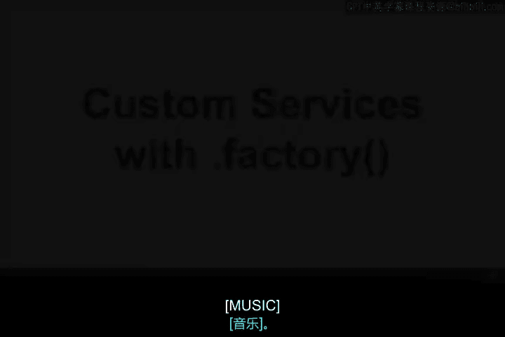
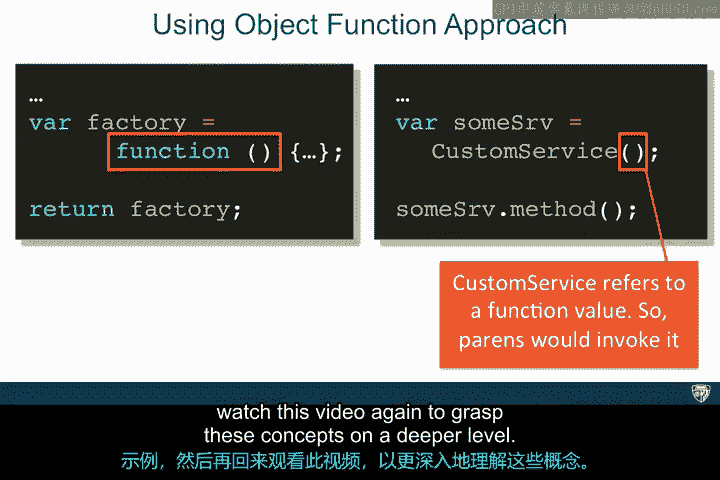

# 约翰霍普金斯大学《使用 AngularJS 开发单页 Web 应用｜Single Page Web Applications with AngularJS》中英 - P41：40_第21讲（第1部分）：使用工厂创建自定义服务.zh_en - GPT中英字幕课程资源 - BV1dsFDeZEQr

🎼。

In this lecture， we're going to talk about creating services and really just about anything else with that factory method。

😊，First， it's a good idea to review the characteristics of the design pattern。

 which is what this method is based on the factory design pattern characteristic is basically is that that it's a central place that produces new objects or functions Now this is not an official definition of the factory design pattern。

 but I think it communicates the idea without too much of the computer science ceilingingo for our purposes。

 the point is is that a factory can produce any type of object。

 not just a singleton and it can also be used to produce dynamically customizable services which is what we're going to end doing in this lecture。

😊，Now there's quite a bit of confusion in the Angular JS community regarding factory versus service After all。

 the dot factory method is sometimes called a service factory。

 which actually makes sense because the factory is something that can produce a service。

 but theres some very important distinctions that dot factory method is not just another way of creating the same service you create with a dot service method。

 but it can be the dot service method is also called a factory。

 but a much more limited one compared to the dot factory method。

 the thatt service method is a factory that always produces the same type of service a singleton and without an easy way to configure its behavior。

The debt service method is usually used as a shortcut for something that doesn't require any configuration whatsoever。

Now the way you register the service factory function is very similar to the way we registered the service and the controller。

 you called it that factory method on the module you specify the name of your factory in this case custom service。

 and then you specify the factory function。Now the factory function is the thing that's expected to produce a service when you execute it。

 note the very big difference， if we made the same exact call with that service method。

 the custom service would be expected to be the service。

 not produce a service as a result of either direct ver or invocation of one of its methods。

Also note that in this example we name the factory function custom service and it name that we registered with that factory method as the same custom service。

 but the truth is what we name our function doesn't make any difference。

 however what we register that function with， which is what is in quotation marks。

 is the name that we use to inject into other services controllers etc。

 so it's not the name of the function， it's the name that you register that function with。

 with that factory method。Now when it comes to writing the factory function itself， in this case。

 the name custom service function， there's a couple of different implementations you could go with。

 the first one is the one you see here is the one that returns a function as a result of the execution of our factory function。

 which is custom service as you could see the local variable that's returned factory is actually a function value。

What we're ultimately after is creating a service called some service。

Note that we're the ones calling new in other words。

 we're the ones in control of how and what gets created once we create whatever we want。

 we could return that as a result， the execution of the custom service function， in other words。

 our factory function itself returns a function because the returned local variable factory refers to a function。

 that's one way of implementing this factory function。

A different way of implementing the factory function would be to return an object literal here we're creating an object literal with a property called Get some service。

 The value of the property gets some service is a function。

 So the return value of the execution of the custom service factory is an object literal。

 we can then retrieve that object literals get some service property。

 whose value is a function and execute， obtaining an instance of some service that we can then use。

 Even using this implementation again， where the ones responsible for knowinging up the service called some service。

 where in control of how it gets created， and that's the biggest point of using that factory method。

😊，So to highlight the differences between two equally valid approaches。

 I've pulled out just a body of the factory function on the left you see one approach。

 which is an object literal with a property method that calls new sum service。

 that object literal is what is returned as part of the execution of the factory function on the right where returning a function that returns a reference to the new sum service。

 the value of that function， the factory is what gets returned when you execute the factory function itself。

There are obviously differences in how you use the factory depending on which implementation you chose。

 if you go with the object literal approach， then the way you would use it，😊。

Is by referencing your factory function as an object that Angular JS created for you and then accessing the method property。

 which is dot get some service。Since the custom service refers to an object literal。

 you would then access one of its properties called Get some service in the same way you would access any property of an object literal through the dot notation。

 however， Gett some service property is a function。

 so in order to execute that function you simply put Pars behind it。Once that's done。

 you could then use the service that's produced inside of the function that's referenced by the property。

 get some service， so it's some service， that method and so on。

In the case of implementation that uses a function as the return value from the factory function。

 unlike the object literal approach where the custom service factory function actually refers to an object literal。

 in this case custom service will refer to a function。

 so all we need to do is put Pars behind it and execute it in order to get our created service。

 and then use just like before， some serviceduct method and so on。😊，Okay。

 so now that we understand the process of creating these factories。

 let's go to the code editor and see an example of how to create and use these factories。

If you have never heard of the factory pattern， this overview may be a bit difficult for you to digest on the first try。

 My suggestion is for you to move on to part two， see a coding example of these concepts and then come back and watch this video again to grasp these concepts on a deeper level。

