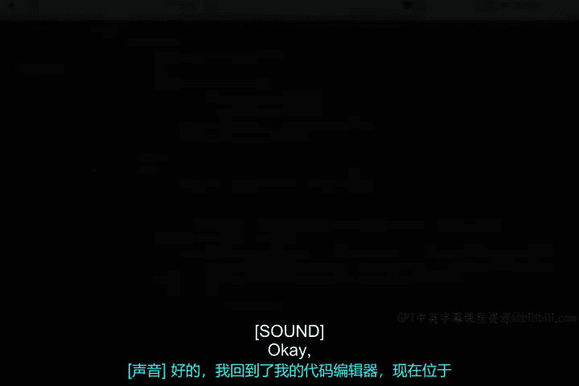
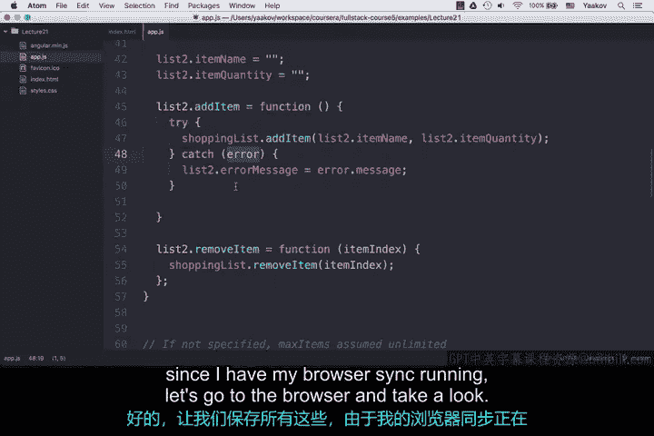
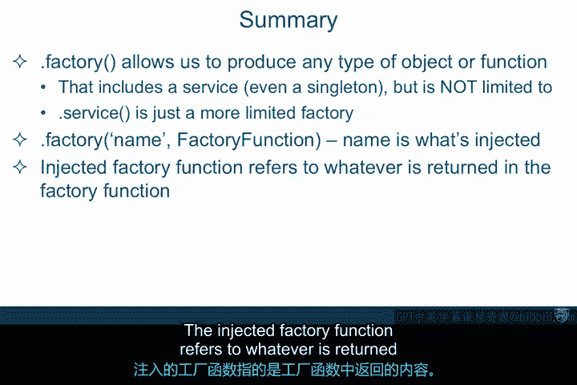

# 约翰霍普金斯大学《使用 AngularJS 开发单页 Web 应用｜Single Page Web Applications with AngularJS》中英 - P42：41_第21讲（第2部分）：使用工厂创建自定义服务.zh_en - GPT中英字幕课程资源 - BV1dsFDeZEQr

🎼。

Okay I'm back in my code editor and I'm located in lecture 21 folder。

 which is located in fulltag dash course 5 examples folder and this is a similar application to what we've written before in other words we're going to be creating a shopping list except now we're going to be creating two separate independent shopping lists that are going to be sitting side by side so we're going need a shopping list service but we don't want it to be a singleton anymore because we don't want one shopping list affecting the other one so the way we're going to do that is basically create two separate controllers one is going to be responsible fullest one shopping list one and the other one is going to be responsible for shopping list2 except we want to enhance the shopping list service just a little bit we want to be able to tell the shopping list service that there might be a max number of items that we might ask it to limit itself to Obviously we're going to be creating the shopping list service using a factory because in every single controller we need to create。

A new one and sometimes we'll need to create one that doesn't have a max item limit。

 and sometimes it will have a max item limit。 So let's go to our app Gs and see how we did that。

 The first thing we want to do is actually scroll down to our shopping list service and modify it a little bit。

 In this case， we want to specify that there might be a max number of items that we want to limit the shopping list too So the code is almost identical。

 except for the service add item method。 And in this case， just before adding our item。

 we actually need to check if the max items is undefined。

 which means the color of our service didn't even bother to redefine the max number of items in which case we're going to go ahead and assume that there is no max items it's unlimited and we'll go ahead and push the item onto our list or we have to check if there is。

 in fact， a max items specified meaning it's not undefined。 We need to。😊。

Check that the number of items in our list is less than the number of max items allowed。

 And if that is the case， we can then go ahead and add that item to the item list that our items array。

 If this condition is false。 then we're gonna have to throw an error and here you see an example of throwing an error and error is a builtin javascript class and we'll give it a message Max items of max items is reached。

 So the user knows or the user of this service knows that we've reached our limit。

 everything else about the service is exactly the same as we've done before。

 Now we need to create the factory。 Well， the first thing we need to do is scroll all the way up。

 and look at our factory declaration。 So the factory declaration is that factory。

 we're gonna give it the factory name， which is our shopping list factory。

 and the function that is going to be our factory function， which is in this case again。

 shopping list factory。 note that。😊，don't need to register the shopping list service here with that service method。

 And that's because we don't want Angular to create the shopping list service for us。

 We want to create that service ourselves。 Let's go ahead and scroll to the shopping list。😊，Factory。

 and you can see it's very simple and you can see also that we're using the kind of the function approach here instead of the object literal approach and our factory is a function that takes the max number of items and it will return a new shopping list service passing it the max number of items and so what will get returned as part of the execution of the shopping list factory is a function that takes these max number of items and returns the shopping list service。

Now all that's left is to take a look at the code of the controllers。

 Let's go ahead and scroll up to the first controller。

 which is called list1 that's how we nicknamed it in our template because we're using a controller as syntax you could see that we're injecting the shopping list factory into our shopping list controller one in in order for us to get a new shopping list。

 you could see that we're using our shopping list factory and simply executing it note we're not passing anything into it which means the max number of items is going to be undefined。

 but since the shopping list factory refers to a function that is being returned out of it。😊。

Putting parentss behind it will execute that function and will execute the new shopping list service and that's why we have shopping list as our local variable here as an instance of the shopping list service once we have that we obviously can now start calling methods on it like get items and you could see here when we add the item we could just say shopping list that add item list one that item name list one that item quantity so very similar to the way we used it before in the shopping list controller2 you could see that were likewise injecting the shopping list factory into the shopping list controller2 but this time when we execute the shopping list factory we pass it the max number of items as3 which means our shopping list。

 the local variable， the shopping list that's referring to the shopping list service is now going to be limited to three items only。

So therefore we need to change our add item method slightly。

 we need to make sure that if an error is being thrown from our shopping list that we catch it and do something about it well that's the tricach block that you see here that exists in JavaScript so we're going to try to add the item and if the number of items in the shopping list is going to exceed3 it will throw an error in which case we're going to catch that error and we're actually going to set a property on our scope or really on the instance of our controller since we're using the controller as syntax that is going to get exposed to our HTML template and we're going to set the value of our error message to error that message that is going to come from that error that we threw from the shopping list service。

Okay， let's fable that and since I have my browser sync running。

 let's go to the browser and take a look so we basically have both shopping lists side by side and we could start filling it up so we'll fill it out with cookies again。

 three bags of cookies。

And we'll say， we want chips。Let's get four bags of that。

Four bags of that and we'll say sugary drinks。We'll get 10 bottles of that。And we'll say。Ppttobysmal。

We'll get three bottles of that。As you can see， I was able to add the fourth item without any problems。

 let's see if we could do the same thing for shopping list2 that is supposed to be limited to three items let's go ahead and get again say cookies。

 three bags， and we'll say chips。Four bags， let's make it five bags for good measure。And we'll say。

 sugary drinks。10 bottles。 and will'll say。Beeptobysmal。Two bottles。

Oh and look at that when we add the next item you could see that the error message displayed Max item3 reached and you could see there's only three items in our shopping list so a point is you could see that they're acting independently。

 the number of items here does not affect the number of items here and also the items are differently。

 which means there's a different instance of the shopping list service being used in our controller one versus our controller2。

Now we do have a little bit of an ugliness here， which is this error message that is sitting here。

 no matter what if we refresh here， you'll see that the error message is already here。

 ideally we would really like it not to show up here at all until an actual error occurs we're going to take care of that in the future lecture。

Let's summarize。The dot factory function allows us to produce any type of object or function that includes a service in even a singleton。

 but it's not limited to that。😊，The dot service on the other hand， is just a more limited factory。

 it limits us to creating a service that is a singleton and also one that's very hard to custom configure。

The way you invoked to that factory method is very similarly to the way you invoked in that service or really that controller method。

 you give it a name and a factory function， the name you give to your factory is what gets injected into other components。

The injected factory function refers to whatever is returned in the factory function。

 It can be an object literal with a property that's a function that creates something for us。

 It can also directly be a function that itself creates something for us。

