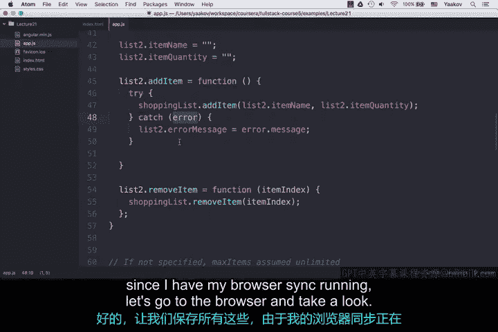
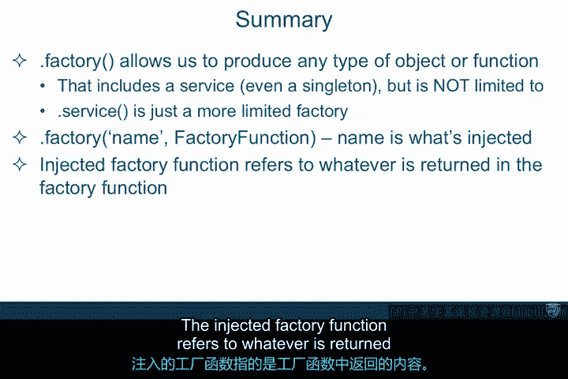

# 使用 AngularJS 开发单页 Web 应用：P42：第21讲（第2部分）：使用工厂创建自定义服务 🏭


在本节课中，我们将学习如何使用 AngularJS 的工厂（Factory）来创建可配置、非单例的自定义服务。我们将通过构建一个包含两个独立购物列表的应用来演示这一概念。

---

## 概述

我们将创建一个应用，其中包含两个并排显示但完全独立的购物列表。为了实现这一点，我们需要一个购物列表服务，但这次我们不希望它是单例模式，因为两个列表的数据应该互不影响。我们将使用工厂模式来创建这个服务，并为其添加一个可选的“最大物品数量”限制功能。

## 修改购物列表服务

首先，我们需要修改基础的购物列表服务，使其能够支持最大物品数量的限制。

以下是修改后的服务核心代码。主要变化在于 `addItem` 方法，它在添加新物品前会检查是否已达到最大数量限制。

```javascript
// 购物列表服务
function ShoppingListService(maxItems) {
  var service = this;
  var items = [];

  service.addItem = function (itemName, quantity) {
    // 检查最大物品数量限制
    if ((maxItems === undefined) ||
        (maxItems !== undefined) && (items.length < maxItems)) {
      var item = {
        name: itemName,
        quantity: quantity
      };
      items.push(item);
    } else {
      // 如果达到限制，则抛出错误
      throw new Error("Max items (" + maxItems + ") reached.");
    }
  };

  service.getItems = function () {
    return items;
  };
}
```

**代码解释**：
*   `maxItems` 参数是可选的。如果未定义，则表示没有数量限制。
*   在 `addItem` 方法中，我们首先检查 `maxItems` 是否为 `undefined`，或者当前物品数量是否小于 `maxItems`。
*   如果条件满足，则添加物品。
*   如果条件不满足（即已达到最大数量），则使用 `throw new Error()` 抛出一个错误。

## 创建工厂函数

上一节我们介绍了如何修改基础服务以支持配置。本节中，我们将看看如何创建一个工厂函数来动态生成这个服务的实例。

我们不使用 `.service()` 方法让 AngularJS 自动创建单例服务，而是创建一个工厂。工厂是一个函数，它负责创建并返回我们需要的对象（在这里是服务实例）。

以下是工厂函数的定义：

```javascript
// 工厂函数
app.factory('ShoppingListFactory', function () {
  var factory = function (maxItems) {
    return new ShoppingListService(maxItems);
  };
  return factory;
});
```

**核心概念**：
*   `.factory()` 方法接收两个参数：工厂名称和一个工厂函数。
*   工厂函数本身返回另一个函数（这里命名为 `factory`）。
*   当其他组件（如控制器）注入 `ShoppingListFactory` 并调用它时（例如 `ShoppingListFactory(3)`），实际执行的是这个内部返回的函数。
*   这个内部函数接收 `maxItems` 参数，并利用它创建一个新的 `ShoppingListService` 实例返回。

## 在控制器中使用工厂

现在，我们可以在不同的控制器中使用这个工厂来获取独立的服务实例。

### 控制器 1：无限制列表

第一个控制器创建一个没有物品数量限制的购物列表。

```javascript
app.controller('ShoppingListController1', ['ShoppingListFactory', function (ShoppingListFactory) {
  var list1 = this;

  // 使用工厂创建新的服务实例，不传入参数，表示无限制
  var shoppingList = ShoppingListFactory();

  list1.items = shoppingList.getItems();

  list1.addItem = function () {
    try {
      shoppingList.addItem(list1.itemName, list1.itemQuantity);
    } catch (error) {
      list1.errorMessage = error.message;
    }
  };
}]);
```

### 控制器 2：有限制列表（最多3个）

第二个控制器创建一个最多只能有3个物品的购物列表，并演示错误处理。

```javascript
app.controller('ShoppingListController2', ['ShoppingListFactory', function (ShoppingListFactory) {
  var list2 = this;

  // 使用工厂创建新的服务实例，并传入最大数量限制：3
  var shoppingList = ShoppingListFactory(3);

  list2.items = shoppingList.getItems();

  list2.addItem = function () {
    try {
      shoppingList.addItem(list2.itemName, list2.itemQuantity);
      list2.errorMessage = ""; // 添加成功则清空错误信息
    } catch (error) {
      list2.errorMessage = error.message; // 捕获并显示错误
    }
  };
}]);
```

**关键点**：
*   两个控制器注入了同一个 `ShoppingListFactory`。
*   通过向工厂函数传递不同的参数（`undefined` 或 `3`），我们得到了两个配置不同的、完全独立的 `ShoppingListService` 实例。
*   在第二个控制器中，我们使用 `try...catch` 块来捕获服务抛出的错误，并将错误信息显示在界面上。

## 应用演示



在浏览器中运行应用，我们可以看到：
*   两个购物列表可以独立操作，互不影响。
*   第一个列表可以添加任意数量的物品。
*   当尝试向第二个列表添加第4个物品时，会触发错误，并显示“Max items (3) reached.”的提示信息。
*   这证明了工厂成功创建了两个独立的服务实例。

## `.factory` 与 `.service` 的对比

让我们总结一下工厂模式与服务模式的区别。

以下是两者之间的核心区别：

*   **`.factory()` 方法**：功能强大且灵活。它可以返回**任何东西**——一个对象、一个函数、一个服务实例，甚至是单例。它非常适合需要定制或配置的场景。
*   **`.service()` 方法**：是 `.factory()` 的一种特例，限制更多。它**只能**用来创建一个单例服务实例（通过 `new` 关键字调用构造函数），并且难以在创建时进行自定义配置。

**调用方式对比**：
```javascript
// 工厂模式：工厂函数返回我们定制的创建逻辑
app.factory(‘FactoryName‘, function() {
  return function(config) {
    // 根据 config 创建并返回某个对象
    return new SomeService(config);
  };
});

// 服务模式：直接注册一个构造函数，Angular 会帮我们 new 一个单例
app.service(‘ServiceName‘, SomeServiceConstructor);
```

当注入到控制器时：
*   注入 `FactoryName` 得到的是工厂函数返回的东西（例如一个创建函数）。
*   注入 `ServiceName` 得到的是 Angular 已经创建好的单例服务实例。

## 总结




本节课中我们一起学习了如何使用 AngularJS 的工厂（`.factory()`）来创建可配置的自定义服务。关键点在于：
1.  工厂模式提供了比服务模式更大的灵活性，允许我们创建非单例的、可定制的对象。
2.  我们通过工厂函数返回一个创建函数，从而让控制器能够按需生成具有不同配置的服务实例。
3.  通过一个双列表购物车应用的实践，我们看到了两个控制器如何使用同一个工厂获得完全独立、配置各异的服务实例，实现了数据的隔离。
4.  最后，我们明确了 `.factory()` 与 `.service()` 方法在用途和灵活性上的主要区别。