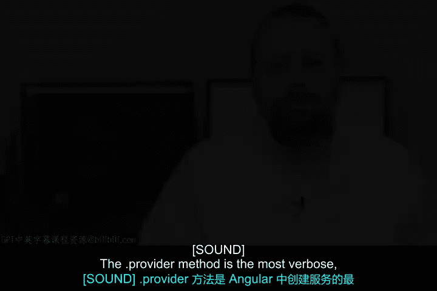
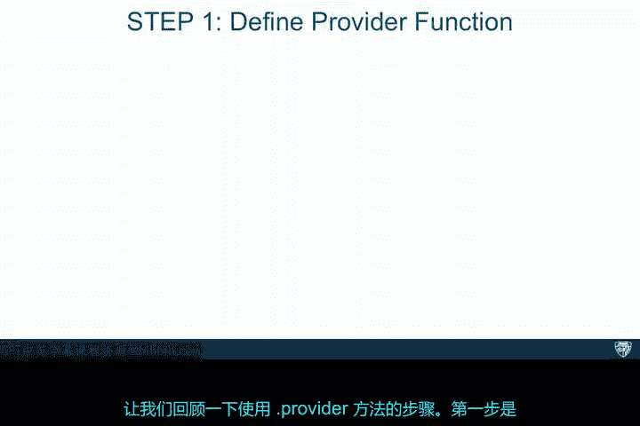
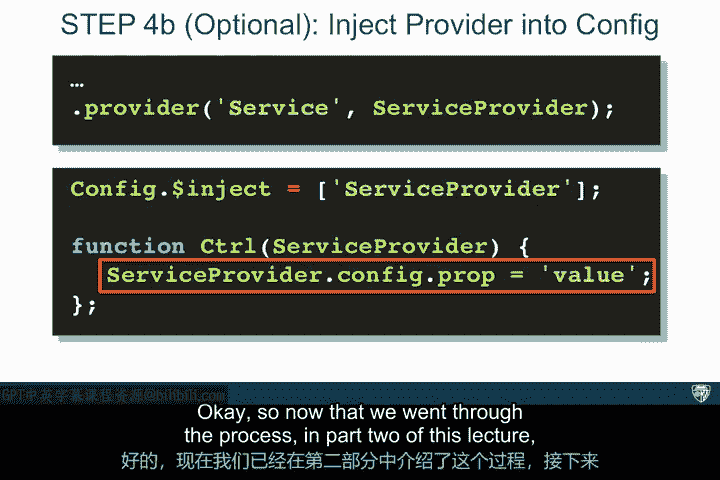

# 约翰霍普金斯大学《使用 AngularJS 开发单页 Web 应用｜Single Page Web Applications with AngularJS》中英 - P43：42_第22讲（第1部分）：使用提供者创建自定义服务.zh_en - GPT中英字幕课程资源 - BV1dsFDeZEQr

🎼。

The dot provider method is the most verbose and at the same time the most flexible method of creating services in Angular。

 not only can you create a factory that' is dynamically configurable at the time of using the factory with the provider method you could custom configure the factory just once at the bootstrapping of your entire application。

 and then use that factory throughout your application with your custom settings。In other words。

 you could configure this factory before your application starts。In fact。

 as the angular documentation tells us， the provider method is what actually gets executed behind the scenes when we configure our services with either dot service or dot factory methods。

Let's go over the steps of using the dot provider method。

The first step is to define the provider function。 You'll notice that this is a special function that has a particular property on the actual instance of the function here you see that the var provider is equal to this。

 so therefore provider do dollar sign get the get the dollar sign get property is a function that is directly attached to the provider instance。

 That function is a factory function。 In other words。

 it's just like the one that we use to provide to the dot factory method in that function you create your service in our case where creating a new service called service。

 This dollar sign get property that's a function is what makes the provider a provider。😊。

Angular JS expects the provider to have a dollar sign get property whose value is a function that Angular will treat as a factory function。

 but what makes this whole setup very special is the fact that you could provide some config object inside the service provider and that usually comes with defaults that you can later override in the step where you configure the entire application which we'll see in a minute。

 so in this case， we're saying provider that config which means the config property again is sitting on the instance of service provider and it equals some object literal that for example can have a prop property in it。

😊，Step two is to register the provider function with the module and the way you register the provider is very similar to the controller。

 the factory and the service， you just say that provider。

 it's a method on the module instance and you supply the name of the service that the provider will produce and the service provider function that has a dollar sign get as part of its properties。

Now notice that the name that you're supplying in the provider function is the name of the service as it will be injected into other services。

 controllers， and so on。The name of the function or the service provider function does not matter at all。

The third step is to inject our service just as usual。

 and you'll notice here that what we're injecting is we're injecting whatever the dot provider defined name was。

 not the service provider function。😊，Our do provider declared that we're going to have a service called service。

 and therefore what we're injecting is also called service。

Well so far we haven't really configured anything， so that's why we're an optional step number 4 a that is registering the config function Now config function is the special function that you can invoke on the module instance that is guaranteed to run before any services。

 factories or controllers are even created。Which means that's a step for us to be able to tap into configuring these services before they're ever created Now the reason it's optional is because you don't have to configure it。

 you could just have the defaults take effect however for some services that doesn't make any sense to have any type of defaults。

 so sometimes this is simply required by the business logic or particular service that needs to be configured。

😊，The optional step 4 B is to actually define the config function。 As you can see here。

 in defining the config function， we're injecting service provider into the config function。 Now。

 we cannot inject any regular services into the config function simply because it gets executed before any services。

 factories or controllers are even created。 therefore。

 what we need to do is get at the provider function over a particular service。

 And if the provider has been declared with a particular string。😊。

The thing that we inject into the config function is that string plus the string provider。

 so in this case our provider has been declared with service。

 therefore what we inject into the config function and then use inside of it is service provider。

Once again， the name of the actual provider function is completely irrelevant。Last but not least。

 we can then use the service provider instance to get at its properties like Config and the Config properties to go ahead and configure it for a particular application。

😊，Okay， so now that we went through the process in part two of this lecture。

 let's get into the code editor and see how this works in action。😊。

