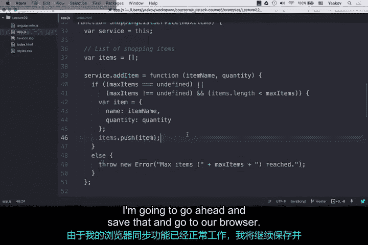
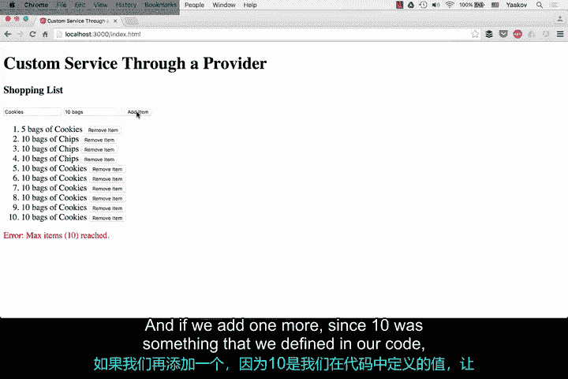
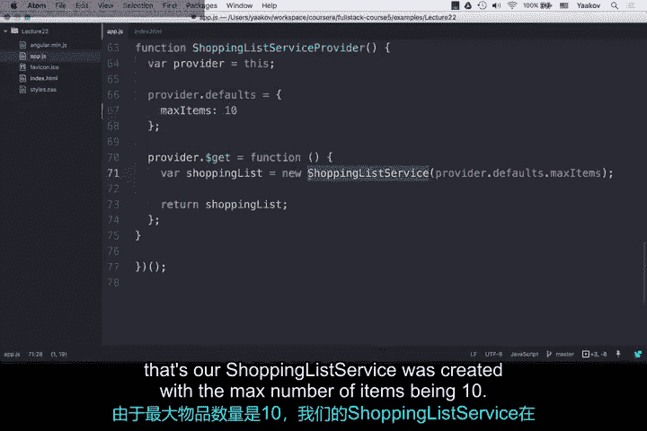
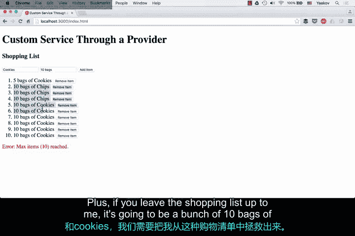
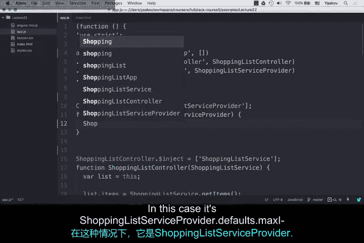
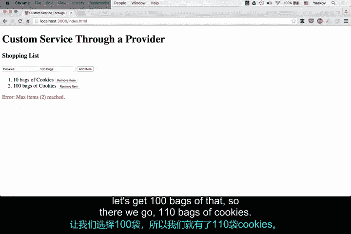
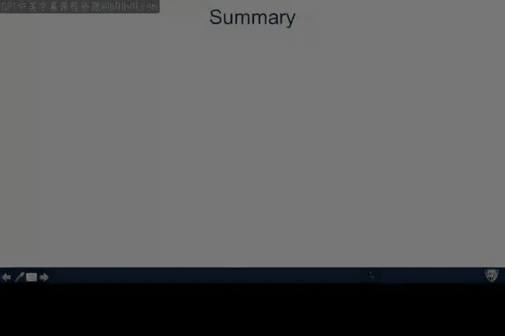
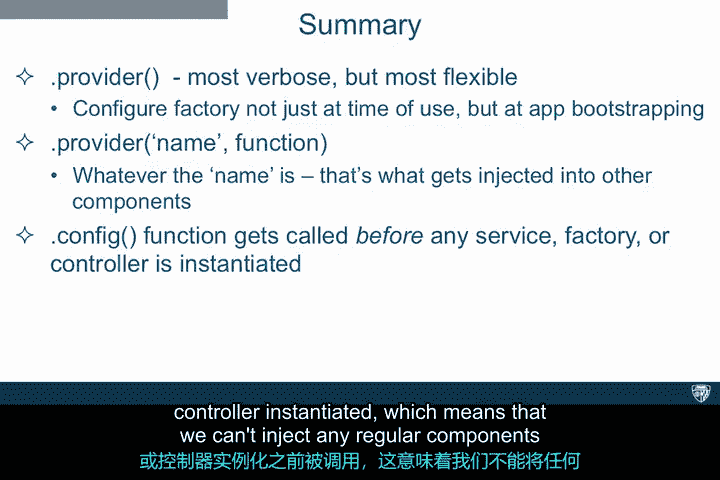

# 约翰霍普金斯大学《使用 AngularJS 开发单页 Web 应用｜Single Page Web Applications with AngularJS》中英 - P44：43_第22讲（第2部分）：使用提供者创建自定义服务.zh_en - GPT中英字幕课程资源 - BV1dsFDeZEQr

🎼。

Okay I'm back in my code editor and I'm located in lecture 22 folder。

 which is inside fulltag dash courseourse 5 Exles folder。

 and here we have again our shopping list app and it actually looks just about the same as our shopping list app that we used in the factory lecture。

😊，So we have a couple of input fields， text fields that we're going to be typing in the item name and item quantity and we'll be able to click the add item button and that will immediately get displayed in our ordered list that is powered here by the NG repeat directive however this time our shopping list service is going to be created using a provider let's go ahead and take a look let's go to app。

gs scroll O we' right here and we could see here that we have a dot provider instead of that service or do factory and the name of our service again that's not the provider it's the name of the service that we're going to be using it' called shopping list service and the name of the provider function is called shopping list service provider so I just tacked on the provider name on there just so it would be clear even though the name of this function makes absolutely no difference let's go ahead and scroll down all the way to see what our shopping list service provider function looks like。

😊，You can see it's very similar to what we had in the slides and the most important thing here is is that we're basically assigning this keyword to the local variable called provider and then we're attaching the dollar sign Git property to the instance of our shopping list service provider right that's really a substitute for this that dollar sign G and that is a function that's going to create our shopping list service and going to return our shopping list service to whoever is asking for it。

😊，Now what we've also done here is we created a default object that has a max items of 10。

 So when we create our shopping list service， we simply look up the provider that defaults that max items to create a shopping list that is going to allow only 10 items inside of it So let's take a look at our controller。

 it shouldn't be really anything different than we've had before。

 our controller shopping list controller is going to inject notice it is injecting the shopping list service。

 not shopping list provider but shopping list service。

 meaning the service name that we gave to our service when we declare the provider because the providers provide service or is a factory that provides a service and the rest of it is basically about the same we're injecting that shopping list service here and we're getting the items straight from the shopping list service instance that's because we return that instance as part of our generation of the shopping list service and the rest of the code is。

😊，Exactly the same we add the item making sure that we are not exceeding the number of items。

 the max number of items because if we do， we're gonna throw an error from inside the shopping list service itself and we're gonna to catch that error right here displaying that error message on our list this error message property that is going to get attached to the instance of the controller because once again we're using controller as syntax and the remove is exactly the same as before the shopping list service itself is once again identical to what we had in the previous lecture it just has some special logic to make sure that the max items are defined and if they are defined the number of items in our items array is less than the max items otherwise we are not going to push a new item onto the items array instead which is going to throw an error saying the max number of items has been reached So since I have my browser sync already working I'm going to go ahead and save that and。

Go to our browser。 And here I have my shopping list， and I could start saying cookies。

5 bags of cookies。 and we'll add that item， and we'll say chips again。

 and we'll take 10 bags of that。Okay， great， in fact， let's add a couple more 10 bags of chips。

 as you can see we could add quite a bit here， you know， we could do more cookies again。

And let's get 10 bags of cookies and we could keep adding this until we hit 10 if we add one more。

 since 10 was something that we defined in our code。

 let's go back and take a look at our provider since the max number of items was 10 that's our shopping list service was created with the max number of items being 10 therefore when we see our browser way up to 10 if we try to add anymore more。

 it's going to throw an exception， the exception is going to get caught inside of the controller and the controller is going to set this error message to be displayed in the browser。

Okay， so the one thing we haven't done is we haven't really configured it ourselves。

 We're relying on the default values。 Plus if you leave the shopping list up to me。

 it's going to be a bunch of 10 bags of chips and cookies and we need to save me from this type of shopping list。

 So let's go ahead and limit our shopping list to much less than 10 items in the list。

 Let's limit like to2。 So let's go back to our definition when we're defining our module and we'll go ahead and define one more function called config and we'll call our configuration function config。

 for lack of creativity， which probably doesn't need to be here。

 So let's go ahead and define our config function。 The first thing we need to do is define our injector array and that injector array is going to have our shopping list service。

😊。

Followed by the word provider。Okay， now that we did that。

 we could actually define a function that is going to be called config and what we're passing in here is shopping list service。

 the same thing that we declare the provider with plus the word provider， the strength provider Okay。

 so once we define that we can now go ahead and get at the provider properties In this case。

 it's shopping list service provider do default do max items。😊。

And let's limit it to two。 So now for the duration of the entire application。

 the shopping list is going to be limited to the max number of items being two。

 And you know here we could say save yaca from。Himself， okay。

 let's go back to the browser and let's go ahead and try to get cookies。 Let's get 10 bags of that。

And here we could add 10 bags of cookies， let's get another 10 bags of cookies。

 And if we try to get yet another 10 bags of cookies。

 it doesn't work because we only limited our shopping list service to have only two items in our shopping list to save yaov from himself。

 However， that doesn't really work since I could just remove that and say let's get 100 bags of that。

 So there we go 110 bags of cookies。 So that whole saving thing didn't really work at all。😊。

So let's summarize。Among the service and factory type of functions。

 the provider one is the most verbose， but it's also the most flexible of them all。

 and that's because you could configure a factory not just at the time of use。

 but also at app bootstrapping before the entire application even starts。

The way the provider works is you give it the name of the service that you will be using and the provider function。

 the function that is the provider， that function has to have a dollar sign get property as part of its instance whatever the name is。

 that's what gets injected into other components， not the provider。

 but the actual name in this the string name that is given in the dot provider function。

The dot config function， which is optional， but very often used。

 is the one that gets called before any service factory control instantiated。

 which means that we can't inject any regular components into the dot config function like other services of factories。

 but we can inject the provider of the service by simply putting the name of the service and appending the string provider at the end of it and that is the service that we inject into the config function that we're able to configure our provider such that the factory that produces some service is configured only once at the beginning of our application。

😊。

