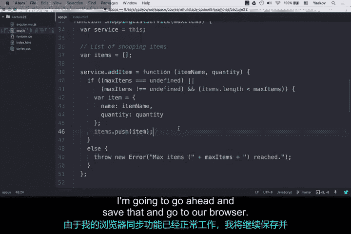
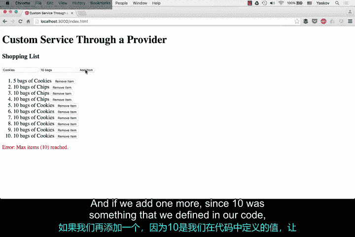
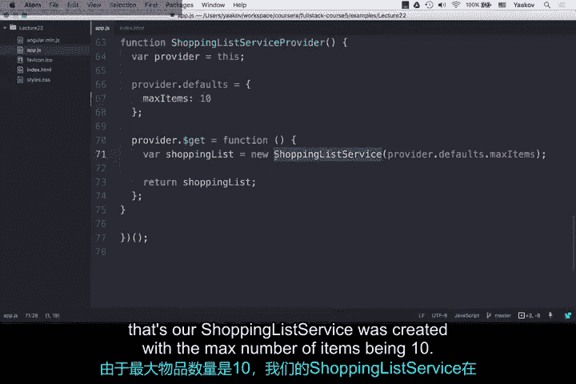
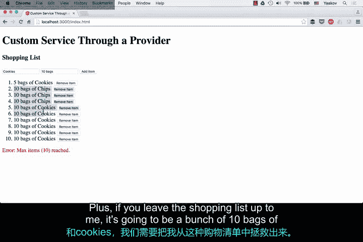
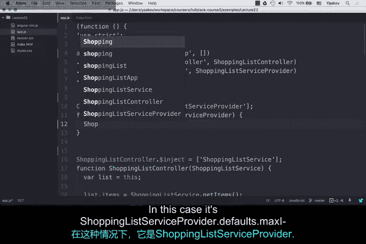
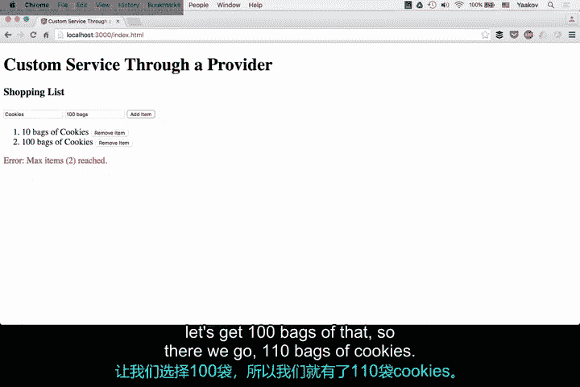
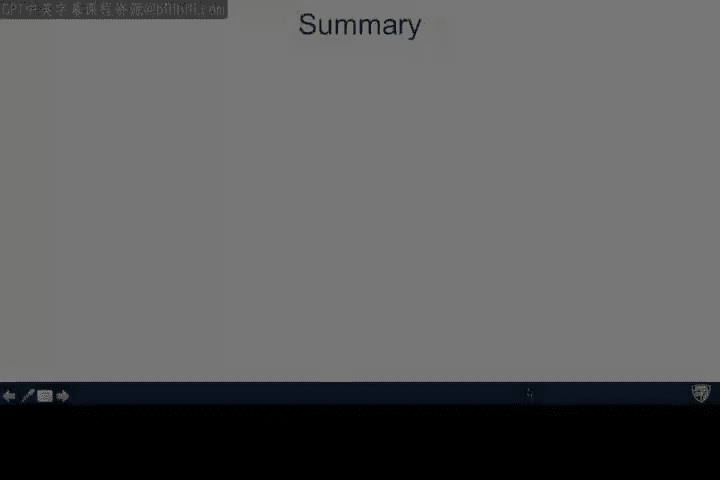
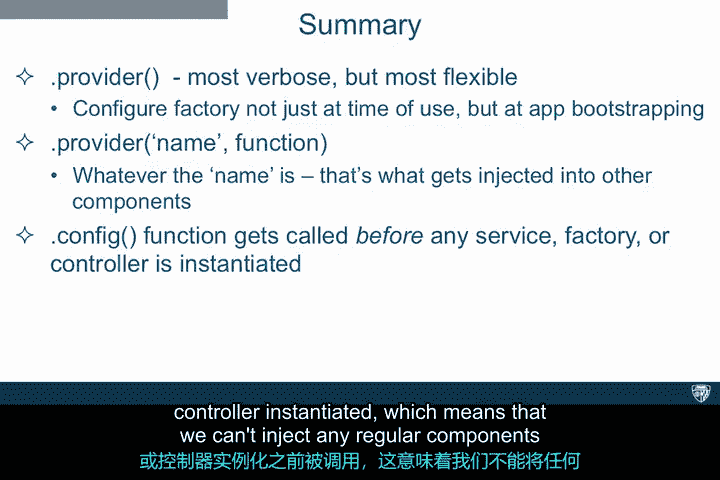

# 使用 AngularJS 开发单页 Web 应用：22：使用提供者创建自定义服务（第2部分）


在本节课中，我们将学习如何使用 AngularJS 中的 `provider` 来创建自定义服务。`provider` 是创建服务最灵活的方式，它允许我们在应用启动前进行配置。

## 项目概览

我们回到代码编辑器中，位于 `lecture 22` 文件夹内。这里有一个购物清单应用，其界面与之前使用 `factory` 创建服务的应用看起来几乎相同。

应用包含两个输入框，用于输入商品名称和数量。点击“添加商品”按钮后，商品会通过 `ng-repeat` 指令立即显示在列表中。但这次，我们的购物清单服务将使用 `provider` 来创建。

## 查看服务提供者

让我们查看 `app.js` 文件。可以看到，这里使用了 `.provider` 方法，而不是 `.service` 或 `.factory`。

```javascript
.provider('ShoppingListService', function ShoppingListServiceProvider() {
  // 提供者逻辑
})
```

服务名称是 `ShoppingListService`，提供者函数名是 `ShoppingListServiceProvider`。函数名本身并不重要，但加上 `Provider` 后缀可以使其更清晰。

向下滚动，查看 `ShoppingListServiceProvider` 函数的具体实现。

```javascript
var provider = this;
provider.defaults = {
  maxItems: 10
};
provider.$get = function () {
  // 创建并返回服务实例的逻辑
};
```

这里的关键是，我们将 `this` 关键字赋值给局部变量 `provider`，然后为这个提供者实例附加一个 `$get` 属性。`$get` 是一个函数，它负责创建并返回 `ShoppingListService` 的实例给任何请求该服务的地方。

我们还创建了一个默认对象，其 `maxItems` 属性值为 10。这意味着，当创建购物清单服务时，它会默认限制清单中最多只能有 10 件商品。

## 控制器中的服务注入



接下来，我们看看控制器。控制器 `ShoppingListController` 注入了 `ShoppingListService`（注意，注入的是服务名，而不是提供者名）。

```javascript
.controller('ShoppingListController', ['ShoppingListService', function(ShoppingListService) {
  var ctrl = this;
  ctrl.items = ShoppingListService.getItems();
  // ... 其他控制器逻辑
}])
```

控制器从 `ShoppingListService` 实例中获取商品列表。这是因为我们在生成服务时返回了该实例。控制器的其余代码，如添加商品（确保不超过最大数量）和错误处理逻辑，与之前完全相同。





## 在浏览器中测试应用

保存代码后，我们可以在浏览器中看到购物清单应用。我们可以尝试添加商品，例如“饼干，5袋”。当添加的商品数量接近默认的最大值 10 时，如果我们尝试添加第 11 件商品，服务内部会抛出一个错误。控制器会捕获这个错误，并将错误信息显示在页面上。

## 配置提供者



目前，我们依赖的是提供者的默认配置（`maxItems: 10`）。但我们可以通过 `config` 函数在应用启动前对其进行配置。

让我们修改模块定义，添加一个 `config` 函数。



```javascript
.config(function (ShoppingListServiceProvider) {
  ShoppingListServiceProvider.defaults.maxItems = 2;
})
```

以下是配置步骤：
1.  定义 `config` 函数。
2.  在注入数组中声明 `ShoppingListServiceProvider`（服务名 + `Provider` 后缀）。
3.  在 `config` 函数中，我们可以访问提供者的属性。在这里，我们将 `maxItems` 的值修改为 2。

现在，在整个应用的生命周期内，购物清单服务最多只允许包含 2 件商品。





回到浏览器测试，添加两件商品后，再尝试添加第三件，就会看到错误提示。当然，我们可以通过移除已有商品来继续添加新商品，所以这个配置并不能完全“阻止”购物，但展示了配置的能力。

## 总结

本节课我们一起学习了如何使用 AngularJS 的 `provider` 来创建和配置自定义服务。

在 `service`、`factory` 和 `provider` 这三种创建服务的方式中，`provider` 的写法最繁琐，但也是最灵活的。它的灵活性在于，不仅可以在使用时配置，还可以在应用启动引导阶段、任何其他组件实例化之前进行配置。

`provider` 的工作原理是：
*   你提供一个服务名称和一个提供者函数。
*   提供者函数必须在其实例上拥有一个 `$get` 属性，该属性是一个函数，用于创建并返回最终的服务实例。
*   其他组件注入的是服务名称对应的实例，而不是提供者本身。
*   可选的 `.config` 函数在服务、工厂或控制器实例化之前被调用。因此，我们不能在 `config` 函数中注入常规的服务或工厂实例，但可以通过在服务名后附加 `Provider` 字符串来注入该服务的提供者。这样，我们就能在应用开始时一次性配置好生产服务的工厂。




通过 `provider`，我们能够实现应用级别的、一次性的服务配置，这是构建复杂、可配置 AngularJS 应用的重要工具。