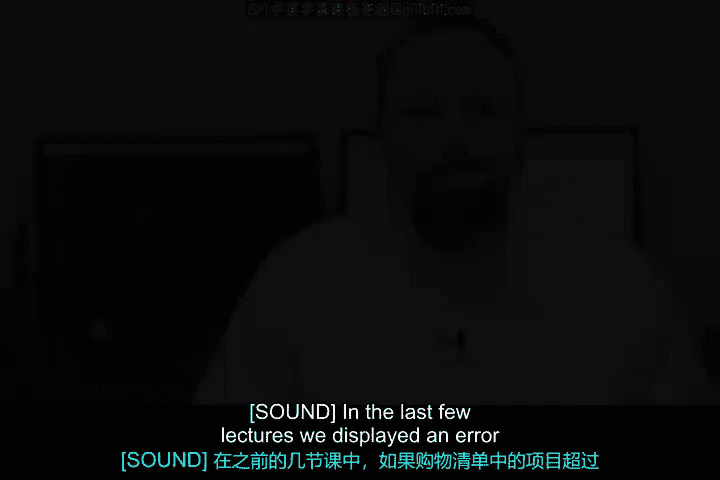
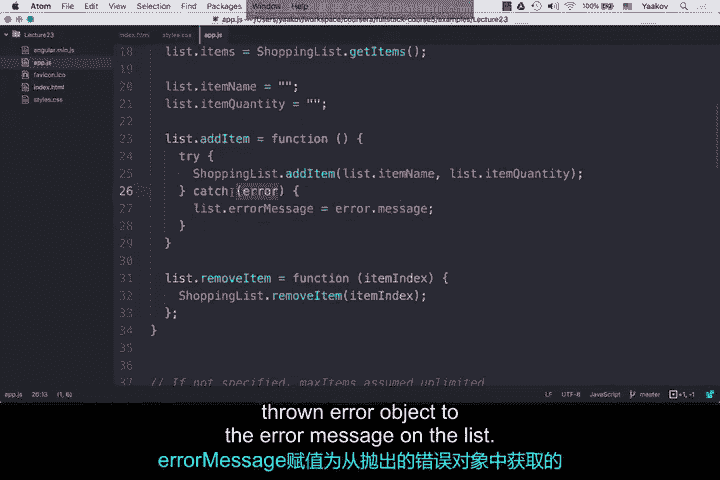
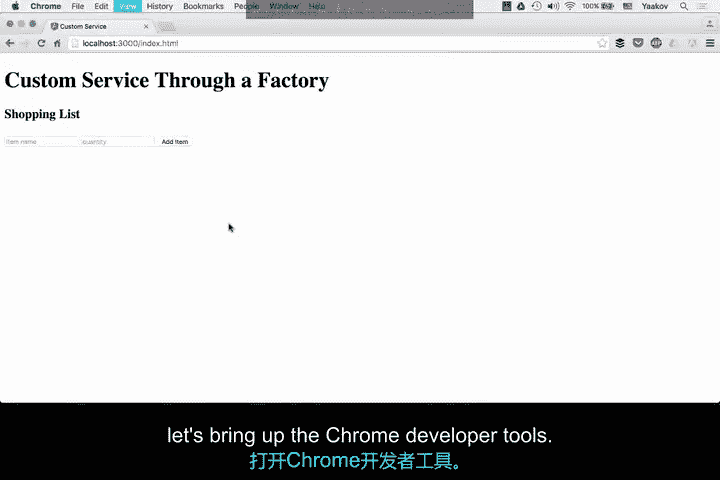
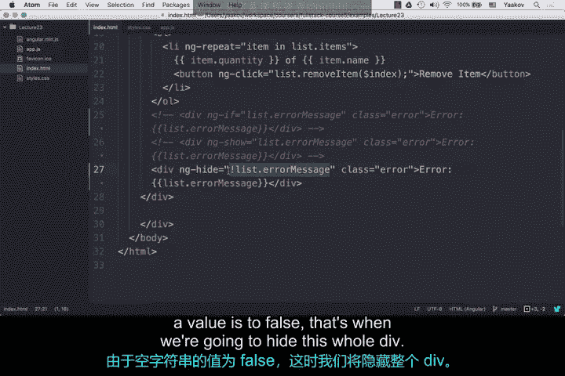
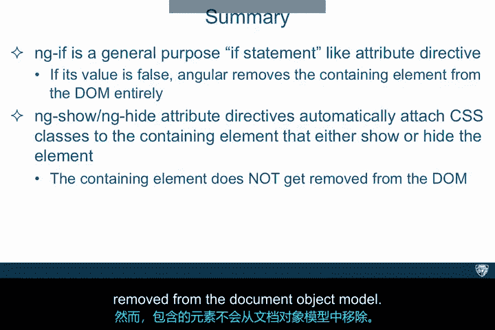

# 约翰霍普金斯大学《使用 AngularJS 开发单页 Web 应用｜Single Page Web Applications with AngularJS》中英 - P45：44_第23讲：ng-if、ng-show和ng-hide.zh_en - GPT中英字幕课程资源 - BV1dsFDeZEQr

🎼。

In the last few lectures， we displayed an error message if the shopping list exceeded a certain number of items。

The error message was a property attached to the controller instance。

 which itself is attached to the scope service。However we displayed the error label at all times if there was no error。

 we simply displayed an empty string next to the label what we would really like to do is hide the entire containing div if there is no error message and show it if there is one we have seen Angular directives like NG controller AnG app NG repeatat in this lecture we'll take a look at another few directives called NG if NG show and NHide。

😊，There is not much theory behind these directives。

 so let's go straight to the code and see how they work。

Okay we're back in our editor and we're in the folder， lecture 23。

 which is located in fullt Cose 5 examples folder and this is our shopping list app that we've seen before and we have one controller here called shopping list controller and we're using controller as syntax to have a label called list for it for the inside of the controller body As you remember when the user clicks on the add item button if the items array inside the shopping list service exceeds a certain number of maximum items it will throw an exception let's take a look at that code and appjs So if we scroll down here to the list that add item you'll see that if this particular statement throws an exception we're going to catch that error and we're going to assign list that error message we'll assign the error message from that thrownrone error object to the error message on the list So if we go back to index that HTML you'll see that we're displaying here displaying the word error。

 the label error。

And then displaying the message that is supposed to come back from the controller As I said。

 what would really like to do is not show this whole div at all if there's no error message Well one way of doing it is to use the NG if directive the NG of directive takes a condition as its value if that condition is true the entire div is shown if that condition is false Val's to false then Angular Js takes the entire div out of the DOm tree in other words is as if this div does not exist in our HTML Let's go ahead and save that and go to our browser and we could see here let's bring up the Chrome developer tools。

😊。

And we'll go to elements。Let's take a look to see if we could see that div in our HTML so if we open that up。

 we could see here that instead of our div right after the ordered list， we see the comment。

 the HTML comment called NG if list error message and you can see it's commented out there is no div existing and the reason there's no div existing is because list that error message evaluate it to false however。

 if we start adding at this point we'll just add some bunch of nonsense here。

 we'll start adding some items。😊，And finally， when we add more than five。

 you'll see that that div all of a sudden sprang up into action and it's now part of the dumb the document object model。

 You see the div here， you see the NG if and thats class error and the error is something class that we assigned to it as you could see it's coming from styles thats CSS and that's why the color of our text is red。

 and you can see that the div showed up。However， there's a different way to hide this message。

 Let's go back to our code editor and we'll go to the HTML template and instead of the divff with a Nng if。

 we'll go ahead and comment that out and I have some prewritten code here and we use that right there。

 and what we're using now is we're using Nng show。 EnG show does exactly the same thing as Nng if does。

 except that it will not remove the diviv from the document object model。

 it will simply put special classes on it that Angular will know to have the div hidden。

 let's save that and go back to our browser and let's go ahead and put some bunch of nonsense in here and add five items。

 and we take a look here before we even edit five items We see that the divff is here except it has some Nng hide on it as one of the classes and that is why it is hidden。

 In fact， I'm sure if you look an Nng hide here。 you'll see it says。😊。

y none and that's why it's hidden。 So as we keep adding the the more and more items add one more。

 you'll see that the Nng hide class goes away from this div and therefore it's now showing up in the browser。

Now， the other directive is called Nng hide。 and as you could probably guess it's the exact opposite of Nng show。

 the only difference between Nnghy and Nng show is whether or not it's going to hide or show the element based on the true or false Nng show will hide the element if the value assigned to it is false Nnghy will show the element if the value assigned to it is false and vice versa。

 let's go ahead and save that we could see here that we're putting a condition here not list error message in other words。

 we're going to hide it when list that error message is false and since an empty string evaluate value it to false。

 that's when we're going to hide this whole div let's go back to our browser and it could see if we scroll down here。

 we could see that the divff is still showing up here and again we have Nng hide already applied to this div and that's because this evaluate it。

😊。

To false， false reversed with the exclamation point becomes true so Nng hide is true。

 so it's hiding the div， so again if we put some bunch of nonsense here and add five items。

 you'll see on the sixth item， this Nng hide class will get removed because list that arrow became true。

 the opposite of true is false， so therefore it's no longer hiding our div。So let's summarize。

NGF is a general purpose if statement like attribute directive。If its value is false。

 Angular removes the containing element from the document object model entirely。

 NG show and NngH attribute directives automatically attach CSS classes to the containing element that either show or hide the element depending obviously on their value。

😊，The containing element however， does not get removed from the document object model。

 so if for some reason you still needed to manipulate that element while it's hidden。

 you can do that with NG show and NGHide， but you would not be able to do that with NG if since when its value is false。

 the entire element gets taken out from the document object model。

