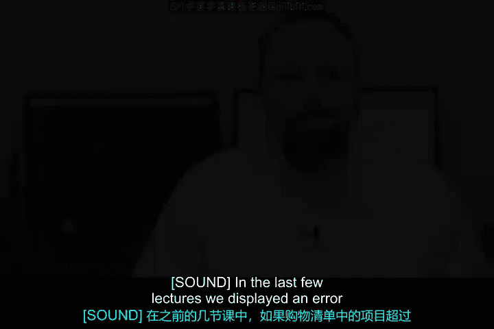
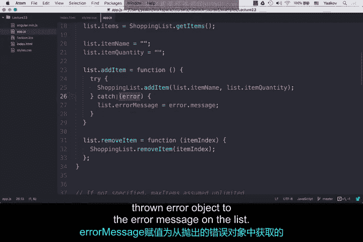
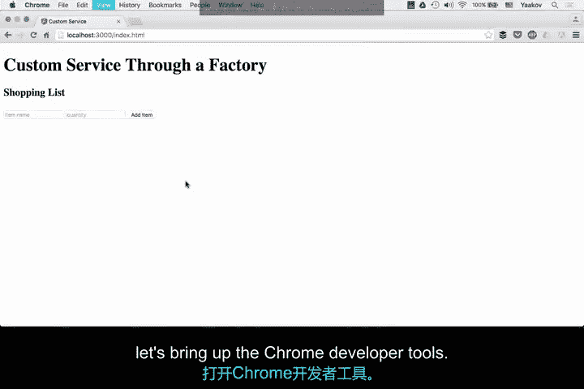
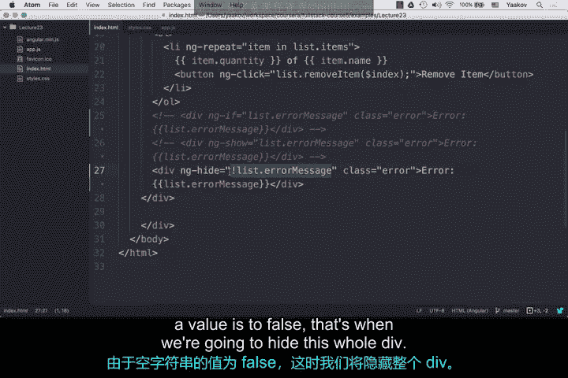
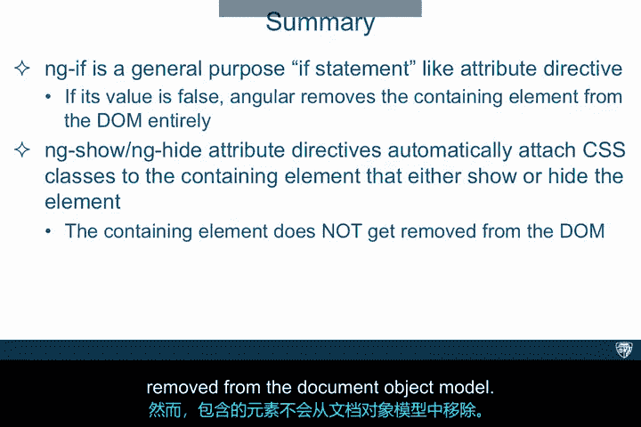

# 使用 AngularJS 开发单页 Web 应用：P45：第23讲：ng-if、ng-show和ng-hide

在本节课中，我们将要学习 AngularJS 中的三个重要指令：`ng-if`、`ng-show` 和 `ng-hide`。这些指令用于根据条件控制 HTML 元素的显示与隐藏。我们将通过一个购物清单应用的例子，详细讲解它们的工作原理、区别以及适用场景。

在之前的几讲中，我们实现了一个功能：当购物清单中的商品数量超过某个上限时，会显示一条错误信息。

这条错误信息是控制器实例的一个属性，而控制器实例本身又附加在作用域服务上。然而，我们之前的方法是无条件地显示错误标签。如果没有错误，我们只是在标签旁边显示一个空字符串。

我们真正希望实现的是：如果没有错误信息，就隐藏整个包含错误信息的 `div` 元素；如果有错误信息，则显示它。我们已经学习过像 `ng-controller`、`ng-app`、`ng-repeat` 这样的 Angular 指令。在本讲中，我们将学习另外几个指令：`ng-if`、`ng-show` 和 `ng-hide`。

这些指令背后的理论并不复杂，所以让我们直接看代码，了解它们是如何工作的。

## 代码示例：购物清单应用

我们回到代码编辑器，进入 `lecture23` 文件夹，它位于 `full-course-5-examples` 目录中。这是我们之前见过的购物清单应用。

这里有一个名为 `ShoppingListController` 的控制器。我们使用 `controller as` 语法，在控制器内部将其命名为 `list`。

正如你所记得的，当用户点击“添加商品”按钮时，如果购物清单服务内部的 `items` 数组超过了设定的最大商品数量，服务会抛出一个异常。让我们在 `app.js` 中查看一下相关代码。

向下滚动到 `addItem` 方法，你会看到，如果特定语句抛出异常，我们会捕获这个错误，并将错误对象中的信息赋值给 `list.errorMessage`。

回到 `index.html`，你会看到我们在这里显示了“Error”标签，然后显示从控制器返回的错误信息。

如前所述，我们真正想做的是：如果没有错误信息，就完全不显示这个 `div`。

## 使用 `ng-if` 指令

实现这个目标的一种方法是使用 `ng-if` 指令。`ng-if` 指令将一个条件作为其值。如果该条件为真（`true`），则显示整个 `div`；如果条件为假（`false`），AngularJS 会将整个 `div` 从 DOM 树中移除。换句话说，就好像这个 `div` 在我们的 HTML 中不存在一样。

让我们保存修改，然后打开浏览器查看效果。打开 Chrome 开发者工具，切换到“元素”面板。

查看我们的 HTML，可以看到在有序列表之后，我们没有看到 `div`，而是看到一个名为 `<!-- ngIf: list.errorMessage -->` 的 HTML 注释。这个 `div` 不存在，因为 `list.errorMessage` 的求值结果为假（`false`）。

然而，如果我们开始添加商品（这里先随意添加一些内容），当添加的商品超过五个时，你会看到那个 `div` 突然出现了，并成为了文档对象模型的一部分。

你可以在这里看到 `div`，看到 `ng-if` 和它的 `class="error"`。这个 `error` 类是我们赋予它的，它来自 `styles.css`，这就是为什么我们的文本颜色是红色的。现在 `div` 显示出来了。

## 使用 `ng-show` 指令

但是，还有另一种隐藏这条信息的方法。让我们回到代码编辑器，在 HTML 模板中，注释掉使用 `ng-if` 的 `div`，并使用一些预先写好的代码。我们现在使用的是 `ng-show`。

`ng-show` 做的事情和 `ng-if` 几乎一样，区别在于它不会将 `div` 从文档对象模型中移除，而是简单地为元素附加特殊的 CSS 类，Angular 会根据这些类来隐藏 `div`。

保存修改，回到浏览器。在添加五个商品之前，我们可以看到 `div` 已经存在，但它有一个 `ng-hide` 类作为其类之一，这就是它被隐藏的原因。实际上，如果你查看 `ng-hide`，会看到它设置了 `display: none`，所以它被隐藏了。

随着我们继续添加商品，当添加第六个商品时，`ng-hide` 类会从这个 `div` 上移除，因此它现在就在浏览器中显示出来了。

## 使用 `ng-hide` 指令

另一个指令叫做 `ng-hide`。你可能已经猜到，它和 `ng-show` 的作用完全相反。

`ng-show` 和 `ng-hide` 的唯一区别在于，它们根据条件的真假来决定是隐藏还是显示元素。`ng-show` 会在其赋值为假（`false`）时隐藏元素；`ng-hide` 则会在其赋值为假（`false`）时显示元素，反之亦然。

让我们保存修改。可以看到，我们在这里设置的条件是 `!list.errorMessage`。换句话说，当 `list.errorMessage` 为假（`false`）时，我们将隐藏这个 `div`。由于空字符串的求值结果为假（`false`），所以这时我们会隐藏整个 `div`。

回到浏览器，向下滚动，可以看到 `div` 仍然存在，并且 `ng-hide` 类已经应用到了这个 `div` 上。这是因为表达式求值为假（`false`），加上感叹号取反后变为真（`true`），所以 `ng-hide` 的条件为真（`true`），它正在隐藏 `div`。

同样，如果我们添加一些商品，在添加第六个商品时，`ng-hide` 类将被移除，因为 `list.errorMessage` 变成了真（`true`），其相反值假（`false`）导致它不再隐藏我们的 `div`。

## 总结

本节课中我们一起学习了 AngularJS 中控制元素显示与隐藏的三个指令。

*   **`ng-if`**：这是一个通用的条件判断属性指令。如果其值为假（`false`），Angular 会将包含它的元素从文档对象模型中完全移除。
*   **`ng-show` 和 `ng-hide`**：这些属性指令会自动将 CSS 类附加到包含元素上，根据其值的真假来决定是显示还是隐藏元素。然而，包含元素并不会从文档对象模型中被移除。

因此，如果你出于某些原因需要在元素隐藏时仍然能够操作它，可以使用 `ng-show` 或 `ng-hide`。但使用 `ng-if` 则无法做到这一点，因为当其值为假时，整个元素会从文档对象模型中被移除。

