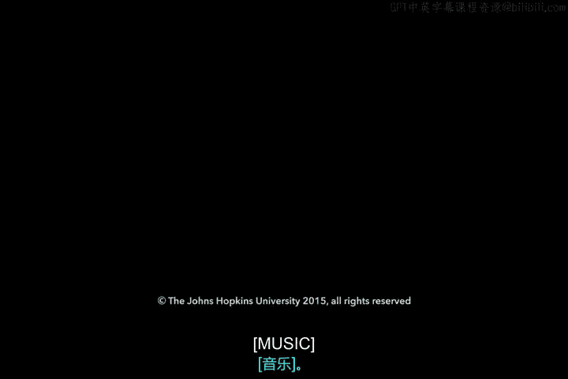

# 约翰霍普金斯大学《使用 AngularJS 开发单页 Web 应用｜Single Page Web Applications with AngularJS》中英 - P46：45_模块2总结.zh_en - GPT中英字幕课程资源 - BV1dsFDeZEQr

🎼。

🎼The。🎼Yeah。🎼，Congratulations on finishing module2， time for a short reflection。

🎼If you have followed me in understanding the concepts behind features taught in this module。

 you're already ahead of a lot of Angular JS developers that simply mess around with Angular features without understanding why they work the way they do that's not a small accomplishment and you should be proud of yourself for that。

Take a quick look back， it's only module2 and you already know quite a bit。So don't stop here。

 keep going to module3 there's much more fun ahead I promise oh。

 and if you haven't visited our Facebook page at Facebookbook。com/coserawebdeap。

 please click on the link below the video and like our page。Oh。

 and if you have followed my cookie advice and ate the whole bag of cookies， congratulations。

 you have gained much more than Angular JS knowledge in this module。All right， that's over。

And if you have followed my advice。By taking a bag of cookies at the beginning of this module。

You gained much more than just Angular JS knowledge。You gained some weight。I'm busy recording。Oh。

Can you put cookies in the shopping list， I think we're going to be out soon。哎。that。

Is that thing still recording？🎼，🎼。

