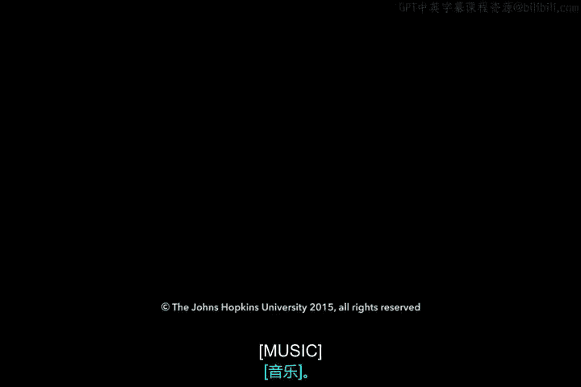

# 约翰霍普金斯大学《使用 AngularJS 开发单页 Web 应用｜Single Page Web Applications with AngularJS》中英 - P47：46_欢迎进入模块3.zh_en - GPT中英字幕课程资源 - BV1dsFDeZEQr

🎼。

🎼The。🎼。🎼We。🎼，Welcome to module 3。🎼这个ね现在的。That's better。Welcome to moduledule 3。

In this module we'll go over a lot of the essential features of Angular JS。

 we will start with learning about the Promise API。While promises are essential to angular。

 this topic reaches far beyond angular， it's really an essential topic to understanding modern web development with JavaScript。

We'll also learn about making calls to the server through the built and Angular service called the HTP service。

🎼We'll finish off the module by spending a considerable amount of time on the crown feature of Angelngular JS directives。

Directives are really at the core of the entire framework。

They not only allow us to extend the functionality of existing HTML elements。

 which is already pretty amazing in and of itself， but they also allow us to create our own elements with custom view and custom behavior。

Pretty exciting stuff。🎼CN的 module。🎼。

