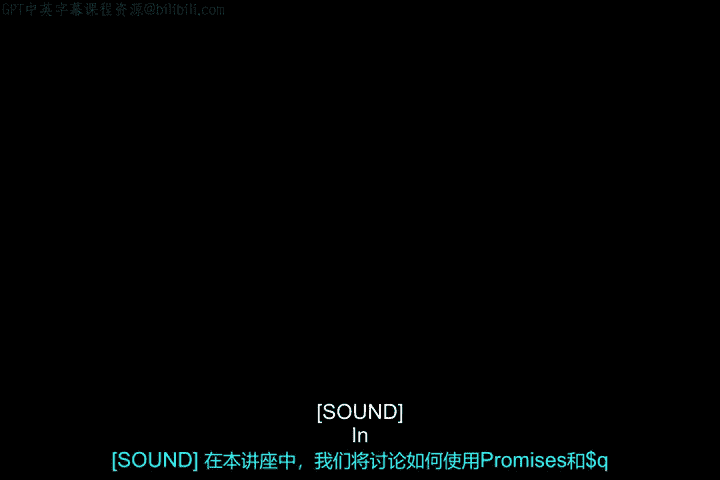
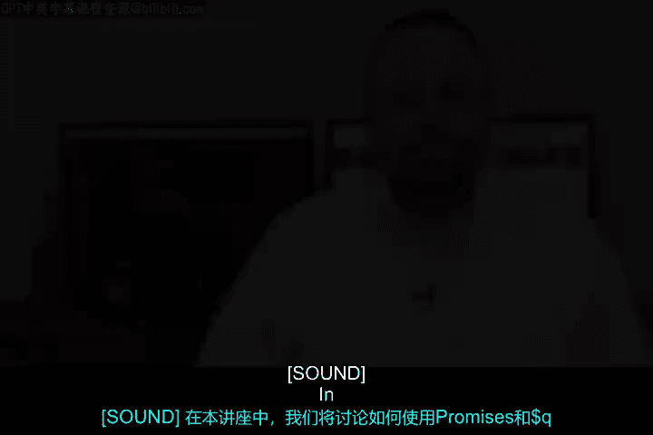
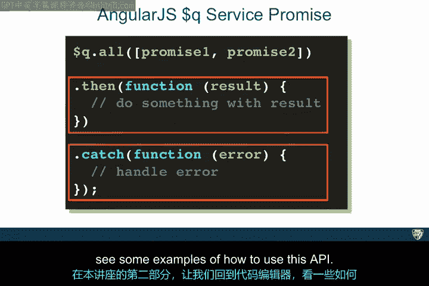

# 约翰霍普金斯大学《使用 AngularJS 开发单页 Web 应用｜Single Page Web Applications with AngularJS》中英 - P48：47_第24讲（第1部分）：使用Promise和$q的异步行为.zh_en - GPT中英字幕课程资源 - BV1dsFDeZEQr

🎼。

In this lecture， we're going to talk about coding and dealing with asynchronous behavior with promises and the dollar sign Q service。

Before promises we had callbacks and we actually still do and the way you would execute asynchronous behavior is you would have some asynchronous function and you would pass as an argument。

 a function value that would get executed once the asynchronous behavior was complete The problem with this model is that there's not really an easy and straightforward way to pass the results of the asynchronous function back to the caller Now this is especially if the real recipient of the result is a few layers away In other words。

 one service can call some other service and that service may call your asynchronous function the result should really propagate all the way to the top function if that's what you choose but it's very hard to achieve this with the callbe approach。

In addition， what would happen if you needed to chain a few asynchronous pieces of behavior together。

 for example， when asynchronous function 1 would complete。

 instead of returning the value you would still have to call asynchronous function 2。

 when that would complete you would finally call asynchronous function 3 and only then deal with all the results combined together。

Right off to bat， you could see that it's very hard to read this code and that's not even showing the error handling with error handling。

 this would look like a complete mess。 Also what if we wanted all these asynchronous functions to execute in parallel and then if every code succeeded。

 execute our logic， but even if one failed， fail all of them and execute some error handling that's not a very trivial thing to accomplish with a coldbe approach。

 but with a promise API we can actually get all these things accomplished fairly easily。😊。

The Promise API is actually part of the new ES6 API， however。

 not all browsers implement ES6 API just yet， so Promise object might not be available。

 but Angular JS implements its own Promise API that is very similar to the one that's coming in ES6。

So what is a promise， a promise is an object which can be passed around or returned that holds references to the outcome of asynchronous behavior in angular promises are created through the special service called the Doar sign Q service。

Let's take a look at some templates as to how you would go about doing that。

So here we have an asynchronous function， and the very first thing we would do is call the dollar sign Q that defer method。

😊，That service creates an object that represents the asynchronous environment with all the hooks into it。

 including the promise object。Then after we implement some behavior。

 that object has a special method calledResolve that marks a successful completion of our execution and then wraps the data for the promise to retrieve later on。

In this case， we're wrapping the result object of some result as part of our resolve method。

If something goes wrong， we could call Defer that reject。

 which will mark unsuccessful completion and will also wrap some data for the promise。

 in this case it will be probably some error object or some error message。

Last but certainly not least， we have to return our promise to the color of this function。

 so therefore we would say return deferred that promise that sends back the promise object to the color。

 which is really a hook back to the life cycle of this entire process。

Now remember that even though this sample code looks synchronous and it probably is looking at it right now。

 the parts that ultimately call Defer dot resolvesve and deferred dot reject can be part of something that truly runs asynchronously。

 for example， if we wanted to simulate that in this example。

 we could wrap the highlighted lines of code in a set timeout function。😊。

The next step is for the caller to call our asynchronous function and to capture a reference to the promise object。

 you can clearly see here that a promise is something I could pass around into other APIs in my application。

😊，Then wherever in my application is appropriate， I could call the then function on my promise and extract the results or handle the error。

Note that the then function takes two arguments， both of which are functions themselves。

 the argument that the Proise API will send into these functions is what we resolved or rejected the deferred object with accordingly。

 obviously here I'm referring to the result object and the error object which could be just a simple string。

The then function is also chainable because it itself returns a promise will demonstrate the power of this chainability in an example of part two of this lecture。

😊，The Q service also has the capabilities to resolve multiple promises asynchronously。

 so no promises to wait for another to complete in order to even start running。

The Dallas S Q O method accomplishes that plus the ability to have a central place to handle all of the results or to handle any errors that come from any of the promises。

In part two of this lecture， let's go back to the code editor and see some examples of how to use this API。

😊。

