# 约翰霍普金斯大学《使用 AngularJS 开发单页 Web 应用｜Single Page Web Applications with AngularJS》中英 - P49：48_第24讲（第2部分）：使用Promise和$q的异步行为.zh_en - GPT中英字幕课程资源 - BV1dsFDeZEQr

🎼。

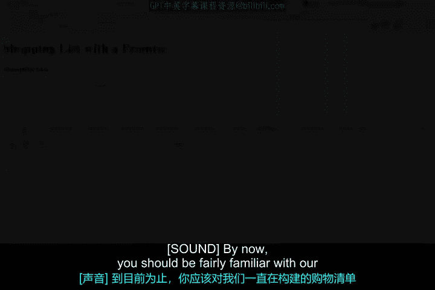

By now， you should be fairly familiar with our shopping list application that we've been building。

 you can enter the name of the item， the quantity of the item。

 click Add item and it will appear in a list right below this form。

In this version of the shopping list， number one is we're going to assume that the quantity is actually just a number。

 and that's why I put the word boxes right here to signify so many boxes。 And number two。

 in order to prevent me from gaining weight。 We're going to have a special service that' is going to examine the item name and make sure there is no word cookie in it。

 if there is it will prevent me from adding that item to my shopping list。 Likewise。

 we will also examine the quantity and if the quantity is anything greater than five。

 the service will likewise prevent me from putting that item on the list。

 Now since analyzing the item name could be a very complicated process and therefore can take a long time。

 we're going to implement that in an asynchronous fashion Analy the quantity will also be asynchronous What that will mean is that when we click add item the item will not immediately appear below the form but will first get analyzed and then decide whether or not it should even appear。

😊，If it does， only then will it appear a couple of seconds later。

 Let's take a look as to how I implemented that。

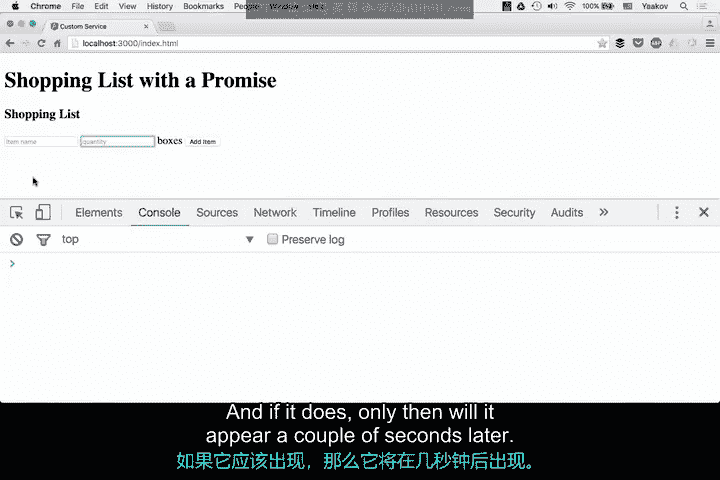

Okay， so I'm in my Adam editor and I'm located in lecture 24 folder。

 which is in fulltag dash course 5 examples folder and this is our shopping list Promise app and as you've seen before is just one controller with two bound text boxes for item name and item quantity and a button that's bound to list that add item right below that we have our ordered list that will go ahead and loop through our items。

 our item array and well give us the quantity boxes of the name of the item and a button to remove that from the list Let's take a look at our app do Js。

In our AbdaGs besides decing the controller and the shopping list service。

 we also declare one more service called weightight loss filter service Well let's take a look at the shopping list service first because that is what our controller is going to directly invoke So here's our shopping list service and you can see we're injecting it with this service called weight loss filter service don't worry about the dollar sign Q for now we're not going to be using it for now but we will use it in a minute。

So you could see that the add item method inside of our shopping list service is something that's using asynchronous behavior by calling weightlofilterservice。

 check name So what we're doing is we're checking the name to make sure that we're allowed to put that on our shopping list so we could use the then method and say promise then and get the response and before we use the response we want to make sure that the quantity is likewise acceptable so we're going to call the weight loss filter service again inside of our then function。

 the success then function and we're going to get the next promise the next promise then we'll call the then function again and only then if that everything is checking out we will go ahead and push that new item that we're going to create onto our items array if this next promise fails for whatever reason we're going to go ahead and output the error message to the console Likewise if the outer problem。

😊，fails， we're going to do the same thing。 we're going to output the error message to the console so far。

 so good， let's go and check out our weight loss filter service we scroll down。😊。

There's lots of commented out code， but here's the weight loss filter service and it depends on the Q service and the timeout service。

 the timeout service is the same as the set timeout of JavaScript except it's angularized so you don't have to manually call Do sign apply or Do sign digestigest。

Here's our method check name， and the check name method first acquires our deferred object that contains the environment for the entire asynchronous behavior and sets up this result with a simple message which in this case is just an empty message so far。

Then we're going to go ahead and execute our timeout function that's going to simulate our asynchronous behavior and we're going to do this very complicated algorithm of figuring out whether or not yaakov is trying to put anything that has to do with cookies as part of his shopping list basically we're not really doing anything complex I was just joking oh we're going to do is we're going to lowercase the name the item name and then see if the word cookie appears anywhere in that name and if it does not appear。

 then we'll go ahead and resolve it beating it's going to be successful with the result which in this case is just an empty object really with just one message property that is an empty message however。

 if we find a cookie as part of the name of the item we're going to set the result that message to stay away from cookies yaov and then we'll callde that reject which will complete our promise unsuccessfully passing it the result so we could retrieve that error message from there。

😊，Note that what you name these arguments makes absolutely no difference。

 it's just going to get retrieveed from the promise inside of the then function。

 and the timeout is going to wait three seconds before this entire functionality is executed。

Last but not least， we need to return the promise back to the color of this function。

 so they can have a hook to tap into whether that's going to be a rejection of our asynchronous behavior or a resolution of it by resolve or reject method。

Note that the check quality method is basically identical。

 The only difference here is is we're checking the quantity to be less than6 as opposed to checking whether the word cookie appears as part of the item name。

 The only other difference is that we're going to wait only one second instead of three seconds to execute this behavior and the error message is going to say that's too matchiiaov instead of saying stay away from the cookies let's go ahead and save that and go back to our browser and we'll try to put something like chips and we'll say we need three boxes of chips and let's go ahead and click Ed and we'll count about three seconds and another second after that and four seconds later we see that we have three boxes of chips Now let's try to go ahead and get around the system by saying we're going to have cookie flavored。

😊。

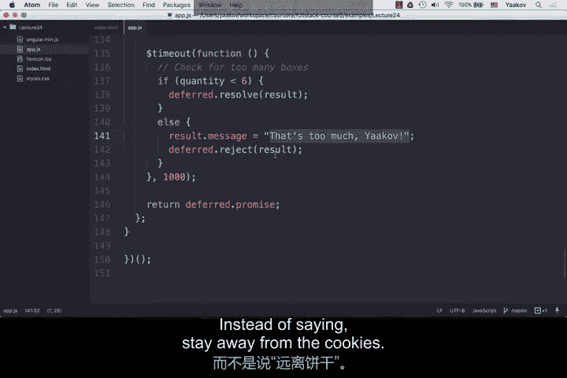

Chhips， and we'll get three boxes of those。 We'll click add add item and。About three seconds later。

 we see that it says stayay away from Cook yaakov in our console and there's no item that is added to our list。

Now what happens if I say chips again， but this time I'll say six。

 so one more than five and click add itemem。It will go ahead and check that cookies are not part of the item list。

 and then it will check and see that six is really greater than five。

 and therefore it's going to say that to muchchiakov it will reject the promise and therefore we're not going to see another item on our list。

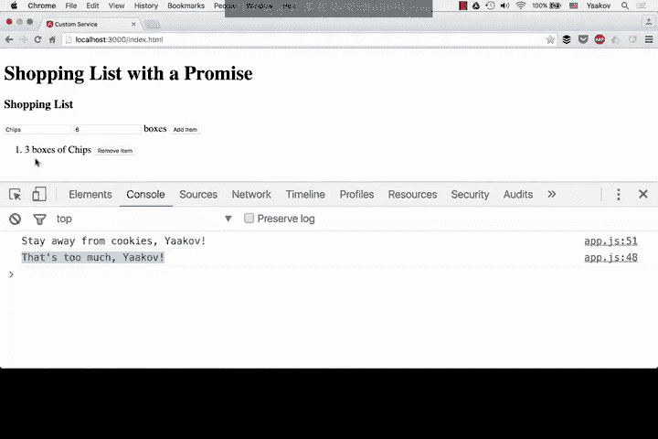

Okay， so so far so good， but let's go back to our code that we use to handle the promise and let's take a look as to how we're handling that promise it's a little bit messy right even though this is not coalbacks。

 it's still kind of looks like coalbacks there's just a lot of indenting and just a lot of code it's hard to understand what's calling what let's go ahead and rewrite this function and make our code much cleaner。

We'll comment this out and I already have a second version of it sitting right here。

 We' unmented and let's go over this code。 This is that same add item method on our shopping list service。

 and I'm still calling the weight loss filter service check name but I'm grabbing this promise。

 And when I call the then method on this promise I don't even supply to it the second function that's supposed to handle an error。

 The reason I don't do that is because if there is an error it will go ahead and bubble up and propagate and I could call the then method on that again which will once again return a promise and then I could call the special method called catch which will get execute it when deferreder that reject gets invoked。

 Now in the original promise that then all I have to do is execute our weight loss filter service to checks the quantity now of my item in the shopping list And since that returns a promise I could just return that which will then get picked up by the next then method。

😊，系。The reason I don't really need to do anything here is because I know that my response object is just an empty object with an empty message。

 In other words， if we're in this code block that means we succeeded and we need to do nothing else other than check the quantity for validity the next then method treats the response the same way because if we got to this code block。

 it means that the check quantity past and we're allowed to add the item or push the item onto our array of shopping list items so note what we did here we no longer have to handle the error condition or the rejection of the promise in every single case we only have to do this once and we could do it centrally so certainly that's much easier to read code and much cleaner let's go ahead and save that and see if this works let's go back to our browser and we'll say cookies we'll give it four boxes of cookies we'll click add and that will be an error condition and therefore stay stay away from cookies。

😊。

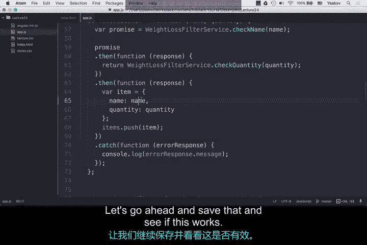

If we say chips。And click Ed about three to four seconds later。

 it should go ahead and add that four boxes of chips， and if we leave it as chips but put。

 let's say seven boxes click Add that will also resolve but resolve with a rejection and then therefore we will say that's to Macko because our catch method right here is catching any errors from any of the promises that were chained above it。

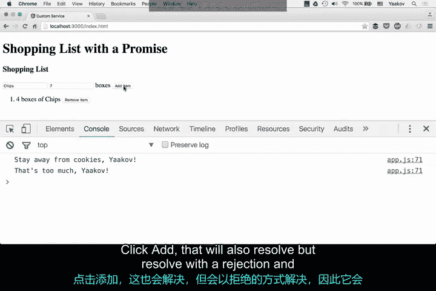

Okay， so far so good， but we can improve it even more。

 let's take a look as to what's going on when we try to add a valid item， but with too many boxes。

 let's go ahead and clear this and click add once again Take a look as to how long that takes takes about four seconds Now why should it take four seconds checking this item takes one second checking this item takes three seconds we know that if either of these items isn't valid I want to go ahead and output and error message and just forget the whole thing about adding it to my list so why should I wait to execute the validation of my number of boxes after I validate it the item name they really should be execute it in parallel so let's go ahead and code that up。

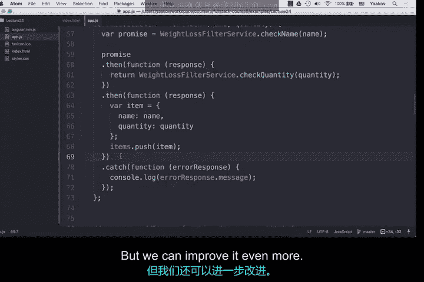

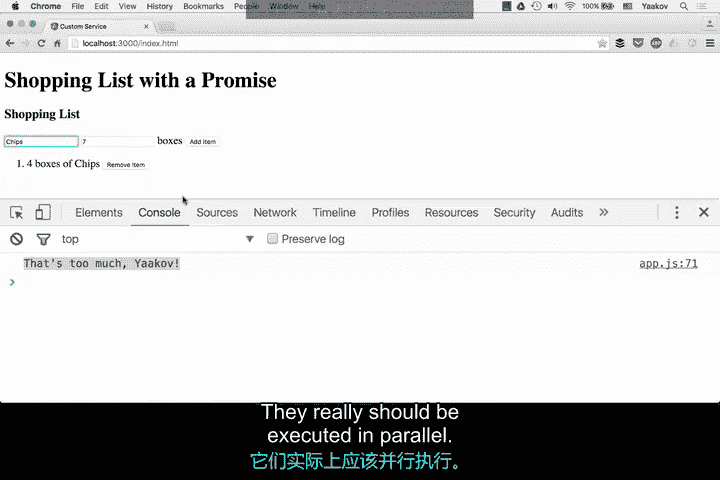

Let's go back。And we'll go ahead and once again comment out this version of the add item method and un yet another version of the add item method and this one does both things in parallel。

 and the way we do that is by capturing the name promise。

 which is the return result of the weight loss filter service check name method that returns a promise and then we're going to capture the quantity promise。

 which is the result of executing weight loss filter service check quantity method and here we're going to use our Q service do all。

 and what that takes is an array of promises。 we can then call the then method on that which will only get executed once every single promise in this array is result。

 However， if any of the promises in this array result in a rejection meaning deferred that reject。

All promises will be canceled immediately， and the execution will jump into the catch method。

 outputting this error response message。 That means that if this promise takes much faster to execute and much faster。

 therefore to fail。 than this promise， I don't have to wait for this promise to finish in order for me to just cancel the whole execution and output the message。

 Now， the quantity promise takes about a second to execute。

 Where the name promise takes about three seconds to execute。

 let's go ahead and save that and let's go back to our browser。

 if I now enter chips in here and quantity 3， meaning a valid item with a valid quantity。

 I click add， that will take about three seconds to execute not for since we're doing both validations asynchronously。

 the longer one will run its three seconds。 But by the time it's done。

 the one that takes shorter amount of time would have finished already。 Now， if I enter。😊。

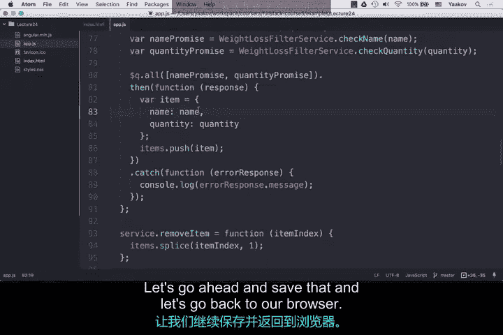

K's in here。That will also take three seconds and three seconds to actually fail and you could see it fails。

 rejects it and says stay away from cookies yaakov and that's also because that's the longer one and therefore the three seconds it took to fail is the old encompassing time but look what happens if I say chips and then enter something invalid like seven for quantity When I click add item take a look how fast that fails。

 it fails almost right away， which about a second later says that's tomat yaakov we could actually do that again click add and you could see that it fails right away。

😊。

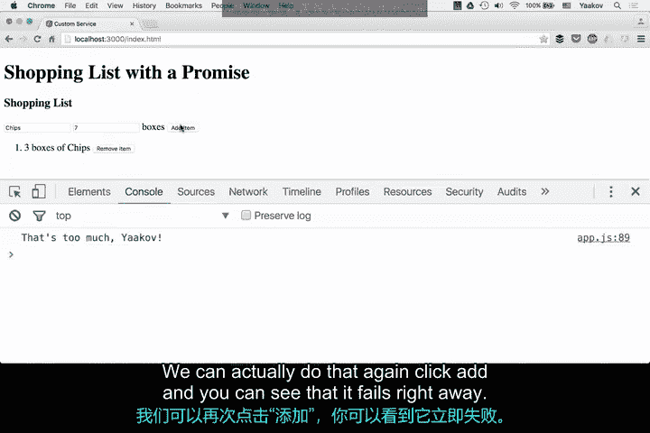

So with the construct of Do sign Q， all we're able to put multiple promises actually as many as we want。

 and they will all try to execute asynchronously making our entire app potentially much faster as well。

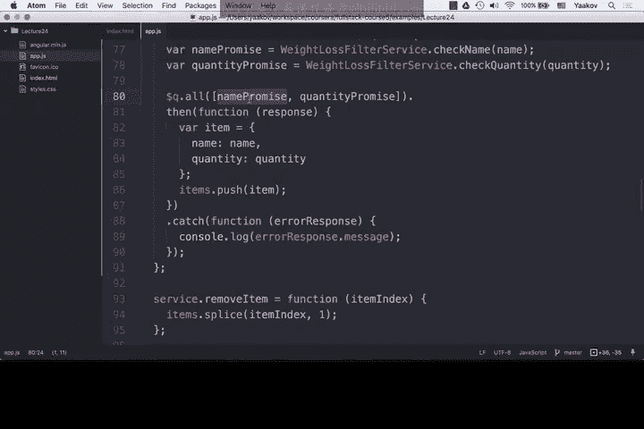

Okay， let's summarize what we learned in this lesson。First of all。

 let's remember that promises give us a lot of flexibility when dealing with asynchronous behavior。

The Q service is the Angular implementation of the Promise API。

 the new implementation of JavaScript ES6 has its own Promise API and will likely use that once it's supported by all the major browsers。

Promises either get resolved or rejected Reol is considered a success and a rejection is considered a failure。

The then method that you could call on the promise takes two arguments。

 both of which have function values。 The first is a function to handle the success or the resolve outcome。

 and the second is a function to handle the error or the reject outcome。 In addition。

 that method itself returns a promise so you could chain it with other promises and make the code a bit more readable as well。

 Finally， we spoke about the Q service O method。 That method allows us to execute multiple promises in parallel。

 making things faster， and at the same time， we're able to handle success and failure of all of those promises in one central place in our code。

😊。

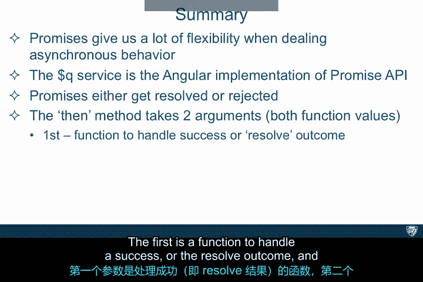

