# 使用 AngularJS 开发单页 Web 应用：P49：第24讲（第2部分）：使用Promise和$q的异步行为 🚀

在本节课中，我们将学习如何在AngularJS应用中使用Promise和`$q`服务来处理异步行为。我们将通过一个购物清单应用的例子，演示如何优雅地管理异步操作，例如验证用户输入，并理解如何通过链式调用和并行执行来优化代码。

---

## 概述

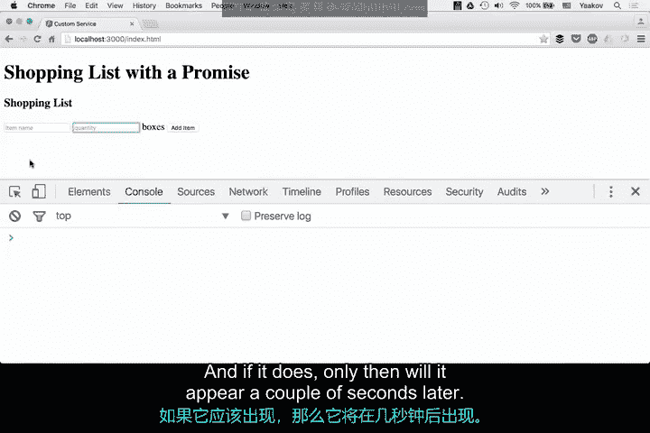

现在，你应该对我们正在构建的购物清单应用相当熟悉了。你可以输入商品名称和数量，点击“添加商品”按钮，商品就会出现在表单下方的列表中。

在这个版本的购物清单应用中，我们有两个关键点：第一，我们假设数量只是一个数字，因此我在这里用“盒”来表示数量。第二，为了防止我增重，我们将使用一个特殊的服务来检查商品名称，确保其中不包含“cookie”这个词。如果包含，该服务将阻止我将该商品添加到购物清单中。同样，我们也会检查数量，如果数量大于5，服务同样会阻止我将该商品添加到列表中。

由于分析商品名称可能是一个非常复杂的过程，因此可能需要很长时间，我们将以异步方式实现它。分析数量也将是异步的。这意味着当我们点击“添加商品”时，商品不会立即出现在表单下方，而是会先被分析，然后决定是否应该出现。如果允许出现，它将在几秒钟后显示。

让我们看看我是如何实现这一点的。

---

## 代码实现分析

我位于`lecture24`文件夹中，这是我们的`shoppingListPromiseApp`。和之前一样，它包含一个控制器，两个用于绑定商品名称和数量的文本框，一个绑定到`addItem`方法的按钮，以及一个有序列表，用于循环遍历商品数组并显示每个商品的数量、名称和一个用于从列表中移除该商品的按钮。

让我们看看`app.js`文件。

在我们的`app.js`中，除了声明控制器和购物清单服务，我们还声明了一个名为`WeightLossFilterService`的服务。我们先看看购物清单服务，因为这是控制器将直接调用的服务。

这是我们的购物清单服务，你可以看到我们注入了这个名为`WeightLossFilterService`的服务。暂时不用担心`$q`服务，我们稍后会用到它。

你可以看到，购物清单服务中的`addItem`方法通过调用`WeightLossFilterService.checkName`来使用异步行为。我们正在检查名称，以确保我们被允许将该商品添加到购物清单中。我们使用`then`方法，获取响应，并在使用响应之前，我们想确保数量也是可接受的。因此，我们将在`then`函数（成功处理函数）内部再次调用`WeightLossFilterService`，获取下一个Promise，并再次调用`then`函数。只有当所有检查都通过时，我们才会将新创建的商品推送到`items`数组中。如果下一个Promise因任何原因失败，我们将把错误消息输出到控制台。同样，如果外层的Promise失败，我们也会做同样的事情，将错误消息输出到控制台。

到目前为止一切顺利。让我们看看`WeightLossFilterService`。

这里有很多被注释掉的代码，但这是`WeightLossFilterService`，它依赖于`$q`服务和`$timeout`服务。`$timeout`服务与JavaScript的`setTimeout`相同，只是它是Angular化的，因此你不需要手动调用`$apply`或`$digest`。

这是我们的`checkName`方法。`checkName`方法首先获取包含整个异步行为环境的延迟对象，并设置一个带有简单消息的结果（这里只是一个空消息）。然后，我们将执行`$timeout`函数来模拟异步行为。我们将执行一个非常复杂的算法，以确定Yaakov是否试图将任何与cookie相关的东西放入他的购物清单中。实际上，我们并没有做任何复杂的事情，我只是在开玩笑。我们要做的是将商品名称转换为小写，然后检查“cookie”这个词是否出现在该名称中。如果没有出现，我们将通过`resolve`方法成功完成Promise，并传递结果（这里只是一个空对象，只有一个空消息属性）。然而，如果我们在商品名称中找到了“cookie”，我们将设置结果消息为“stay away from cookies, Yaakov”，然后调用`reject`方法，这将使我们的Promise不成功地完成，并传递结果，以便我们可以从中检索错误消息。

请注意，你为这些参数命名的方式完全没有影响，它们只是会在`then`函数内部从Promise中检索出来。`$timeout`将等待三秒钟，然后执行整个功能。

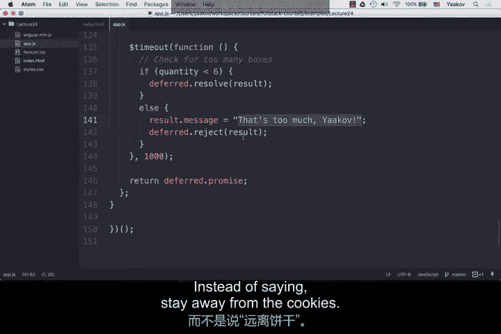

最后但同样重要的是，我们需要将Promise返回给此函数的调用者，以便他们可以有一个钩子来接入异步行为是被`resolve`方法解决还是被`reject`方法拒绝。

请注意，`checkQuantity`方法基本相同。唯一的区别是，我们检查数量是否小于6，而不是检查“cookie”这个词是否作为商品名称的一部分出现。另一个区别是，我们将只等待一秒钟而不是三秒钟来执行此行为，错误消息将是“that's too much, Yaakov”，而不是“stay away from the cookies”。让我们保存并返回浏览器，尝试输入一些东西，比如“chips”，并说我们需要三盒薯片，然后点击“添加”。我们将数大约三秒钟，然后再过一秒钟，四秒钟后，我们看到我们有了三盒薯片。现在，让我们尝试绕过系统，说我们将有“cookie flavored chips”，并得到三盒。我们点击“添加商品”，大约三秒钟后，我们看到控制台中显示“stay away from cookies, Yaakov”，并且没有商品被添加到我们的列表中。

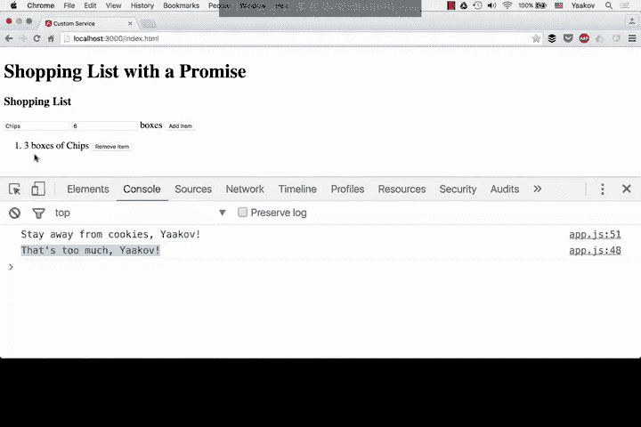

现在，如果我说“chips”但这次数量是6（比5多一个）并点击“添加商品”，会发生什么？它将检查商品列表中是否不包含cookie，然后检查并发现6确实大于5，因此它将显示“that's too much, Yaakov”，它将拒绝Promise，因此我们不会在列表中看到另一个商品。

---

## 改进Promise处理

到目前为止一切顺利，但让我们回到用于处理Promise的代码，看看我们是如何处理Promise的。它有点混乱，即使这不是回调函数，但它看起来仍然像回调函数，有很多缩进和很多代码，很难理解什么在调用什么。让我们重写这个函数，使我们的代码更清晰。

我们将注释掉这个版本，我已经在这里准备了第二个版本。让我们取消注释并仔细看看这段代码。这是购物清单服务上相同的`addItem`方法，我仍然调用`WeightLossFilterService.checkName`，但我获取了这个Promise。当我在这个Promise上调用`then`方法时，我甚至没有提供第二个本应处理错误的函数。我不这样做的原因是，如果出现错误，它会向上冒泡和传播，我可以再次调用`then`方法，这将再次返回一个Promise，然后我可以调用名为`catch`的特殊方法，当延迟对象的`reject`被调用时，该方法将被执行。

在原始的Promise中，`then`方法中我所要做的就是执行`WeightLossFilterService`来检查购物清单中商品的数量。由于它返回一个Promise，我可以直接返回它，然后它将被下一个`then`方法获取。我在这里真的不需要做任何事情，因为我知道我的响应对象只是一个带有空消息的空对象。换句话说，如果我们在这个代码块中，那意味着我们成功了，除了检查数量的有效性之外，我们不需要做任何其他事情。下一个`then`方法以相同的方式处理响应，因为如果我们到达这个代码块，意味着数量检查通过，我们被允许将商品推送到购物清单数组中。

请注意我们在这里做了什么：我们不再需要在每个单独的情况下处理错误条件或Promise的拒绝，我们只需要做一次，并且可以集中处理。这当然使代码更容易阅读，也更清晰。让我们保存并看看这是否有效。让我们回到浏览器，输入“cookies”，给它四盒饼干，点击“添加”，这将是一个错误条件，因此显示“stay away from cookies, Yaakov”。如果我们输入“chips”并点击“添加”，大约三到四秒钟后，它应该会添加那四盒薯片。如果我们保持“chips”不变，但输入7盒并点击“添加”，那也将被解决，但是以拒绝的方式解决，因此我们将显示“that's too much, Yaakov”，因为我们这里的`catch`方法正在捕获上面链式调用中任何Promise的任何错误。

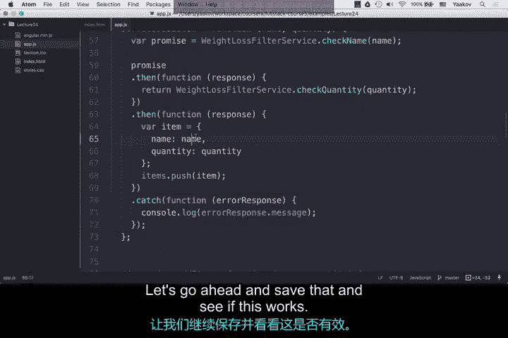

---

## 并行执行Promise以提升性能

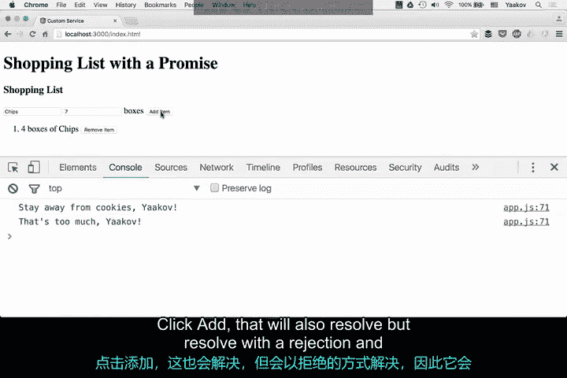

到目前为止一切顺利，但我们可以进一步改进。让我们看看当我们尝试添加一个有效商品但数量过多时会发生什么。让我们清除并再次点击“添加”。看看这需要多长时间，大约需要四秒钟。为什么需要四秒钟？检查这个商品需要一秒钟，检查那个商品需要三秒钟。我们知道，如果这些商品中的任何一个无效，我想输出错误消息并完全忘记将其添加到我的列表中。那么，为什么我要在验证商品名称之后才执行我的盒子数量的验证呢？它们实际上应该并行执行。让我们开始编写代码。

让我们回去，再次注释掉这个版本的`addItem`方法，并取消注释另一个版本的`addItem`方法。这个版本并行执行两件事。我们这样做的方式是捕获名称Promise（即`WeightLossFilterService.checkName`方法的返回结果，它返回一个Promise），然后我们将捕获数量Promise（即执行`WeightLossFilterService.checkQuantity`方法的结果）。在这里，我们将使用我们的`$q`服务`all`方法。它接受一个Promise数组。然后我们可以在其上调用`then`方法，该方法只会在该数组中的每个Promise都得到结果时执行。然而，如果该数组中的任何Promise导致拒绝（即延迟对象的`reject`），所有Promise将立即被取消，执行将跳入`catch`方法，输出此错误响应消息。这意味着，如果这个Promise执行得更快，因此失败得更快，我不必等待这个Promise完成，就可以取消整个执行并输出消息。数量Promise大约需要一秒钟执行，而名称Promise大约需要三秒钟执行。

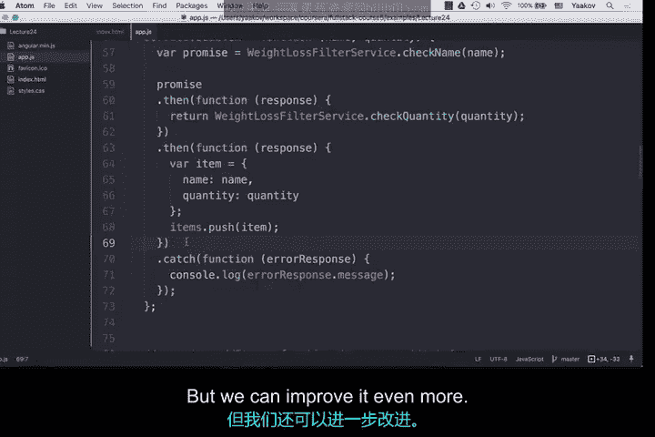

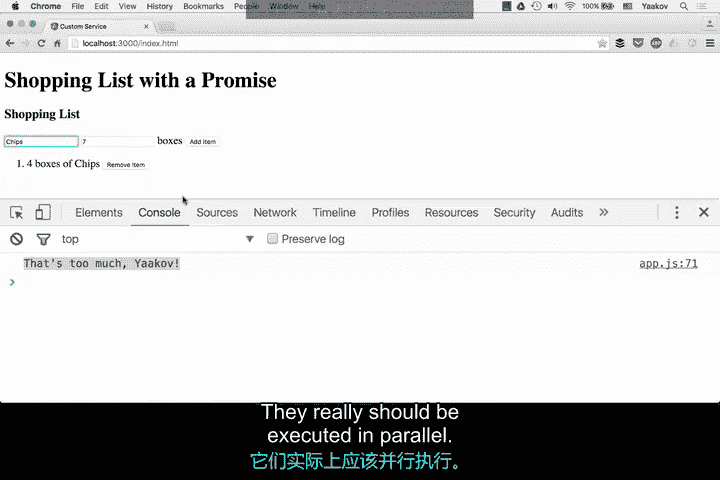

让我们保存并返回浏览器。如果我现在在这里输入“chips”和数量3（一个有效商品和有效数量），我点击“添加”，这将需要大约三秒钟执行，而不是四秒，因为我们正在异步执行两个验证。时间较长的那个将运行三秒钟。但当它完成时，耗时较短的那个应该已经完成了。现在，如果我在这里输入“cookies”，那也将需要三秒钟，并且三秒钟后实际失败，你可以看到它失败了，拒绝了，并显示“stay away from cookies, Yaakov”。这也是因为它是时间较长的那个，因此失败所需的三秒钟是总时间。但看看如果我说“chips”然后输入无效的数量如7会发生什么。当我点击“添加商品”时，看看它失败得多快。它几乎立即失败，大约一秒钟后显示“that's too much, Yaakov”。我们实际上可以再做一次，点击“添加”，你可以看到它立即失败。

因此，通过`$q.all`构造，我们能够放置多个Promise（实际上任意多个），它们都将尝试异步执行，从而使我们的整个应用可能更快。

---

## 总结

在本节课中，我们学习了以下内容：

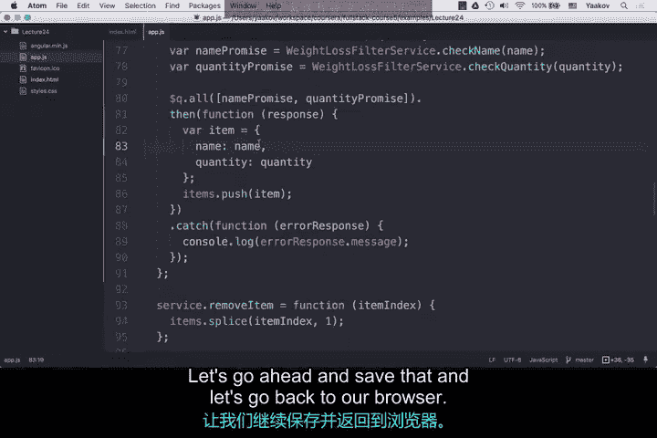

首先，请记住，Promise在处理异步行为时为我们提供了很大的灵活性。

`$q`服务是Promise API的Angular实现。JavaScript ES6的新实现有自己的Promise API，一旦所有主要浏览器都支持，我们可能会使用它。

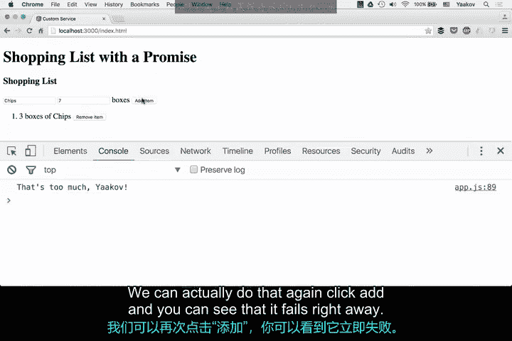

Promise要么被解决（`resolve`），要么被拒绝（`reject`）。解决被认为是成功，拒绝被认为是失败。

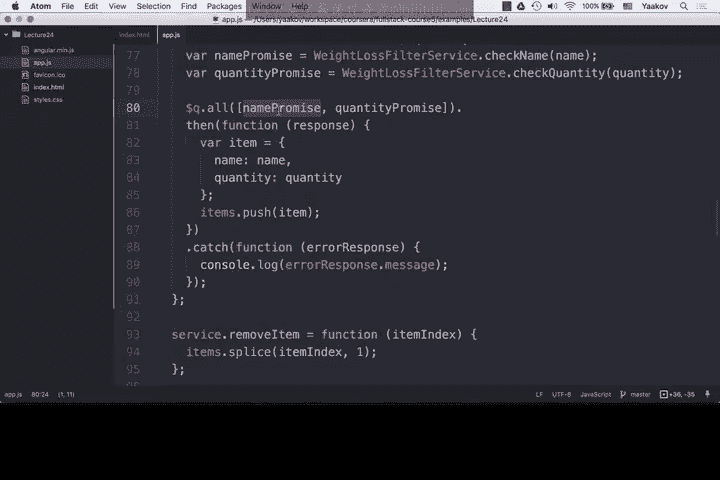

你可以在Promise上调用的`then`方法接受两个参数，两者都是函数值。第一个是处理成功或解决结果的函数，第二个是处理错误或拒绝结果的函数。此外，该方法本身返回一个Promise，因此你可以将其与其他Promise链式调用，使代码也更易读。

最后，我们讨论了`$q`服务的`all`方法。该方法允许我们并行执行多个Promise，使事情更快，同时，我们能够在代码中的一个中心位置处理所有这些Promise的成功和失败。

---

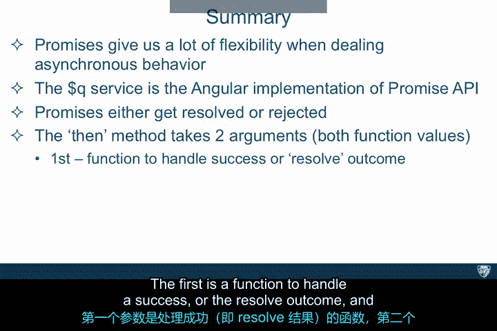

通过本节课的学习，你应该能够理解并应用Promise和`$q`服务来管理和优化AngularJS应用中的异步操作。