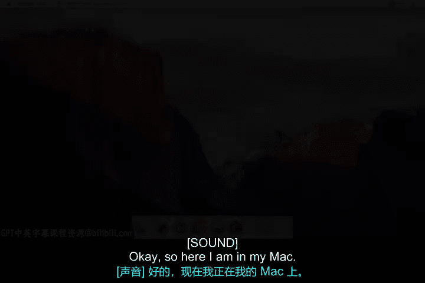
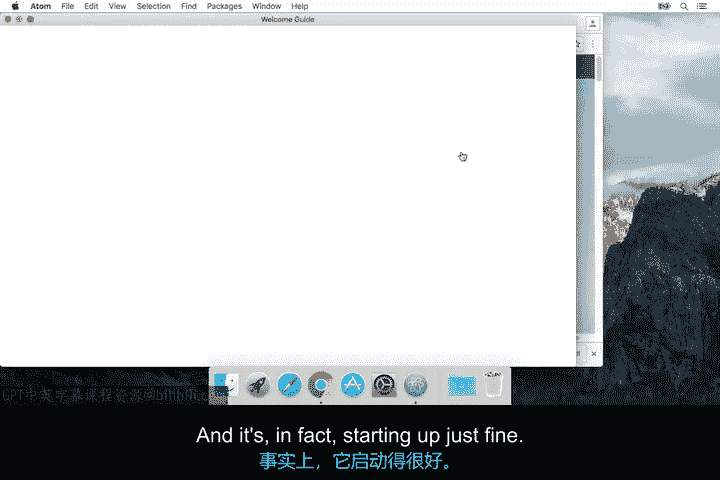
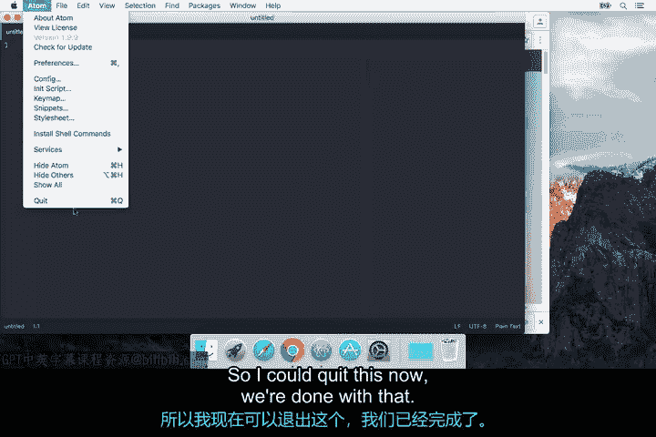
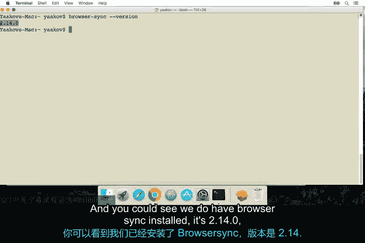

# 约翰霍普金斯大学《使用 AngularJS 开发单页 Web 应用｜Single Page Web Applications with AngularJS》中英 - P4：3_Mac开发环境设置（第1部分）.zh_en - GPT中英字幕课程资源 - BV1dsFDeZEQr

🎼。

Okay， so here I'm in my Mac and nothing really is installed in this Mac yet。

 except maybe a Google Chrome， which is I'm assuming you're going to be able to install all by yourself。

 So I'm not going go over that。 I'm actually using right now the LC cap 1010。 11。6。

 but your versions may vary and it's probably not going to matter that much。

So the first thing we're going to do is install our Adam editor。

 we'll open the Chrome browser and we'll go ahead and go to Adam。o。

 and it will give us the download button really very straightforward， we'll download the zip file。

And once it's done， let's go ahead and open it up and finder， we'll double click it。

 it'll go ahead and extract the file for us， and all we'll need to do is drop this file into our applications folder like that and we're done。

 we can actually even erase this one we don't need it anymore。Okay。

 so let's verify that Adam is actually is working so we'll click on the launchpad and we can see Adam is here when we click it。

 it'll start up and hopefully it will show up without any issues。

 it will ask us whether we want to open it for sure because it's from the web。

 download it from the web and it's in fact starting up just fine。😊。

And we could close this welcome screen and as you can see we have our our first file right here now in order to pin it。

 I will just go ahead and drag it over here so I don't have to constantly open it up through searching for it so I could quit this now we're done with that。

😊。

The next thing we want to do is make sure that we have Git in our system so we'll go back to the launchpad and we'll start typing terminal and we'll open up our terminal。

 Now your terminal will probably look different。 I customize this one so you could see it a little bit better in fact maybe we'll make it a little bit bigger as well so you could see it even better we'll make the font bigger if I type Git space dash dash version and press enter you'll see that it says that Git command requires the command line developer tools we like to install the tools now so you can have a couple of options one you could get the entire Xcode from the app store or you could just get the command line developer tools only。

 which is what I'm gonna to choose I'm going to click install I'm going agree to that and the software is going to get found download it and installed。

And once it's done， we could click the done button and now we say git space dash version is going to give us the version 2。

7。4 which is pretty good if you wanted to get the absolute latest one you could certainly go and search for download Git and that will take you to this website right here which you could go to download and you could download the very latest version。

 but whatever version that came with this version of Mac OS is good enough the next thing we need to do is download and install node JS let's go and say download node JS。

😊，And we'll go straight to the download page of No JS。

 we could close this Adam tab and we could scroll down。And see that we have a couple of options here。

 we have the Mac package and the binaries I'll choose the 64 bit package one and click to download once that's done I'll tell Chrome here that it's okay I could keep this file I trust it and I'll go ahead and open it in my finder and double click it to install it it's gonna give me this wizard well I'll just keep clicking continue step by step we'll agree the terms and condition we'll finally click install it needs our administrative username and password。

 I'm a regular user not an administrator I'll type in my password and it's installing the software。

So it's done and it's just telling us to make sure that user local bin is't our dollar signed path and its almost always is。

 but we'll going check it in a second and we'll just go to our terminal and we'll do echo of Do signed path。

And you can see that user local bin is， in fact there。 So we're good to go。

 Let's switch back to that window， click close and we're done。

 So the only thing now we need to do is make sure that node installed。

 The way we do that is from the command line。 Let's make that full screen。😊。

So you could see it better and from the command line what's clear than say node dash dash version and sure enough we have node 4。

5。0 and the other command that we'll need that actually use more than node is NPM stands for node package manager and we'll say dash dash version there too and we'll see that we have that as well 2。

15。9 that's pretty good Now the reason we installed node GS and this NPpm is because we want to be able to install these packages that are in the node package repository So one of them that we need is called browser sync let's go to the browser again and we'll type in browser sync and it will Google it for us and that's the first thing that comes up。

We'll click on that and it's actually telling you how to install browser sync right here。

 you use the NPm install dash G browser dash sync and dash G here is just to install it for old users of the computer not just you let's copy that and's go back to our terminal。

 we'll paste that。And we'll install it and it's erroring out and the reason it's airing out with permission denied is because it's trying to install it for all the users and I'm not an administrator so what we could do to fix that is just say pseudou to act as an administrator and paste that NPM command and press enterter again and let's see if that works out and since we've typed in the password of our own account that will go ahead and give us the pseudou privileges that are preet up with the Mac OSOS for your user。

And that should go ahead and download and install browser sync。

 So it looks like we're done and everything went well， even though as you could see。

 there were some warnings， I'm sure there's one warning right there。

 but usually when you install NPpm， there's usually some sort of warnings and errors that show up。

 but if it finishes properly， then you're okay。 So let's clear the screen and do browser dash sync dash dash version。

And you can see we do have browsersing installed， it's 2。14。0 at least at the time of this recording。

 and that's fine。😊。

