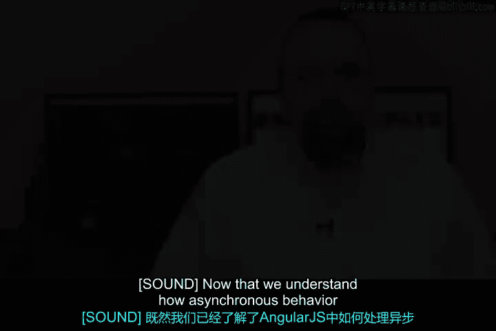
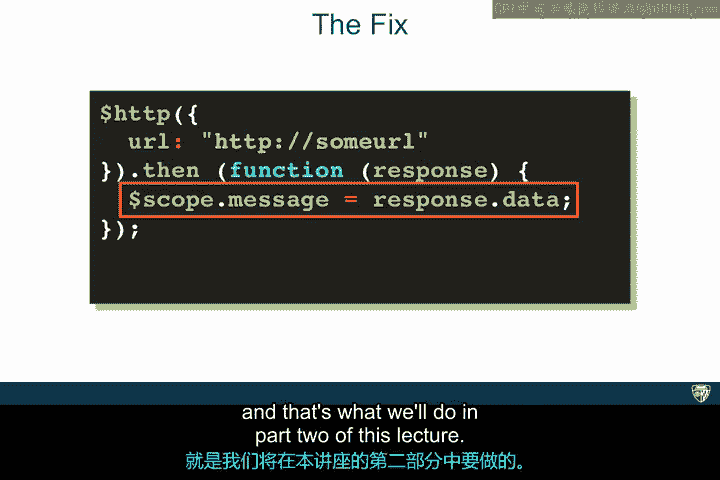

# 约翰霍普金斯大学《使用 AngularJS 开发单页 Web 应用｜Single Page Web Applications with AngularJS》中英 - P50：49_第25讲（第1部分）：使用$http服务进行Ajax.zh_en - GPT中英字幕课程资源 - BV1dsFDeZEQr

🎼。

Not that we understand how asynchronous behavior is handled in Angular JS it's time to turn to a core utility service that comes with Angular out of the box and that's the HTP service there's nothing complicated about the service at all In fact the whole idea behind the service is to make communication between your front end application and the server super simple and straightforward since the HTTP service is in its essence asynchronous it's based on the deferred and promise API exposed by the Q service that we spoke about when invoked the main methods in the service return of promise which is then up to us to process。

Calling HTP service is very simple the HTP service is itself a function so you can actually call it directly。

 it takes just one argument， a configuration object which Angular expects to have some predefined properties such as method。

 URL and so on As I mentioned it returns a promise so that's why you can invoke the familiar then method。

The only required property of the configuration object is the URL if the method property is not specified。

 the HP method get is assumed。Another property worth taking a look at is the Paras property。

 that property can take an object whose property names become parameter names。

 and their corresponding values become the values for those parameters。

The parameter values are automatically URL encoded if you don't remember what that means a URL is not allowed to have spaces and other special characters if the parameter value you're trying to pass to the server contains those special characters。

 the process of URL encoding replaces those special characters by replacing them with a percent sign followed by two hexadecimal digits。

 spaces turn into plus signs。The three properties you see on the slide method URL and parameterss are certainly not the only properties that the configuration object can have。

 there's a lot more properties for most specific cases and you can look them up in the Angular documentation that talks about the HP service。

The arguments that you would pass into the then function are the usual arguments that you would pass into the then function when you deal with a promise。

The first argument is a function value of a successful response， meaning a resolution of a promise。

 and the second value is an error response meaning a rejection of a promise here in the slide I actually named these functions success and error。

 but in practice you could keep them anonymous when you use them in line like this。

Probably most used property of the response object will be the response that data property。

 that's the property that holds the response body。Now if Fla detects that the response body contains JSON。

 it will automatically transform the response body into a JavaScript object using the JSON Parser。

 as I said， the same response object gets returned if an error occurs。

 however its data property will probably contain some server generatedrated HTML page explaining the error message。

 so it's usually not as useful for our programmatic needs。

Before we move on and look at some coding examples。

 let me warn you to avoid a fairly common mistake a fairly common mistake goes something like this if you look at the slide it starts with declaring a local variable called message as an empty string。

 then we called the HTP method providing some URL and then we resolve it successfully resolve it and set our local message variable to the response that data。

Then we take the scope object and create a message property on it。

 initializing it to the value that the message holds。

So what would you say is the value of the dollar science scope， that message？

If you get an empty string， you are correct。Why is that Well。

 remember that we're dealing with an asynchronous call The local variable message will not get set with the response that data until after the last line on the slide executes that last line will set the dollars and scope that message to whatever the value of the local message variable is right now。

 which is an empty string。So what's the fix， well it's actually quite simple。

 the proper implementation will be to set the dollararcicope message to the response data directly in the function representing a successful resolution of the promise。

The setting of the message on the scope service will then occur only when the data is returned and the promise is resolved。

Okay， time to look at some live code examples of what we've discussed so far。

 and that's what we'll do in part two of this lecture。😊。

