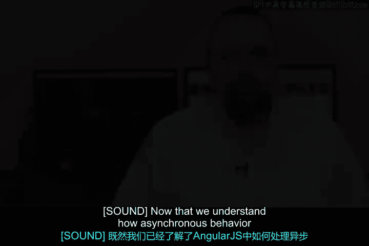
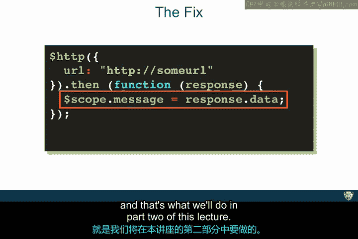

# 使用 AngularJS 开发单页 Web 应用：P50：第25讲（第1部分）：使用 $http 服务进行 Ajax 🚀

在本节课中，我们将要学习 AngularJS 中一个核心的工具服务——`$http` 服务。我们将了解它的基本用法、配置选项以及如何正确处理其异步特性。

## 概述

上一节我们介绍了 AngularJS 中异步行为的处理方式。本节中，我们来看看 AngularJS 自带的一个核心工具服务：`$http` 服务。该服务的目的是让前端应用与服务器之间的通信变得非常简单直接。

## $http 服务简介

`$http` 服务本质上是异步的，它基于我们之前讨论过的 `$q` 服务所暴露的延迟（deferred）和承诺（promise）API。当调用该服务的主要方法时，它会返回一个承诺（promise），然后由我们来处理这个承诺。

调用 `$http` 服务非常简单。`$http` 服务本身是一个函数，因此可以直接调用它。

## 配置对象

它只接受一个参数：一个配置对象。Angular 期望这个对象具有一些预定义的属性，例如 `method` 和 `url` 等。正如前面提到的，它返回一个承诺，这就是为什么你可以调用熟悉的 `.then()` 方法。

配置对象唯一必需的属性是 `url`。如果未指定 `method` 属性，则默认使用 `GET` 方法。

以下是配置对象中一些重要的属性：

*   **`url`**：请求的目标地址。
*   **`method`**：HTTP 方法，如 GET、POST 等。
*   **`params`**：一个对象，其属性名将成为参数名，对应的值将成为这些参数的值。

参数值会自动进行 URL 编码。URL 不允许包含空格和其他特殊字符。如果你试图传递给服务器的参数值包含这些特殊字符，URL 编码过程会用百分号后跟两个十六进制数字来替换它们，空格会变成加号。

幻灯片上展示的 `method`、`url` 和 `params` 这三个属性当然不是配置对象可以拥有的全部属性。对于更具体的用例，还有更多属性，你可以在 Angular 关于 `$http` 服务的文档中查阅它们。

## 处理响应

传递给 `.then()` 函数的参数与处理承诺时通常传递的参数相同。

第一个参数是处理成功响应（即承诺被解决）的函数值，第二个参数是处理错误响应（即承诺被拒绝）的函数值。在幻灯片中，我将这些函数命名为 `success` 和 `error`，但在实践中，当你像这样内联使用它们时，可以让它们保持匿名。

响应对象中最常用的属性可能是 `response.data`。这个属性保存了响应体。

如果 AngularJS 检测到响应体包含 JSON，它会自动使用 JSON 解析器将响应体转换为 JavaScript 对象。

同样，如果发生错误，也会返回相同的响应对象。然而，它的 `data` 属性可能包含一些服务器生成的 HTML 页面来解释错误信息，因此对于我们的编程需求来说通常不那么有用。

## 避免常见错误

在我们继续看一些编码示例之前，让我提醒你避免一个相当常见的错误。

这个错误通常是这样发生的：首先声明一个名为 `message` 的局部变量并初始化为空字符串。然后我们调用 `$http` 方法，提供某个 URL，并在成功解析后，将我们的局部 `message` 变量设置为 `response.data`。接着，我们获取 `$scope` 对象并在其上创建一个 `message` 属性，将其初始化为局部变量 `message` 当前持有的值。

那么，你认为 `$scope.message` 的值是多少？

如果你认为是空字符串，那么你是正确的。为什么会这样？请记住，我们正在处理一个异步调用。局部变量 `message` 只有在幻灯片上最后一行代码执行之后才会被设置为 `response.data`。而最后一行代码会将 `$scope.message` 设置为局部变量 `message` **当前** 的值，也就是空字符串。

那么如何修复呢？其实很简单。正确的实现方式是直接在代表承诺成功解决的函数中，将 `$scope.message` 设置为 `response.data`。

这样，只有在数据返回且承诺被解决时，才会在作用域服务上设置 `message`。

## 总结

本节课中，我们一起学习了 AngularJS 中 `$http` 服务的基本概念和使用方法。我们了解了如何配置请求、处理响应，并重点讨论了如何避免在处理异步调用时常见的错误。接下来，我们将在本讲座的第二部分查看一些实际的代码示例。