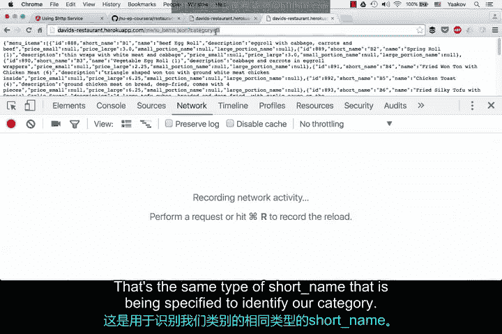
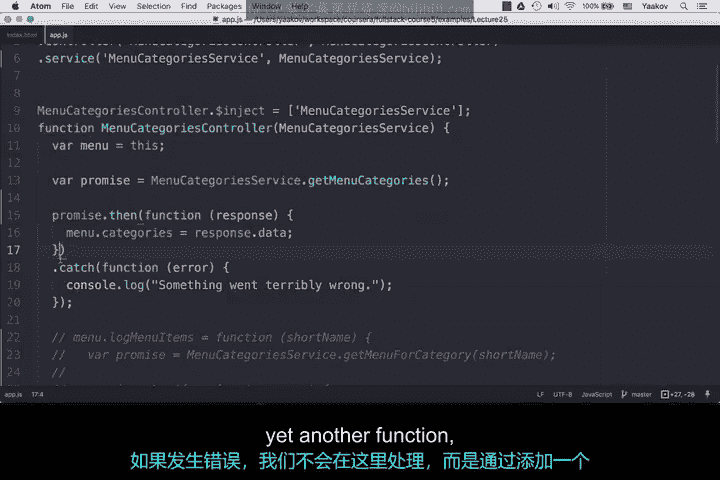
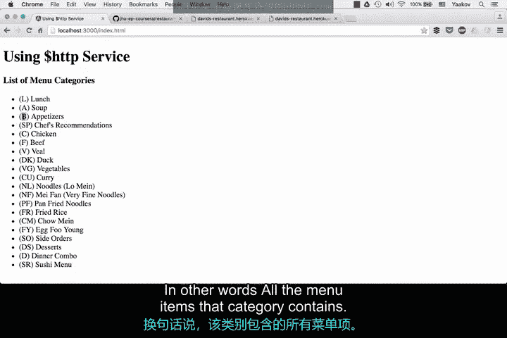
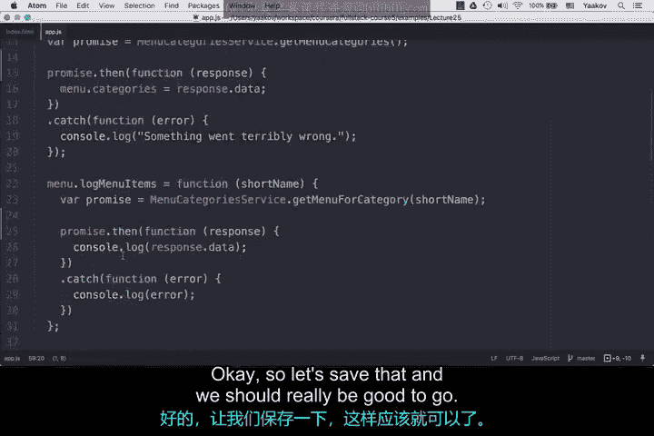
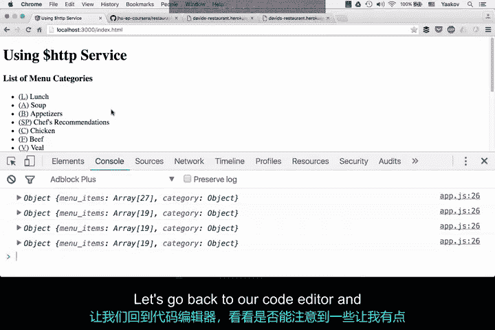
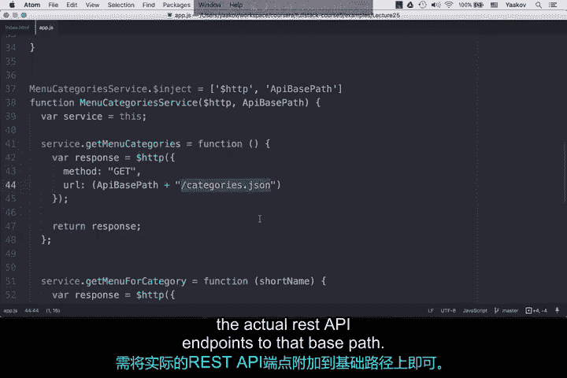
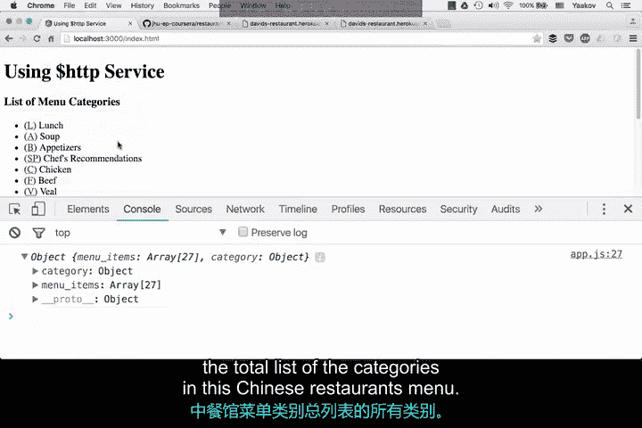
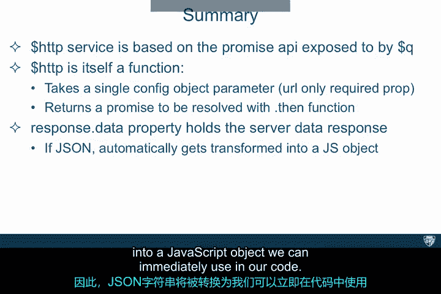

# 约翰霍普金斯大学《使用 AngularJS 开发单页 Web 应用｜Single Page Web Applications with AngularJS》中英 - P51：50_第25讲（第2部分）：使用$http服务进行Ajax.zh_en - GPT中英字幕课程资源 - BV1dsFDeZEQr

🎼。

Before we embark on making any kind of remote calls。

 we actually need to have some kind of remote server set up and since the previous course built a restaurant app which we're actually going to reimplement using Angularjs that server is still set up and actually exposed to the entire internet so we're going to go ahead and use that as our resource the instructions and the URLs of where that server is actually deployed and what APIs it supports can be found on Github。

com/jhuueppcosera/resrantmanu server。And if you scroll down you'll see some documentation regarding this particular server and you'll see that the URL patterns it supports is to show me all the categories of the menu of our Chinese restaurant show all the menu items and show me all the menu items for a specific category together with information about that category okay and here are the URLs that are deployed on heroroku for us to be able to retrieve this data and for our purposes all we're going to use is this one slash categories that JsonN and this onelash menu items that Json with a category for whatever category we specify so I actually opened up both these URLs in my browser you could see this one is slash categories that JsonN and if we actually reload it again we'll see what the categories that JsonN response was and we could look at the response itself as just an array of a bunch of object literals and if we look at the preview it will show us that array。

in a little bit more of a nicer fashion here and we can open up the object and you could see that it contains a couple of properties。

 but contains a few properties， one is name and the other one a short name and these are going to be important because these are the ones we're going to display and use。

😊，Also， if we look at the other rest API that we have here is smanu underscoreiteems。

Json for a particular category and that is that short name that we were looking at before that's the same type of short name that is being specified to identify our category and let's go ahead and reload that as well。

And let's click on that URL and let's go to the preview。

 we could see that gives us categories and also gives us a list of menu items for that particular category and what it's inside of it doesn't really matter for our purposes。

So what we would like to do going back to our code editor is code up an application that simply lists all the categories that our menu contains and obviously we're going to use the HP service to accomplish it so right now I'm located in my editor in the lecture 25 folder which is located in the fulltag course 5 examples folder and here's our Angular app called menu categories app and it's a fairly simple app let's go take a look at the HTML template that consists of just one controller called menu categories controller with a controller as syntax with a labeled menu and then what it's going to do is going to create an unored list and use NG repeatpeat to loop over menu that category so we're going to have a categories property on our menu label that's going to be attached to the dollar science code for us automatically using our controller as syntax in each list item we're going to list the category short name in parentheses and the。

😊，Gory name。 and that's really all we're going to do。

 Let's go ahead and take a look at our app dot Js。Let's actually close the file browser so will be easier to see Okay。

 in our app dot Js， we obviously declare our controller。

 but we also declare the service called menu category service。

 Let's first take a look at this service that we coded up。

So the menu category service is injecting the HTP service as you could see and it's really structured just like a regular service would it creates this service local variable that is equal to this and it has this method called get menu categories which is our main method that we're going to use in order accomplish our use case inside of that function we're going to use our dollar signine HtP。

 the HtP service and we're going to configure it using this config object which is an object literal with a method of get which will tell the HtP service to issue a get an HtP get request and a URL to our API the categories Json API once we capture that response which is of course a promise we're going to go ahead and return that response to the color Now let's take a look at our color which is our menu categories controller Well it's going to use that promise to initialize some things on the dollar sign scope Obviously the first thing is going to do is。

😊，Co menu categories service that get menu categories that's as you remember going to return a promise then we're going to resolve the promise using the then function。

 expecting a response will actually respond that data to be that J that is converted into an array of object literals and will' assign that array to the categories property of our menu。

 which is obviously the this reference。😊，And instead of dealing with an error if it occurs right here by putting comma in yet another function。

 we're just going to go ahead and use a catch all kind of function called catch and we'll go ahead and do that here since that looks a little bit more cleaner in the code and here we're not going to do much we're just going to log something when terribly wrong So let's go ahead and save that and let's go back to our browser let's go to our HP service that's already running using browser sync and you could see that it listed all of our categories with a short name and parentheses and the category name right after that。

😊。

Okay， so far so good。 Let's enhance this just a little bit by having these short name letters be a link that I could click and have my app reach out yet again to the server。

 which should return the data about that particular category。 In other words。

 all the menu items that category contains。 Let's go back to the code editor And the first thing we going to do is create a link around this category that short name。

 and the first thing we're going to do is surround our category short name with an a tagag。

 So we're going to go ahead and say a H ref just so it appears to be a link and we're going to close that and we need to surround it。

 So we'll put the closing a tag right here。 So the only other thing is left to do is to do andG click。

😊。

Now double click， just click and。Set that to our menu that log menu items and pass to it what we're going to need to log。

 we're going to need to log something with a category。That short underscore name once we do that。

 this category， that short name is going to get passed to our log menu items function or method that is sitting on the controller instance So let's go ahead and save that and's go to the app do js and let's actually create that method Well actually it's already create it。

 all I have to do really uncommented and talk a little bit about it here So as you could see it's taking a short name as an argument and we're doing the same thing we did before we're calling menu category service that get menu for category passing it the short name meaning that identifying label for a particular category and then all we're doing here is really logging it on success and logging the error on failure The important thing is to look at this get menu category method。

 So let's go ahead and scroll down to the menu category service and here I have this method already coded up I just need to get again uncommented and let's go over it a little。

So the get menu for category is a function that takes a short name so the HP call， the HP。

 the Dallas and HP it's very similar except now we have a parameterss property as part of our configuration object and the PRs property is an object literal that has category and short name this short name the value of our category in a parameterss comes from the short name that is passed into this function and the category is the name of the parameter that should really go right here after a question mark。

 a question mark category equals whatever it is that the category。

 the short name that they passed in so since we want that done for us automatically by angular we need to just provide this parameterss object or Paras property with an object where the object property names become the request name parameters and the values become the values of those request parameters。

😊，And as usual， we return the response， which ends nothing more than a promise。

Okay so let's save that and we should really be good to go。

 let's go back to our browser and you could see now every single one of these things is a link。

 let's go ahead and up and open our console so we could see what happens when we click on one of these let's click on L and you see an object got returned with menu items of 27 menu items for that particular category let's click on another one let's click on C and you could see once again that object in a category is chicken and the short name is C that's how we identified that particular category when we used it to request it so if we look at the network right now and let's clear that go ahead and clear that and click the C again。

 you'll see that we're making an Ax call to this URL which is slash menu of this item that Json with a question mark category equals C So question mark category equals C is the result of us providing that parameterss object as a configuration property if we click that and look。

It's response， or the preview of the response， you can see that's the same thing that's coming back that we're actually seeing in the console right here。

Okay， so that looks pretty good。 except one little thing。

 Let's go back to our code editor and see if we could notice something that kind of is bugging me a little bit in every single call of our menu category service。

 we're providing the full URL including what our rest API endpoints are going to be。

 What happens if tomorrow the next day， we decide to deploy the same service but at a different URL。

 let's say we wanted to give it a custom URL， not a heroroku app do co URL。 Well。

 we would have to change this URL in every single place that we're calling out to it。

 That seems kind of dirty and inefficient。 Instead it would be great to be able to define the base URL once and then reuse it in every single circumstance。

 and we could do that with a special function that gets invoked on the angular module called constant Let's go ahead and define that now called Con。

😊。

And the constant takes the name。That we're going to inject a constant with。

 and let's call it API base path and what that path is。

 let's go ahead and scroll down and grab the base path， which is right here， let's copy that。

And that's going to be the constant that we're going to use every time when we inject it into different types of services。

 or at least in this case， was going to be injected into the menu category service so let's go ahead and inject that right here。

And that one is called API base path， and we obviously need to also inject it into the actual function and now instead of providing the entire URL。

 what we're going to do is we're going to shorten that a bit。And say that's the only part of it。

 And then we're just going to say APIbased path plus that categories slash categories that J。

 In fact， if you look at the actual URL property here， I see that I have left my parentss here。

 the parentss really aren't needed here at all until I actually erase this part and need to make an addition or string andcateation here。

 which is again， APIbased path plus that string and actually in this case。

 I need to surround that with parent so it knows it's one value when I save that now you could see that now we have one APIbased path constant that we're able to reuse everywhere else。

 So if we were to redeploy the server at a different URL we would only have to change that constant in one place and wouldn't have to worry about the rest of application because it will automatically work by just appending the actual。

Rest API end points to that base path Well let's go ahead and save that and go back to the browser and you can see that everything is still working just fine when I click I get that object and obviously I get the entire list of my categories that comprise the total list of the categories in this Chinese restaurant menu。

Okay， so let's summarize the HTP service is based on the Pro API exposed by the Dign Q service。

 the dollar sign HtTP is itself a function it takes a single configuration object parameter of which URL property is the only required property and then it returns a regular promise to be resolved with the then function Now when that promise gets resolved inside the then function or the success then function response that data property will hold the server data response sometimes referred to as a response payload if the original response that data is JSON Angular will automatically detect that and then will transform that response into a ja object so the JON string will be turned into a ja object we can immediately use in our code。

Now one more thing we used in this lecture is module。con。

 and that can be used as an injectable constant that we could define once and it will never change for the duration of the application。

 and then we can inject it into controllers， services or other types of components。😊。

