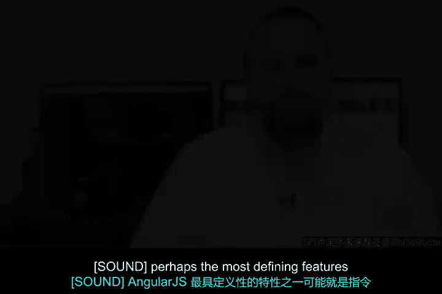
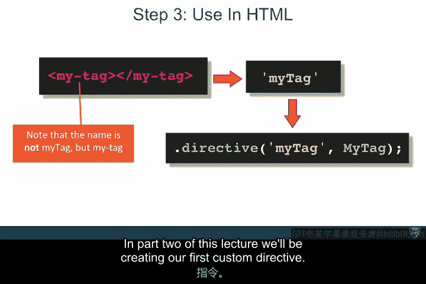

# 约翰霍普金斯大学《使用 AngularJS 开发单页 Web 应用｜Single Page Web Applications with AngularJS》中英 - P52：51_第26讲（第1部分）：指令：动态HTML.zh_en - GPT中英字幕课程资源 - BV1dsFDeZEQr

🎼。

Perhaps the most defining feature of the Angular Js is the idea of directives this is so much so that the front page of Angularjs。

org hints to directives when it answers the question why angular it's worthwhile reading their answer。

It states as follows HTML is great for declaring static documents。

 but it falters when we try to use it for declaring dynamic views in web applications Angular JS lets you extend HTML vocabulary for your application the resulting environment is extraordinary。

 expressive， readable and quick to develop。The keyword in this description is extendt Angular allows you to extend the standard HTML into whatever suits your particular application。

😊，That is incredibly powerful as youll soon see so when it comes to HTML and HTML templates in Angular。

 it's nothing strange to see something like this As you can see here we have a tag called list item appearing right in the middle of regular HTML code that's an angular directive。

😊，It's certainly not a standard HTML tag， but how does this code become quote unquote regular HTML code remember from a previous lecture when we tried to understand how custom HTML attributes work and therefore demystify how Angular is able to find placeholders in HTML Once Angular was able to find NG app attribute on an element。

 it got access to the entire document object model that was attached to that element。

 the angular functions are then free to manipulate that tree of HTML nodes。

 however it pleases it can then replace the variables surrounded by double curly braces with values it looks up in a dollar sign scope It can also examine any node。

 be it content tag or attribute and decide if it should replace it with something else。

 attach some function or behavior to it etc in Angular。

 this process is called compilation If you've done programming before when you hear the word compilation。

😊，It usually means translating your source code into some other code that the machine can understand。

 usually this is done before you actually execute your code in Angular most of the time the compilation happens at the beginning when you load your page or particular HTML template and sometimes even later。

 but the process is the same Angular compiles and links your custom HTML code。

You can also combine directives together here you could see that we're using the familiar energy repeat on this custom list item directive。

Okay， so let's define what a directive is。A directive is really just a marker on a DOM element that tells Angular's HTML compiler to attach a specified behavior to that domain object model element The compiler can also transform or change the DOm elements and its children the marker itself as we're calling it can be one of four things it could be an attribute。

 an element name， a comment and even a CSS class however it's not a best practice to use comment or CSS classes in order to use directives so most of the time you will stick to elements and attributes when you define your custom directives。

Okay so let's go over the steps of creating your custom directive。

 The first step is to register the directive with the angular module。 and as you could see here。

 it's almost identical to the way you register controllers， services， factories and so on。

 here we're using a special module method called directive and we're defining a directive name not a directive name that we're specifying here is a normalized name that will appear in HTML。

 and I'll explain what what's meant by normalized shortly。

 The second argument is the factory function that returns what's called a DD。

 otherwise known as a directive definition object。 The DD is basically a configuration object that tells angular compiler how this directive should behave when Angular finds this tag or element or attribute in our HTML the factory function might tag in our example here we'll execute only once and not every time it finds our directive mentioned in our HTML and since it's only going to get executed once。

😊，You could use that function to perform any initializations you need besides obviously returning this special object。

 the DO， the directive definition object。😊，The second step is to define our factory function and note just like a controller service。

 we can inject other things into this directive。 We can inject other services， controllers， etc cea。

 as usual， the most important thing about this function is for us to return our DD the directive definition object The directive definition object consists of multiple properties that are defined in the Angular Gs documentation。

 The template property defined here is just an example and it's not a required property。 However。

 in this example， every time we use my tag in our HTML。

 The words hello world will be displayed to the user。

 The third and final step is obviously to use the tag in our HTML。

 note that the name of the element is not my tag but my dash tag in order for Angular to match your element or attribute to the name of the directive it first needs to normalize the name it finds in the HTML The way it normalizes the name is by removing the dash。

😊，And then capitalizing the next letter In other words。

 it replaces the dash delimited notation with Caml case notation。

 If you're not familiar with Caml case notation， it's actually very simple it's basically a way to name something in programming where you take a number of words cancatenate them together leaving the first word all lowercase with each subsequent word capitalized So when Angular Gs sees my dash tag and our HTML it will look for a directive that was registered with the name my tag with a t capitalized and obviously it will find our declaration of a directive called my tag with a t capitalized thus connecting the two pieces together and providing the functionality that is defined in the my tagag factory function time to get back to our code editor in part two this lecture will be creating our first custom directive exciting C in part2。

😊。

