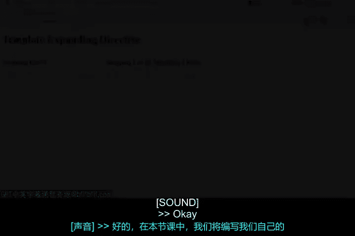
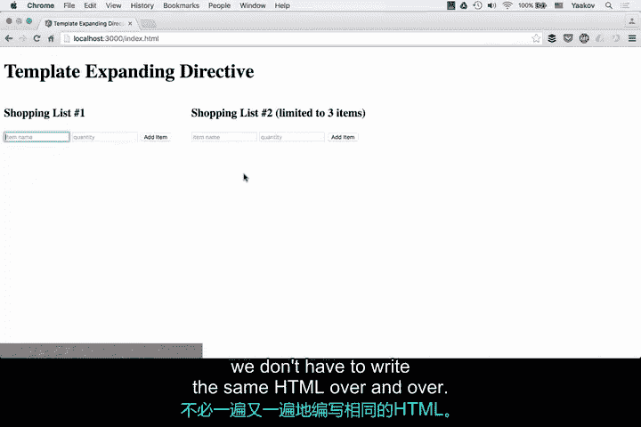
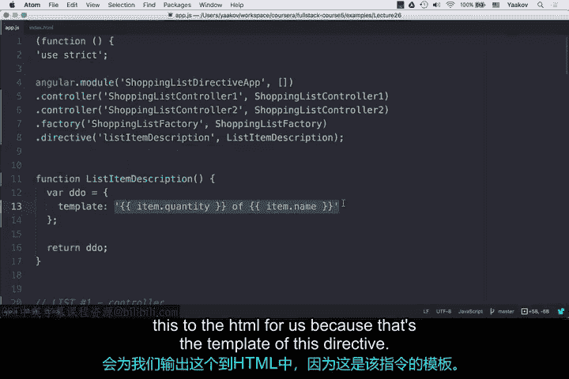
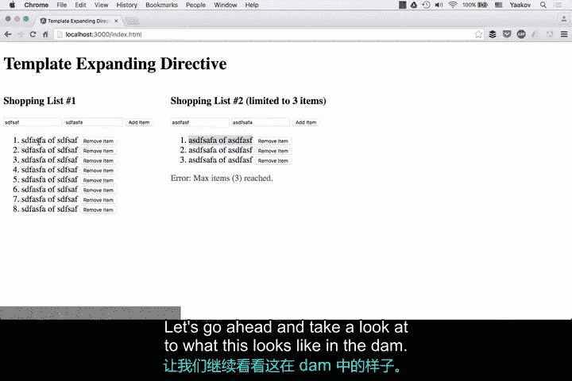
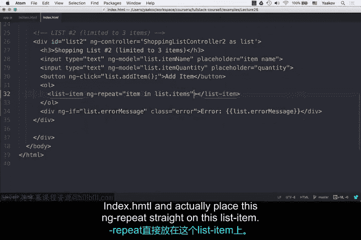
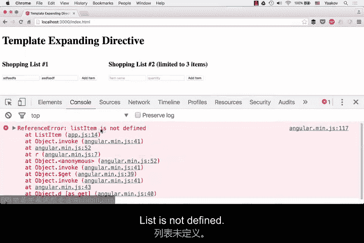
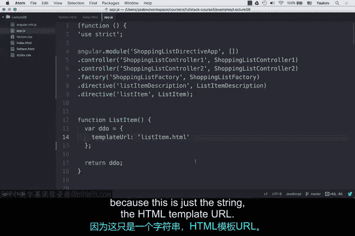
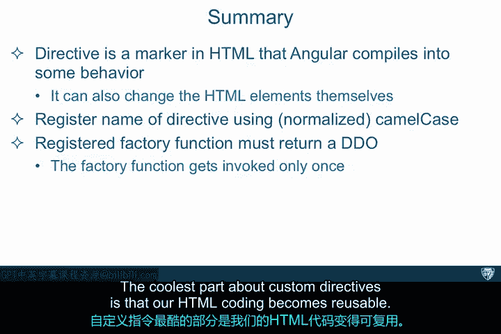

# 约翰霍普金斯大学《使用 AngularJS 开发单页 Web 应用｜Single Page Web Applications with AngularJS》中英 - P53：52_第26讲（第2部分）：指令：动态HTML.zh_en - GPT中英字幕课程资源 - BV1dsFDeZEQr

🎼。

Okay in this lecture we're going to write our very own first custom directive and in order to do that。

 we're going to reuse the application that we've written previously if you remember we had an application where we had two shopping list that worked independently from each other meaning that each had their own instance of the shopping list service and therefore each shopping list was saved in the separate instance and they did not interfere with each other what we're going to do now is look for opportunities to reuse pieces of HTML so what to have to write the same HTML over and over let's go back to the code editor and I'm located in lecture 26 which is located in full stackack course 5 Ex folder and here we have the shopping list directive app and it's really just a renamed app it's exactly the same as we had it before with just a minor differences obviously the title is a little bit different but also I change the label instead of list one and list two I just kept it as list these two list labels do not interfere with each other。

simply because this list label is only exposed to the body of this controller and that list label is only exposed to the body of the first controller so as you remember as a user clicks to add a new item into the list it gets output using this interpolation right here so this is in the first list if you take a look at the second list well it's exactly the same thing again well it would be nice that we wouldn't have to rewrite this over and over but only really write this once and then just use some element to signify that we are describing an item here so let's go back to our aGS and let's actually'll minimize the file browser in the right and let's define a list item description directive so we'll put enter here and we'll call directive and we' say list item description notice that I started the name of my directive with a lowercase L and that is because we are using this as a camel case notation that will be later matched with an element in our。

HTMNext， I need to name the function that' is going to be responsible for this。

 and we'll just name it the same list item description。 change the first letter to lowercase。 Okay。

 now we're ready to actually define this function。 So let's go ahead and say function we'll say list item description。

We don't need to inject anything into this function， so we' just leave it at that。

And we'll define our DD and a D is going to be an object literal with one simple property called template and that template is going to be and let's go back to our index at HTML。

 that template is going to be just the string right here。😊。

Let's go ahead and copy and paste that right here and that's really all we need and we'll go ahead and return not to forget to return our DD Okay。

 so now that we've registered our directive and we defined the factory function that returns our DD and every time this particular tag or this particular element is going to be in our HTML it's going to output this to the HTML for us because that's the template of this directive。

😊，Okay so what's left is to go to index that HTML and wipe this out and instead write list item description and notice that the list item description is using dashes in between because I need to leave it in a nonnormalized notation so Angular Gs can then take that normalize it and match it with a list item description directive declaration so that's one and we use the same thing in the second one so we'll wipe that again and we'll paste that we'll save it let's go back to our browser and let's try it out。

 we'll just put a bunch of nonsense in here just to test it out and you can see as we keep doing this it's working this one is gonna be a little bit separate but you can see this one only has limit to three but our item description meaning this piece right here is working very well let's go ahead and take a look as to what this looks like in the Dm What does the dumb look like for these particular。

😊。

Element let's expand this out a little bit and let's take a look you could see that Angular left the list item description right in place and actually placed our value right in the body of that particular custom tag let's go back for a second to the code and take a look at our template that we've defined for that particular tag you could see that the template is using interpolation and it's using item that quantity and item that name wheres Angular getting this item that quantity item that name when we were inside our controller item referred to the item that was part of the anng repeat and that was pulled out out of the controller's scope。

 the local controller scope so how is it that we are able to access this item inside of our directive and the answer is that unless you specify otherwise the scope of your directive will be the same scope of the containing controller。

😊，go to our index that Html。 you could see that this list item description directive is sitting inside of our shopping list controller1。

 So the scope that is available to the body of this controller is the exact same scope that is available inside of our list item description directive。

 That is how we're able to if we go back to Ab Gs That's how we're able to say item that quantity and item that name because ultimately all these properties are part of the scope that this particular directive lives in。

 Let's go back to index that Hml and see if we can find other opportunities to create a template exp directive for us。

 Well one of them is right here。 we see this li item this L item repeats again in the shopping list number two。

 Well what if we make this li item as a list item for our shopping。 In other words。

 the shopping list item。😊，Well， let's go back to our app Js。 and let's create another directive。

 And this time we're going call it directive。 We're gonna call it again starting with a lowercase list item。

 so not description， but the whole list item and we'll specify its factory function as list item so all we need to do now is actually define it。

 Let's go ahead and say function list item。 we don't need to inject anything into it。

 so we're good here。 we'll create our DD object the directive definition object a semicolon here。

 And again， we'll say template。 except that let's take a look as to what we would actually have to place into this template。

 Let's take a look at the in H。 So we are really gonna be expected to place this whole string into our template。

 That's kind of difficult not only is it kind of a large string but also notice there's got quotation marks in here。

 which means we're gonna have to escape those quotation marks or make sure that we don't use the same。

😊，So they don't conflict。 So instead of a template。

 we're gonna to use something else called a template URL and a template URL allows you to point to an HTML template or HTML file and place your entire template into that file much more convenient for things that are a little bit longer than just a line of HTML code let's call it list item hm and let's go ahead and not forget to return the DD let's save that and let's go ahead and create this file called list item h。

 let's open up the file browser We'll go ahead and create a new file and we'll call it list item HTML There it is and let's go to index HTML。

's actually close the file browser for a second。 we'll go to indexl we'll grab this whole string here we'll actually cut it at this point and we'll go back to list item paste that there and here we are let's save that and let's go back to index that HTML and now what we need to place。

😊，Here is we need to place our list item so we'll say list dash item。

 the deormalized name and there's our list item right here and every time this appearss in our HTML it's going to get substituted or at least it's going to get implemented as this liI item let's go back to index that HTML and actually replace that over here as well and we'll say list item。

😊，And we'll save that。 And one more thing。 while it would be okay to leave this N repeat right on the inside of the directive template。

 it's much easier， I think to actually pull it out。

 so we could see a little bit better as to what's going on。 Let's go ahead and cut that out of here。

 save this and go to our index at HTML and actually place this NG repeat straight on this list dash item and'll do the same thing for the first one and we'll go ahead and save that。

 And I believe now we're already ready to go。 So if we go back to our browser let's make this smaller again。

 And if we start， we'll just enter some garbage for now， and you could see nothing is working。

 Why isn't it working。 let's take a look as to what we messed up。 list item is not defined。

 So if we go back to our code。 Let's take a look at Abdat Js。😊。

Oh， we forgot to put quotes around our HTML template because this is just a string。

 The HTML template URL is just a string。 Let's save that。 this should fix it and it does fix it。

 let's go ahead and close that We don't need that and we'll say let's put some cookies in here。

 So it was a good idea to put some cookies in here and let's get a few of them So that's working and we'll put some other cookies another cookie in here and we'll put a lot of cookies here and as you can see here it's limiting us to only three of them let's go ahead and expect the element here actually as to what got placed inside of our list item here So let's take a look So you could see here we start with a list item and these list items keep repeating because we put NG repeat on them inside of the list item。

 you see anI followed by our list item description yet another custom directive that we create it So what we're able to accomplish here is create a。

😊。

That we are reusing in multiple places in our application and if we change something in that directive。

 it changes in every single place because the functionality obviously travels together with that directive and that's a really an amazing concept We're now doing code reuse right inside of our HTML templates。

Note one more thing if we take a look at our code。And specifically indexed at HTML。

 you could see that the HTML code itself became very semantic if you remember from the previous course coursese 4 HTML CSS and JavaScript for web developers。

 we discussed the reason for having semantic tags in HTML 5 but even the semantic tags that exist as part of standard HTML5 section article and so on a such generic terms in Angular GS application we could create our own semantic tags that actually makes sense in the application the we coding so list item is clearly one list item in our shopping list how cool is that。

😊，So let's summarize a directive is really just a marker in our HTML that angular compiles into some behavior。

 it can also change the HTML elements themselves because it gets a hold of the entire document object model tree that is under the control of the directive。

😊，Remember when you register the name of directive when you use the dot directive method on the module object。

 you have to use the normalized Chel case name because that is the name that the Angular Gs compiler will then look for when trying to match your custom element or attribute back to the registered directive the function that you register with the dot directive method is a factory function that must return what's called a DD a directive definition object that factory function will get executed only once so you can use it to initialize whatever you need for the directives that are going to be in your application the coolest part about custom directives is that our HTML coding becomes reusable we can actually employ code reus directly in our HTML coding and last but not least the HTML code itself becomes semantically relevant to the actual web app that we are building。

