# 约翰霍普金斯大学《使用 AngularJS 开发单页 Web 应用｜Single Page Web Applications with AngularJS》中英 - P54：53_第27讲：restrict属性.zh_en - GPT中英字幕课程资源 - BV1dsFDeZEQr

🎼。

In the previous lecture we saw a couple of properties of the directive definition object or the DDO。

 we saw how to use the template and the template URL properties in this lecture we're going to see another DDO property called restrictstrict。

😊，The restrict property tells Angular JS compiler where to detect your custom directive。

 should it try to detect it as an attribute to a different element or should it look for an element with the name of your register directive If you don't specify the restrict property on the DDO。

 Angular will default its value to be A E the A stands for attribute and E stands for element That means that Angular will look for your directive as being either an attribute or an element so that's the default。

If you wanted to restrict your directive to be only an attribute to a different element。

 you would specify an A as a value for the restrict property。

 it's a best practice to restrict your directive to an attribute if that directive is extending some behavior of some other element for example。

 think of NG repeat it doesn't have any content of its own。

 it's just extending the behavior of any element that you place that particular NG repeat attribute on。

If you wanted your directive to be an element only you would specify an E for the value of the property。

 the best practice to restrict a directive to be an element。

 if that directive is defining a component with some associated template。

 think of the previous example we had that had a list item in it。

 it had some content to it it had a template to it。

 so it would only make sense that that template and that content with some behavior would be an element。

It's a best practice not to use the class and CSS based directives so obviously don't restrict your DDO to that either Now if you restrict the directive to be a one type and then you use that directive in a different fashion。

 Angular will not match that directive and will simply ignore it like anything else in your HTML that it's not supposed to process so if you specify the directive to be an element and then use it as an attribute。

 Angular will ignore it completely。Okay， let's jump into the code editor and see these concepts in action。

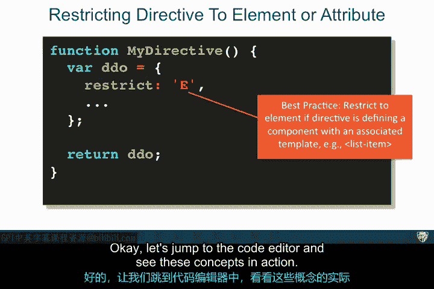

Okay I'm back in my code editor and I'm located in the lecture 27 folder。

 which is inside fulltag dash coursese 5 examples folder and here I have the exactly same app that we had in the previous lecture。

 the shopping list directive app and as you remember we created a couple of custom directives。

 one of which was list item directive and the list item directive basically just corresponds to the solicit item。

 HTML which is its template and it's just an LI with yet another actually custom directive inside of it and a button we can click on。

If we take a look back at our HTML we see that the list item is being used as an element Now if we look at Abdajs。

 we'll see that our list item does not specify the restrict property so that means that we could use it as either an attribute or an element。

 but let's go ahead and specify restrict property here and we'll call it AE so for attribute and an element so we could use it either or and we're going to ahead and save that and we're going to make sure not to forget the comma here now if we go to our browser。

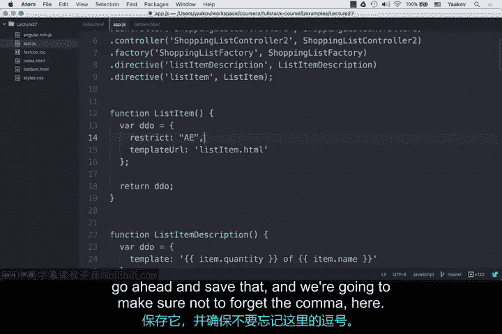

We could see that we could still add whatever we can want to add into the list and it will work just fine。

Going back to the code editor， let's go ahead and change our list item。

 at least in the first controller in the first shopping list。

 let's change this to an attribute instead since it's allowed to be one。

 Let's go ahead and erase this part。And we'll erase this part conveniently。

 it shortens to li and we'll go ahead and list list item as an attribute on the li element。

 Let's go ahead and save that and let's go back to the browser and see what happens if we add some cookies in here and four bags of cookies and we click add Well that's a little weird if you notice we have this one and two kind of looks at the same time。

 So if we keep adding it it will keep looking like there's like two numbers in our ordered list Well let's go ahead and crack open the code here。

 the DOm element and see what's really going on inside and if we take a look。

 this is our ordered list and this is our li and if we open our li right here。

 you see there's another li inside of that。 well how did that get here and that li has the list item it looks like we have really two nested li is in here。

 Well the reason this is happening is because。

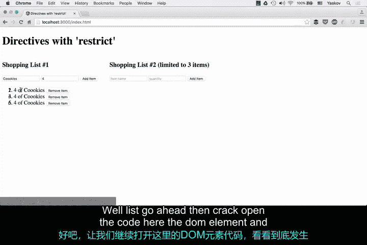

When we listed the list item on this LI， the list item as you remember， let's take a look at the DD。

 the list item lists the list item that HTML as its template and the list item that HTML already has an LI in it so that's not really going to work In other words for this to actually work we would actually have to remove this LI out of this template let's go ahead and do that now just to test this out save it and now if we go back to our browser let's close the ChromeDevelop tools the browsering should have refreshed it and let's do this again。

😊。

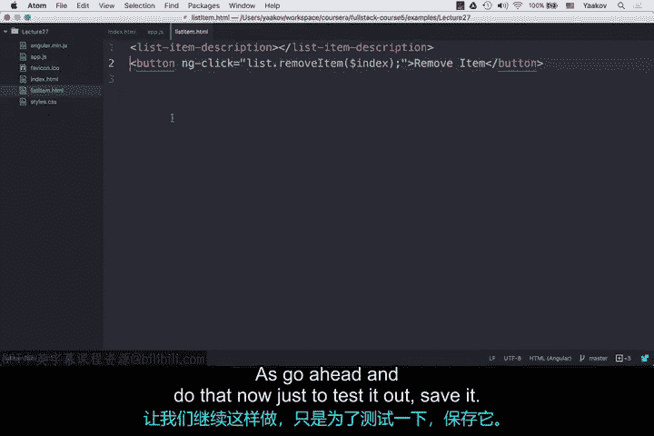

Cookies， four bags of cookies， we'll click add and for three bags of cookies and then chips。

 five bags of chips and we'll click add and it's still working just fine。

 So if we again open up our elements here and take a look we see that an ordered list has an all and inside of that all is the list description and a button and so on here。

 all the code that we expected to be there and we're using an attribute instead of an element in order to produce that。

 Now if we close our Chrome developer tools and try the same thing on the shopping list too。

 Now remember shopping list too， essentially should go ahead and take a look at the code real quick shopping list too has the list item being used as an element。

 So if we go to our browser and start adding here， cookies four bags。😊。

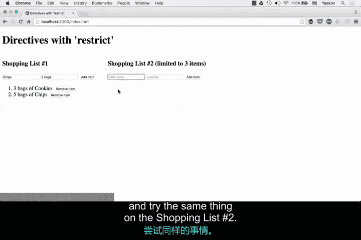

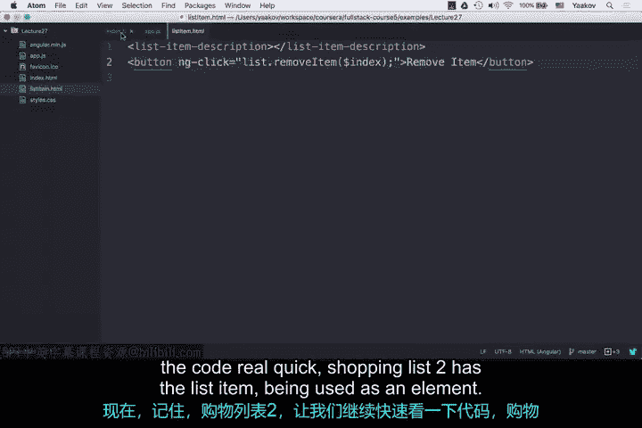

And click Ed and it says four bags of cookies。 But for some reason we don't see a number next to it。

 So if we keep adding stuff， it's not really looking like there's the proper formatting going on。

 Well's go ahead and crack open that code。

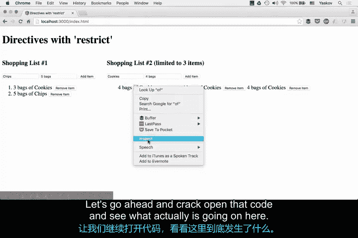

And see what actually is going on here。 and you see here our ordered list and we see our list item and we see the list description。

 So what seems like is going on is that we don't have an alli element。

 And obviously we don't have an all element because we removed it from our template right here。

 So point number one is whether you restrict something to be an attribute or an element。

 The associated template that comes with a particular directive has to make sense within the context of your HTMLtm。

 Okay So so far， if we look in the ajs， we restricted the list item to be either an attribute or an element。

 Well， let's try to restricted to be only an attribute。 let's go ahead and save that。

 let's go back to the browser。 It will get refresh by browser sync and we'll again at some cookies in here5 bags of cookies。

 notice the bags。 the number of bags keeps going up and here it is that works。

 we can do it a few more times。😊。

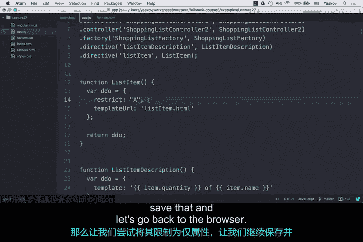

And if we look here， inspect the elements here， this should be just like before。

 we have an all item that has a list item as an attribute which produces this whole template in in the middle or in the content of the li element if we go to our shopping list number two however and put in some stuff here。

 bags the cookies and add that you see nothing is going on。 if we click this a couple more times。

 this shows up so it's the functionality is actually working。 but nothing is showing up right here。

 let's take a look at at maybe just somewhere here as to what's going on in our dumb so we could see that So we see the list number two let's open that up that's the list number two that's the H1。

 the shopping and that's the input elements and there's our ordered list and if we take a look at here our ordered list still has these items and theyre repeating but they're not showing up at all。

 Why is that。

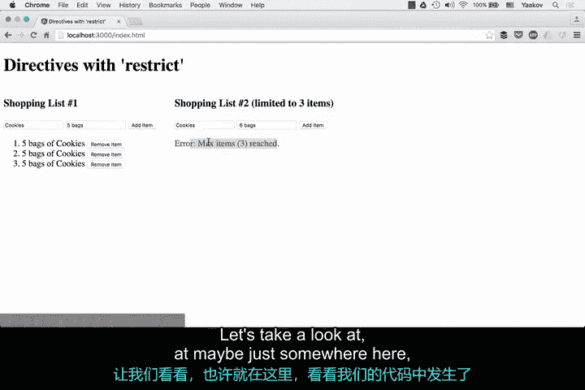

The reason they not showing up is there is nothing inside of them。

 and the reason there's no content inside of them is because Angular Gs compiler completely ignored list that item。

 It doesn't even know what that is。 it doesn't recognize that and the reason it doesn't recognize it is because we used it as an element when we in fact restricted that particular directive to be only an attribute。

 but as we said in the lecture， something that has a template is probably much more suited to be an element than an attribute。

 so let's go ahead and change that here and we'll save that and we'll go back to our index that HTML and the second list the second shopping list is going to be using that as an element while the first will leave it as an attribute。

 however， this is really not going to work because we're sharing the same list item that HTML and for this directive to work as an element we actually need to put the allies back let's go ahead and do that now。

Because we don't have an ally without this because it's not being used as an attribute。

 so if we now go back to the browser， the second list should work just fine， cookies， four bags。

 and we'll add that， we'll let it again we'll let it again it's working just fine except to reach the maximum of three items。

 but if we go here and try to add stuff。

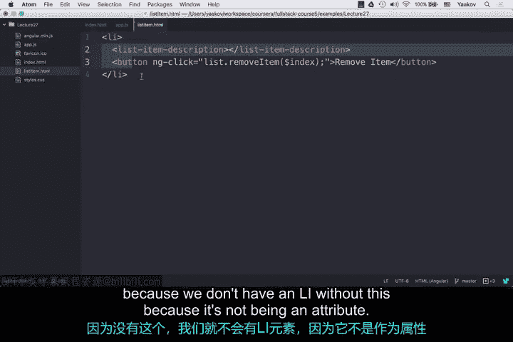

It will not work。 You could see the numbers are showing up， but if you look inside。

Let's inspect the inside， it's an LI and we have a list item as an attribute。

 but the content of LI is empty， and the reason the content of LI is empty is because Angular JS compiler cannot even find the fact that there is a custom directive as an attribute sitting on LI because we told Angular JS that the only directive that list dash item can be is an element and since this is an attribute it is simply ignored。

So let's summarize。The DDO's restrict property determines what AnglGS compiler should look for to detect your custom directive。

Using Directive as a different restrict type than defined will cause the compiler to simply ignore it。

 and therefore your tag with custom behavior will simply not work。

Best practice number one is use E for elementement when Directive has content along with possible behavior。

 also the best practice is to use A for attribute when your directive has no content and only extends the behavior of your host element。

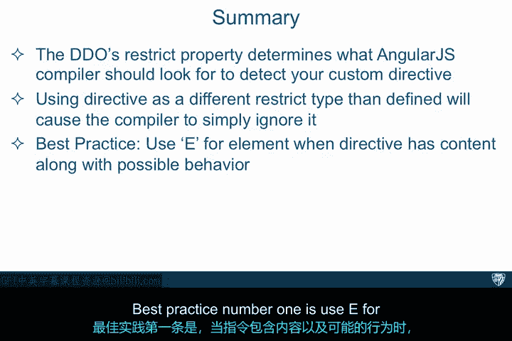

Finally， another best practice we talked about is that while it's possible to use class and comment directives。

 that's only for older browser compatibility and is really not used anymore。

 therefore just avoid defining your custom directives as a class or comment。

