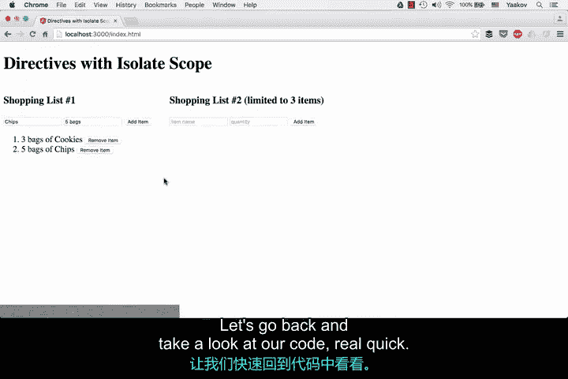
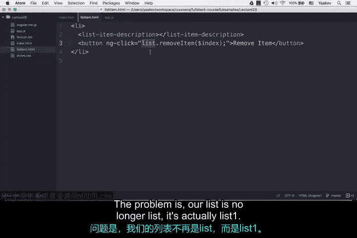
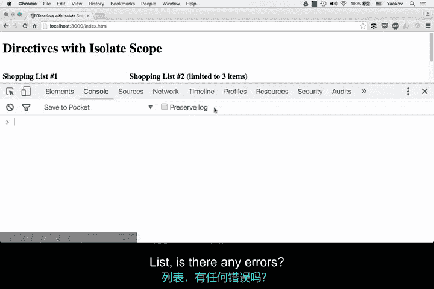
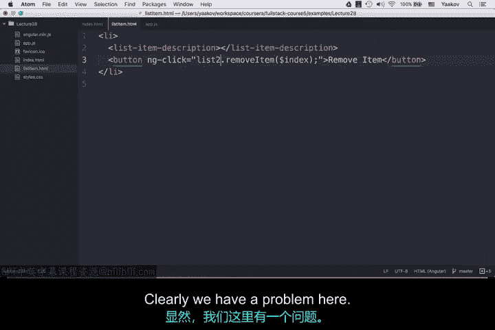
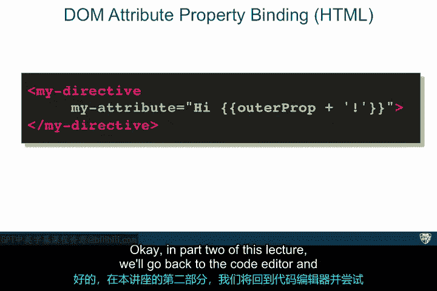
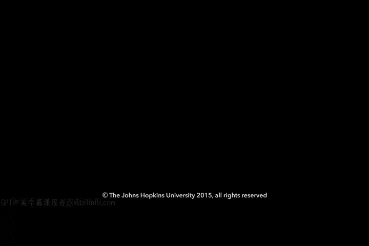

# 约翰霍普金斯大学《使用 AngularJS 开发单页 Web 应用｜Single Page Web Applications with AngularJS》中英 - P55：54_第28讲（第1部分）：指令：隔离作用域和&.zh_en - GPT中英字幕课程资源 - BV1dsFDeZEQr

🎼。

Previously， we spoke about the fact that without any additional configuration。

 our directive is functioning with the scope of its parent in the examples we've seen that meant that the dollarine scope inside of our directive was the exact same object as the dollarine scope of our directive's parent controller While this setup seem fine if we look closer we have a bit of an architectural problem here That type of setup makes the directive dependent on our particular controller In other words。

 there's too much coupling going on between the controller and the directive。😊。

Let's examine this issue in the code editor。Okay， I'm back in the code editor and I'm located in Le 28 which is located in full stack dash Cose 5 Exles folder and this is just a copy of the previous application we had the shopping list Directive app The only thing I change here is the title。

😊，And as you remember we have a couple of shopping lists here。

 both of them are marked as list in the controller as syntax and both of them have this line right here called list item。

 which is our custom directive that has an engine repeatpe in it that's looping over our list items in our shopping list The trouble is is that we have two lists here and when you look at this code in the code editor it's sometimes hard to understand which list you're looking for I guess you could look for shopping list number two in labels like that but it'll be much nice if I actually labeled our controller as syntax as a list one or list2 let's go ahead and try to do that let's multi selectlect the lists and we'll say list1 and here there's also a list one and this is a list one and we'll save that。

😊，Let's see we're not missing anything and let's go to the second list and call it list2。

 once again try to multiselect as much as we can and we'll say list2 and we'll say list two over here and list to over here。

 So let's say that and let's go back to the browser and see if everything is working so far。

 So let's add cookies as usual。Three bags of cookies and three bags of cookies are working and then let's add some chips。

 Okay'll get five bags of chips。 and we'll add that。 Okay。

 you know what actually let's remove the chips and add some drinks instead let's click the remove item I'll look at that。

 It's not working anymore。 Let's take a look at our Chrome developer tools and we see absolutely no errors either So what is going on here exactly let's go back and take a look at our code real quick and we know that the list item right here。

 the directive actually use this list item that HTML template。

And the problem should be pretty clear。 We're using this list that remove item。

 We're laying on the fact that list is available to us on the controller scope。

 The problem is our list is no longer list is actually list one。

 so let's change this to list one let's go back here and we'll add actually we'll just add one nonsense for now and let's try to remove that。

 See that works。 Well let's try to add to this list now。😊。

And add that item， let's try to remove that item， but this item doesn't work well， why not？

List is there any errors yet again no errors Why isn't this item working Well the reason this item is not working is because we're using list1 listist1 agains coming from the first controller but the second controller doesn't know anything about list1 so in order to get the second controller to work we would have to change that to list too well then the first controller would work clearly we have a problem here what we actually want to do is rearchitecture our custom directive such that it functions independently from its environment and have the environment around it pass certain values into it just like it would pass arguments into a function and we could do that with a concept called isolate scope let's go back to the slides and learn about this concept first and then in part two of this lecture will go back to the code editor and code up a different solution using the isolate scope concept。

As I mentioned， without additional configuration， the scope of the parent is the scope of our directive。

 however， as I just showed you in the code， it would be better to break away from this inheritance and create an isolated scope for our directive or as it' termedis scope。

The way this is accomplished is through specifying another property on the DDO called Scope and assigning it some object without any properties all we've done was isolate the directive scope from the parent。

But if it's isolated， how do we get the data that we need into our directive。

 the answer is that we explicitly bind predefined attributes to the is scope properties。😊。

Here you see the first type of binding we're going to discuss in this lecture we're specifying a property on the scope object called MyP that's the name of the property that you're mapping something outside of your directive into the value of my prop is going to be an equal sign followed by some attribute name the attribute name is the HTML template attribute name in the HTML template the object value you specify here in your HTML template will be evaluated in the parent scope and passed into our directive。

In this example， my pro property will be a reference to that object inside of our directive scope There are a few ways to bind and pass the outer values into the directive bidirectional is probably the most communicative way bidirectional binding means that if you change the parent value。

 the value in the directive will change automatically and vice versa。

 if you change the value in the directive， the parent value will change as well。😊。

If you leave the value as simply an equal sign and you don't specify the name of the attribute。

 Anglo JS compiler will assume that the name of the attribute in the HTML template is the same as your directive's property name。

 in this case， my Pro or when it's denormalized for the HTML template it will be my dash prop。Also。

 if you follow the equal sign with a question mark that will signify to the Angular compiler that the attribute is optional。

 obviously the coding your directive has to be aware that it's possible that the user of your directive will not supply a value for the scope property。

 so you cannot rely on that value to be there as it might be undefined。

In our HTML template we specify myD Pro attribute using the same normalization rules we use for the element name。

 in other words we'll lowercase the name of the attribute and then separate its parts with a dash。

 inng Gs will normalize it to match it with our My Pro property in the directive。

Using the a sign is yet another way to bind the external values to the isolate scope of our directive。

Using the E sign tells the Angular compiler that we want to bind my prop property to the domain object model's attribute。

 my attribute that's located in the same element as our directive。

Note that even in this case our directive can itself be either an element or an attribute。

 the name of the actual attribute appearing in HTML will be deormalized version。

 which is my dash attribute。 The result value that's assigned to my prop in our directive scope in this setup is always a string。

😊，In the HTML template， we simply specify myDash attribute attribute and give it the value of some interpolated string。

 This type of setup behaves as one way binding， meaning that the outer value change affects the inner value。

 but if we explicitly change my prop that's bound to my dash attribute inside of the directive。

 the value of my dash attribute du node will be unaffected。

Also note that there's nothing stopping us from doing the regular interpolation inside of the myadeash attribute here you could see we're concatenating the string high and also concatenating an explanation point sign using the plus operator directly inside the double curly braces。

Okay， in part two of this lecture， we'll go back to the code editor and try out these features。😊。

