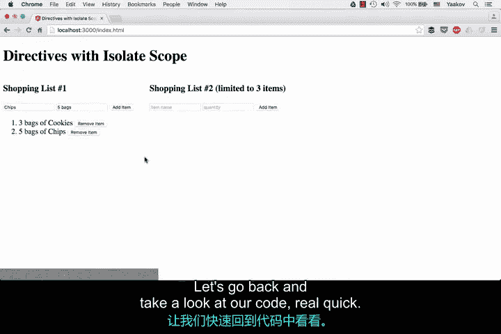
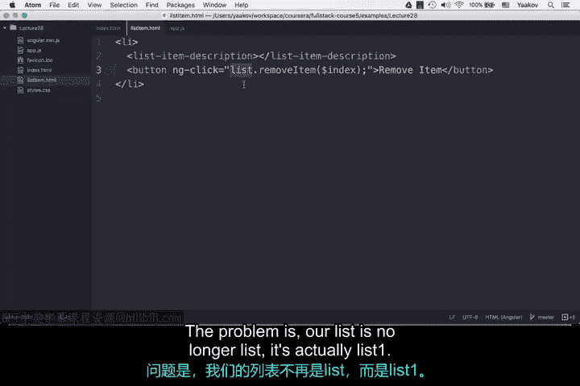
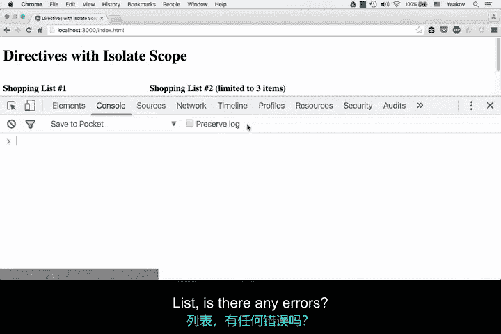
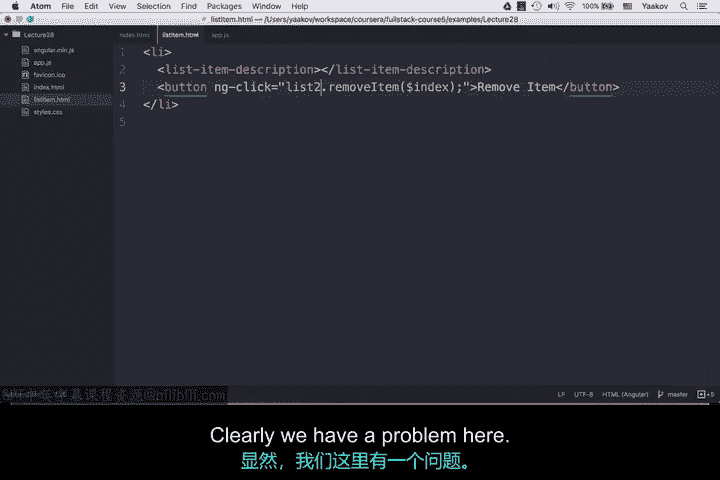
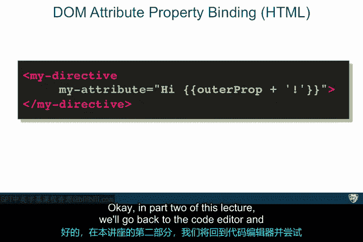

# 使用 AngularJS 开发单页 Web 应用：P55：指令：隔离作用域和&


在本节课中，我们将要学习 AngularJS 指令中一个非常重要的概念：**隔离作用域**。我们将探讨为什么需要隔离作用域，以及如何使用不同的绑定方式（`=`、`@`、`&`）将外部数据传递到指令内部。通过本课的学习，你将能够创建出更独立、可复用性更高的自定义指令。

## 概述

在之前的示例中，我们创建的指令默认使用其父控制器的作用域。这意味着指令内部的 `$scope` 对象与其父控制器的 `$scope` 是同一个对象。虽然这种设置在某些情况下看起来可行，但它带来了一个架构上的问题：指令过度依赖于特定的父控制器，导致控制器和指令之间存在过高的耦合度。

## 发现问题：指令与控制器过度耦合

让我们在代码编辑器中具体审视这个问题。我们有一个购物清单应用，其中包含两个购物清单，它们都使用了同一个自定义指令 `listItem`。

```html
<!-- 清单1 -->
<shopping-list list="list1">
  <list-item></list-item>
</shopping-list>

<!-- 清单2 -->
<shopping-list list="list2">
  <list-item></list-item>
</shopping-list>
```

问题在于，指令的模板中硬编码了对一个名为 `list` 的变量的引用（例如，在 `ng-click` 中调用 `list.removeItem(...)`）。当我们把第一个控制器的列表变量名从 `list` 改为 `list1` 后，指令就无法在第二个控制器中正常工作了，因为第二个控制器中并没有 `list1` 这个变量。

```javascript
// 指令模板中的问题代码
template: ‘<button ng-click="list.removeItem($index)">Remove Item</button>‘
```

这清楚地表明，我们的指令与其运行环境（父控制器）紧密耦合。为了使其更通用，我们需要一种方法，让父环境将所需的数据“传递”给指令，就像给函数传递参数一样。这就是**隔离作用域**要解决的问题。



## 引入解决方案：隔离作用域



正如前面提到的，在没有额外配置的情况下，指令会继承父作用域。为了打破这种继承关系，并为指令创建一个独立的作用域，我们需要在指令定义对象（DDO）中指定一个 `scope` 属性。

```javascript
app.directive(‘myDirective‘, function() {
  return {
    scope: {}, // 创建一个空的隔离作用域
    // ... 其他配置
  };
});
```

仅仅设置 `scope: {}` 就足以将指令的作用域与父作用域隔离开来。但是，如果作用域是隔离的，我们如何将外部数据传递到指令内部呢？答案是：通过**在 `scope` 对象中定义属性，并将它们与指令元素上的特定属性进行绑定**。

AngularJS 提供了几种绑定策略，本讲我们先介绍前两种：**双向绑定 (`=`)** 和 **DOM 属性字符串绑定 (`@`)**。



## 绑定策略一：双向绑定 (`=`)



使用 `=` 符号可以实现父作用域与指令隔离作用域之间的**双向绑定**。

```javascript
scope: {
  myProp: ‘=someAttr‘ // 双向绑定到名为 ‘some-attr‘ 的HTML属性
}
```

以下是关于双向绑定的关键点：
*   **双向通信**：如果父作用域中的值发生变化，指令内部的值会自动更新；反之，如果在指令内部修改了这个值，父作用域中的值也会同步更新。
*   **属性名推断**：如果省略属性名，AngularJS 会假设HTML属性名与 `scope` 中的属性名相同（遵循规范化规则，即驼峰命名 `myProp` 对应短横线命名 `my-prop`）。
*   **可选绑定**：在 `=` 后添加 `?`（如 `myProp: ‘=?‘`）表示这个绑定是可选的。指令内部的代码需要处理该值可能为 `undefined` 的情况。

在HTML模板中，我们这样使用：

```html
<my-directive some-attr="parentObject"></my-directive>
```

这里，`parentObject` 是父控制器 `$scope` 上的一个对象，它会被求值，然后其引用被传递给指令内部的 `myProp` 属性。

## 绑定策略二：DOM 属性字符串绑定 (`@`)

使用 `@` 符号可以将指令元素上某个 **DOM 属性的值**（始终是字符串）绑定到指令的隔离作用域。

```javascript
scope: {
  myProp: ‘@myAttribute‘ // 绑定到名为 ‘my-attribute‘ 的DOM属性值
}
```

以下是关于字符串绑定的关键点：
*   **单向绑定（外到内）**：这是一种单向绑定。当外部DOM属性的值改变时，指令内部的值会更新。但是，如果在指令内部修改 `myProp`，DOM 属性的值**不会**被更新。
*   **值是字符串**：通过 `@` 绑定获取的值总是一个字符串。
*   **支持插值**：你可以在属性值中使用 `{{ }}` 插值语法，AngularJS 会先对其进行求值。

在HTML模板中，我们这样使用：

```html
<my-directive my-attribute="{{ ‘Hello ‘ + userName + ‘!‘ }}"></my-directive>
```

在这个例子中，指令内部的 `myProp` 将被赋值为一个拼接后的字符串，例如 “Hello Alice!”。

## 总结与预告

本节课中我们一起学习了：
1.  **问题**：指令默认共享父作用域会导致与特定控制器**过度耦合**，降低可复用性。
2.  **解决方案**：通过设置 `scope: {}` 为指令创建**隔离作用域**。
3.  **数据传递**：为了在隔离后仍能获取外部数据，需要在 `scope` 对象中定义属性并进行绑定。
4.  **两种绑定策略**：
    *   **`=` （双向绑定）**：用于在父作用域和指令间建立双向数据同步，适合传递对象或变量。
    *   **`@` （字符串绑定）**：用于将DOM属性的字符串值（支持插值）单向传递到指令内部。




在下一部分（第28讲第2部分），我们将回到代码编辑器，运用隔离作用域和 `=` 绑定来重构我们的购物清单指令，解决其与控制器耦合的问题，并使其变得更加通用和健壮。我们还将介绍第三种绑定策略：`&`，它用于绑定父作用域中的表达式或函数。