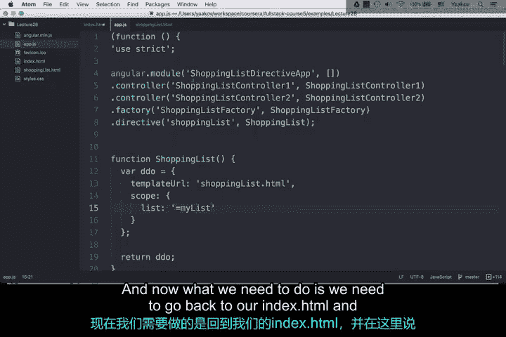
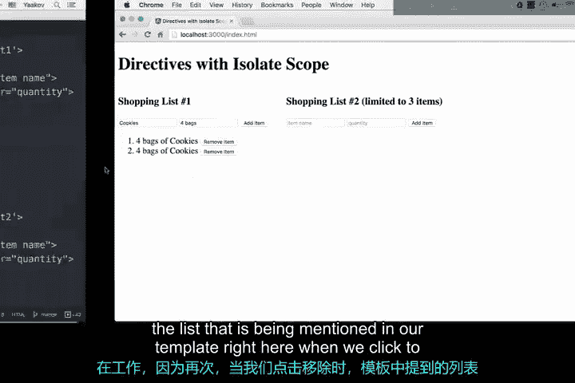
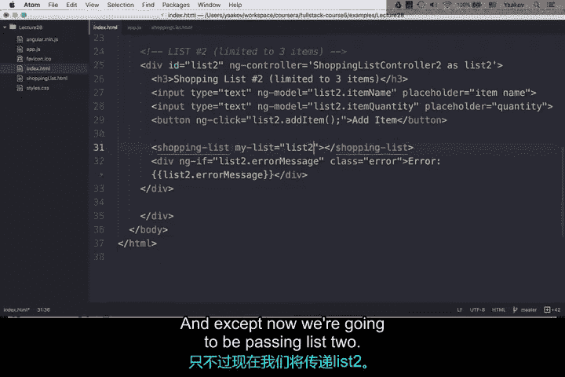
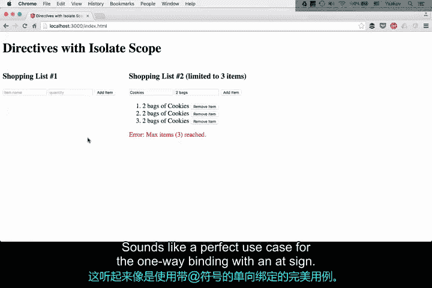
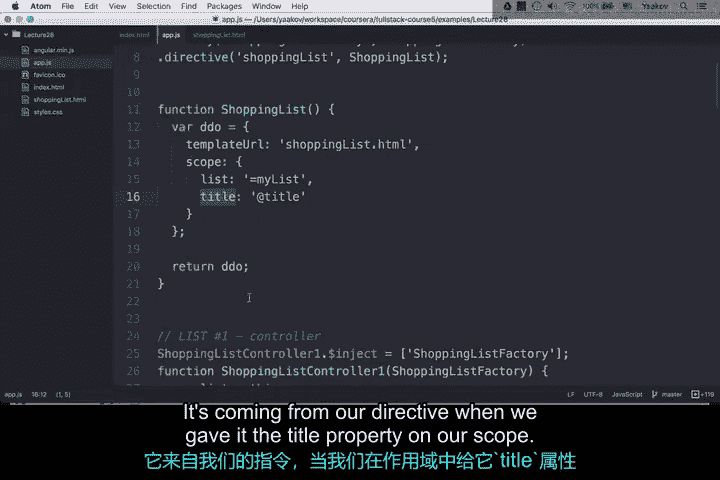
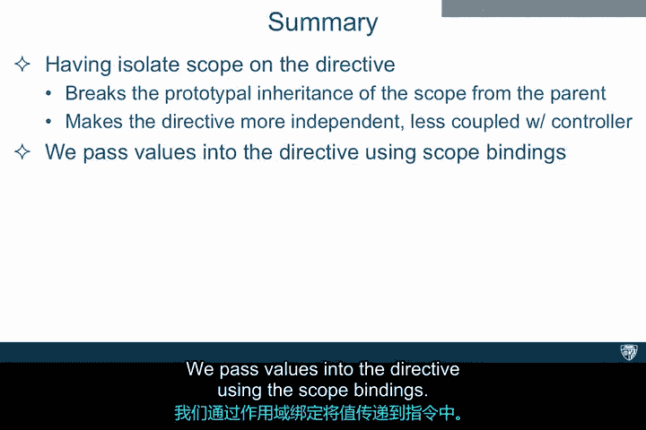
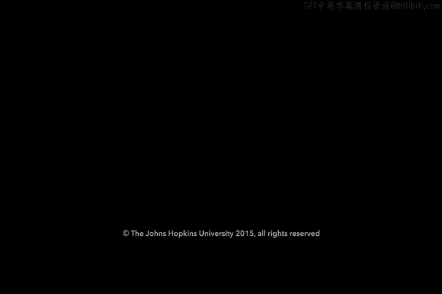

# 约翰霍普金斯大学《使用 AngularJS 开发单页 Web 应用｜Single Page Web Applications with AngularJS》中英 - P56：55_第28讲（第2部分）：指令：隔离作用域和&.zh_en - GPT中英字幕课程资源 - BV1dsFDeZEQr

🎼。

Okay so I'm back my code editoror in lecture 28 folder which is located in fulltag dash course 5 examples folder and this is the same app we discussed in part1 except I reverted everything back and I removed all custom directives from the application so we could start anew and what seems to me that we should do is we should just create a directive cold shopping list and the template for the shopping list directive should encompass all of this in other words the actual list so let's go ahead and start coding that let's go to Ab dot Gs and let's create a directive。

😊，With a directive method。Cllold shopping list。And notice the shopping list。

 the S is lowercase and the function we're going to create is called shopping list。

Let's go ahead and create that function now。And that function is going to have a DDO which is going to be an object。

 And let's just set up the framework here and it's going to return the DDO。

 So we don't forget to do that。 Okay， inside of our DDO， we need to， first of all。

 point to a template that iss going to be responsible for this。Directive。

 so we'll call it template URL， and we'll give it a path。 Let's call it shopping list that Htm。

 Let's say that for now。 and let's actually create shopping list that Html。

And we'll do is we'll place that whole piece that we wanted to replace right here。

 we'll just actually cut it out of here， make a little bit of a space here。

 and we'll go and place it right here。Now it's still referencing these labels from the controller and we don't want that。

 let's just call it something generic like list。And that actually looks pretty good so we'll save that and now in order for us to isolate our directive from the parent controller and at the same time pass this list of items into our directive。

 we need to create the isolate scope with a directive local property called list let's go ahead and do that first we'll go here we'll put a comma and we'll say scope so that's going to be an isolate scope and our directive property will be list。

😊，And it's going to be bound to something we'll call my list。 Let's go ahead and save that。

 And now what we need to do is we need to go back to our index at HTML and say shopping list right here as a tag and specify my list and again my list would be with a dash because we need to have a deormalize so then Angular will go ahead and create this property out of that okay and my list is going to be equal to and in this case since we're in list one my list is going to be equal to list one let's go ahead and save that and now if we go back to the browser the first list should work let's give it cookies for bags will add the list and you can see the list is working we could add multiple number of those and if we click the remove item。

The remove item is working as well because again， the list that is being mentioned in our template right here when we click the remove is actually the past in object。

 the past in object list， list one actually in this case。

 through the property my list so we could do exactly the same thing by copying this over and going over here in the second controller。

And just copying that over right here and except now we're gonna to be passing list to。

 let's save that We'll go back to the browser and let's call cookies。

 two bags of cookies and as we edit it will work until obviously hit the limit which is three for the second list so let's change something a little bit about how our list is constructed。

 The title of our list is kind of sitting on top of all the controllers to add things to the list What I really like to do is actually have the title of the list as being part of our list seems like they should go together and at least for the first list。

 I would like to have a total number of items in parentheses in the list so far。

 Obviously we want the parent controller to decide what the title would be even though the parent controller would know where the title goes but the actual title words it's something that the parent controller knows about and it should be in control of that but the directive should be the one displaying it。

 sounds like a perfect use case for the one way binding with。😊。

signSo let's go back to the code editor。 We'll go to our Abdo Gs and we'll add one more property here for the comment here。

 we'll say title and the property is going to be at and we'll just call it title。

 So this way the shopping list directive will require a title attribute that we're going to give it from the parenting controller in order for that to happen。

 let's go to the controller code and initialize that property。

 we'll go ahead and remember what the rich title was。😊。

A rich title and we'll get that title from our HTML。The original title was shopping list number one。

 let's go ahead and copy that， go back to AbGs and say the original title is shopping list number one。

 and we'll construct list that title which is our scope property now。

 we'll call it original title plus we'll give it a space parentheses we don't need this parentheses here yet。

 plus list that items length， that's the number of items in our list and we'll go ahead and close the parentheses right here。

 say items。The other way around items， close prints and obviously we need to do this again a couple more places when we change the number of items when we edit and also when we remove it。

 let's go ahead and save that and now let's go back to our shopping list and right on top of here we'll say H3 which is the same type of title and we'll say we'll interpolate our title right in here。

The title， this title name is coming from。 Let's say that。 It's coming from our directive。

When we gave it the title property on our scope， all that's left is to go to indexex@ HTML and specify the title。

 at least the original title。 So let's go ahead and remove this H3 out of here。😊。

We'll go to our shopping list directive and we'll say title equals to。

 and in this case we're going to interpolate what we have from the controller。

 this list one controller， so list one controller will be list one， thatt title。We'll save that。

 Let's verify that that's the name of the title in the list one controller and it sure is the title。

 So list that title is what we needed to place in here and this list that title is marked with a label list1。

 So if we'll go back to our application in the browser I see here that I forgot to put a space after the number So let's go back to our app do js and actually put a space between the number and the word items and I also need to change it in the other two places that I mentioned it right here。

 So we'll save that let's go back to the browser and we'll start adding cookies again。

 three bags of cookies and we'll add that。 And as you could see if I keep adding the number of items is changing and the entire title is changing because of that as well So if I remove things it will also get updated because the parent controllers scope title property is being updated and therefore our attribute value that is holding this actual string it interpolated again and gets past thin。

Into our directive over and over again。 So one more thing we need to do not have any errors is to specify the title for the second controller that we have and we could go back to the index at HTML and we'll go ahead and copy that second title right here we'll cut it over here we'll take out of here and we'll actually put it right on the shopping list'll say title equals to and we'll just cut and paste that string right there there's nothing wrong with that and we'll go back to our browser and you could see that the string is just straight up right there and we don't have any logic in the second controller to update this because this thing is limited to three items anyway。

 so we could again put cookies in here and Smithpell cookies that's very important to spell cookies correctly So we're gonna respell that again and as we keep adding obviouslyll hit our limit of three and that's it So we were now able to create a reusable directive a reusable component so to speak that we're able to use。

😊，Two separate controllers without the controller's properties affecting how we implement our directive。

 so we're able to pass a list of items from the controller number two that has list two label and from the controller number one that has list one label。

Okay， so let's summarize having isolate scope in the directive breaks the prototyal inheritance of the scope from the parent。

 but it also makes the directive more independent， therefore less coupled with a controller or whatever parent component the directive is living in。

We pass values into the directive using the scope bindings there's a couple that we learn。

 the first one is the bidirectional binding， which is signified by the equal sign。

 and in that type of scenario the directive scope property change affects the bound property and vice versa。

The other one we learned about was the DOm attribute value binding。

 and that's signified with the net sign。In this scenario。

 it always results in the directive property being a string。

The a property also acts like a unidirectional binding。

 meaning changes to the DOm attribute value are propagated to the directive property。

 but not the other way around。

