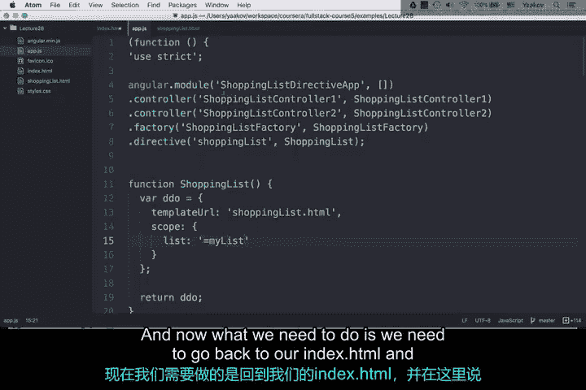
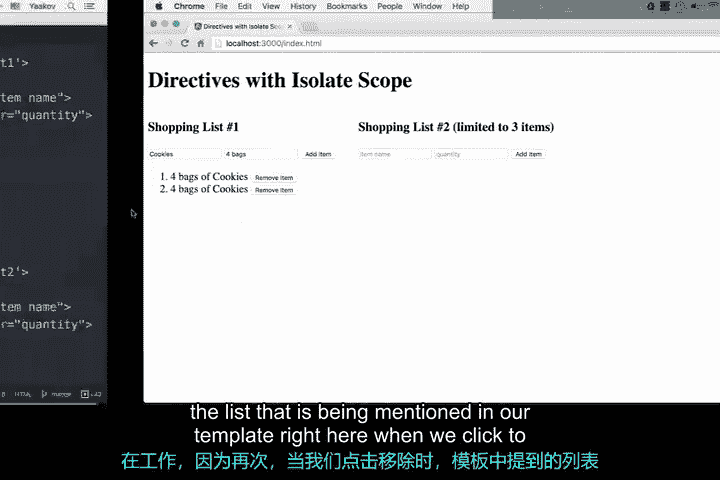
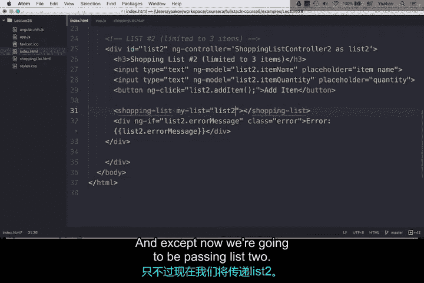
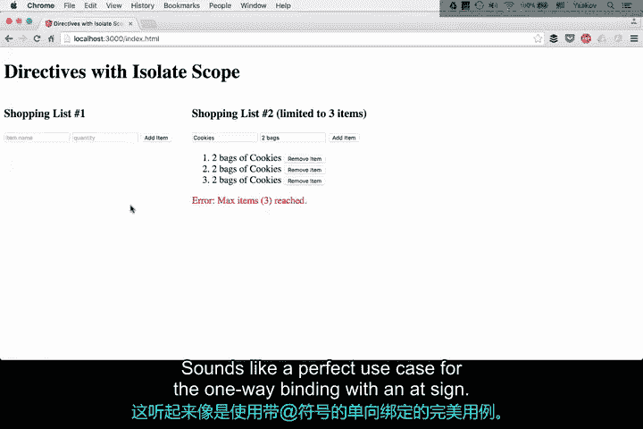
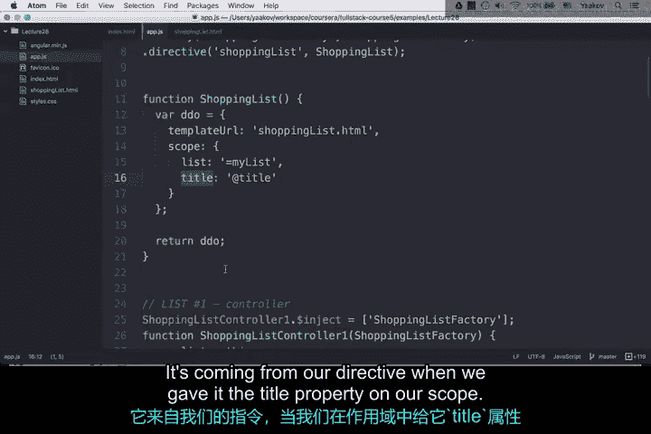
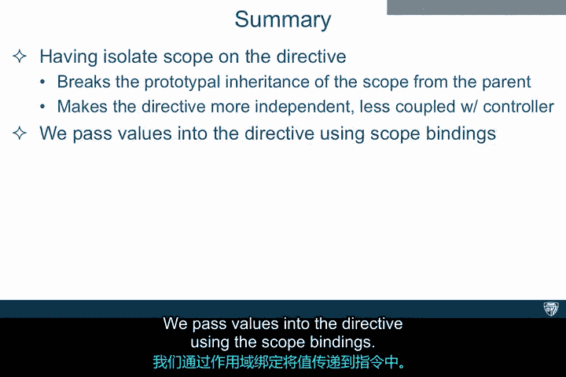

# AngularJS 单页应用开发：P56：指令：隔离作用域与&符号


## 概述

在本节课程中，我们将学习如何创建具有隔离作用域的 AngularJS 指令。我们将构建一个可复用的购物清单组件，并探讨如何使用不同的绑定方式将数据从父控制器传递到指令中。

---

## 创建购物清单指令

上一节我们介绍了指令的基础概念，本节中我们来看看如何构建一个实际的、可复用的指令。

首先，我们需要在代码编辑器中定位到 `lecture 28` 文件夹。这个应用与第一部分讨论的相同，但我们已经移除了所有自定义指令，以便从头开始。

接下来，我们将创建一个名为 `shoppingList` 的指令，其模板将包含整个购物清单的 HTML 结构。

以下是创建指令的步骤：

1.  在 `app.js` 文件中，使用 `directive` 方法注册一个名为 `shoppingList` 的指令。
2.  该指令的工厂函数将返回一个**指令定义对象**。
3.  在 DDO 中，我们首先需要指定模板的 URL。

```javascript
app.directive('shoppingList', function() {
  var ddo = {
    templateUrl: './shoppingList.tpl.html'
  };
  return ddo;
});
```

然后，我们创建 `shoppingList.tpl.html` 模板文件，并将之前位于控制器视图中的清单 HTML 结构剪切并粘贴到这个新文件中。在模板中，我们将对控制器的引用替换为更通用的名称，例如 `list`。



---

## 建立隔离作用域并传递数据



为了使指令独立于父控制器，同时又能接收来自控制器的数据，我们需要为指令创建隔离作用域。

我们将在指令的 DDO 中定义一个 `scope` 属性，它是一个对象，用于建立指令的隔离作用域并声明需要绑定的属性。

```javascript
scope: {
  list: '=myList'
}
```

这段代码意味着：在指令的隔离作用域内创建一个名为 `list` 的属性。这个属性将通过一个名为 `my-list` 的 HTML 属性，与父作用域中的某个表达式进行**双向绑定**。



现在，我们需要在 HTML 中使用这个指令。在 `index.html` 中，我们使用 `<shopping-list>` 标签，并通过 `my-list` 属性将控制器的数据传递进去。

```html
<!-- 对于第一个控制器 -->
<shopping-list my-list="list1.items"></shopping-list>
<!-- 对于第二个控制器 -->
<shopping-list my-list="list2.items"></shopping-list>
```

保存后，在浏览器中测试，第一个清单应该可以正常工作：可以添加项目，点击“移除”按钮也能成功删除项目。这是因为模板中 `ng-click="list.removeItem($index)"` 所引用的 `list`，正是通过 `my-list` 属性传入的 `list1.items` 对象。



我们为第二个控制器复制相同的指令标签，并传入 `list2.items`，第二个清单也能独立工作。

---

## 使用单向绑定传递标题

现在，我们希望将清单的标题也整合到指令中。标题内容应由父控制器决定，但由指令负责显示。这是一个使用**单向绑定**的典型场景。

我们回到指令的 DDO，在 `scope` 对象中添加一个新的绑定属性。



```javascript
scope: {
  list: '=myList',
  title: '@' // 使用 @ 符号进行单向绑定
}
```

这里，`title: '@'` 表示指令的 `title` 属性将与一个 DOM 属性的字符串值进行绑定。这是一种单向绑定：当父作用域中对应表达式的值发生变化时，指令中的 `title` 会更新，但指令内部对 `title` 的修改不会影响父作用域。

接下来，我们需要在父控制器中设置标题。我们在第一个控制器的逻辑中动态计算标题，使其包含项目数量。

```javascript
$scope.title = $scope.originalTitle + " (" + $scope.items.length + " items )";
```

我们需要在添加、编辑和移除项目时都更新这个 `title` 属性。

然后，在指令模板 `shoppingList.tpl.html` 的顶部，使用插值表达式显示标题。

```html
<h3>{{ title }}</h3>
```

最后，在 `index.html` 中使用指令时，通过 `title` 属性传递标题值。

```html
<shopping-list my-list="list1.items" title="{{ list1.title }}"></shopping-list>
<shopping-list my-list="list2.items" title="Shopping List #2 (Max 3 items)"></shopping-list>
```

现在，第一个清单的标题会随着项目数量的增减而动态更新。第二个清单的标题则是一个固定的字符串。这样，我们就创建了一个高度可复用、与父控制器解耦的指令组件。

---

## 总结

本节课中我们一起学习了 AngularJS 指令中隔离作用域的核心用法。



1.  **隔离作用域的作用**：它打破了指令作用域从父作用域的原型继承链，使指令更加独立，降低了与父组件（如控制器）的耦合度。
2.  **传递数据的绑定方式**：我们学习了两种主要的绑定方式。
    *   **双向绑定 (`=`)**: 使用等号 `=` 声明。在这种方式下，指令内部属性与父作用域属性是双向联动的。任何一方的修改都会影响另一方。
    *   **单向属性绑定 (`@`)**: 使用 `@` 符号声明。这种方式将 DOM 属性的值（始终是字符串）传递给指令。它是单向的：父作用域属性的变化会传递给指令，但指令内部对属性的修改不会传回父作用域。


通过结合使用这些技术，我们可以构建出模块化、可测试且易于维护的 AngularJS 组件。