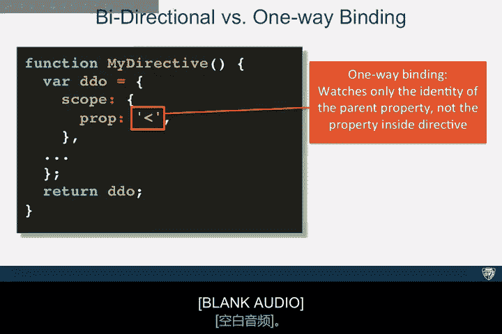

# 约翰霍普金斯大学《使用 AngularJS 开发单页 Web 应用｜Single Page Web Applications with AngularJS》中英 - P57：56_第29讲（第1部分）：在指令内使用控制器.zh_en - GPT中英字幕课程资源 - BV1dsFDeZEQr

🎼。

It's very often the case that we want our directives to do more than just serve as a template holder。

 which does simplify our code， making it more readable， semantic and reusable。

 it's often the case that we want to bundle behavior with the directive。😊。

We have a couple of options as to how to get that accomplished。

 but one of those options is to declare a controller directly on the directive。😊。

Let's take a look at a few required steps to get that done。

The first thing to do is to provide yet another property called controller or our directive definition object or DDO。

 the value of that property should be a function that will implement a controller。

The way this function works is exactly same as any other controller we've been coding so far。 Now。

 if we left it at just specifying the controller function。

 the properties that are declared on our isolate scope would now be available on the dollar sign scope inside of our controller Obviously we would need to inject the dollar sign scope on our controller just like you would need to do that for any other controller to access the properties on the scope。

 however， remember when we first introduced controllers and we explained that it was the best practice not to place properties directly on the scope but place them on the instance of the controller itself and have angular attach that controller instance as a property on the scope。

 that was the controller as syntax and this is what the other two properties here are about。

 The first one the bind to controller property tells angular to place our isolate scope properties onto the controller instance instead of directly on the scope。

😊，The other property specifies the label in our controller at syntax so we can use that label to refer to scope properties and methods in the HTML template in this example in our template that HTML。

 we would refer to properties using my CTRL label。😊。

Implementing the controller function should be familiar since we use the controller as syntax。

 we should follow the best practice and attach any additional properties and methods to this variable here I'm using yet another best practice and that is to store a reference to this variable in the local variable first and then use that local variable to attach properties and methods to the instance of this controller。

I can now use and manipulate the declared isolate scope properties as well as other properties I defined here in the controller myself。

 Note one obvious point， since we declared our directive scope to be isolate scope。

 anything we attached to that scope is still inside the isolate scope and not just what was mapped through the scope declaration in the DD or the directive definition object。

The last step is to use our properties and methods in a directive template。

 note that I'm using the label My CTRL that I declared as the value of the controller as property on the DDO or the directed definition object。

One more thing worth mentioning before we jump into the code editor。

 we have been declaring nonstr values with an equal sign。 That's bidirectional binding。

 In the case of bidirectional binding， both sides， the property in the directive and the property in the parent are watched for changes。

 and then those changes are synchronized。 However， it's a best practice to try to avoid changing the values inside of the directive。

 Either way， certainly if we have no plans of changing the bound value inside of the directive。

 we're wasting resources because Angular is setting up extra watches inside of our directive that will be always checked but never used。

😊，So we will use one way binding symbol which is a less than symbol whenever possible One way binding watches only the identity of the parent property。

 not the property inside of the directive obviously one- way binding does not change how ja fundamentally works So if you pass in a primitive like a number using one- way binding。

 one way binding can guarantee that the value outside of the directive will not be affected by anything you do in the directive with a past in value however。

 if you pass in an object and your directive changes the value of a property of that object while no watchers will be set up or triggered as a result。

 the context outside of your directive will definitely be affected since the change will be visible outside of the directive。

Remember that in JavaScript， objects arepassed by reference and both your directive and the context outside of your directive point to the same object。

So while setting up one way binding will help with performance because Angular will not set up extra watches。

 it simply cannot guarantee that the object's properties aren't changed by the directive。Okay。

 let's get back to the code editor and see these concepts in action。

