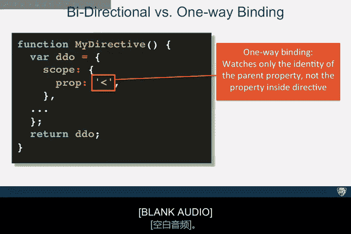

# 使用 AngularJS 开发单页 Web 应用：P57：在指令内使用控制器


## 概述

在本节课中，我们将学习如何在 AngularJS 指令中定义和使用控制器。这将使我们的指令不仅能作为模板容器，还能封装特定的行为逻辑，从而提升代码的可读性、语义化和可复用性。

## 在指令中定义控制器

上一节我们介绍了指令的基本概念和隔离作用域。本节中我们来看看如何为指令添加控制器，以赋予其更复杂的行为。

我们可以在指令定义对象中，通过添加一个名为 `controller` 的属性来实现。该属性的值应为一个函数，此函数将作为控制器的实现。

```javascript
angular.module('myApp').directive('myDirective', function() {
  return {
    scope: {},
    controller: function() {
      // 控制器逻辑
    },
    // ... 其他属性
  };
});
```

此控制器函数的工作方式与我们之前编写的任何其他控制器完全相同。

## 控制器与作用域属性的绑定

如果仅仅指定控制器函数，那么声明在隔离作用域上的属性，现在可以通过控制器内的 `$scope` 对象访问。当然，我们需要像其他控制器一样注入 `$scope`。

然而，我们之前介绍控制器时曾解释过，最佳实践不是将属性直接放在 `$scope` 上，而是放在控制器实例本身，并让 Angular 将该控制器实例作为 `$scope` 的一个属性附加。这就是“controller as”语法。

为了实现这一点，我们需要在指令定义对象中使用另外两个属性。

以下是实现“controller as”语法和属性绑定的关键步骤：

*   **`bindToController` 属性**：此属性告诉 Angular 将隔离作用域属性绑定到控制器实例上，而不是直接绑定到 `$scope` 上。
*   **`controllerAs` 属性**：此属性指定在“controller as”语法中使用的标签。在 HTML 模板中，我们可以使用这个标签来引用作用域属性和方法。

```javascript
angular.module('myApp').directive('myDirective', function() {
  return {
    scope: {
      myData: '='
    },
    bindToController: true,
    controllerAs: 'myCtrl',
    controller: function() {
      // 控制器逻辑
      // 现在可以通过 `this.myData` 访问隔离作用域属性
    }
  };
});
```

## 实现控制器函数

实现控制器函数应该很熟悉，因为我们使用了“controller as”语法。我们应该遵循最佳实践，将任何额外的属性和方法附加到 `this` 变量上。

这里我使用了另一个最佳实践：首先将 `this` 变量的引用存储在局部变量中，然后使用该局部变量将属性和方法附加到控制器实例上。

```javascript
controller: function() {
  var ctrl = this;
  ctrl.someProperty = 'Hello';
  ctrl.someMethod = function() {
    // 方法逻辑
  };
  // 可以访问和操作声明的隔离作用域属性 `ctrl.myData`
}
```

需要注意一点，由于我们声明指令的作用域为隔离作用域，因此我们附加到该作用域的任何内容都仍在隔离作用域内，而不仅仅是通过 DDO 中的 `scope` 声明映射的内容。

## 在指令模板中使用控制器

最后一步是在指令模板中使用我们的属性和方法。请注意，我使用的是在 DDO 的 `controllerAs` 属性中声明的标签 `myCtrl`。

```html
<template>
  <div>{{ myCtrl.someProperty }}</div>
  <button ng-click="myCtrl.someMethod()">Click Me</button>
</template>
```

## 关于单向绑定的说明

在深入代码编辑器之前，还有一点值得提及。我们一直使用等号 `=` 来声明双向绑定。在双向绑定的情况下，指令中的属性和父级中的属性都会被监视变化，然后同步这些变化。

然而，最佳实践是尽量避免在指令内部更改传入的值。无论如何，如果我们没有计划在指令内部更改绑定的值，那么我们就是在浪费资源，因为 Angular 会在我们的指令内部设置额外的监视器，这些监视器会一直被检查但从未被使用。

因此，我们将尽可能使用单向绑定符号 `<`。单向绑定只监视父级属性的标识，而不监视指令内部的属性。

**公式**：`scope: { myValue: '<' }`

显然，单向绑定不会改变 JavaScript 的基本工作原理。因此，如果你使用单向绑定传入一个原始值（如数字），单向绑定可以保证指令外部的值不会受到你在指令内部对传入值所做的任何操作的影响。

然而，如果你传入一个对象，并且你的指令更改了该对象的某个属性值，虽然不会因此设置或触发监视器，但指令外部的上下文肯定会受到影响，因为这种更改在指令外部是可见的。

请记住，在 JavaScript 中，对象是通过引用传递的，你的指令和指令外部的上下文都指向同一个对象。

因此，虽然设置单向绑定有助于提高性能（因为 Angular 不会设置额外的监视器），但它根本无法保证对象的属性不会被指令更改。

## 总结



本节课中我们一起学习了如何在 AngularJS 指令中集成控制器。我们了解了在指令定义对象中定义 `controller` 函数，以及如何使用 `bindToController` 和 `controllerAs` 属性将隔离作用域属性优雅地绑定到控制器实例上。我们还探讨了在指令模板中通过控制器别名来访问属性和方法的最佳实践。最后，我们讨论了双向绑定与单向绑定的区别，以及何时使用单向绑定 `<` 来优化性能。通过这些步骤，我们可以创建出功能更强大、结构更清晰的指令。