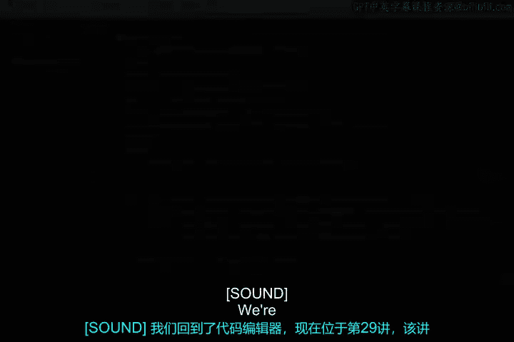
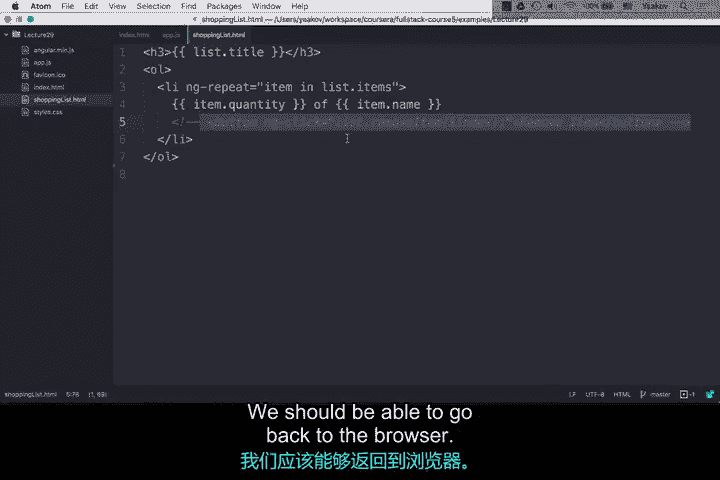
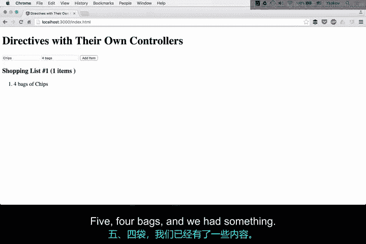
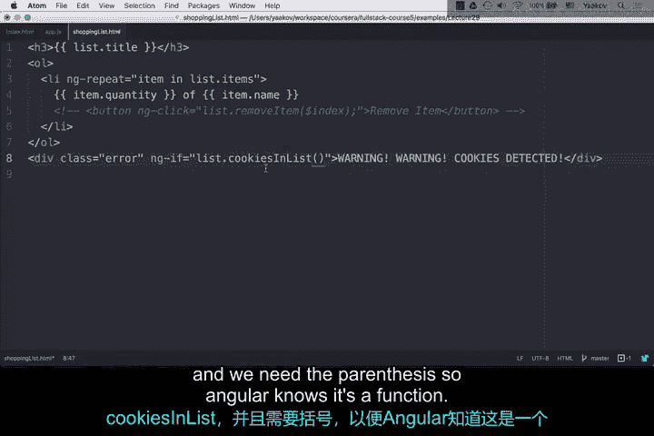
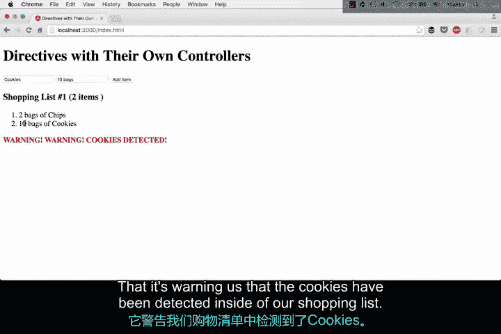
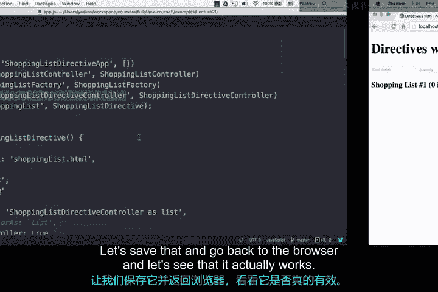
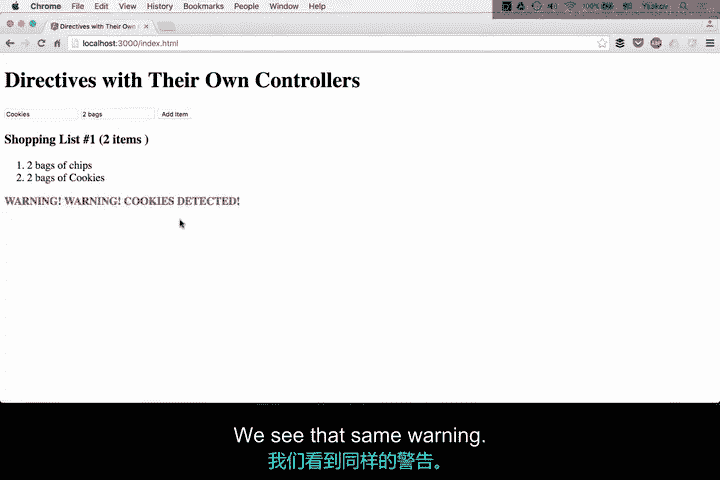
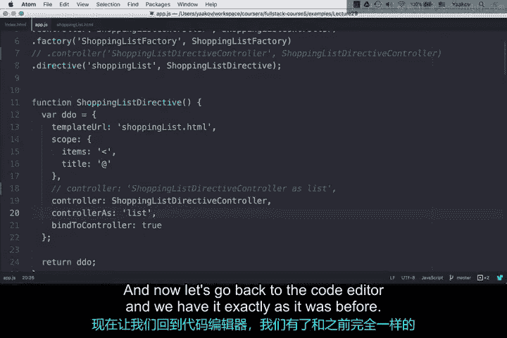
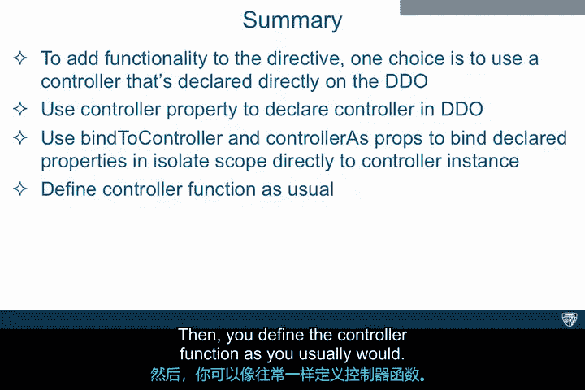
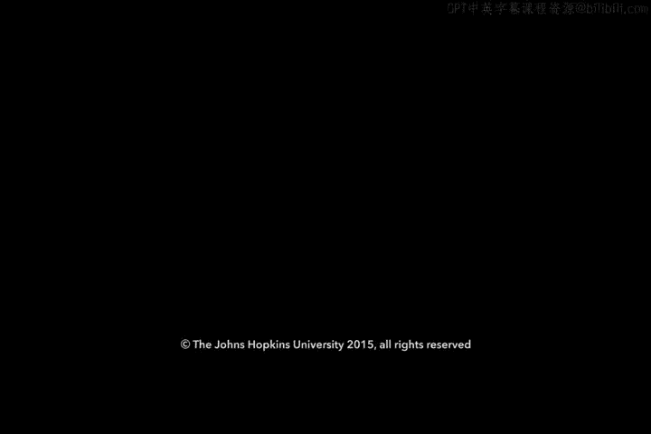

# 约翰霍普金斯大学《使用 AngularJS 开发单页 Web 应用｜Single Page Web Applications with AngularJS》中英 - P58：57_第29讲（第2部分）：在指令内使用控制器.zh_en - GPT中英字幕课程资源 - BV1dsFDeZEQr

🎼。

Okay we're back to our code editor and we're located in lecture 29。

 which is located in fulltag dash course 5 examples folder and this is the same shopping list application we've been working with except this time we're going to combine some behavior together with our shopping list directive Now the shopping list directive basically lists all the things in our shopping list and prior to this lecture we used to have another div right here that used to be the error message so if something was detected that's wrong the error message would be outside of our shopping list if you think about this a little bit more in a component type of fashion really the error message should be part of the shopping list directive。

 After all the shopping list knows about the items in the list and it can decide whether or not an error message should be displayed So that's exactly what're going to do and to do that we're going to declare our own controller on the shopping list I already remove the error message from the main index at HTML let's save that and go to Abdojs。

So here the first thing you see is it's basically the same directive we had before。

 except we change the items from an equal sign to the less than sign which is a one- way direction。

 we're not really planning to change anything about the items so one way binding is plenty okay so the first thing we want to do is declare a controller we do that through a controller property and we'll call it shopping list directive controller to distinguish it from the other controllers and we also want to follow the best practices so we'll say controller as and we'll give it a label called list so that means in our shopping list that HTML we'll be able to refer to the shopping list directive controller instance through this label called list and that's where the items and title properties will show up on they will show up on the instance of the actual controller which we're going call list inside the shopping list that HTML。

One more thing we need to make sure is to tell Angular that we actually want to bind all of these scope variables of scope properties to our controller and for that we'll just say bind to controller。

😊，And we'll call it true we'll say true， So now it's bound to controller Obviously we now need to implement our shopping list directive controller we'll go right below the actual function that declares directive and we'll say function we'll give it the name and inside we'll do the best practice of storing this keyword inside the local variable。

So now it is list and again this list obviously has absolutely nothing to do with this one other than the fact that this is a local variable named the same as this list that is going to be a label on the shopping list direct controller will we reference it inside the shopping list that HL but here inside of our controller it's nothing more than a local variable and the functionality want to implement is that if there is a cookie as part of our shopping list won to display a warning Yeah I know I'm obsessed about cookies but what can you do。

And we want that functionality to be sitting inside of the controller， not outside of our directive。

 so this would be a place to define it and the way we define it。

 Jessica we define anything else in the controller。

 we define it through the this keyword in this case it's going to be list' one the same so we'll say cookies in list and we'll define a function don't need a name and it's going to be a bullan is going to return a boolean either it has cookies in list or not and actually prepare some code right here and all we're going to do is let me copy and paste it right here。

😊，All we're going to do is we're going to loop over our list items。

 the items that got bound to the scope right here。 so and we're referring to them by this keyword。

 which is now list So list that items that length're basically looping over all the items in the list and all we're doing is just checking whether or not cookie string is part of it。

 if it is， then we're going to return true and if we go through the entire list and it's not there。

 we'll return false。 Okay so let's save that and the last thing we need to do is actually use it in our template。

 which is shopping list that HTML and you see here this is leftover code from a previous time we're still referring to our scoped properties directly without the label of the controller as syntax and we remember that the label was list we could just start saying list do and it's item in items or actually it's list that items and the rest we're can just leave along this button right here that I commented out we're going to deal with in a different lecture So let's go ahead and save that。

And we should be able to go back to the browser and now if we go ahead and say something like chips。

5，4 bags and we had something so that's working， we could keep adding some stuff in here but we didn't actually activate our special function here。

 which is cookies in list， So in order to do that， we're going put another div right below that。

And we're going to say class error， actually， because we defined an error class。

 which is in the styles。 you could look at the styles， just makes the whole thing bold and red。

 and we're going to do one more thing。 we're going to say here warning。Warning。

 close the file browser so you could see it better， cookies detect it。Very dire warning right here。

 So the point is we want this warning to show up only when there are cookies inside of our list。

 So how do we do that？ Well， we could do it easily with N G if。

And we could say if list that cookies in。List and we need the print。

 so Angular knows it's a function。 and we're going to save that。 And now if we go back to our。

Browser and will say chips。You know， three， two bags of chips and everything is good。

 but we say cookies。Let's get 10 bags of that。And when we do that。

 the warning shows up immediately right here that it's warning us that the cookies have been detected inside of our shopping list。

Now let me go back to the coder in the for a second because there's one more way we could have declared our controller。

 Let's take a look at this controller right here。 We see that we declared the controller directly as a function value we didn't really have to do that we could declare our controller on the module itself and then use it right here So let's try to do that just to see how that works。

 let's say controller and we'll give the controller a name。

 we'll give a controller exactly the same name as the name of the function so we don't get confused and now we have a controller that we could now reference through this string anywhere inside this angular module So then when we say controller here。

 we could do is we could put it in quotation marks right here and we don't even need the controller as we could just say as list right here and then we could comment this out right there and save it So we're binding everything to the controller and the controller as list is now。

😊，Being done through a string because Angular will look up the string to see if there's any such component exists in its module and now it will。

 because we just declared one and let's save that and now we can actually use this controller in more than one place we could use it in this directive but we could use it somewhere else as well so we could definitely have a reusable controller and not just in this file because here obviously in this file。

 we could reuse this function without any problems but if it wasn't a different file and we're still working off of the same module if we left this just as a regular local function inside of this ify function。

 it wouldn't be visible however， once we stuck it as a declared controller on the angular module anywhere this module is being referenced we can actually retrieve this controller and reuse it so let's save that and go back to the browser and let's see if that it actually works let's say chips。

Two bags of chips。And it's adding the bags of chips， let's say cookies。

 two bags of cookies and we add it we see the same warning so basically you can declare it either way you want for our purposes I will just comment this out so you have this code but I will actually put it back the way it was maybe I'll just comment this out as well and put controller here。

And we'll say shopping。List controller and put a comma here and we'll come and this out as well。

 And now let's go back to the code editor and we have it exactly as it was before。 Now。

 if we say chips， two bags。

It works and we say cookies。And the di warning shows up that cookies have been detected。

So let's summarize。To add functionality to the directive。

 one choice is to use a controller that's declared directly on the DDO。

 the directive definition object。In order to do that。

 you use the controller property on the DDO to declare that controller。

 since the best practice is to use the controller S syntax， even inside the directive。

 you have to use the bind to controller and controller S properties to bind the declared properties in isoscope directly to the controller instance。

Then you define the controller function as you usually would。

One last point， whenever possible use the less than sign for a one way binding to save resources instead of the bidirectional binding with the equal sign。

 the one way binding is not only preferred for performance reasons。

 but also architecturally because it is usually a bad practice to change the objects that are passed in into the directive。

