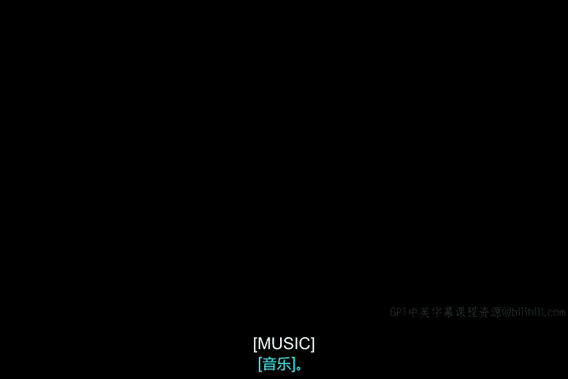
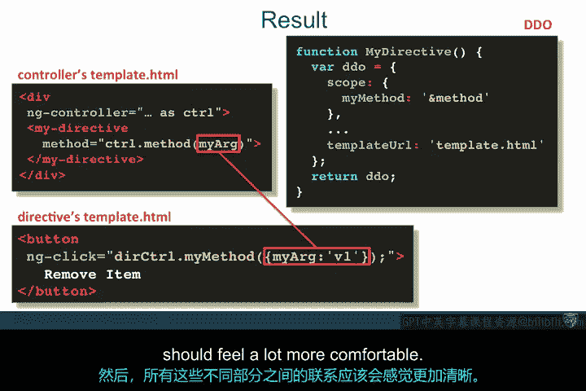

# 约翰霍普金斯大学《使用 AngularJS 开发单页 Web 应用｜Single Page Web Applications with AngularJS》中英 - P59：58_第30讲（第1部分）：指令API和&.zh_en - GPT中英字幕课程资源 - BV1dsFDeZEQr

🎼。

There are times when it makes sense that the directive should invoke a method on its parent passing it some data only our directive would know about。

 like what item was clicked in the list based on the original data given to the directive。

For example， say you have a directive like the one we've been working with the shopping list directive that's responsible for displaying the shopping list。

 It may also be responsible for providing a button to remove an item from the list However。

 it's the parent that's in charge of that data The shopping list directive only displays the list It has no idea and shouldn't have any idea what should happen if someone wants to remove something from the list。

😊，Maybe some side effect needs to occur that has nothing to do with the responsibilities of our directive。

The actual data manipulation like removal of an item needs to happen in the parent controller in other words we need to set up a link from the directive to some method on the parent and then provide some data from the directive to that parent' method for execution however we must be careful the parent has to execute that method in the parent's context。

 not in the directive's context。That means that when we call the parents method and that method tries to use the dollar sign scope。

 it should refer to the parent's scope， not the directive's isolate scope。

This is accomplished with the reference binding signified by the Ampersent sign and some additional syntax that we'll see in the following steps。

Obviously， we need to start with the requirement to call some parent controllers method in this example。

 we're calling the method method， which is a function that takes one argument。

 note that we're using that this keyword to define this method as a property over the controller's instance and that it is obviously very important that this keyword stays referring to the instance of this controller The argument declared here as arg1 needs to come from the child directive。

In the DDO， the directive definition object， we declare a My method isolate scope property which will serve as the property name we can reference the past in method that exists on the parent controller scope。

 the reference with the Emperserson sign will be followed by the name method。

 which is what will need to use in the parent HTML template to pass in the reference to the parent method。

 again not much new here， the property name is used by the directive and the value of that property is used by the parent controller that references that value inside of its HTML。

In step 3， we'll use our directive in the parent controller template。

 specifying the method attribute we declared in the DDO and providing a reference to the controller's method as a value。

Note here that my Arc argument passed in here is simply a key which will later use to assign something from the directive's isolate scope we are not actually passing in the My arg argument from the controller to the my directive as it appears here I know it's a bit of an weird syntax because that's exactly how it appears。

 but remember with the Emperserson sign reference binding the argument name in the call is simply a key will later use to map a value from the directive to that key with which angular will gl call our controller's method。

😊，This can get a little bit confusing， so don't get frustrated too quickly and wait for the coding example to put it all together in your mind。

 We still have one more step。Finally， in the directive template。

 we trigger the mapped controller's method call by using our directives controller as a label DIR CTRO and invoking the method my method as declared on the isolates co binding。

 but notice what we're passing into the method， not your regular argument。

 instead we're using the name of the argument that parent made the call with and mapping some value to it from our directive。

So what we're passing into the method is a map object， not a single argument， my arc。

The keys in that map object have to correspond to the argument name or names the parent controller declared the call with。

So just to be clear， the name of the argument we used in the controllers template HTML shown at the top is the key we use to map a directive internal value to by passing in an object with the argument name as that key。

😡，Okay， so let's try to visually put it all together to make things as clear as possible before we jump into the code editor。

You have some functionality in your controller that you won't execute when something happens inside of your directive housed in your controller's template。

 after all， the controller has the handle on the data and you want your directive to only display that data not manipulate it。

😊，The controller has a method called method that takes one argument。

We need to pass our method into the directive as a reference so that the directive can delegate the call to this method whenever something happens inside of the directive that only the directive will know about for example。

 whenever somebody clicks on a button inside of the directive template the way we pass a reference to the controller's method is by using an attribute that matches what we've declared to be in the DDO in this case the attribute name is method。

😊，That means that our directive's internal way of referring to that method is now my method if we wanted to call the controller's function passed into our directive。

 the name we have to use is my method and since we're using controller as syntax inside of our directive。

 my method will be bound to the directive's controller instance not directly to the directive's scope。

 so when we call my method inside of our directive template is going to be prefixed with the label that our directive's controller is declared with。

😡，Now， inside of our directive， when a user clicks in a button， we can invoke my method。

 which is just an alias to the outer controllers method that was passed into our directive。

The last task is to make sure to properly pass the data from our directive to the outer controller's method。

 we do that by passing in an object whose property names must match the argument names of the method call in the controller's template。

S， that was a lot my suggestion to you is to go through this lecture again once you've seen an example in part two。

 and then all these connections between different parts should feel a lot more comfortable。😊。

Okay， let's jump into the code editor and see these concepts in action。

