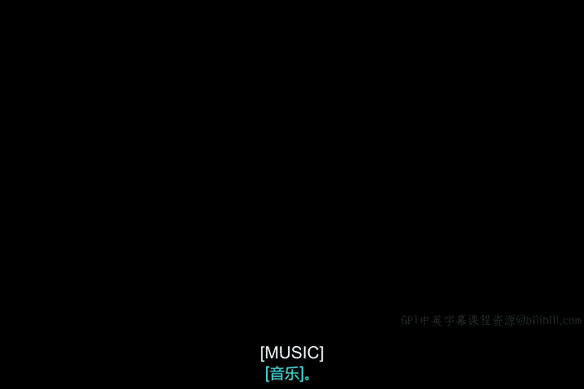
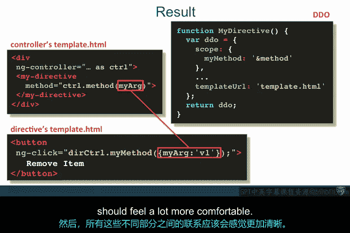

# AngularJS 单页应用开发：P59：指令API与&绑定

## 概述
在本节课中，我们将学习AngularJS指令API中的一个重要概念：使用`&`符号进行引用绑定。这种绑定方式允许指令调用父控制器中的方法，并将指令内部的数据传递给该方法。

## 指令与父控制器的通信场景

有时，指令需要调用其父控制器中的方法，并传递一些只有指令自身才知道的数据。

例如，基于最初提供给指令的数据，传递列表中哪个项目被点击了。

假设你有一个类似于我们一直在使用的购物清单指令，它负责显示购物清单。

它可能还负责提供一个按钮，用于从列表中移除项目。

然而，负责管理这些数据的是父控制器。购物清单指令只负责显示列表。它不知道，也不应该知道如果有人想从列表中移除项目时应该发生什么。

也许需要发生一些与指令职责无关的副作用。

实际的数据操作，例如移除项目，需要在父控制器中进行。换句话说，我们需要在指令和父控制器的某个方法之间建立链接，然后从指令向父控制器的方法提供一些数据以供执行。

然而我们必须小心，父控制器必须在自己的上下文中执行该方法，而不是在指令的上下文中。

这意味着当我们调用父控制器的方法，并且该方法尝试使用`$scope`时，它应该引用父控制器的作用域，而不是指令的独立作用域。

这是通过引用绑定实现的，用`&`符号表示，我们将在后续步骤中看到一些额外的语法。

## 实现步骤详解

显然，我们需要从调用父控制器中某个方法的需求开始。

### 步骤1：在父控制器中定义方法

在这个例子中，我们调用`method`方法，这是一个接收一个参数的函数。

请注意，我们使用`this`关键字将此方法定义为控制器实例的一个属性。`this`关键字保持指向此控制器的实例显然非常重要。

这里声明的参数`arg1`需要来自子指令。

### 步骤2：在指令定义对象中声明绑定

在DDO中，我们声明一个`myMethod`独立作用域属性，它将作为属性名，用于引用父控制器作用域上存在的传入方法。

`&`符号后的引用将跟随名称`method`，这是在父HTML模板中需要使用的名称，用于传递对父方法的引用。

这里没有太多新内容，属性名由指令使用，而该属性的值由父控制器使用，父控制器在其HTML内部引用该值。

### 步骤3：在父控制器模板中使用指令

在父控制器模板中使用我们的指令，指定在DDO中声明的`method`属性，并提供对控制器方法的引用作为其值。

请注意，这里传入的`myArg`参数只是一个键，稍后将用于分配来自指令独立作用域的内容。我们实际上并没有像这里显示的那样将`myArg`参数从控制器传递给指令。

我知道这语法有点奇怪，因为它看起来就是这样。但请记住，使用`&`符号引用绑定时，调用中的参数名只是一个键，稍后我们将使用该键将指令中的值映射到该键，Angular将用此键调用我们控制器的方法。

这可能会让人有点困惑，所以不要过早感到沮丧，等待编码示例将这一切在你的脑海中整合起来。

我们还有一个步骤。

### 步骤4：在指令模板中触发方法调用

最后，在指令模板中，我们通过使用指令的控制器作为标签`dirCtrl`，并调用在独立作用域绑定上声明的`myMethod`方法，来触发映射的控制器方法调用。

但请注意我们传递给方法的内容：不是一个常规参数。

相反，我们使用父控制器调用时使用的参数名，并将指令中的某个值映射给它。

所以我们传递给方法的是一个映射对象，而不是单个参数`myArg`。

该映射对象中的键必须与父控制器声明调用时使用的参数名对应。

为了更清楚，我们在控制器模板HTML顶部使用的参数名，就是我们通过传入一个以该参数名为键的对象，将指令内部值映射到的键。

## 概念梳理与总结

好了，在我们跳转到代码编辑器之前，让我们尝试直观地将所有内容整合起来，使其尽可能清晰。

你的控制器中有一些功能，你希望当指令内部发生某些事情时执行这些功能，而该指令位于控制器的模板中。

毕竟，控制器掌握着数据，你希望指令只显示这些数据，而不是操作它。

控制器有一个名为`method`的方法，它接收一个参数。

我们需要将我们的方法作为引用传递给指令，以便当指令内部发生某些只有指令自己知道的事情时，指令可以将调用委托给这个方法。

例如，每当有人在指令模板内点击一个按钮时。我们传递对控制器方法的引用的方式，是使用一个与我们已在DDO中声明的属性相匹配的属性。在这个例子中，属性名是`method`。

这意味着我们的指令内部引用该方法的方式现在是`myMethod`。如果我们想调用传入指令的控制器函数，我们必须使用的名称是`myMethod`。由于我们在指令内部使用控制器即语法，`myMethod`将绑定到指令的控制器实例，而不是直接绑定到指令的作用域。

所以当我们在指令模板内调用`myMethod`时，它将加上我们声明指令控制器时使用的标签作为前缀。

现在，在我们的指令内部，当用户点击按钮时，我们可以调用`myMethod`，它只是传递给指令的外部控制器方法的一个别名。

最后一项任务是确保将数据从指令正确传递给外部控制器的方法。我们通过传入一个对象来实现这一点，该对象的属性名必须与控制器模板中方法调用的参数名匹配。

## 结束语

本节课中我们一起学习了AngularJS指令API中的`&`引用绑定。这是一种强大的机制，允许指令安全地调用父控制器中的函数，并传递指令内部的数据，同时保持数据操作逻辑在父控制器中，符合关注点分离的原则。

内容很多，我的建议是，在你看到第二部分中的示例后，再回顾一遍本讲内容，那么不同部分之间的所有这些联系应该会感觉清晰得多。

好了，让我们跳转到代码编辑器，看看这些概念的实际应用。