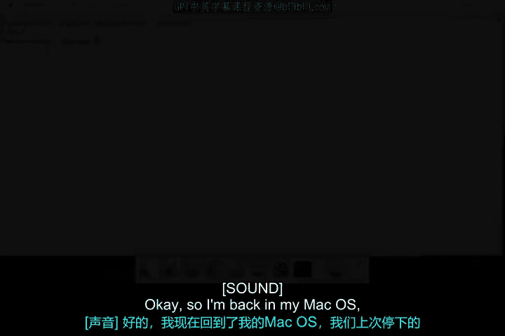
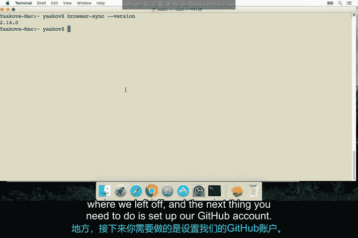
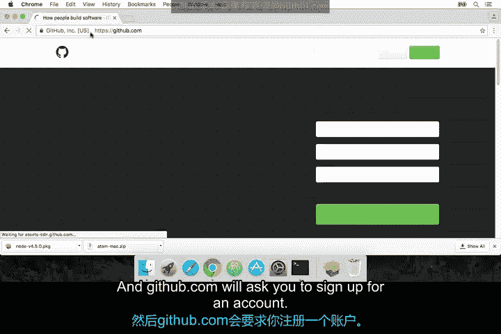
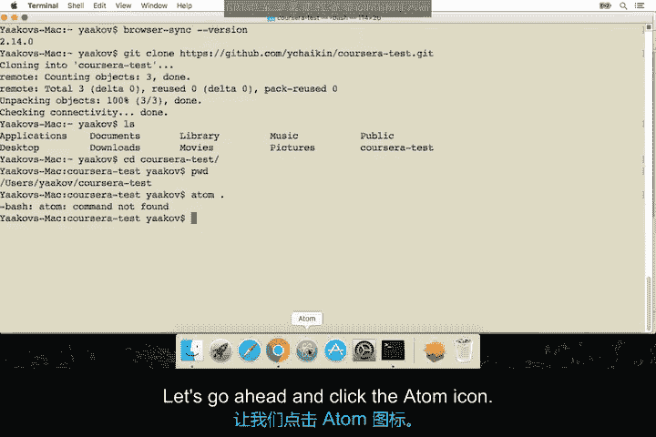
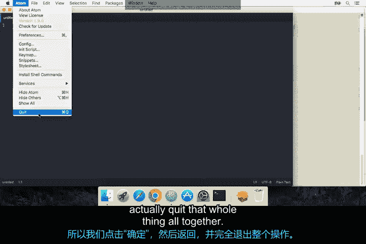
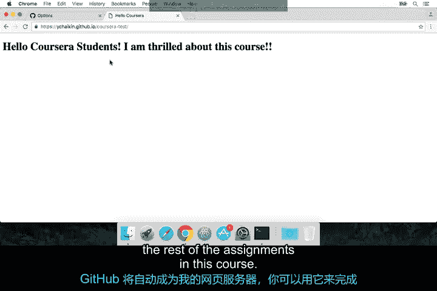

# 约翰霍普金斯大学《使用 AngularJS 开发单页 Web 应用｜Single Page Web Applications with AngularJS》中英 - P5：4_Mac开发环境设置（第2部分）.zh_en - GPT中英字幕课程资源 - BV1dsFDeZEQr

🎼。

Okay， so I'm back in my Mac OS where we left off and the next thing you need to do is set up our Gitthub account。

 so let's go to the browser， we'll actually make it full screen here and we'll say Github。com。😊。

And Github。com will ask you to sign up for an account。 It's very simple。 Just give it the username。

 pick the user you want， give it the email address and a password。 and then you sign up。

 I'm already signed up， so I'll go ahead and click sign in， use my username。😊。

And password and click sign in。And I'm in， I don't want it to remember my password。

Your view will probably look very different in mine。 You probably have different repositories。

 if you've never done this， you probably have no repositories here。

 So the first thing you want to do is create your own repository。

 and I suggest you use one repository for the entire course So you go to the top right here。

 you see this plus sign next to your icon here and you click this down arrow and click new repository。

😊，And I'm just going to name it Coursera dash test， but you can name it whatever you want。

 Coursera or your course， whatever you want， and we'll give you a description， test， Coursera repo。

And we're going to keep it as public because private costs money。

 so we're going to go ahead and keep it for free and we'll click here initialize this repository with a readme file always a good idea。

 and all I have to do is click createre repository and repository is created。😊，Now。

 since you're going to be using this repository for your assignments in this course。

 the next thing you want to do is make your repository deployable or make your repository such that it can be viewed as a regular website on the webLuckiily GitHub provides this functionality for free and it's actually very convenient if you go to the settings which is right here on the right you could scroll down and you'll see that there's something called Github pages well it says here Github pages is designed to host your personal organization or project pages from a Github repository Now it used to be yet to designate a special branch in your repository and if you look up here and if you look back to the original you could see that we are on the branch master。

😊，So let's go back to the settings so it used to be yet to create a special branch for that but GitHub simplify that so all you have to do is right now it says it's currently disabled。

 we'll click this down arrow and we'll say that what we want to be displayed in our Github pages is exactly what is sitting inside of the master branch that is what I recommend you do for this course we'll click that we'll click save when we click save it will tell us that GiHub pages source Sa so if we scroll down again。

😊，You'll see that your site is ready to be published and it is giving us a URL you can see it's a URL very close to what we have。

 it's my username that Github。io slash the name of our repository which is Coursera test I'm going to go ahead and open it in a new tab。

And you can see there's nothing here yet because there's nothing in my repository。

 We're gonna change that in a minute。 We'll close that。

 We'll go back up to our repository and you'll see here it says clone or download button the green button if we click that you can go ahead and copy the link which is the link to your repository that you can actually use on a command line to clone it or to copy it or to download it from Github to your local machine So we'll click this copy to clipboard and we'll go back to our terminal and now we could use Github commands to pull this repository down to our or pool otherwise known as download really our repository to our local machine So let's go ahead and say Git clone that's the command to pull it or to clone it or to copy it and we'll go ahead and paste whatever we copy it from the website press enter the whole thing gets download it and now if we do NlS you could see the Coursera。

Is one of the things that showed up。Now， if we go ahead and C into Coursera test。

 what we would like to do is we would like to create a whole project that is based right here at the PwD。

 you'll see I'm sitting inside of the Courra test folder so I'd like to start the entire project in my at editor straight from this particular folder but I don't want to have to navigate back to it again I'm already here So one way of doing it is to call Adam with a dot meaning this particular directory。

 I want you to go ahead and start Adam and place the project as being in this folder So if I press now it's not going work and the reason that's not going to work is because we haven't set up Adam to do that let's go ahead and click the atom icon。

AndOnce it opens， we can go to the Adam menu and click。Install shell commands。

We're going to have to give it our password and it says they have been installed and you could call it Adam or8 PMm。

 Both commands are installed。 we're only going to need Adam for this course。

 so we'll click OK we'll go back we'll go ahead and actually quit that whole thing altogether We'll go back and we'll say again Adam dot and press enter and this time it's going to open our entire directory as the base of our project So now we create new files straight inside the Courra dash test。

 let's create a simple file called index at HTML。😊。

And we'll say that this is。HtMl。And we'll say this is Ho Coursera。

 and we'll give it just a simple H1 tag that says hello Coursera。And we'll save it Now。

 as we develop， we would like to see an immediate feedback as to what we're developing right in the browser。

 So one way of doing it is to use browser sync。 So let's go ahead and open a tab here and we'll make the browser smaller。

😊，So we could see it side by side together with our editor。

And we'll go back to the command line and since we're sitting right now inside the Coursera test。

 we can issue a browsering command that goes like this browser dash sync and then we want to start the browser sync and we want to start it in dash dash server mode which means I want you to serve up everything that's in this directory and we'll also start it with dash dash directory mode and what that's going to do is it's going to serve up the directory even if there's nothing in it it will at least show us the directory and last but not least we'll say which files do we want to watch for changes and once those files changes I want you to go ahead and reload it and what we want to watch is we want to watch any directory that's star star star meaning any directory in anything in that directory but close that quote we'll press enter。

Andvoila， it started up our browser sync and if you look at our browser and our a editor side by side。

 you could see that here's our index at HTML if we click on it。

 you'll see hello Coursera and what's really cool about it is because I can actually now say hello Coursera students and the second I save it。

😊，You can see that browsering will automatically update whatever it is that is in your files and will reload the page free automatically so as you type。

 you can quickly see what's going on right in your browser and it is very convenient。

Okay so the only thing that's left not that I've edited my file is to go back to the command line and go ahead and we'll quit the browser sync。

 We'll do an a less just to see what's in it。 So we see our index that HTML and then we'll do a command called Git status to see what our Git status is and it's telling you that we have one un tracked file here which is index that HTML and Git is usually very good in telling you what you might want to do next and what it says here you could say Git add and the file name to include in what will be committed In other words。

 Git add is a command to mark whatever it is that you're gonna specify in this case index at HTML to mark it for committing it to the repository So we'll say that to say anything in this directory and when we press enter and do Git status again。

You'll see that now we have changes to be committed and you can see the file is green and it says it's a new file。

 so if I'm committing this， this file is the one that's going to get committed to the repository Now the way to commit it is to say git space commitM4 message that's required and the message I can commit with first web file。

😊，And press enter。 And now giving you a whole long message here telling you that I never really told Git that I have installed here who I am exactly。

 It didn't tell it my name。 I didn't tell it my email address and that's really okay because at least in this version of Git。

 It's automatically configuring it for you saying I'm just gonna grab whatever it is you register your account with and grab this really kind of meaningless email yaakov at yaakovs Mac local。

 It doesn't really matter this email is not really used for anything other than announcing to other users of your repository who you are and how to get in touch with you。

 So we're gonna just leave it alone。 And we could go ahead and do Git status again。

 It's clear the page terminal Git status。😊，We could see that were on branch master and your branch。

 meaning the one local to your computer is ahead of the origin master by one commit。

 meaning we've committed something。 but the master itself。

 the one that's sitting or the origin master， the one that's sitting in Github is actually kind of behind。

 So we are ahead of it by one commit。 That means that at this point I have code on my computer that is in my repository。

 but it is not in the Github do co repository in order to upload this code to Github co repository。

 it's actually giving you a hint here。 use Git push and that does upload Git push And this is the first time I'm using Git on this particular instance of this machine。

 and I never told it which type of pushing which type of upload， I want to apply using Git。 Well。

 the one that's recommended is right here， the one's called simple will go ahead and copy that and will quit that for now。

 So it doesn't bug us again about it will issue that command and have the Git。😊。

push that default be simple。 En that and we'll go ahead and clear it and we'll do one more time Git pushush in this case it's going to start asking me for my username and I' go ahead and enter my username and my password Note as I type in the password nothing is actually showing up and that's okay it's the expected behavior。

 I'm going gonna press enter it will go ahead and push the code changes that I made locally to the repository at Github and it's telling you right here that it did that And if you do the Git status right now。

 it will say we're in branch master and everything is up to date and nothing to commit and working directory is clean。

 Now we could actually view this index that HTML back in Github。

 let's go ahead and go to our browser again let's make this full screen again and we go let's close these up。

And we'll go to our repository。 Let's do a reload。 and you could see now we have an index at HTML inside of our repository。

 and that is what we committed and pushed to this repository just a minute ago。 Now。

 suppose I forgot what my link is supposed to be because it's not Github co It's actually Github pages。

 which is Github o。 Well， the way I could get back to that link is pretty easily。

 I could just click on the settings again， scroll down to where my Github pages are right here。

 the configuration for Github pages。 and here's my link I could click on that link right now。

 Let's open it in a new tab。 When I opened it since I have indexed that HTML sitting in that directory。

 it will automatically go ahead and serve index at HTML to me and you could see hello Cosera students is what shows up。

 That's the file that we edit it。 Now for your assignments what you going to want to do is create subfolds in your repository like module 1 assignment or something like that。

 you go ahead and。😊，Flllowow the particular instructions and put your applications in the subfolders that are specified in the assignment description and then we could repeat this process as we keep developing so if we go back to our at editor。

 we can update this file by saying I am thrilled about this course。And save that。

 and now if we go to our terminal and we are already here， we're in PWD。

 we're inside the Coursera test folder， we could say git status again。

 you will see that it's showing us index at HTML as modified and it's telling us again that we could use Git add in order to market for committing so we'll say git add and instead of giving the index at HTML。

 we could just say dot which means I want to commit anything in this folder and below we'll press enter and if I say git status。

You can see now that it is marked as modified and marked green。 So it's ready to be committed。

 So I'll say gi commit dash M。 and'll say new version of web file。

 And we'll go ahead and press enter。😊，And now it's again telling me it's committed。

 but it's complaining that I never identified myself officially so I could go ahead and do that right now by copying these two commands that it's conveniently giving us。

 The first one is username and that's just my name I could say yaov I could say full name press enter and the second command that's telling us is user email go ahead and copy and paste that and email could be anything it's really there for other users of Github repository again to be able to see what your email address is so I could say yaov at whatever co and let's make this a little bit bigger so you could see what I'm doing here and pressent and now I'm no longer going to be bugged about this whole lack of meseing the commits username and email address so now let's clear the screen and let's say Git status again and you could see once again my local branch my local repository is ahead by one commit from the repository on Github。

 co。😊，To do that， the way to upload all my changes to Github。com is to say gi push。

 Gi push that uploads everything to the remote repository and now if I go back to my even straight to my GiHub pages and just reload。

Right here you could see that it says I am thrilled about this course， exclamation point。

 exclamation point， which means kind of you know things took。

 so I don't need to no longer do anything to upload to any other server。

 GitHubbble automatically be my web server and this is what you can use for the rest of the assignments in this course。

