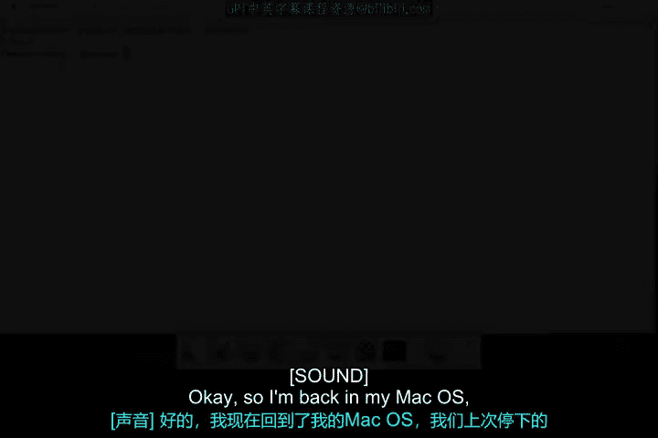
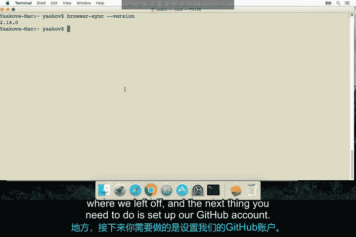
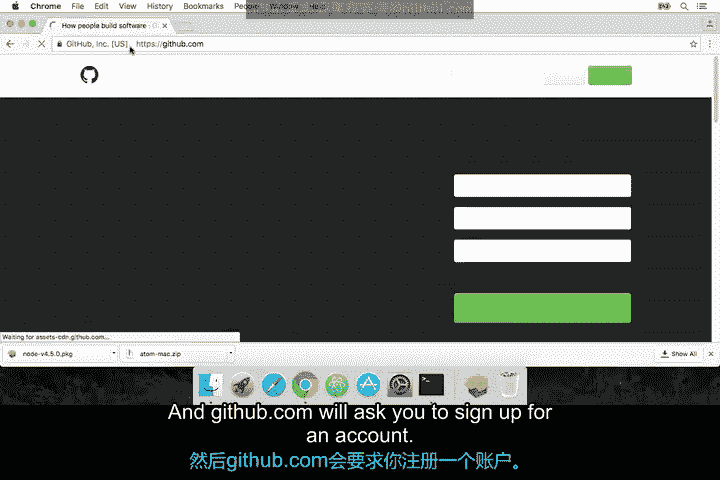
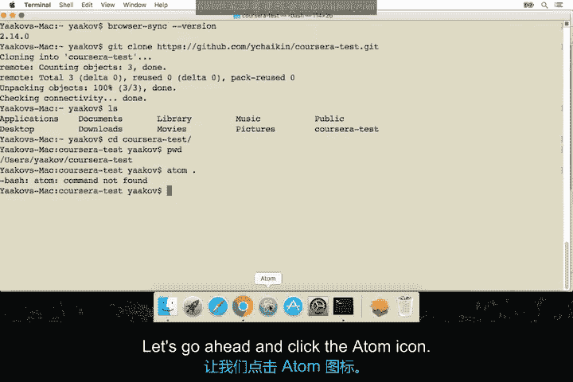
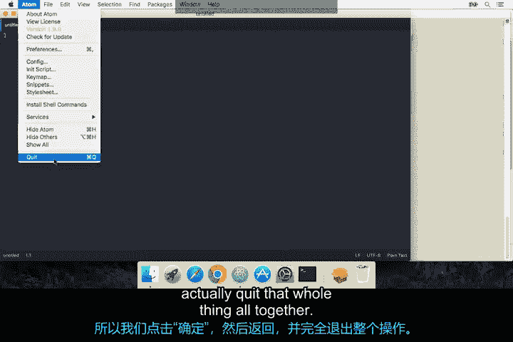
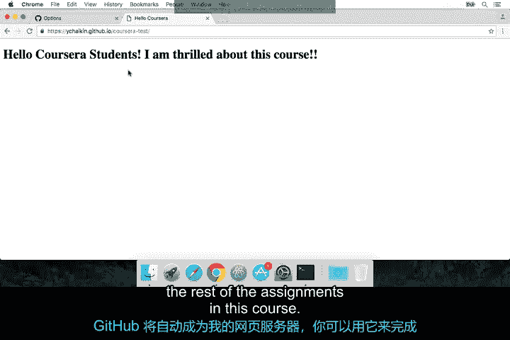

# 使用 AngularJS 开发单页 Web 应用：P5：Mac开发环境设置（第2部分） 🛠️








在本节课中，我们将继续完成 Mac 开发环境的设置。我们将学习如何配置 GitHub 账户、创建代码仓库、使用 Git 进行版本控制，以及如何利用 GitHub Pages 免费托管我们的网页应用。通过本教程，你将能够将本地代码同步到云端，并实时预览你的网页。

---

上一节我们安装了必要的开发工具，本节中我们来看看如何配置 GitHub 并建立本地与远程仓库的同步工作流。

## 创建 GitHub 账户与仓库 🚀

首先，你需要访问 GitHub.com 并创建一个账户。如果你已有账户，请直接登录。

登录后，你需要为整个课程创建一个代码仓库。以下是具体步骤：

1.  点击页面右上角你的头像旁边的加号（+）图标。
2.  在下拉菜单中选择 “New repository”。
3.  为仓库命名，例如 `Coursera-test`。
4.  添加一个简短的描述（可选）。
5.  保持仓库为 “Public”（公开），因为私有仓库需要付费。
6.  勾选 “Initialize this repository with a README” 选项。
7.  点击 “Create repository” 按钮完成创建。

## 启用 GitHub Pages 🌐

为了让你的仓库能够作为一个网站被访问，我们需要启用 GitHub Pages 功能。

1.  在新建的仓库页面，点击右侧的 “Settings” 选项卡。
2.  向下滚动到 “GitHub Pages” 部分。
3.  在 “Source” 下拉菜单中，选择 “master branch”。
4.  点击 “Save” 按钮保存设置。

保存后，页面会显示你的网站发布就绪，并提供一个 URL，格式通常为 `https://{你的用户名}.github.io/{仓库名}`。你可以点击此链接查看，目前页面是空的，因为我们还没有上传任何网页文件。



## 克隆仓库到本地 💻

接下来，我们需要将远程仓库复制（克隆）到你的本地电脑上。



1.  在仓库页面，点击绿色的 “Code” 按钮。
2.  点击链接旁边的剪贴板图标，复制仓库的 HTTPS 地址。
3.  打开终端（Terminal）应用程序。
4.  使用 `git clone` 命令，后面粘贴你复制的仓库地址。

```bash
git clone https://github.com/你的用户名/仓库名.git
```

命令执行后，你的仓库就会被下载到当前目录。

## 配置 Atom 编辑器 ⚙️

为了更方便地在本地仓库目录中编辑文件，我们需要配置 Atom 编辑器。

1.  打开 Atom 编辑器。
2.  点击顶部菜单栏的 “Atom”，选择 “Install Shell Commands”。
3.  根据提示输入你的系统密码，完成安装。

安装后，你可以在终端中直接使用 `atom .` 命令，在当前目录打开 Atom 并将此目录作为项目根目录。

## 使用 Browser-Sync 实时预览 🔄

在开发过程中，实时看到代码更改的效果非常重要。我们将使用 `browser-sync` 工具来实现这一点。

首先，确保你位于本地仓库的目录中。然后运行以下命令：

```bash
browser-sync start --server --directory --files "**/*"
```

这个命令会启动一个本地服务器，并监视目录中所有文件的更改。一旦你保存了文件，浏览器中的页面会自动刷新。

## 使用 Git 管理代码变更 📝

当你对文件进行修改后，需要将这些更改提交到本地仓库，并推送到远程的 GitHub 仓库。

以下是基本的工作流程：

1.  **检查状态**：使用 `git status` 查看哪些文件被修改。
2.  **添加更改**：使用 `git add .` 命令将所有更改标记为待提交。
3.  **提交更改**：使用 `git commit -m “提交信息”` 命令将更改提交到本地仓库。
4.  **推送到远程**：使用 `git push` 命令将本地提交上传到 GitHub。

如果是第一次推送，Git 可能会要求你配置全局用户名和邮箱：

```bash
git config --global user.name “你的名字”
git config --global user.email “你的邮箱”
```

配置完成后，再次执行 `git push` 即可。

## 查看在线网站 ✅

完成推送后，你可以再次访问之前 GitHub Pages 提供的 URL。现在，你应该能看到你刚刚创建或修改的网页内容了。对于课程作业，你可以在仓库中创建子文件夹（例如 `module1-solution`），将作业文件放入其中，并重复上述的 `add`、`commit`、`push` 流程来提交作业。

---




本节课中我们一起学习了如何设置 GitHub 仓库、启用免费的网页托管服务、将代码克隆到本地、使用编辑器进行开发、通过工具实现实时预览，以及使用 Git 进行版本控制和代码同步。掌握这些步骤后，你就拥有了一个完整的开发、测试和部署环境，可以高效地完成本课程的所有实践项目。