# 约翰霍普金斯大学《使用 AngularJS 开发单页 Web 应用｜Single Page Web Applications with AngularJS》中英 - P60：59_第30讲（第2部分）：指令API和&.zh_en - GPT中英字幕课程资源 - BV1dsFDeZEQr

🎼。

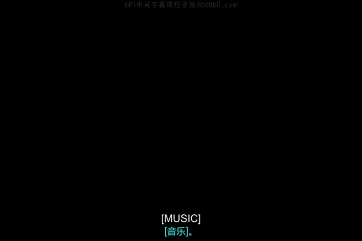

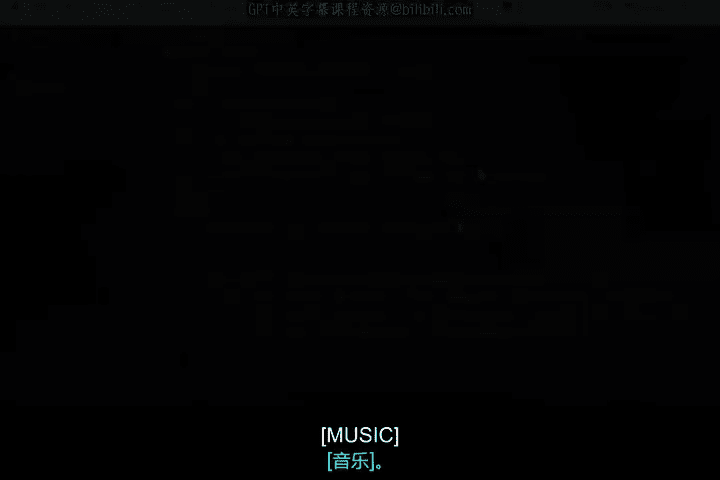

Okay， so we're back our code editor and I'm located in lecture 30 folder。

 which is located in fullt dash course 5 slashex folder and this is again our shopping list directive app and the goal of our task right now is to provide a button next to each list item and let the user click it and it will get removed except we're going to try to accomplish this task in a little bit of a wrong way first and what we're going to do is we're going to supply this bed remove attribute on our shopping list directive and we're going to pass the actual function directly as a reference to our directive if we go to Abgs we'll see here that on our directive itself。

😊，We're going to create a bed remove property and we're going to use an equal sign。

 so it will be a bidirectional binding and the function value of that remove that we're going to pass in is going to be equal to this bad removed property in the actual service removed method or controller I should say in the actual controller removed method we're going to have one more thing let me actually close the file browser will be easier to see but what we're going to do is we're going to have one more side effect here that long comment and we're going to create a property under the this keyword。

 which means since we using controller as syntax is going to be attached to the controllers instance and it's going to be called last removed basically whenever somebody passes as an item index。

 we're going to look that item index up in our this thatt item array and save the name of that item in the last removed property in the index that HTML we're going to place a real quick span here and we'll say。

😊，Last or list， I should say thatt last removed。 So now we're going to output whatever it is that was last removed right inside of our controller。

 This list is the label for our shopping list controller。 If we go to the shopping list that HTML。

 which is the template for our directive。 We're gonna see here a button and the button says list that bed remove and bed remove is our function and we're able to obviously take a function reference。

 which is what this is surrounded with pers and execute passing it our dial signed index。

 which is the index in the list that somebody is clicking to remove and the button name is gonna be bed remove。

 Just to look back at index HTML。 we have our bad remove attribute map to list that remove item。

 So it's the remove item function value that is being assigned to this bad remove and then that bed remove gets called right here inside of our。

😊，Dirive template。Okay， so let's save that and let's go to the browser and let's try to add item test test one。

 we'll just say test for now， we'll click that item， we'll see the better remove button， test two。

 click add item button， test three， and click the add item button。

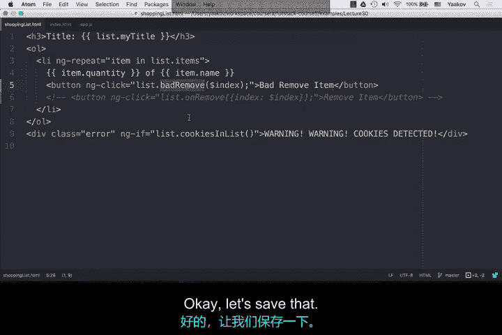

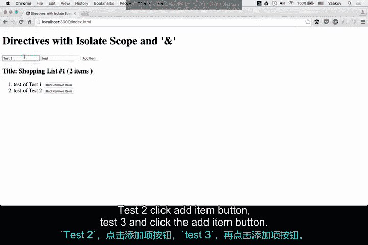

One more thing let's go take a look at when we go to the code is that I printed out this console。

 log this is and I'm printing out what this variable is pointing to just so important so we'll be able to look at the console and see when we attach to this that last remove and this title。

 where's this actually pointing to at the time what we call it let's go back to our browser and let's go ahead and actually open the console so we could see what's going on。

😊。

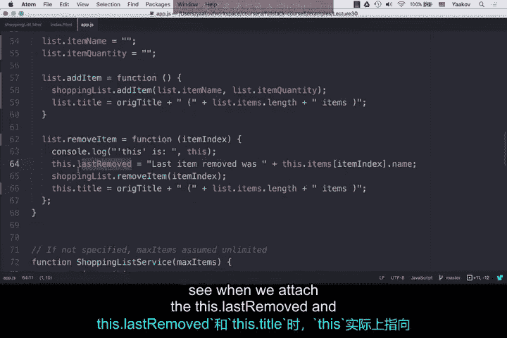

Open the console here and let's go ahead and try to click bed remove item number one When we click here。

 we see that for some reason we don't have any kind of announcement here what the last removed item was and if we take a look at our console I think is going to give us a clue This is and remember this right now is being called from the Re item method that is sitting on our controller that is the main controller and if we take a look this is shopping list directive controller So it's not the shopping list controller。

 its shopping directive controller which is not what we want because shopping list directive controller is the controller for our isolateco and we wanted this to execute in the parent controller scope is you could see all these things that we thought were being assigned on the parent controller scope are actually being assigned directly to our directives isolate scope and that's why you see that the title still says。

😊，list number one has three items in it。 And so what happened to the title。 Well。

 when we set this that title and updated the title with two items。

 it went ahead and created that title， the title property on our shopping list directive controller。

 Meanwhile， the actual shopping list controller doesn't know anything about this。

 Let's go back to the code editor and actually take a look as to why something like that is happening。

 I actually created this this hm and it's just referencing this dotjs。

 So we will be able to see what's going on。 here's a quick example on the microcosm as to what's going on here and our controllers。

 S we have this function called person。 and it says this that full name is yaov this do fave is cookies。

 and we have one method on this object， which is the function and all it's doing is logging to the console and says this that full name likes this fave。

 If we now go ahead and create this yaov object with the。😊。

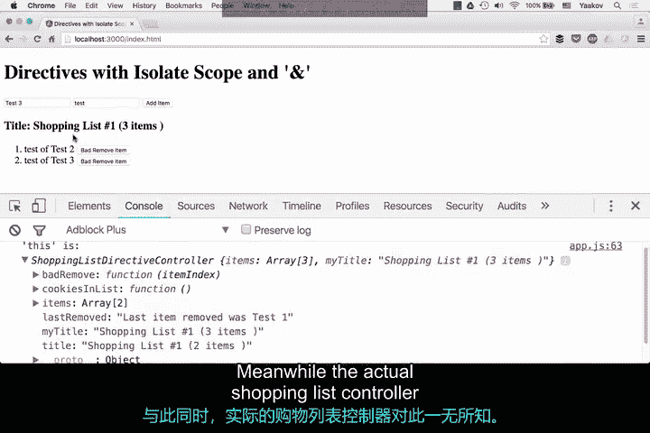

Call to new person as we should， that this variable inside of this object will be pointing to the person object。

😊，And when we call Yaakov that describe， in other words， this method。

 this will still be pointing to the person object and therefore you'll be able to reference full name and fave。

 so let's go ahead and actually comment this out for a second。

 let's go ahead and save that and let's open this HTML in the browser。😊。

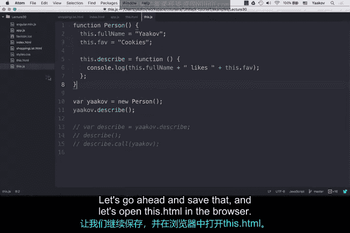

And you'll see that the console says Yaakov likes cookies， very true。

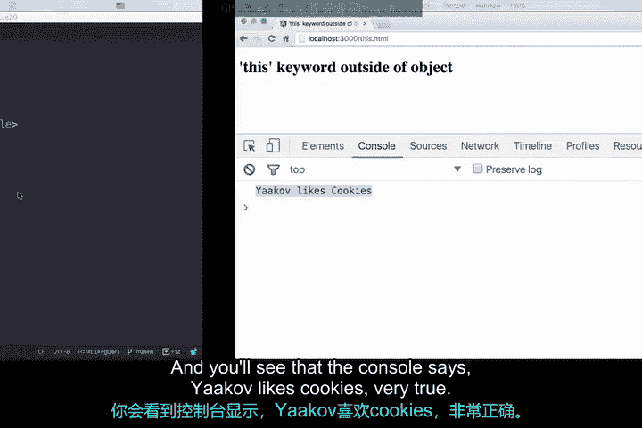

Now if we go back and go to this dotjs， what we're going to do now is we're going to pull out the method from this yaov object After all yaakov dot described without the Pars is just a function value so we could grab that value and stick it in a local variable and then since that local variable is pointing to a function value we could actually execute it just by putting Pars behind it if we save that and go back to our browser let's refresh that you could see here already says that undefined likes undefined how come this is going on Well the reason this is going on is if we actually put a console do log right inside of here let's put a log statement here and say what exactly is this variable let's go ahead and say this is what is this variable let's go ahead and output this you could see that the first time we go around this variable is the person but the second time going around this variable。

😊。

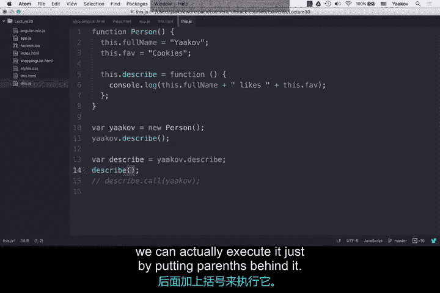

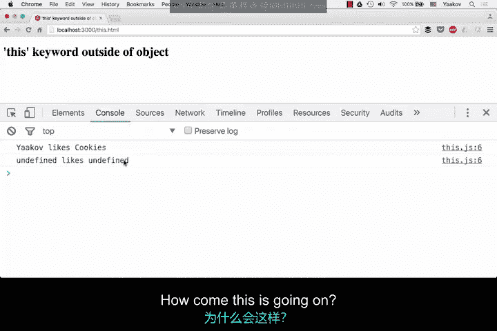

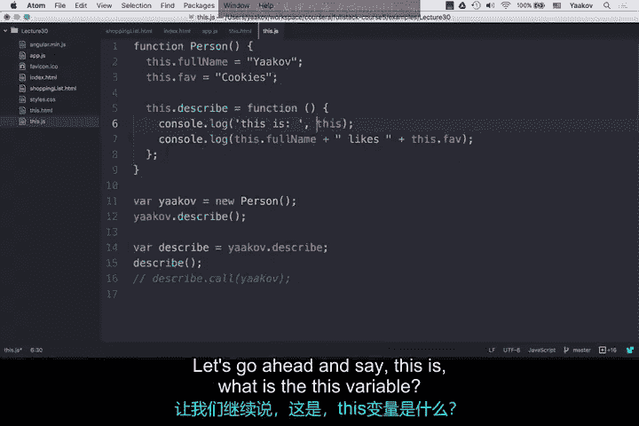

Is actually the window and the window doesn't have a full name and a faith。

 The reason this is happening is because we took that method out of its context and its context became the window。

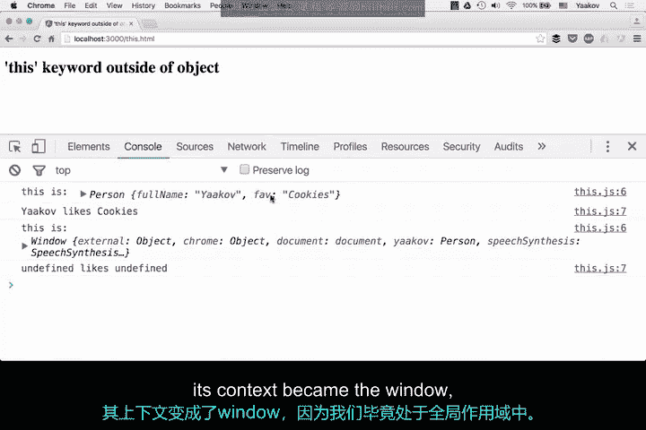

Because we were sitting after all in a global scope there is actually a JavaScript solution to that and it's called the Co method if you take the method that is's out of context。

 in other words， this variable is pointing to whatever the surrounding context is。

 you could actually give it context and basically it will get that this variable assigned to whatever object that you passing in in the coal method。

 so if we invoke describe with a co method and pass it the object yaakov that this variable will all of a sudden once again be pointing to yaakov so if we save that and go back to our browser。

 you'll see that even though the first time it says undefined undefined。😊。

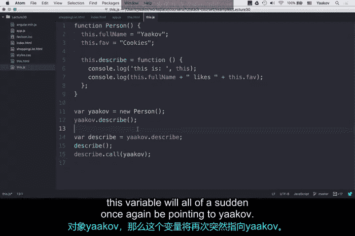

The next time this is actually pointing back into person and actually willll say yaakov likes cookies and this is what's happening in our controller If we go back。

 we could close this now， what's happening in our controllers is that when this call is being made right here this call is being made just with a function reference it's like a variable that was yanked out of its context and now sitting in a different context in the case of the describe function in our this example。

 it was sitting in the context of the window object Well， in the case of this bad remove example。

 it's sitting in the context of the directives controller。

 not of the parent controller as we want So the solution is is to use the at reference and then pass a map of arguments that is mapped to how we call this method to begin with So let's go to Abda Gs and what we're going to do now is we're going to declare yet another attribute and another attribute is going to be called。

😊。

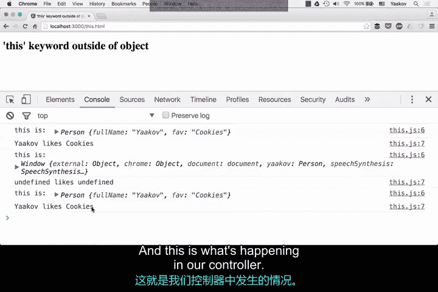

On remove and un remove is going to have an am percent binding。

 which means it's going to be a reference binding。 We'll go to index that Hm。

 and we'll add one more button right here or one more attribute。 And we'll call it on remove。

 and this time we'll call list that remove item and we'll pass it an index。 except as I told you。

 as you remember， this index is not something that the shopping list controller will be passing。

 This index is just the key for our directive to be able to find and assign some value to it。

 So all of this will get executed in the context of the shopping list controller。

 not of the shopping list directive controller。 Let's go ahead and actually put this back there。

'll look a little bit better that way， we'll go back to our shopping list that html that is the template for our directive。

 Let's close the file browser。 It'll be easy to see we'll actually uncomment this button right here。

 And if you take a look， it's list which is the list of。😊，S list directive controller onremove。

 that's the property we mapped unremoved into the controller on our isolatecope。

 and then you could see we're passing it an object that is a map。

 It's mapping the index if you take a look at the index at HTML This is the index that we're mapping So it's taking that index and it's saying it should be equal to at the time that you call this。

 it should be equal to dollar sign index， which is the index through the loop at the moment。

 Now when we save it and go back to the browser we'll close our this example and we'll close this as well。

 and here's our directive isolatecope。 Let's go ahead and add test。 Well first of all。

 it's not refreshing for some reason it's refresh it Here we go Okay so let's add our test test1。😊。

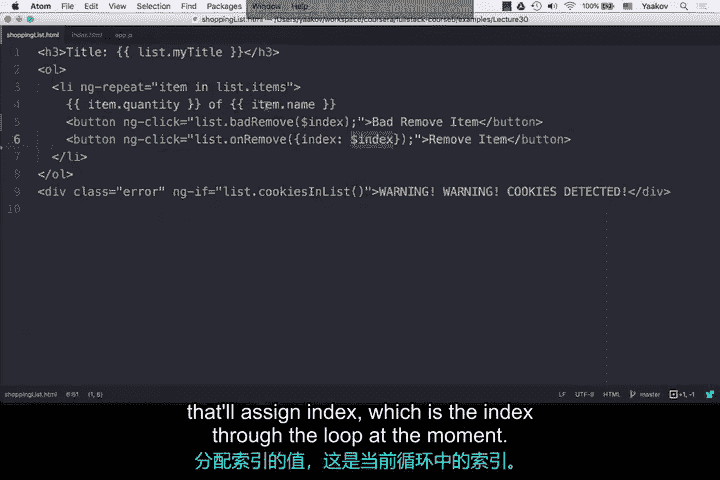

Add one so we have better remove and remove item。 We'll do test2 add that item and test3 and add that item and let's go ahead and try to click remove item。

 let's say remove test2 request remove test2 you'll see that the last item removed showed up here which means that property did show up in the parent controller and if we take a look in our remove item method we logged what the variable this pointed to in this case is's pointing to the shopping list controller。

 which is exactly wanted。 we wanted to execute that method in the context of the shopping list controller。

 which is the parent of our directive And if we take a look all the things that we need are here and you see the last remove property is here and the shopping list title also got updated to two and therefore it's right there if we remove it again this time we remove number one so it's number one and so on So this is working So once again。

 what allowed us to be able to call this method in the context of the parent of this direct。

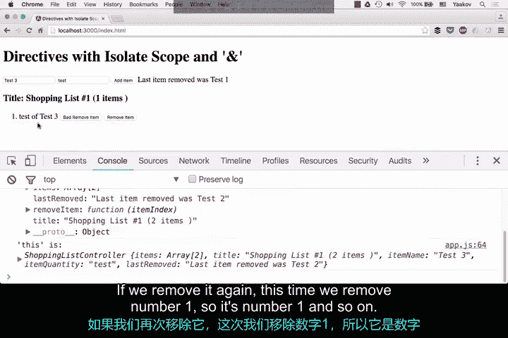

Is the reference that we declared unremove property with。

 which is the imppercent that is giving us a reference to the function such that is going to get executed in its parent environment。

 evaluating all the properties like they should be。

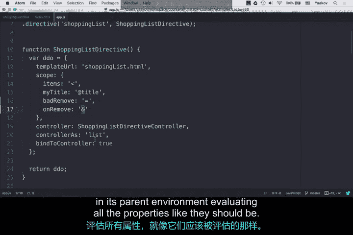

Okay， so let's summarize the Mpers binding allows us to execute an expression such as a function value in the context of the parent scope the way this is done is the following the parent template must declare an attribute providing the method reference for the directive to call on the parent and an argument keys for directive to bind values to when it needs to pass the data from the isolate scope back to the parent scope。

The directive on the other hand， calls the reference method and also provides an object map of argument key to value pairs。

 This allows the directive to pass data back to the parent from the isolate scope。

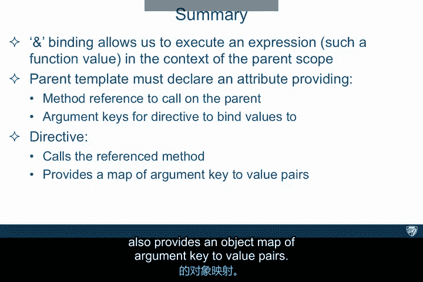

