# 使用 AngularJS 开发单页 Web 应用：P60：指令 API 与 `&` 绑定

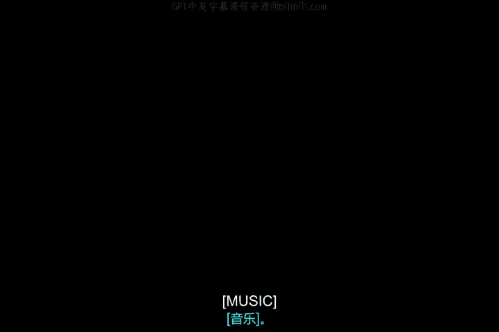


## 概述
在本节课中，我们将学习 AngularJS 指令 API 中的一个重要概念：`&` 绑定。我们将通过一个购物清单应用的例子，演示如何从指令的独立作用域中调用父作用域中的函数，并传递数据。我们将首先展示一种“错误”的实现方式，然后修正它，以理解 `&` 绑定的工作原理和必要性。

---

## 初始场景与问题

我们回到代码编辑器，位于 `lecture30` 文件夹中。这是一个购物清单指令应用。当前的任务是：在每个清单项旁边提供一个按钮，用户点击后可以删除该项。

我们首先尝试一种不太正确的方式来实现这个功能。

在 `index.html` 中，我们在 `shopping-list` 指令上添加一个 `bad-remove` 属性，并直接将父控制器中的函数引用传递给它。

```html
<!-- index.html -->
<shopping-list ... bad-remove="list.removeItem">
```

在指令的控制器文件 `abgs.js` 中，我们为指令的独立作用域定义一个 `badRemove` 属性，使用 `=` 进行双向绑定。

```javascript
// abgs.js
scope: {
  badRemove: '='
}
```

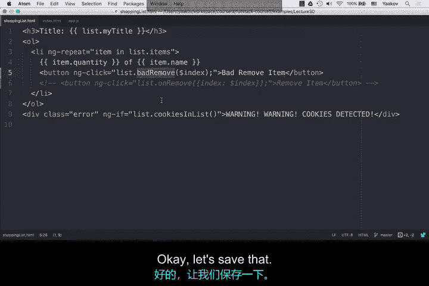

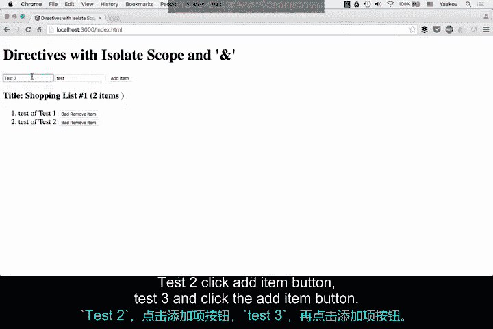

在父控制器 `ShoppingListController` 中，我们有一个 `removeItem` 方法。为了观察 `this` 的指向，我们添加了一个副作用：将最后删除的项名保存在 `this.lastRemoved` 属性中，并在视图中显示它。

```javascript
// ShoppingListController
this.removeItem = function (itemIndex) {
  console.log("‘this’ is: ", this);
  this.lastRemoved = this.items[itemIndex].name;
  this.items.splice(itemIndex, 1);
};
```

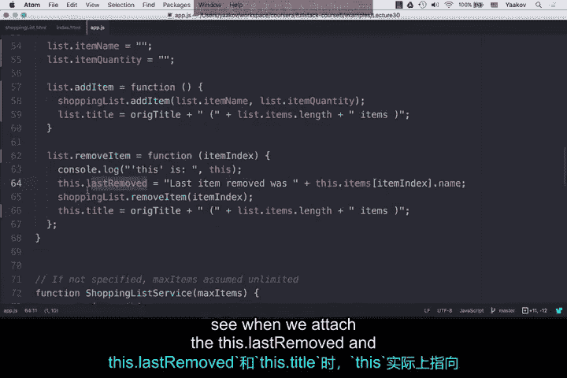

```html
<!-- index.html 中显示最后删除的项 -->
<span>Last removed: {{list.lastRemoved}}</span>
```

在指令的模板 `shopping-list.html` 中，我们为每个项添加一个按钮，点击时调用 `badRemove` 函数并传入当前项的索引。

```html
<!-- shopping-list.html -->
<button ng-click="badRemove($index)">Bad Remove</button>
```

**预期**：点击按钮，项被删除，`lastRemoved` 被更新并显示。
**实际**：点击按钮后，项被删除了，但 `lastRemoved` 没有显示，标题也未更新。

打开浏览器控制台，查看 `console.log` 的输出，我们发现 `this` 指向的是 `ShoppingListDirectiveController`（指令的控制器），而不是我们期望的父控制器 `ShoppingListController`。因此，`this.lastRemoved` 和 `this.title` 的赋值都发生在指令的独立作用域中，父控制器对此一无所知。

---

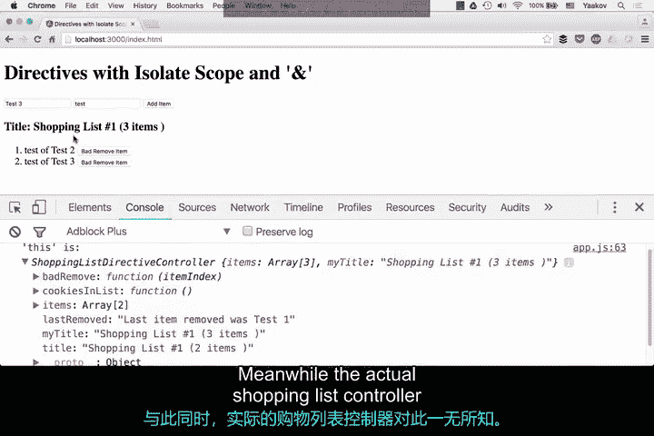

## 理解问题根源：`this` 的上下文丢失

上一节我们遇到了函数在错误上下文中执行的问题。本节中，我们通过一个简单的 JavaScript 例子来理解其根本原因。

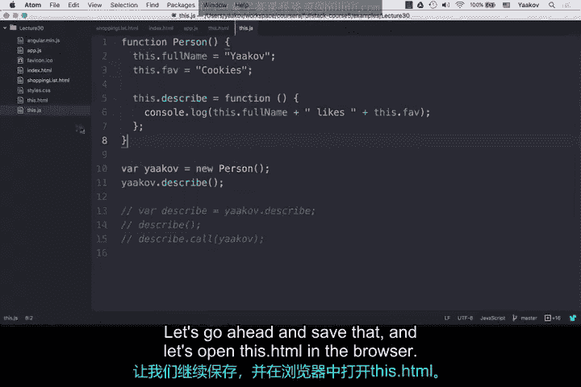

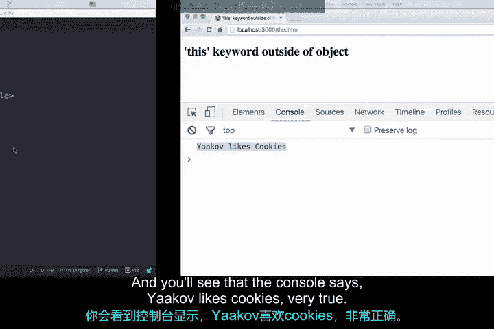

考虑以下对象：
```javascript
function Person() {
  this.fullName = ‘Yaakov’;
  this.fave = ‘cookies’;
  this.describe = function() {
    console.log(this.fullName + ‘ likes ’ + this.fave);
  };
}
var yaakov = new Person();
yaakov.describe(); // 输出：”Yaakov likes cookies”
```

当我们直接调用 `yaakov.describe()` 时，函数内部的 `this` 正确指向 `yaakov` 对象。

但是，如果我们把方法“抽离”出对象，再调用：
```javascript
var describeFunction = yaakov.describe;
describeFunction(); // 输出：”undefined likes undefined”
```

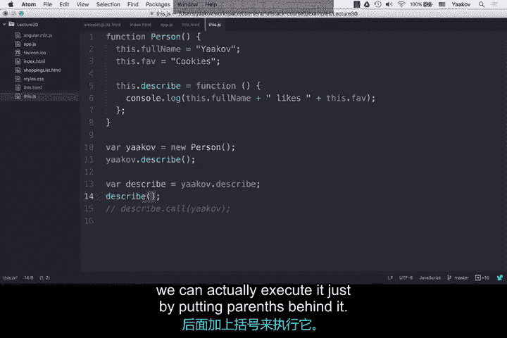

此时，`describeFunction` 作为一个独立函数被调用，其 `this` 指向了全局对象（在浏览器中是 `window`），而 `window` 上没有 `fullName` 和 `fave` 属性，所以输出是 `undefined`。

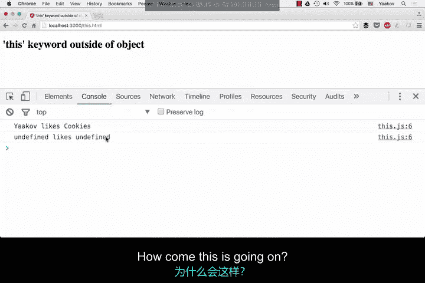

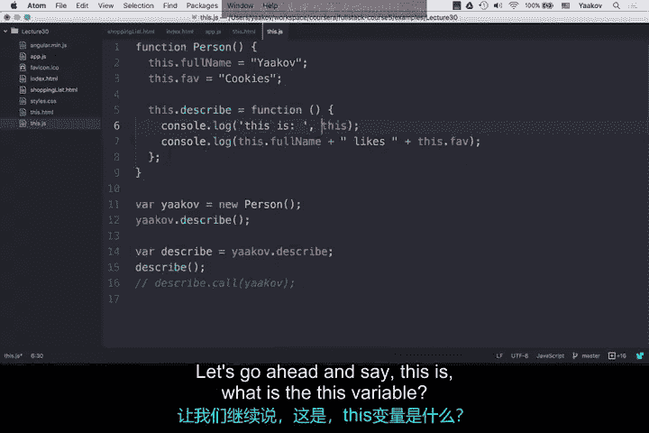

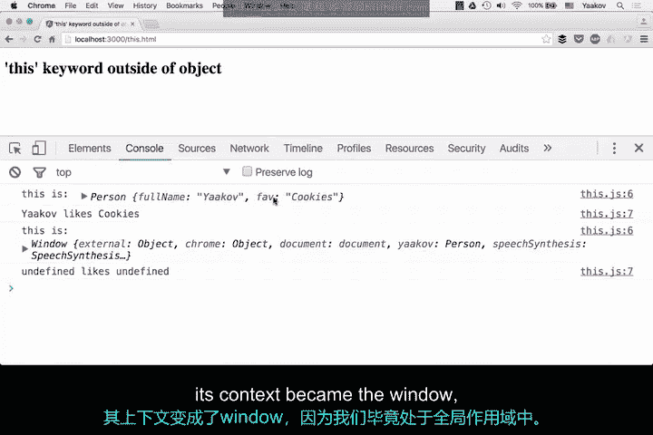

**JavaScript 的解决方案**：使用 `.call()` 方法显式指定 `this` 的上下文。
```javascript
describeFunction.call(yaakov); // 输出：”Yaakov likes cookies”
```

**回到我们的 AngularJS 问题**：在指令模板中，`ng-click=“badRemove($index)”` 的调用方式，类似于将父控制器的 `removeItem` 方法“抽离”出来，然后在指令控制器的上下文中执行，导致 `this` 指向错误。

---

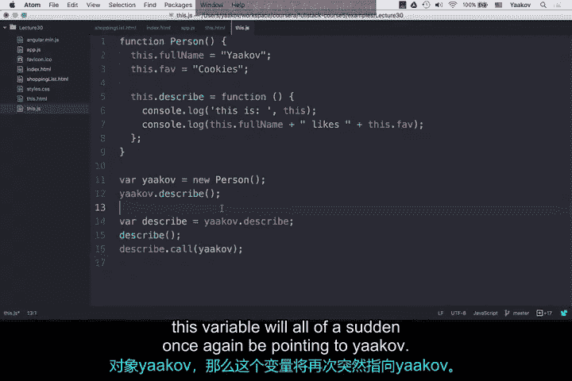

## 解决方案：使用 `&` 绑定

理解了问题所在后，我们来看看 AngularJS 提供的解决方案：`&` 绑定（引用绑定）。它允许我们在父作用域的上下文中执行一个表达式。

以下是实现步骤：

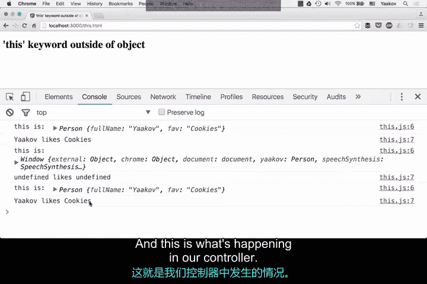

1.  **在指令定义中声明 `&` 绑定属性**
    在 `abgs.js` 中，我们为独立作用域添加一个新的属性 `onRemove`，使用 `&` 符号。

    ```javascript
    // abgs.js
    scope: {
      // ... 其他绑定
      onRemove: ‘&’
    }
    ```

2.  **在父模板中传递函数引用和参数映射**
    在 `index.html` 中，我们不再使用 `bad-remove`，而是使用新的 `on-remove` 属性。其值是一个函数调用，并指定一个参数名（例如 `index`）来接收指令传递过来的值。

    ```html
    <!-- index.html -->
    <shopping-list ... on-remove=“list.removeItem(index)”>
    ```
    这里的 `index` 是一个**键名**，它告诉指令：“当你调用这个函数时，请把一个值绑定到名为 `index` 的参数上”。

3.  **在指令模板中调用并传递数据**
    在 `shopping-list.html` 模板中，我们调用 `onRemove` 函数。但这次，我们传递一个**对象映射**，将父模板中定义的参数键（`index`）映射到指令内部的值（`$index`）。

    ```html
    <!-- shopping-list.html -->
    <button ng-click=“onRemove({index: $index})”>Remove Item</button>
    ```

**工作原理**：当按钮被点击时，AngularJS 会执行 `onRemove` 所引用的表达式（即 `list.removeItem(index)`），并且将指令提供的对象 `{index: $index}` 中的值，赋给表达式中的对应参数 `index`。**关键**在于，这个表达式是在定义它的地方——即父控制器的上下文中——被求值和执行的，因此函数内的 `this` 正确指向了父控制器。

---

## 验证结果

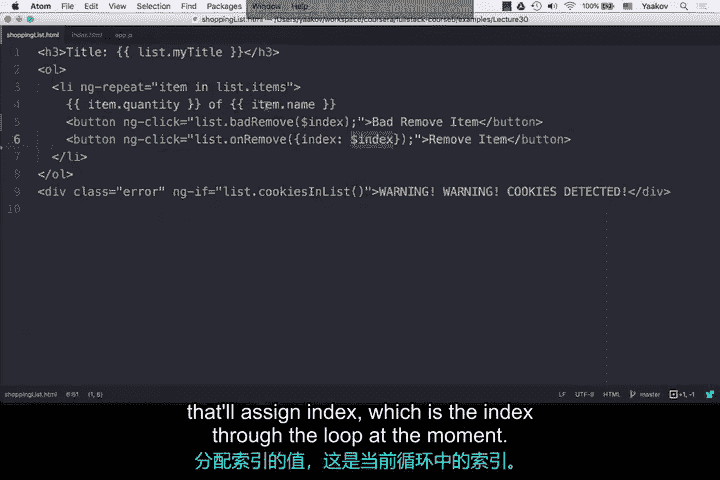

保存所有更改并刷新浏览器。

*   添加几个测试项（如 test1, test2, test3）。
*   点击新的 “Remove Item” 按钮删除 `test2`。
*   观察结果：“Last removed: test2” 成功显示，页面标题也更新为正确的项目数量。
*   查看控制台，`console.log(“‘this’ is: “, this)` 的输出现在显示 `this` 指向 `ShoppingListController`，这正是我们期望的。

至此，功能正确实现。`&` 绑定确保了函数在正确的上下文中执行，并且建立了一个清晰的、从指令独立作用域到父作用域的数据传递通道。

---

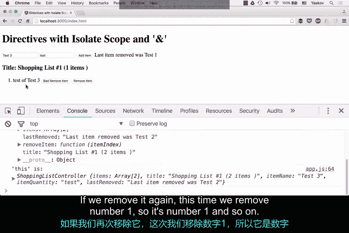

## 总结

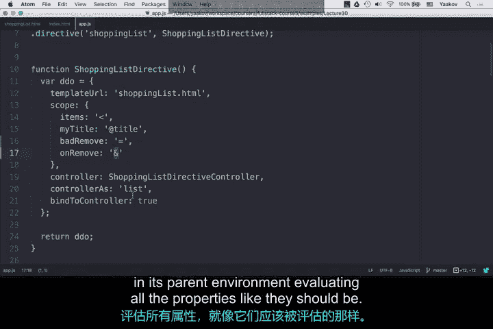

本节课我们一起学习了 AngularJS 指令 API 中的 `&` 绑定。

*   **问题**：当指令需要调用父作用域的函数时，简单的函数引用传递可能导致函数在错误的上下文（指令的独立作用域）中执行，引发 `this` 指向错误。
*   **解决方案**：使用 `&` 绑定（引用绑定）。
*   **实现模式**：
    1.  **父模板**：通过属性提供一个函数调用表达式，并定义参数键，例如 `on-remove=“parentCtrl.removeItem(index)“`。
    2.  **指令模板**：调用该引用时，传入一个对象映射，将值绑定到父模板定义的参数键上，例如 `ng-click=“onRemove({index: $index})”`。
*   **核心优势**：`&` 绑定保证了表达式在父作用域的上下文中执行，同时提供了一种结构化的方式，让指令能将数据从独立作用域传递回父作用域。

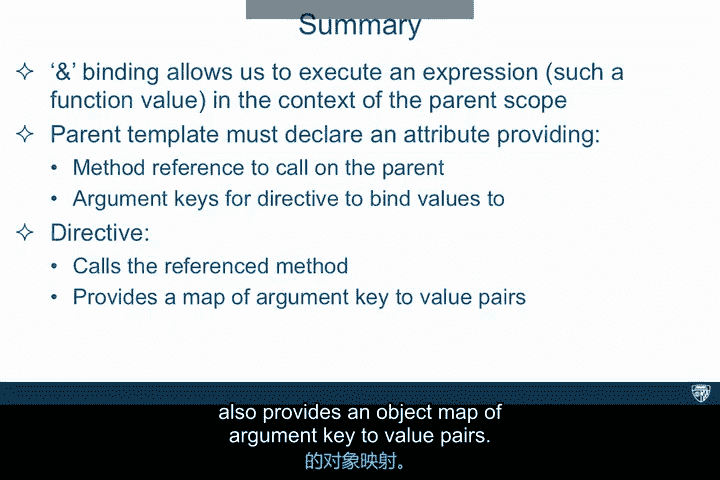


通过先展示错误再修正的过程，我们深刻理解了 `&` 绑定的必要性和工作原理，这是构建交互式 AngularJS 指令的关键技能之一。