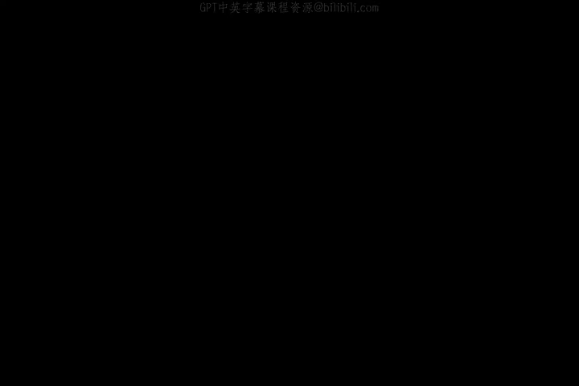
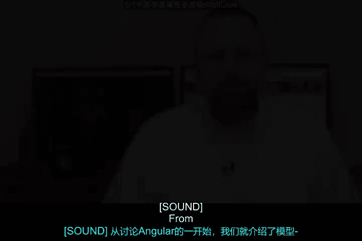
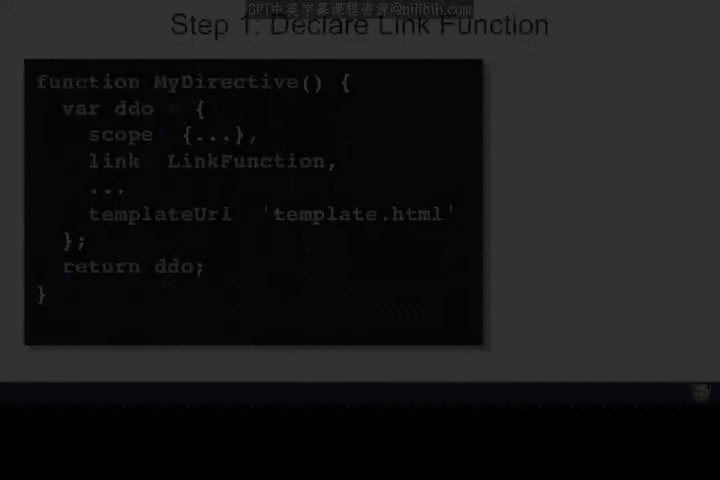
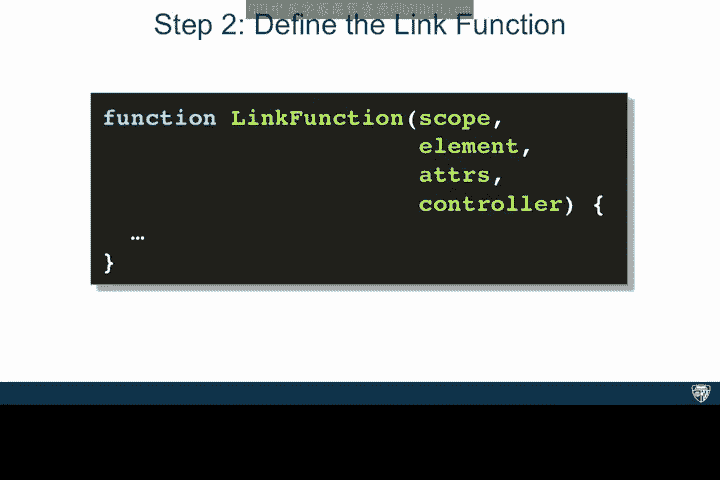
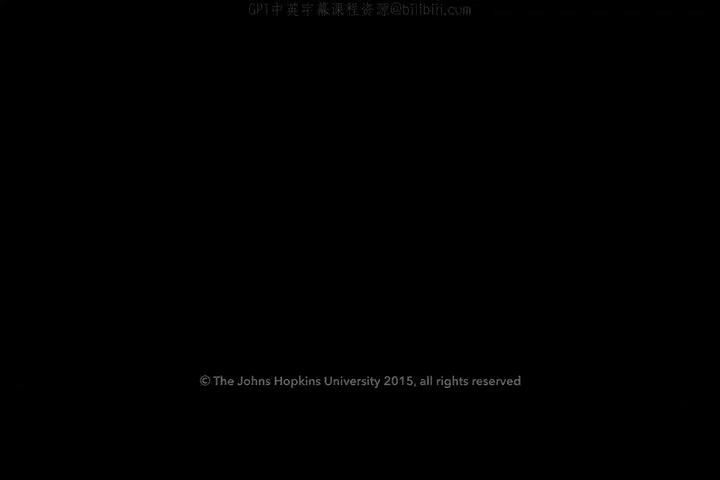

# 约翰霍普金斯大学《使用 AngularJS 开发单页 Web 应用｜Single Page Web Applications with AngularJS》中英 - P61：60_第31讲（第1部分）：使用link操作DOM.zh_en - GPT中英字幕课程资源 - BV1dsFDeZEQr

🎼。

From the very beginning of discussing Angular， we introduced the model view model architecture or the MVVM design pattern。

Part of this architecture has been a clear indication that we do not want to directly manipulate the Dama ourselves。

 instead we want Angular to do it for us while we simply use declarations of property bindings and so on。

I also told you that Angular is called the MV Star framework because sometimes it simply doesn't work to stay the purest and never manipulate the dump directly in our code。

😊，Angular allows for such occasions， and that is one of the reasons why it's so much easier to integrate Angular with other neat libraries like D3 JS for example。

 which is an advanced JavaScript visualization， graphics library and the like。

But Angular doesn't just allow you to manipulate the DOm。

 it helps you to do that by exposing a water down version of JQury right out of the box called JQ light and also allowing you to use the full version of JQury Library by simply including it without having to configure anything else。

😊，Angular also provides a special window into the Dom manipulation through the directives link property。

 which holds a function。 This function is where you typically manipulate the Dm by directly updating it and registering native event listeners when we were playing around with setting up custom watches。

 I warned you that setting them up inside of a controller was a bad practice and promised to show you a more appropriate place for setting up watches。

 Well， the link function is one of those places。 Let's take a look at some sample code。😊。

In the DD directive definition object， we declare our link function through the link property。

 The link function can work alongside the directive's controller。

 or since it has access to the same scope and properties that a controller does。

 it could take over all of the controller's responsibilities。

 Link function is always called with specific parameters so we don't inject anything into the link function directly。

 however， if we wanted to use some service， we can inject it into the directive factory function。

 in our case， my directive and then use it inside of our link function。😊。

Once we've declared the link function in the DD， we have to define the actual link function。

 Note the parameters here。 First the scope。 note that it's not dollar sign scope。

 but just scope you could certainly name a dollar sign scope here too but the reason we usually emit the dollar sign is to remind ourselves that the scope is not injected into the link function。

 remember that the dollar sign scope or dollar sign anything is just a valid name of a variable in jascript。

 The link function is simply past the scope of the directive as the first argument into the function you can read and attach properties on the scope just like you would inside of a controller。

 The second parameter， the element parameter represents the top level element of the directive。

 In other words， either that custom element that this directive defined or the element this custom directive is declared as an attribute on On top of that。

 this element is a wrapper around the。😊，ular Dom element object with special functions that come from JQ light。

 which is a waterd version of jQury again If JQury is included in the main HTML page before the Angular Js main file this element is the jQury object itself In which case it supports many more selectedQu functions the jQury supports plus some animation methods like fade in。

 fade out， slide down， slide up and so on。 We'll see those in a minute when we get to the actual code example。

 The third parameter， the attributes parameter is an object that contains references to the attributes declared on the element。

 the fourth parameter， the controller is a reference to the controller declared for this directive if there is one There is one more parameter at the end which has to do with transclusion that I'm not showing because we haven't covered transc and because it's jascript so I could leave off parameter I won't be dealing with anyway。

😊，Okay， time to jump into the code editor and see these concepts in action。

 and that's exactly what we're going to do in part two of this lecture。😊。

