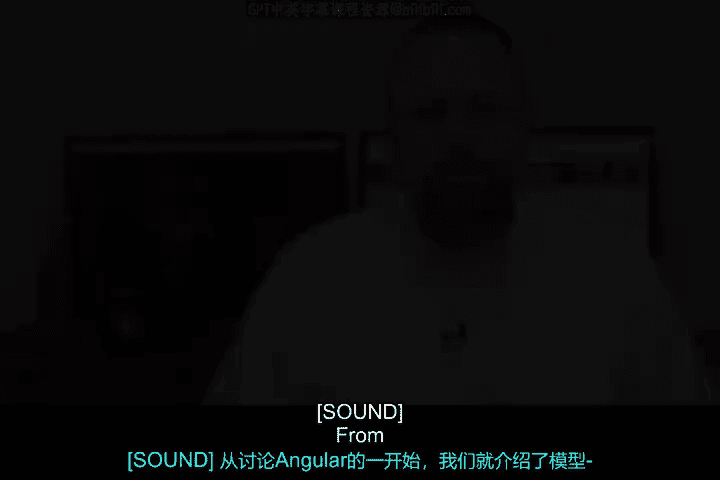
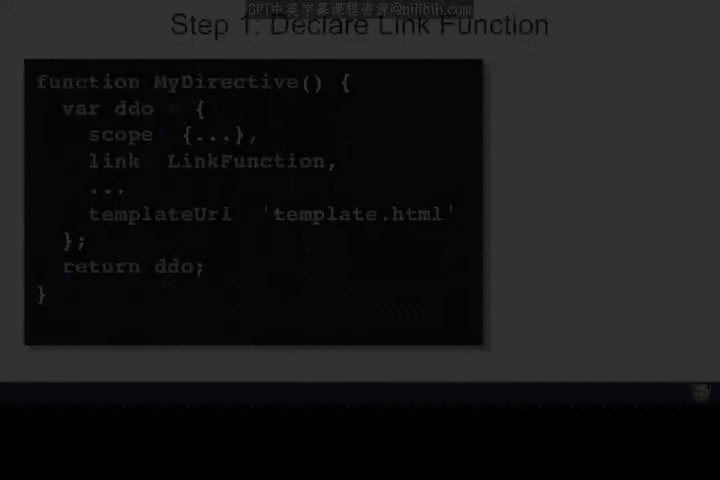
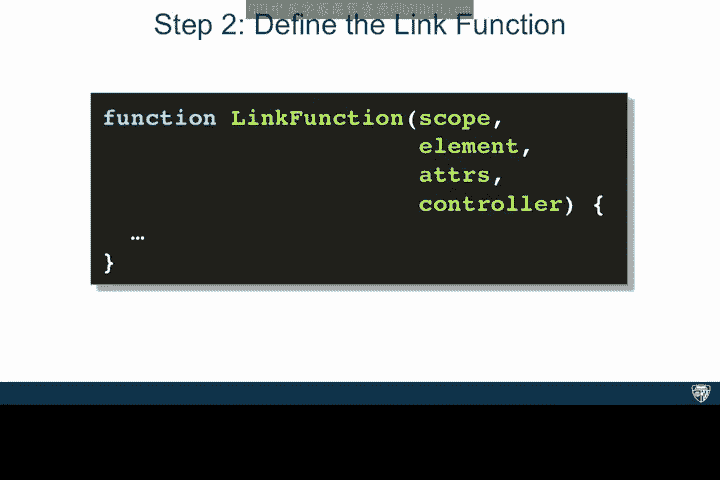

# 使用 AngularJS 开发单页 Web 应用：P61：使用link操作DOM




## 概述
在本节课中，我们将要学习 AngularJS 中一个重要的概念：如何在指令中通过 `link` 函数来操作 DOM。我们将探讨为什么有时需要直接操作 DOM，以及 AngularJS 如何通过 `link`  函数和 JQLite 来帮助我们安全、高效地完成这项工作。

---

从开始讨论 AngularJS 起，我们就介绍了模型-视图-模型架构，即 MVVM 设计模式。这个架构的一部分明确指出，我们不希望自己直接操作 DOM，而是希望 AngularJS 为我们完成，而我们只需使用属性绑定等声明。

我也曾告诉过你，AngularJS 被称为 MV* 框架，因为有时坚持最纯粹的方式、永远不在代码中直接操作 DOM 是行不通的。AngularJS 允许应对这种情况，这也是它能更容易地与其他优秀库（例如用于高级 JavaScript 可视化和图形的 D3.js 库）集成的原因之一。

但 AngularJS 不仅仅是允许你操作 DOM，它还通过提供一个精简版的 jQuery（称为 JQLite）来帮助你，并且允许你通过简单地引入完整版 jQuery 库来使用它，而无需进行任何其他配置。

此外，AngularJS 还通过指令的 `link` 属性提供了一个操作 DOM 的特殊入口。这个属性持有一个函数，通常你在这个函数中直接更新 DOM 并注册原生事件监听器。

之前我们在学习设置自定义监视器时，我曾警告过在控制器内部设置它们是一种不好的做法，并承诺会向你展示一个更合适的地方来设置监视器。`link` 函数就是这些地方之一。让我们来看一些示例代码。

---

## 理解 `link` 函数的结构



在指令定义对象中，我们通过 `link` 属性声明 `link` 函数。`link` 函数可以与指令的控制器一起工作，或者，由于它可以访问与控制器相同的范围和属性，它也可以接管控制器的所有职责。

`link` 函数总是被传入特定的参数，所以我们不直接向 `link` 函数注入任何东西。然而，如果我们想使用某些服务，我们可以将其注入到指令工厂函数中，然后在 `link` 函数内部使用它。

一旦我们在指令定义对象中声明了 `link` 函数，我们就必须定义实际的 `link` 函数。请注意这里的参数：

1.  **`scope`**：注意它不是 `$scope`，而只是 `scope`。你当然也可以在这里命名为 `$scope`，但我们通常省略美元符号的原因是为了提醒自己，作用域不是注入到 `link` 函数中的。请记住，`$scope` 或任何带 `$` 的变量在 JavaScript 中只是一个有效的变量名。`link` 函数只是将指令的作用域作为第一个参数传递给你定义的函数，你可以像在控制器内部一样读取和附加属性到该作用域上。

2.  **`element`**：`element` 参数代表指令的顶层元素。换句话说，要么是这个指令定义的自定义元素，要么是这个自定义指令作为属性声明所在的元素。此外，这个元素是原生 DOM 元素对象的包装器，带有来自 JQLite 的特殊函数。JQLite 是 jQuery 的精简版。如果在主 HTML 页面中，jQuery 库在 AngularJS 主文件之前被引入，那么这个 `element` 就是 jQuery 对象本身。在这种情况下，它支持 jQuery 的许多选择器函数，以及一些动画方法，如 `fadeIn`、`fadeOut`、`slideDown`、`slideUp` 等。我们稍后在查看实际代码示例时会看到这些。

3.  **`attrs`**：`attrs` 参数是一个对象，包含对元素上声明的属性的引用。

4.  **`controller`**：`controller` 是对该指令声明的控制器的引用（如果存在的话）。

末尾还有一个与嵌入（transclusion）相关的参数，这里没有展示，因为我们还没有涉及嵌入，并且因为它是 JavaScript，所以我可以省略那些我无论如何都不会处理的参数。

---

## 核心概念与代码示例

以下是 `link` 函数在指令定义中的基本结构：

```javascript
angular.module('myApp')
.directive('myDirective', function() {
  return {
    restrict: 'E',
    scope: {},
    link: function(scope, element, attrs, controller) {
      // 在这里操作 DOM 和注册事件监听器
      // 例如，改变元素的文本内容
      element.text('Hello from link function!');

      // 例如，添加一个点击事件监听器
      element.on('click', function() {
        alert('Element was clicked!');
      });
    }
  };
});
```

在上面的代码中：
*   `scope` 是当前指令的作用域。
*   `element` 是指令关联的 DOM 元素（已由 JQLite/jQuery 包装）。
*   `attrs` 包含了该元素上所有属性的键值对。
*   `controller` 可用于访问指令控制器的实例方法。

---

## 总结




本节课中，我们一起学习了 AngularJS 指令中 `link` 函数的作用和用法。我们了解到，虽然 AngularJS 推崇声明式的 MVVM 模式，但在需要与 DOM 进行直接交互或集成第三方库时，`link` 函数提供了一个官方且强大的途径。它接收四个主要参数：`scope`、`element`、`attrs` 和 `controller`，使我们能够在正确的生命周期里安全地操作 DOM 元素、绑定事件以及访问属性。下一部分，我们将通过实际的代码示例来进一步巩固这些概念。