# 约翰霍普金斯大学《使用 AngularJS 开发单页 Web 应用｜Single Page Web Applications with AngularJS》中英 - P62：61_第31讲（第2部分）：使用link操作DOM.zh_en - GPT中英字幕课程资源 - BV1dsFDeZEQr

🎼。

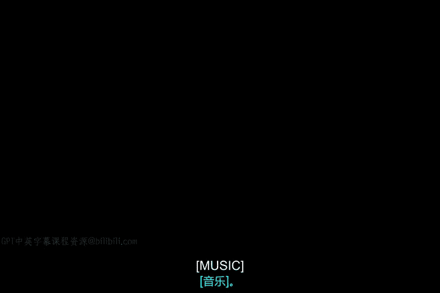

Okay so we're back in our code editor and I'm located in lecture 31 folder。

 which is located in fulltag course 5 examples folder and this is again our shopping list directive app that we looked at before in the previous versions if cookies were detected as part of the shopping list would display an error message underneath the shopping list what we used to display that message was NG if so if one of the shopping list items included cookies in it N if we detect that being true and then we'll display that particular div with a warning in this version we're gonna to do something similar except we're going to use do manipulation to achieve that and then we'll upgrade it to jQury and use some animation effects on that as well So the first thing I need to do is declare my link function where I'm going to be able to call these do manipulation methods so I'll put a comma here and I'll say link and I'll say the name of the link function which will be something like shopping list。

Directive。Link。Let's save that and let's go right here and actually define this shopping link shopping list directive link actually have some of the code premate a little bit so I'll go ahead and copy and paste it here to save some time for us and here's our shopping list directive link which has a scope and element attributes in the controller and again I'm ottting one parameter here at the very end that we're not looking at right now so far we have our shopping list directive link and we're logging to the console the scope。

 the controller and the element so let's go to the browser and let's go ahead and open up the console and see what it's telling us so the link scope is and we can open it up and then we could see that the link scope is exactly the same thing as what weve inject it into our shopping list directive controller In fact you could see that the list here is that shopping list directive controller we open it up we'll see all of our cookies and list items my title on removemove and so on。

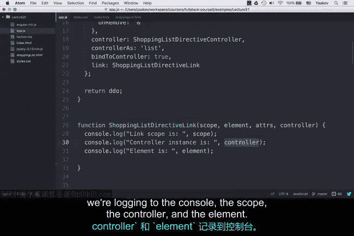

So that's the link scope， the controller instance you can see again， the shopping list。

 directive controller as we thought it was， and the element is if we take a look here closely is the shopping list。

 so the shopping list is the parent element that this element parameter represents。

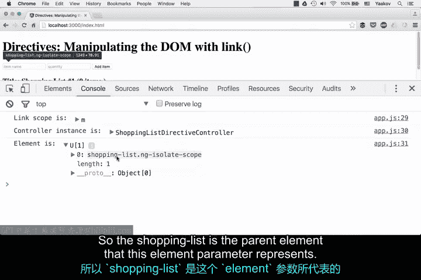

Let's go ahead and minimize that and let's go back to the code editor。

 So what we want to do here is actually set up a watch on our shopping list directive controllers function and we have a controller function for the shopping list directive which is called cookies inlist so we really want to have this as the property that we are watching So it's go ahead and copy that and let's set up a watch here。

 we'll say scope Dasine watch and we'll give it the property name which in this case is our list that cookies inlist well since this is a function we need to indicate that as such So that's the property where we're watching on our scope and then we're going to give it a function that is going to take a new value and an old value。

As its parameters， let's put a semicolon right here and beginning we actually log the old value and this is a bullan function so it's going to say either false or true。

 and we could go ahead and do it again， say new value。Okay。

 so now we're watching our list that cookies inlist so when cookies inlist changes its value either from false to true or from true to false。

 this function right here will fire So what we want to do here is we want to actually display a warning a cookie warning so we're going to say if new value is equal to true。

Then what we want to do is we want to display cookie warning。

And we're going to write that function in a minute else。

We want to remove the cookie warning since if it came false。

 it means that the cookies have disappeared， we maybe remove them from the list。

 Remove cookie warning。 Okay， so those are the two functions that we need。

 Now all we need to do is define the function display cookie warning。

And we need to define a function called。Remove cookie warning。Okay。

 so now we've defined these two functions。 Let's take a look at our template and in our template here。

 we want to set up a placeholder for our error message so we'll create a regular div and we'll give it a class error as before and we'll give it to message or the horror。

😊，Cookies detected。 Okay， that sounds like a good message。 Another thing is。

 is we need to make sure that at the beginning， this div right here is invisible because we certainly don't want this message to show up to start with。

 So if we go to our styles that C S。 We see this， the error class。

 And this is exactly what we declared our div width。

 So what we could do is simply add one more property called display。 And we'll give it a none。

 So at the beginning， it's not going display that div to the user。 So it will be just an empty space。

 Let's go ahead and save that。 Let's go back to our browser just to make sure we could say cookie。😊。

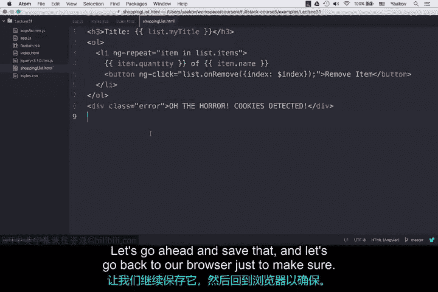

Three bags and nothing really should happen so far。

 right because we did not activate showing this cookie warning at the bottom。 Okay。

 so let's go back to the code editor ands go to our Abdo Js and let's write this display cookie warning。

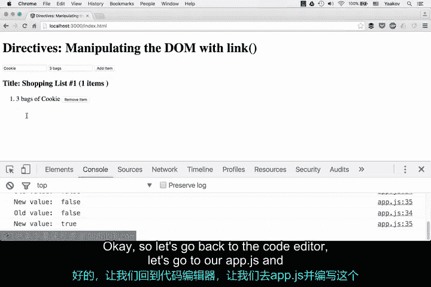

Okay so first of all， we need access to our element object here and I already realized that I made a minor mistake if you take a look as to where these curly braces end。

 I actually defined my cookie warning display cookie warning and remove cookie warning outside of my link function I don't want to do that I want to go ahead and grab these cut them out and put them right back inside so I'll have access to the element that I'm going to be using in order to manipulate the downm so let's go to the display cookie warning now that were now inside of our shopping list directive function and the first thing we're going to do is we're going to try to use just regular using angular JQ light actually if we save that for now go back to the browser and we'll just search for angular angular JS JQ light should take us to the angular dot element documentation let's take a look at that and you'll see here if you scroll down a little bit。

😊。

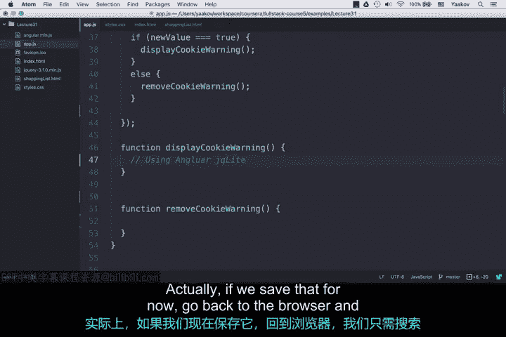

You'll see that angular JQite provides the following jQury methods。

 You can see a whole bunch of methods here， not that many， but a nice amount。

 and one of them is a fine function。 If you take a look here。

 there will be a fine function right here and it says limited to lookups by tag name。

 So we can just use fine and use regular selector API。

 we're limited to only looking things up by tag name。 If we were to use jQury。

 we would not be limited to that。 But for now， let's just use tag names to look things up。

 let's go back to a code editor and let's create a var warning element a warning element and we'll say element。

😊。

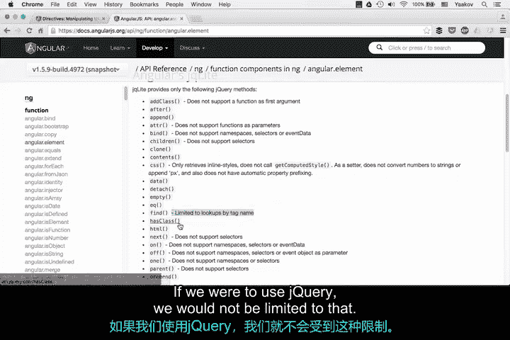

Dot find and we'll say we're going to find the div。 Now， what is going on here。

 Why am I saying find this divff， If we go back to the shopping list at HTML。

 you'll see that this is the only div in this shopping list that HTML template。

And here's point number one about element that find when you're using the element that find it is only going to look starting at that element in the Dom and below。

 which means it's only going to look right here。 This is actually great news because if you have a huge HTML page it's not going to have to look through the entire Dom it's only going to have to try to find that div in this small little snippet of HTML So this is a very performant way of actually looking up elements inside of U HTML templates。

 And at this point once we have this warning element。

 all we really need to do is call it CSs class And if you take a look at our list of classes。

 This is one of them， we can have a CSS class by the way。

 if you click on that it will take you straight to jQury API documentation and you'll see you could provide the property name and the value as part of its method signature。

 So let's go back to the code editor and let's say CSS。😊。

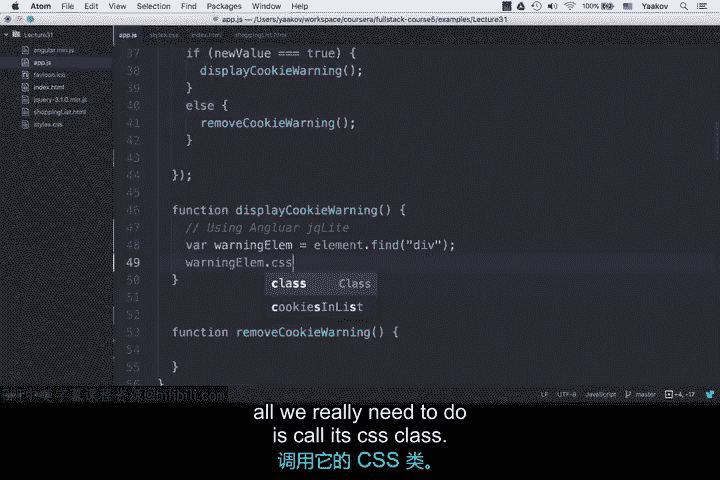

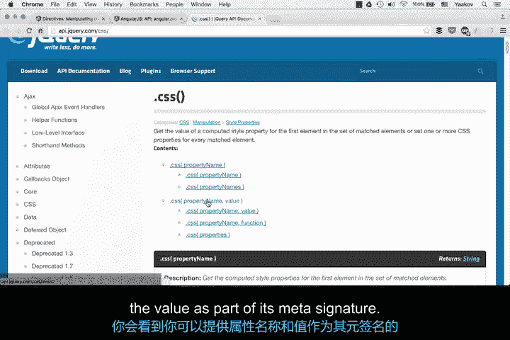

And we need to say display and this time we' to show it。 So we'll say block。

 We'll go ahead and end it with a semicolon。 Okay so for the remove cookie since things are going to evaluate too false at some point again。

 we're gonna say using angular jQ light And what we want to do is again we want to find that same element as we did before we'll just copy and paste it right here。

 and we'll actually copy and paste this as well。 and instead of block。

 we need to turn it back to none。 not done none。 We'll save that。 let's go back to our browser。

 let's go to the actual application。 don't need this anymore。 So let's go ahead and say chips。

 We'll do five bags of chips。'll add that you see there's no message。 but the second we say cookies。

 five bags of cookies。 all the horror cookies detect it And if we remove the chips for example let's just remove the cookies right away if we remove the cookies。

 you'll see that the cookie warning disappears so that was fine。

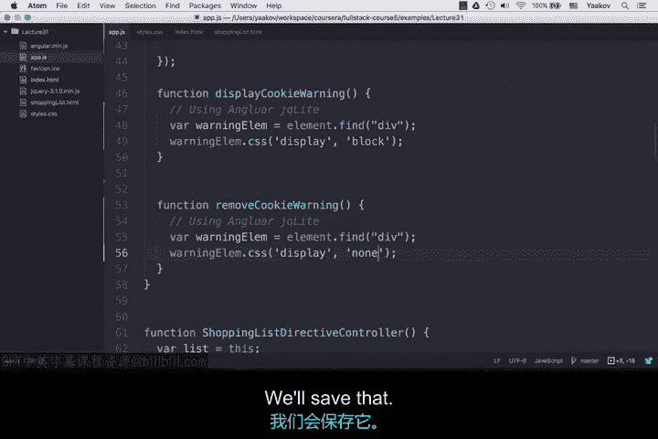

But let's go ahead and try to use JQury instead Before we do let's go ahead and log what does this warning element look like on the console。

 let's go ahead back to the console and let's go ahead and add something that will trigger it cookie。

 three bags， whatever。

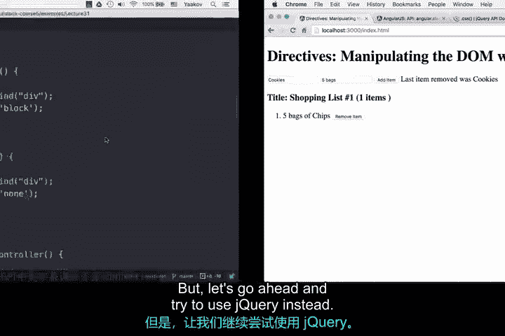

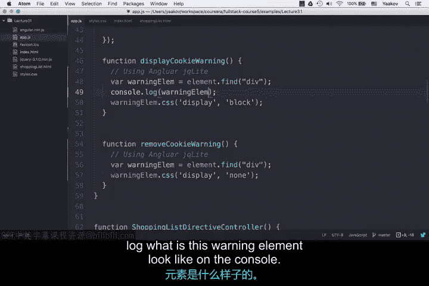

And let's open up the console and let's take a look at what we have here， we have this。

You and let's take a look at its prototype its prototype and you can see its prototype。

 look at all those methods that we spoke about and we saw in the documentation。

 So you see the find here， you see the CSs we used So a whole bunch of methods pretty good let's go ahead and go back to the code editor go to our index that HTML already pre downloadloaded the jQury that 3。

1。0 that Minnda Js and I have it here just commented out let's go ahead and un that So now what we have is we have jQury mentioned before our angular that Minnda Js。

 if we save that and go back to our browser we've done nothing else just mentioned jQury before we imported the actual Angular Js let's just refresh it just in case and let's go ahead and say cookieie。

😊，Three bags， let's add that and let's take a look as to what we have now。

 let's open that up and let's go look at its pro again， what is this prototype。

Let's see can we scroll it up a little bit more。 Look at that。

 Do you see how many more methods all of a sudden showed up on that same element。

 We have a whole bunch of methods and some of them look at that says fade in， fade out。

 and I'm pretty sure there's a slide down， slide down and slide up。

Which I can't see them at the moment， but I know they're there because they're part of JQury。

And then all the way down probably right by S slide。

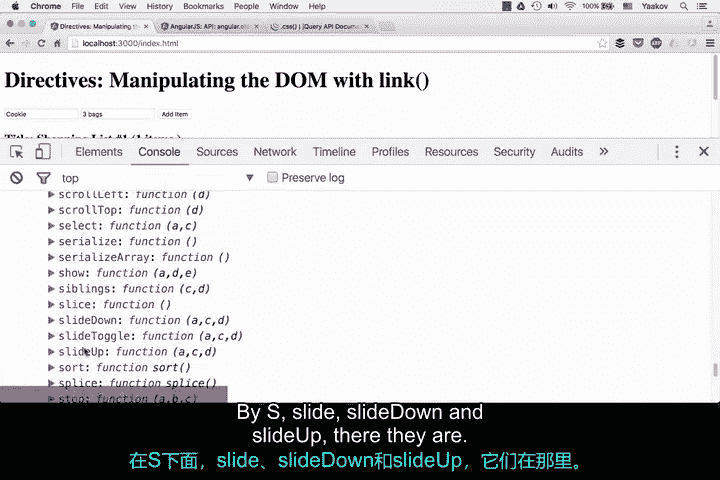

Slide down and slide up there they are so let's go back to the code editor another that way have JQury installed。

 let's go to Abdojs and use JQury to do that。 We'll actually just leave this alone。

 maybe we'll just comment that out and comment this out as well and let's use JQury to get the same thing done so let's say if JQury include it before Angular。

Okay， first of all， the warning Elm。As we had it before can now be found by a much more precise selector because the find of jQury。

 the find of jQury supports much more than just looking for tags So we could say div we could say div that error so I want to find a div within class called error which is exactly what our div is and now instead of simply showing a display block what we're going to do is we're gonna say warning element that slide down I want to slide down effect and I want 900 milliseconds。

 I want to take 900 milliseconds to slide down that's all we're going do to display the cookie warning and to display or remove the cookie warning。

 we're gonna do some similar again， we're gonna find that same div that error except we're going say slide up to remove it from the view let's go ahead and save that let's go back to our browser。

 we could close that and we could say chips。😊。

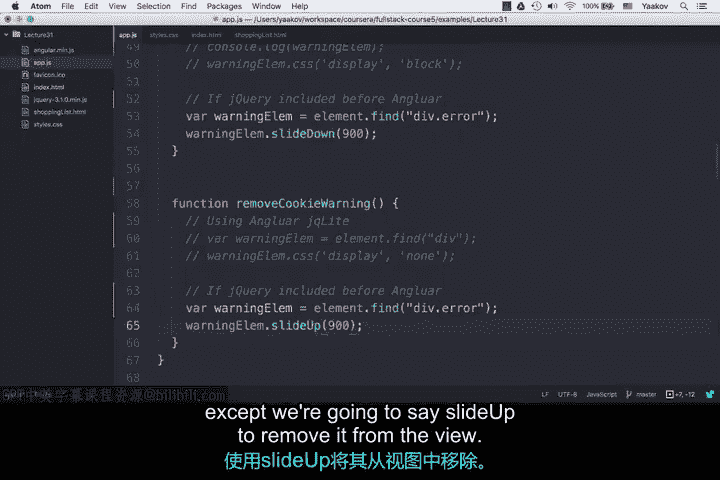

Three bags of chips and nothing's going on。 Well then we could say cookies。

 Let's say five bags of cookies， Why not。 And when we do that。

 you see oro cookies detected kind of slid down and gave us that effect。 Now。

 if we remove the cookies， take a look what's gonna happen to this oro cookies detected。

 It's gonna slide back up。 Remove bam。 it's gone。 So now we're able to manipulate the dam and actually affect and even use thirdparty libraries like jQury and obviously any other library we want directly in the dam。

 and it's all compartmentalized inside of our directive。

 So the code is not spread all over the place。 it's very nicely segmented only to the that deals directly with dam manipulation。

😊，Okay， so let's summarize do manipulation is usually done inside of the link function。

 you declare the link function directly on the DD， the directive definition object。😊。

The link function does not support injection itself。

 but if you wanted to use injected components services or other controllers。

 you can inject them directly into the directive declaration。

The scope parameter that is the first parameter of the link function is the exact dollar sign scope in the directive's controller。

 it doesn't have the dollar sign to remind us that it is not injected。

 it is simply passed into the link function the second parameter is the element object and that represents the element of the directive it actually represents the top level element of the directive that object is either the JQ light object which is a waterdown version of JQury that Angular provides out of the box or it is the JQury object itself if JQury is included before the Angular do Js is included in your main HTML page。

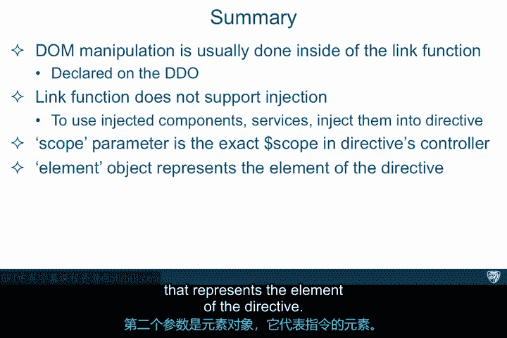

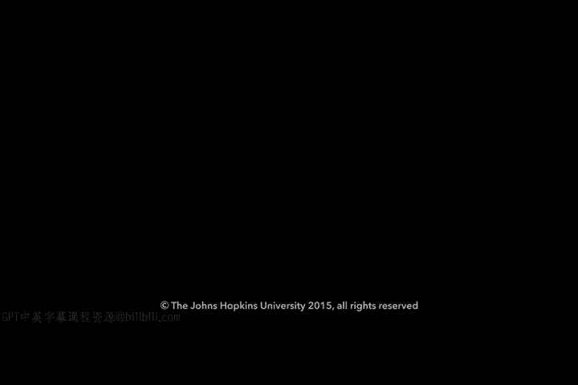