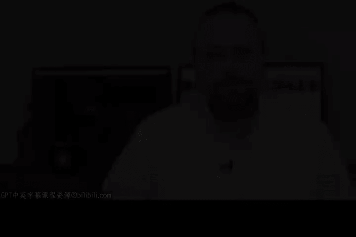
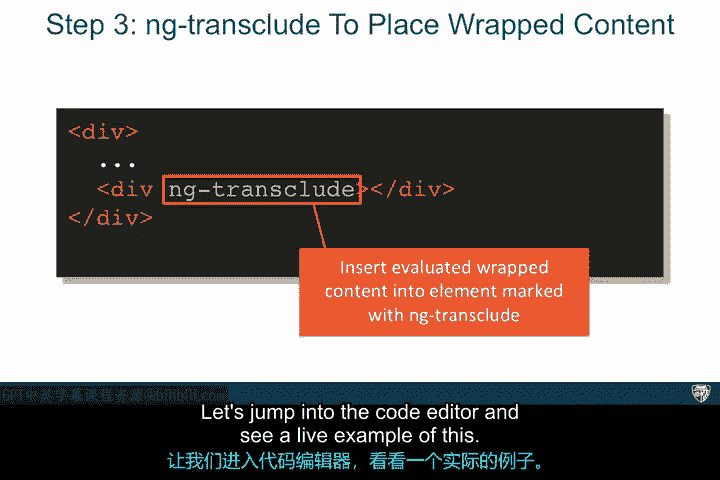
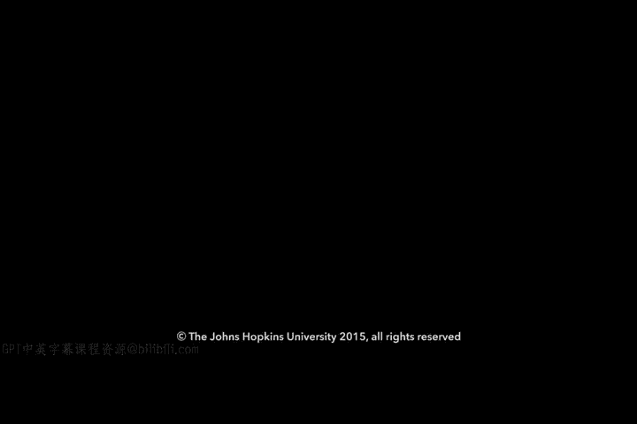

# 约翰霍普金斯大学《使用 AngularJS 开发单页 Web 应用｜Single Page Web Applications with AngularJS》中英 - P63：62_第32讲（第1部分）：使用指令的transclude包装其他元素.zh_en - GPT中英字幕课程资源 - BV1dsFDeZEQr

🎼。

In the previous lectures we passed in regular strings into isolate scope of the directive。

 interpolated strings as well as objects and function references， however。

 sometimes what's needed is to pass an entire template rather than a string or an object。😊。

A fairly common use case is when you're coding a dialog box as a directive。

That dialog box has to have the behavior of a dialog box， be able to close。

 perhaps provide OK and cancel buttons， but it also has to be generic enough to let its users provide the actual content for the dialog box to display。

This is what yet another property on the DDO called Transclude allows you to accomplish。

Using Ch exclude allows you to wrap arbitrary content with your directive。

 including expressions and function callss in your HTML template。

The really neat part about all that is that the expressions wrapped in a directive that has its translude property set to true are evaluated not in the directive's isolate scope but in the parent scope。

 let's see how that works。Step one is to define the property transclude on the video and set it to true。

Step two is to use your directive and wrap some content with that。

 note that any properties interlations and such are evaluated in the parent controller。

 not in our directive。The last step is to use NG dash transclude attribute inside of the template of our directive。

 that attribute tells Angular where in the directives template to include the evaluated content that was wrapped by your directive in the parent template。

That's pretty much it， it's that easy and that powerful。

 let's jump into the code editor and see a live example of this。

